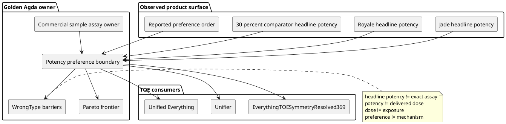

# Cannabis potency and preference boundary

## Status

Agda is the semantic owner.

The canonical implementation is:

- `DASHI/Wikimedia/IbrahimCannabisTerpeneCommercialSampleQuantitativeAssayExact.agda`

The TOE consumers are:

- `DASHI/EverythingTOESymmetryResolved369.agda`
- `DASHI/Unifier.agda`
- `DASHI/Unified/Everything.agda`

The Lean repository may mirror this surface.
The Lean mirror does not own the semantics.

## Current bounded problem

The current comparison uses three product labels.

- Jade has a nominal THC label near 25 percent.
- Sunflower Royale has a nominal THC label near 27 percent.
- A comparison product has a nominal THC label near 30 percent.

The reported preference orders Royale above Jade.
The reported preference also orders Royale above the 30 percent comparison product.

The formal result is narrow.

A monotone nominal-THC-only preference account does not fit this bounded fixture.

The formal result does not identify the cause.

## Preconditions

The product labels are observations.
They are not exact same-batch assays.

The preference order is a bounded report.
It is not a blinded controlled trial.

The 30 percent comparison product is not identified in the canonical fixture.

The exact delivered amount is not known.

The exposure trajectory is not known.

The exact terpene and minor-cannabinoid vectors are not known for the compared batches.

## Invariants

Headline potency is not exact batch composition.

Product potency is not delivered THC dose.

Delivered dose is not physiological exposure.

A reported preference does not create a terpene mechanism.

A reported preference does not create an outdoor-cultivation mechanism.

A product label does not create a universal cultivar profile.

Co-occurrence does not create synergy.

The current lane does not create a clinical recommendation.

The current lane does not mutate ESD surfaces.

The 584 discharged fibres remain discharged.

Only live formal gaps remain eligible for targeting.

## Postconditions

The TOE root and Unifier expose the same canonical potency/preference boundary.

The bounded reversal is reachable from the TOE graph.

The exact-batch assay remains the first Pareto target.

The constituent-mechanism and cultivation-mechanism questions remain open.

## ZKP frame

### O — objective

Formalise the current Jade, Royale, and higher-labelled THC comparison.

Do not promote headline THC into dose, exposure, mechanism, or clinical effect.

### R — reuse

Reuse the commercial same-sample assay owner.

Reuse the chemotype/composition owner.

Reuse the constituent-interaction owner.

Reuse the temporal evidence and non-promotion machinery.

Reuse the existing TOE ZKP frame.

### C — construction

Extend the existing commercial-assay owner.

Add one bounded product comparison.

Add one bounded reported-preference order.

Add exact WrongType barriers.

Expose aliases through the TOE root, Unifier, and Unified aggregate.

Do not add a second cannabis ontology.

### S — safety invariant

Keep each evidence type separate.

Keep nominal potency separate from exact assay data.

Keep potency separate from delivered dose.

Keep delivered dose separate from exposure.

Keep preference separate from causal explanation.

### L — lane

Use one nonblocking cannabis evidence lane.

Do not edit ESD modules.

Do not retarget the 584 discharged fibres.

### P — preconditions

Agda remains golden.

Source attribution remains explicit.

No exact Royale or Jade batch COA is assumed.

No outdoor mechanism is assumed.

No terpene mechanism is assumed.

### G — governance

ITIL is a process lens.

ISO 9000 is a quality-management lens.

ISO/IEC 42001 is an AI-management-system lens.

ISO/IEC 27001 and 27701 are security and privacy lenses.

ISO/IEC 23894 and NIST AI RMF are risk-management lenses.

ISO 9241 is a usability and human-centred-design lens.

Six Sigma is a process-control lens.

C4 and PlantUML are architecture documentation lenses.

None of these statements claims certification.

Meta-introspector repositories retain their own attribution and authority.

No meta-introspector result is promoted by this lane.

### F — postconditions

Nominal THC alone does not determine the current reported preference order.

Exact batch composition remains open.

Delivered dose remains open.

Exposure remains open.

Constituent mechanism remains open.

Cultivation mechanism remains open.

Clinical translation remains open.

## Pareto order

1. Acquire the exact Royale batch cannabinoid and terpene assay.
2. Acquire the exact Jade batch cannabinoid and terpene assay.
3. Identify and assay the 30 percent comparison batch.
4. Record preparation, consumed mass, route, and composition transformation.
5. Establish the exposure trajectory.
6. Repeat the preference comparison with controlled coordinates.
7. Test a constituent-specific mechanism.
8. Test a cultivation-specific mechanism.

The umbrella entourage claim remains dominated by these narrower payments.

## Source receipts

Wishart et al. retain source ownership for *Chemical Composition of Commercial Cannabis*.

DOI: 10.1021/acs.jafc.3c06616.

Haney, Arout, and Bedillion retain source ownership for *Human behavioral pharmacology of cannabis: Insights on cannabis use disorder*.

DOI: 10.1016/j.ypmed.2026.108663.

The bounded reading used here is that product potency and THC dose are distinct objects.

Lorenzetti et al. retain source ownership for *Cannabis in the wild: Analysis of street cannabis and cannabinoid composition in Australia*.

DOI: 10.1016/j.drugpo.2025.104974.

The bounded reading used here is that subjective strength ratings were not correlated with measured THC or total THC in the same donated products.

Perceived strength is not the same endpoint as preference, therapeutic benefit, or causal mechanism.

Caruso, Acquaviva, Lemus Müller, Pellegrino, and Castells retain source ownership for the 2026 cultivation metabolomics study.

DOI: 10.1016/j.chroma.2026.467331.

The bounded reading used here is that cultivar and cultivation method can change measured composition.

That source does not establish a Royale-specific outdoor causal effect.

## C4 / PlantUML view

## Verification contract

Search for existing and near-duplicate symbols before construction.

Run `related_symbols`, `discover`, and `round_lineage` when the local referee is available.

Reject `postulate`.

Reject `allow-unsolved-metas`.

Reject `TERMINATING`.

Reject `NO_POSITIVITY_CHECK`.

Reject accidental edits to ESD paths.

Run the exact-head Agda kernel check before claiming kernel verification.
