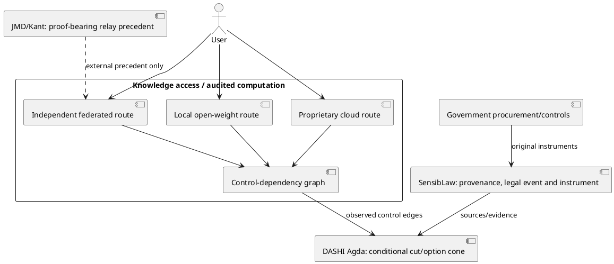

# Knowledge-processing monopoly, regulatory capture and sovereign dependency — 2026-11-01 max-cut

**Objective (O):** falsifiable study of whether market concentration in knowledge/information processing plus compliance, incident and procurement incentives can create effective dependency and allow state capture. **Not** a blanket theory of collective intention, proof of lab insolvency, a political recommendation, or a claim that safety harms are invented.

**Owner/reuse:** golden Agda `DASHI/Governance/KnowledgeProcessingSovereignCaptureExact.agda` (synthetic finite countermodels); source-bound `DASHI/Governance/KnowledgeProcessingCaptureSourceAtlas20261101Exact.agda`; existing proof donors:
- `DASHI/Economics/AISafetyRegulatoryMoatGameExact.agda` and `AIGlobalFundingRegulatorySynthesisExact.agda` (merged #1071);
- `DASHI/Governance/EpistemicCaptureProfessionalClosureExact.agda`, `AuthorityMandateCore.agda`, `OptionConeCoercionExact.agda`, `InstitutionalDependencyEntrapmentBridgeExact.agda`, and contested ambient authority (merged #603);
- `DASHI/Interop/DistributedEpistemicPlaneSeparationExact.agda` (originating DASHI architecture; JMD/meta-introspector transport precedents acknowledged independently);
- `DASHI/Reasoning/FederatedGeometricLearnedMoEProblemExact.agda` (open #1442; pending actual crypto, executor conformance and kernel checks);
- `DASHI/Economics/AIRegulatoryBurdenConcentrationSensibLaw2026Exact.agda` and Australia regulatory acquisition on **open** #1101 (do not pretend in `master`);
- `DASHI/Law/SensibLawSpringfieldGasLobbyingOwnershipSnowballExact.agda` (merged #893), climate-source genealogy on open #1251, Epstein/evidence genealogy on open #1245/#1131; each has case-specific authority and attribution.

## ZKP O/R/C/S/L/P/G/F

- **O / Organization:** DASHI golden claims; SensibLaw owns legal-source/event/evidence identity; JMD/meta-introspector owns observed Kant relay/codec and zkperf precedents; economic, security, national-security and theological originals retain original authors. No ESD edits.
- **R / RFP:** distinguish `supplier revenue`, `lab cost recovery`, `public procurement ceiling`, `contractual obligation`, `institutional exit cost`, `regulatory fixed cost`, `coercive dependency`, `public backstop`, `government operating control`, `knowledge exclusion`, `deliberate incident fabrication` and `shared doctrine`.
- **C / Code:** generic actor-relative `KnowledgeAccess` with an inhabited feasible route outside a given actor's unilateral blocking relation; two-cloud-one-gate **counterexample**; independent-local/federated **synthetic positive control**; a strict `OptionConeCoercionExact` safe reachability contraction without an invented refusal penalty; discriminated memory-supplier/lab/SPV and PHP2Shell/HTML2Shell source objects.
- **S / Safety / security:** a graph certificate never proves physical/legal robustness, a deployed federation, actual public legitimacy, a motive, a conspiracy, or system-wide security. A safety concern may be genuine even when compliance burdens advantage incumbents. Preventing monopoly does not remove accountable action controls or protections against harmful SI use.
- **L / Legal:** authority, procurement, equity, guarantees, warrants, step-in rights, operational control and nationalisation remain separate source-scoped instruments. The *Federal Reserve* is NOT a required actor in the user's national-security/economic-rescue scenario.
- **P / Proof:** source-written finite `TwoRoutesOneController`, common-cut and independent-route witnesses; `canonicalEpistemicOptionLoss` reuses the original option cone. Abstract `ActorIndependentKnowledge` is conditional on real feasibility/control relations; never assert it for a real federation without data. No Agda kernel run in this GitHub-only session.
- **G / Governance:** disjoint economic, narrative, security, theology, legal and federation evidence routes. Annotate claims `observed/author assertion/formal synthetic/candidate/unknown`, with dates, exact object identifiers, jurisdiction, producer, evidence, alternatives, counterfactual.
- **F / Follow-through:** exact remaining empirical and runtime cutset below; CI/local validation is owned by repository runner, not falsely claimed from connector readback.

## Primary evidence: same-object and claim-level audit

1. **Memory suppliers are profiting, not a lab insolvency certificate.** SK hynix *Q3 2026 Financial Results*, 28 Oct 2026, reports 80% operating margin (company-reported preliminary): https://news.skhynix.com/en/q3-2026-business-results/. Micron *Fiscal Q4/FY2026*, reports Q4 core data center segment 85% operating margin and FY26 consolidated 74.6%: https://investors.micron.com/news/press-release/2026/Micron-Technology-Inc--Reports-Record-Fiscal-Fourth-Quarter-and-Full-Year-2026-Results/default.aspx. Different accounting objects and denominators. Lab capital obligation > sustainable terminal external returns **not yet measured** here; see existing capital recovery work/#1101.
2. **Defence procurement and dependency.** US Army official 31 July 2025 Palantir enterprise agreement **consolidated 75 contracts** with 10-year **$10B maximum option/ceiling**, explicitly NOT obligation: https://www.army.mil/article-amp/287506/u_s_army_awards_enterprise_service_agreement_to_enhance_military_readiness_and_drive_operational_efficiency. Palantir Q2 2026 issuer results: https://investors.palantir.com/news-details/2026/Palantir-Reports. Actual substitutability, exit, system downtime and public-interest costs remain unmeasured.
3. **Sovereign frontier and contractual control rights.** White House 5 June 2026 national-security AI memorandum fact sheet: https://www.whitehouse.gov/fact-sheets/2026/06/fact-sheet-president-donald-j-trump-signs-historic-directive-on-ai-in-the-national-security-enterprise/. It directs multiple vendor access, secure facilities and prohibition on unapproved vendor disable/degrade/modify of military AI. Government operating requirements != government purchase of a frontier lab. White House Accord dated 29 Sep 2026: https://www.presidency.ucsb.edu/documents/white-house-accord-super-intelligence. Voluntary joint controls/audits and potential future codification, not actual coercive rule. EO 14434 dated 29 Sep 2026 https://www.whitehouse.gov/presidential-actions/2026/09/inaugurating-the-era-of-super-intelligence/ re-labels AI as SI within executive communications: **terminology is not a demonstrated superhuman threshold**.
   - **Executive meeting original (independent of an accord text).** White House video of 29 Sep 2026 luncheon: https://www.whitehouse.gov/videos/president-trump-participates-in-a-meeting-and-luncheon-on-super-intelligence/. US government presidential remarks transcript: https://www.govinfo.gov/content/pkg/DCPD-202600653/pdf/DCPD-202600653.pdf. Contemporaneous AFP/Reuters/AP reporting identifies OpenAI's Greg Brockman, Anthropic's Dario Amodei, Google's Sundar Pichai, Meta's Mark Zuckerberg, Nvidia's Jensen Huang and xAI's Elon Musk among signers. Meeting, executive dialogue, voluntary accord and enacted regulation are FOUR different event types. Do not turn a signed voluntary accord into an implemented rule or an individual company's loan guarantee.
4. **Real incident and parody independent controls.** PHP Foundation original incident and 20–21 October leak/patch account: https://thephp.foundation/blog/2026/10/21/todays-php-security-release-and-how-were-strengthening-php-security/. It says an OOM weakness was noticed after a 2024 audit, Calif and OpenAI reported in August, Wiz reported additional vectors, and CVE ID leaks plus a mistakenly published video disrupted coordinated disclosure; no source establishes deliberate regulation-mongering. Wiz original October 21: https://www.wiz.io/blog/php2shell-php-rce. As of Wiz Oct 27, attempts observed, but not successful compromises in its telemetry: https://www.wiz.io/blog/php2shell-exploitation-so-far. **HTML2Shell is a viral joke**, NOT a second peer vulnerability: https://leadstories.com/hoax-alert/2026/10/fact-check-cve-2026-42069-html2shell-vulnerability.html.
5. **Apocalyptic ideological first-person authorship.** Peter Thiel & Sam Wolfe, *Voyages to the End of the World*, First Things, 1 Oct 2025: https://firstthings.com/voyages-to-the-end-of-the-world/. Thiel & Wolfe, *The Pope and the Antichrist*, 15 Jul 2026: https://firstthings.com/the-pope-and-the-antichrist/. Contemporary audio-based coverage: Guardian 10 Oct 2025 https://www.theguardian.com/us-news/2025/oct/10/peter-thiel-lectures-antichrist; Reuters Rome 15 Mar 2026 https://www.reuters.com/technology/thiels-secretive-rome-conference-draws-church-attention-2026-03-15/. Distinguish his *anti-one-world-AI-governance apocalyptic argument* from an inference that Thiel designed a totalitarian system; likewise no automatic identification with other essay authors' belief systems.
6. **Target essay source.** Will Manidis & Joe Roberts, *The Commanding Heights*, 29 Oct 2026: https://commanding-heights.com/. Treat the essay's Antichrist references, 'sovereign frontier', 'peculiar labs' and infrastructure rents as attributed authored rhetoric/forecast. **Shared language does not pay a direct Thiel-to-Manidis/Roberts transmission edge**. First-party acknowledgments/feedback are not an endorsement by every person listed.

## Structural causal graph and falsification

Pre-registered directed links (each may be positive, null, or reversed):

```text
hardware scarcity -> supplier rents -> infrastructure cost pressure
lab capex/debt + terminal-customer recovery -> refinancing stress
model/protocol adoption -> critical workflows -> exit costs/dependency
genuine incident + amplification -> risk salience -> policy agenda
policy text -> class-relative fixed costs -> entrant response -> concentration
institutional dependence + distress -> intervention incentives
*actual legal instrument* -> step-in/operational/exclusive control
local/open alternative paths + security -> feasible capability escape
```

**Discriminators:** (a) original contracts, same-entity debt schedule, customer external cash and GPU life; (b) fixed-compliance costs on a common timeframe/denominator by incumbent/startup/academic/open-weight; (c) supplier switching and measured recovery-time/criticality for Palantir-style workloads; (d) disclosure timeline and independently discovered exploits, distinguishing genuine defenders from narrative agents; (e) trace every policy proposal to meeting, amendment, rule, enforcement and economic effects, with lobbying as **typed, nonconclusive** links; (f) direct document/speaker/quote chains for eschatological discourse and its policy use; (g) operational control, credentials, cloud/network ownership and alternative routes in independently administered deployments.

The hypothesis is **weakened** by independent economically viable competitor paths, falling migration costs, regulation with neutral low fixed costs, uncorrelated policy/disclosure timing, primary records indicating ordinary coordination for remediation, or intervention without transfer of intellectual/operational control. Negative findings must be scoped and timestamped, not treated as global absence.

## Convergence and exact remaining max-cut

| Cut | Status on 2026-11-01 | Exact payment |
| --- | --- | --- |
| Two routes can share one gate | Finite Agda source written | Golden typecheck; add runtime graph evidence before application |
| Distinct controllers yield conditional single-actor escape | Finite Agda source written | Prove mapped identity/availability across actual model and transport clients |
| Loss of verification option != coercion | Existing option-cone import + finite witness | Only promote if actor-specific refusal penalty + dependency evidence |
| Supplier rent vs downstream lab return | Distinct source objects; primary numbers | Same-object capex, debt, realised external operating receipts, GPU life and sensitivity |
| Palantir criticality / substitutability | Contract and quarter original acquired | Actual deployed functions, public-interest cost, alternate vendors, data export/migration and outage resilience |
| PHP2Shell disclosure / HTML2Shell parody | Primary/secondary source originals distinguished | Incident timing, independent CVE, patch/exploit timeline and any direct purposeful lobbying producer |
| Industry -> policy -> firm advantage | Existing moat + #1101 burden carrier | Comparable implementation costs and real entry effects, counterfactual/control group |
| Sovereign capture | Government policy interface and operational requirements acquired | Executed guarantees/equity/step-in rights, who commands model weights/keys and users' effective exit |
| Thiel public Antichrist ideology | Authored First Things originals acquired | Speaker-to-audience-to-policy transmission evidence; no automatic identification with essay authors |
| Distributed anti-monopoly | Synthetic finite witness only | Adversarial common-mode failure test: keys, DNS, clouds, compute, updates, model weights, liquidity, shutdown, WAN |
| Kernel certification | Not executed | `scripts/run_agda29_parallel_check.sh DASHI/Governance/KnowledgeProcessingSovereignCaptureExact.agda` (draft), pinned golden track and aggregates |

## C4 / PlantUML architecture



**Validation / attribution rule:** these new files are source-written on a GitHub connector branch. None of the original-source observations, formal type signatures, examples or claims of proof are equivalent to a successful exact-head Agda run or measured production-world anti-capture guarantee. Ownership: original financial/technical/government/theological sources; Stigler 1971, Pitkin 1967; JMD's observed relay/proof toolkit; prior DASHI owners per files/PRs; new finite cross-owner synthesis belongs to this DASHI PR, not to the essay authors.


## 2026-11-01 continuation: realised policy function / political selection (POSIWID)

The analytical object is an **observed selection-and-consequence loop**, not only a declaration of intent. Stafford Beer's POSIWID ("purpose of a system is what it does") is used as a diagnostic: *what recurring institutions select, fund and preserve* is a different observation from how actors describe their motives. Import original Beer systems literature with attribution; this finite example is DASHI's construction, not a theorem by Beer.

New `DASHI/Governance/KnowledgeCaptureSelectionFeedback20261101Exact.agda` adds **distinct same-declared-safety-rationale policies** with different open-weight feasibility and incumbent benefit, a finite state where selection for concentrated benefit persists, positive common-control witness import, and empty-type non-promotion barriers for unsupported motive/manufacture claims. Exact formalisation is source-written, not Agda kernel checked or causally identified against any named company.

**Identification rule:** measured distributional benefit may be considered a *functional mechanism* without direct subjective intent; naming it *deliberate anticompetitive strategy* requires additional evidence such as lobbying clause lineage, internal documents, proposed versus adopted amendments, pricing/implementation choices and event sequences. This is not deferral of material consequences pending motive: **measured harm and mitigations can be assessed before any motive claim**.

## Concrete new high-alpha findings (and claim-specific provenance)

- **Anthropic is publicly requesting binding government powers, not merely accepting regulation.** Dario Amodei, original June 2026 essay, `https://darioamodei.com/post/policy-on-the-ai-exponential`, proposes mandatory third-party risk evaluation, government power to block or reverse unsafe deployment, and potential government-authorised private evaluators. His essay *also* warns against state/corporate concentration, proposes parity of capability for citizens defending adverse government action, and advocates safeguards against favoritism. Those are distinct authored policy positions, not justification to ignore the regulatory-control mechanism. Anthropic originally endorsed SB 53: `https://www.anthropic.com/news/compliance-framework-SB53`. Anthropic Oct 19 regulatory roadmap: `https://www.anthropic.com/responsible-scaling-policy/updates` future proposals concerning embedded evaluators and pacing development. Axios, Maria Curi 21 July 2026 `https://www.axios.com/2026/07/21/anthropic-ramps-up-lobbying-spending-ai-policy-fights` reports more than USD3.5 million first-half lobbying vs USD3.1m full-year 2025. Do not infer enacted clause causation from spending alone.
- **Anthropic SEC S-1 is a same-entity capital and operating cash receipt.** SEC archive `https://www.sec.gov/Archives/edgar/data/2130357/000162827926001111/filename1.htm`, amended draft dated 2026-09-03; six months to 2026-06-30, USD millions: operating cash **+3,929**, investing **-17,181**, financing **+110,774**. The company says significant compute commitments are generally payable regardless of revenue or utilization, including cloud partner minimums. The filing documents partner-provided/facilitated capital or credit and specific Google/Amazon/xAI relationships. Distinguish operating earnings, free cash flow, equity financing proceeds, minimum-purchase obligations, contingent commitments, total bookings, debt maturity, and terminal independent demand. **Positive operating cash flow does not close lifetime capital recovery.**
- **OpenAI cash projection:** Reuters relaying the FT's 2026-09-18 investor-slide report, syndicated original text at `https://www.investing.com/news/economy-news/openai-expects-to-burn-through-almost-280-billion-by-2030-ft-reports-4907970`: projected 2026–2030 USD278bn negative FCF; USD856bn infrastructure compute spend and USD840bn cumulative revenues, not actual cash flow, net profit or bailout.
- **Reuse actual CoreWeave same-object investor and lender receipts from OPEN PR #1101, do not copy branch:** signed GPU-backed lending agreements give roughly 66–78-month contractual depreciation, typically 72 (not the discarded generic 36–48mo assumption). Filed DDTL4 borrowing-base rules link GPU costs to credit, and a filed OpenAI/Phoenix-1 MSA weld maps cash and rack serials into lender reporting. These are a genuine contractual producer↔customer↔lender interface but remain **not by themselves proven circular fake sales or inevitable loss**.
- **Project 2025 proposal is earlier than the 2026 company-government accord.** Heritage original 2023 `Mandate for Leadership: The Conservative Promise`, original PDF `https://static.heritage.org/project2025/2025_MandateForLeadership_FULL.pdf` (reviewed original PDF screenshot): **Christopher Miller, DoD, printed page 106** proposes expanding AI analysis of public and classified intelligence; **Peter Navarro, trade chapter, printed page 790** proposes DHS/DOJ contracting with US-owned AI companies to identify/disrupt specified social-media influence networks. Typed path requires recommendation → named chapter author/printed span → actual independently sourced administration instrument → operational receipt. A book authored by outside policy advocates does not self-authenticate implementation.
- **October vulnerabilities are not two events.** Original reproducible count `https://www.balancebitsconsulting.com/insights/black-october-2026-the-month-the-cve-count-broke` (Bryant Eadon, 28 October): **14,514 CVE records published Oct 1–27** (CVEProject publication count), vs **30 CISA KEV additions** in that interval. The latter indicates *known exploitation* based on CISA evidence. Differing NVD/CVE.org publication dates and rejected records yield different denominators. There is no valid inference from total disclosure count to deliberate coordinated disclosure. Distinguish (i) vulnerability existed, (ii) reserved/published CVE, (iii) disclosed/patch ready, (iv) active exploit, (v) known successful compromise, (vi) AI discovery or coordinated narrative work. PHP2Shell real; HTML2Shell parody negative control.
- **Epstein historical AI interface is substantive and source-gated.** SCMP 16 Feb 2026 `https://www.scmp.com/news/hong-kong/society/article/3343645/epstein-funded-ai-pioneer-helped-him-get-hk89-million-hong-kong-government-grants` reports, based on ~800 pages of DOJ original correspondence, at least **USD113k funding of OpenCog / Ben Goertzel over 2010–2015** and HKD8.9m Hong Kong public grants influenced by contacts. Acquired DOJ corpus identifier **EFTA00587395**, `https://www.justice.gov/epstein/files/DataSet%209/EFTA00587395.pdf`, transcribed in third-party mirrors, is an unfinished **2014 bracketed DRAFT** letter describing a proposed **USD300k Humanity+ gift** under Leon Black / foundation alternative signatures for a cognitive architecture project. Its source-text language says wired; the draft **does not itself prove actual wire settlement**. The distinction is precisely the older DASHI released-artifact and evidence-grade methodology (#657, #1131, #1245). Neither historical funding edge proves current government/lab coordination, but it is a real upstream AI finance–institutional-broker relation worth preserving.
- **Banality of evil as functional diagnostic, not historical identity.** Distinguish publicly good intentions, delegated professional role, local incentive, selection function, cumulative option-cone loss, dissent/appeal channels and actual harm. The term from Hannah Arendt's account of Eichmann must not flatten historically distinct harms into the Holocaust or infer subjective criminal intent; its usable systems insight here is that administration can produce coercive outcomes through ordinary role-bound compliance and distributed responsibility. Model observed distributions before motive and maintain affected-person exit/repair/rights.

## Revised operational max-cut

P0. Implement measured **control/beneficiary graph** with company/entity, regulator, appropriations, conditional financing, actual model/weight/update ownership, customer cash, disclosed lobbying, active safety gate, realistic user alternatives and dated legal authority.

P0. Reuse existing PR #1101 same-company credit/compute exhibits and S-1 **cash vs cash commitment** to compute stress envelopes and a credible (not forced) public-intervention scenario. Create explicit positive/negative counterfactuals: privately recapitalized or orderly default vs public rescue; completed public rescue does NOT imply nationalization of weights or all scientific knowledge.

P0. Clause-to-policy influence receipt for 2026 Dario, Anthropic SB53, regulation and security incident narrative, with **realised compliance/access outcome** and open-weight viability, not a motive detector.

P1. First-party and mirrored-source Epstein/Goertzel/Black records into existing source lineage, preserving original authored/drafted/custody/settlement status and dated role transitions. No claim of a single historical command network.

P1. CVE data by published date/severity/vendor/KEV/incident with 2025–26 comparison, NVD latency/reject handling and original patch disclosures; compare media/safety-policy activity against normal incident-disclosure baselines.

P1. Project 2025 author/spans → administration acts → procurement → actual deployed control and rights, separately from Thiel's first-person theology and company-narrative authorship.

P1. Runtime test selected actual independent knowledge routes under common cloud/auth/supply restrictions, rather than counting model deployments. Distinguish safety governance from discriminatory model gatekeeping.

**Status:** source/original material inspected in web and GitHub, separate source-written Agda bridge on draft PR, no exact-head kernel run, real-world causal estimation or runtime federation test claimed.
