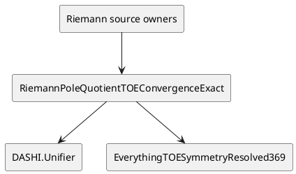

# Riemann pole-quotient TOE frontier

## Purpose

This note keeps the Riemann formalism, implementation, and TOE aggregate in step.

Agda is the golden formal surface.

Lean is a theorem donor and replay surface.

The current golden frontier is not the historical G21 determinant lane.

The current golden frontier is the final pole-quotient two-core cut.

## Canonical owners

The normalization reuses these owners.

- `DASHI/Analysis/RiemannAristotleCurrentFrontierExact.agda`
- `DASHI/Analysis/RiemannG2PoleQuotientFinalCutReconciliationExact.agda`
- `DASHI/Analysis/RiemannG2FinalPoleQuotientAnalyticCoreExact.agda`
- `DASHI/Analysis/RiemannZetaLiteralFrontierSchedulerExact.agda`
- `DASHI/Analysis/DeBruijnNewman2026SourceWeldExact.agda`

The TOE normalization owner is:

- `DASHI/Unified/RiemannPoleQuotientTOEConvergenceExact.agda`

The focused validation owner is:

- `DASHI/Unified/RiemannPoleQuotientTOEConvergenceValidation.agda`

The result is exported through:

- `DASHI/Unified/Everything.agda`
- `DASHI/Unifier.agda`
- `DASHI/EverythingTOESymmetryResolved369.agda`

No ESD or `digital_esd` surface is edited.

## Current max-cut

The high-ordinate consumer already exists.

It needs two analytic cores.

The Off core must prove its budget below the assigned Off allowance.

It must use one common quarter-period crossing cutoff.

The Gamma core must prove its budget below the assigned Gamma allowance.

It must use the same universal pole-quotient taper as the final consumer.

The existing attachments compile those two cores to the owned high-ordinate contradiction.

The cluster-margin mathematics is downstream and already owned.

The historical determinant lane remains diagnostic.

It does not replace the final pole-quotient taper.

The low-ordinate lane is independent.

The Platt-Trudgian published verified-zero source is recovered.

Its theorem is not imported or reconstructed as an Agda proof.

RH remains open.

## Residual set

The normalized residual set has three entries.

1. High-ordinate Off allowance.
2. High-ordinate Gamma allowance.
3. Low-ordinate Platt-Trudgian theorem attachment.

This is the current Pareto cut.

Do not reopen the G21 determinant lane as a fourth analytic leaf.

Do not rebuild the final contradiction compiler.

Do not redo the owned cluster-margin mathematics.

## ZKP control frame

The normalized owner uses the O/R/C/S/L/P/G/F frame.

### O. Objective

Expose the authoritative Riemann frontier through the DASHI TOE graph.

### R. Reuse

Reuse the current frontier, final cut, analytic-core compiler, literal scheduler, and source weld.

### C. Construction

Add aliases and non-promotion theorems only.

Do not add a new zeta estimate in the normalization layer.

### S. Scope

Keep Off and Gamma as the two high-ordinate analytic leaves.

Keep low-ordinate theorem attachment independent.

Keep the determinant lane diagnostic.

### L. Lane

Use one nonblocking Riemann normalization lane.

Do not edit ESD surfaces.

### P. Preconditions

Require all canonical owners to exist.

Require exact same-object carrier identities before promotion.

### G. Invariants

Preserve theorem ownership.

Preserve source attribution.

Preserve one common Off cutoff.

Preserve one universal final taper.

Preserve false RH promotion.

### F. Postcondition

The TOE aggregate reaches the exact current residual cut.

The TOE aggregate reaches the existing high-ordinate compiler.

The TOE aggregate reaches the explicit non-promotion facts.

## Control-system mapping

These mappings are implementation vocabulary.

They are not certification claims.

- ITIL: each residual is a named service obligation with an owner and consumer.
- ISO 9000: one canonical owner and deterministic regression reduce duplicate quality surfaces.
- ISO 42001 and NIST AI RMF: unsupported theorem promotion fails closed.
- ISO 27001 and ISO 27701: evidence does not move through excluded ESD surfaces.
- ISO 23894: uncertainty and open proof obligations remain explicit.
- ISO 9241: statements use short active wording and one obligation per item.
- Six Sigma: the max-cut removes stale and duplicate work before new analysis.
- C4 and PlantUML: source owners feed the Unified normalization owner; that owner feeds Unifier and the TOE aggregate.

## C4 / PlantUML view

The arrows show dependency only.

They do not transfer theorem authority.

## Lean donor status

The dashi_lean4 G21 branch remains useful as historical theorem-donor evidence.

PR #77 contains the hyperbolic TP2, parity-minor, common-radius, and literal pole-transversality work.

The Agda current frontier supersedes that historical scheduler position.

The TOE layer does not re-import those G21 obligations as current leaves.

Lean ownership remains separate from Agda theorem authority.

## Recent PR cross-pollination

Recent Agda PR #1417 reinforces worker discipline.

It treats worker allocation as capacity, not proof authority.

This Riemann task therefore uses one sequential normalization lane because the current work has one canonical owner path.

Recent Agda PR #1416 reinforces quotient discipline.

A fine quotient may transport to a coarse quotient only through an explicit relation inclusion.

It does not create proof authority.

That matches the pole-quotient same-object rule.

Recent Agda PR #1414 reinforces reuse-first TOE wiring.

It attaches finite theorem owners to the three canonical TOE roots.

It preserves source boundaries.

This Riemann normalization follows that pattern without importing draft PR code.

## External web check

Bellotti, Trudgian, and Yang, arXiv:2603.21490, give a 2026 explicit zero-free region inspired by Heath-Brown.

That result does not discharge the current Off or Gamma pole-quotient allowance leaves.

It is not imported as a DASHI theorem.

## Attribution

Published low-ordinate authority remains with Dave Platt and Tim Trudgian.

Published de Bruijn-Newman analytic authority remains with the cited source authors in the existing source weld.

DASHI owns only its formal reconstruction, normalization, and proof plumbing.

Meta-introspector repositories keep their own authorship and proof authority.

No matching scalar, count, route priority, or source metadata is promoted into theorem identity.
