# Governed legal workflow TOE handoff

## O — Objective

Connect existing SensibLaw, matter-workflow, compliance, and governance non-promotion proofs to the focused DASHI TOE root.

## R — Reuse

The implementation reuses these owners.

- `DASHI.Core.CompositionalComplianceExact`
- `DASHI.Core.ITIRGovernanceControlCaseExact`
- `DASHI.Governance.FormalisationGovernanceCapstoneExact`
- `DASHI.Cognition.PNF.SensibLawOperationalSemanticBoundaryExact`
- `DASHI.Cognition.PNF.SensibLawLiveReviewMutationExact`
- `DASHI.Cognition.PNF.SensibLawMatterAcceptanceExact`
- `DASHI.Cognition.PNF.SensibLawProvenanceSemanticStatusOrthogonalityExact`
- `DASHI.Cognition.PNF.SensibLawSourceRealisedLegalRuleExact`
- `DASHI.Cognition.PNF.SensibLawSourceConditionedApplicabilityViolationExact`

PR #1278 already owns kernel-closure versus semantic-closure reuse.
This tranche stacks on that result.

No Actionstep-specific Agda ontology was found.
The existing operational, review, matter, admission, and compliance owners already cover the required workflow boundary.
Current Actionstep product documentation uses matters, tasks, and ordered workflow steps with task assignment and progression gates. This supports the generic workflow mapping only. It is not DASHI theorem authority.

## C — Construction

The normalized surface is:

`DASHI.Unified.GovernedLegalWorkflowTOEBridgeExact`

The regression owner is:

`DASHI.Unified.GovernedLegalWorkflowTOEBridgeRegression`

The focused TOE root imports both modules.

The normalized bridge lives in `DASHI/Unified/`.
The focused TOE root imports it directly.

`DASHI.Unifier` exposes proof aliases only.
It does not use its historical axiom-shaped interfaces as proof authority.

### Canonical invariant handoff

The bridge also exposes:

`GovernedLegalWorkflowTOEInvariantHandoff`

The canonical inhabitant is:

`canonicalGovernedLegalWorkflowTOEInvariantHandoff`

This handoff binds the existing governance boundary, promotion boundary, detailed ZKP control receipt, and the repository-wide `DASHI.Interop.IntrospectiveProofLoopExact.ZKPFrame` to the same TOE surface.

It also carries the existing task, review, runtime, admission, publication, Casey, formal-proof, and execution-authority firewalls.

It adds no new legal semantics.

It adds no new proof authority.

The focused TOE root and `DASHI.Unifier` expose aliases to this same canonical inhabitant.

`DASHI.Unified.Everything` imports the same bridge and exposes the canonical governance boundary, invariant handoff, and generic ZKP frame. The focused regression does not depend on the whole aggregate because that aggregate carries unrelated legacy debt.

## S — Safety invariants

- Task completion does not create world truth.
- Review persistence does not create semantic authority.
- Accepted review status does not pay applicability.
- Matter acceptance does not create claim truth.
- Source attribution does not create claim truth.
- Legal authority does not create truth status.
- Citation alone does not realise a legal rule.
- A semantic meet alone does not prove legal applicability.
- A source-realised wrong type does not prove violation.
- Control evidence does not create truth.
- A passing control does not create certification.
- Kernel closure does not create semantic closure.
- Compliance composition retains the intermediate witness.

## L — Lane

This lane is disjoint.

It edits the focused TOE root, `Unified/`, `Unifier`, documentation, and the focused TOE workflow only.

It does not edit `dashi_digital_esd`.

It does not edit files whose names contain `digital_esd` or `ESD`.

## P — Preconditions and postconditions

### Preconditions

The exact source theorem owners must exist.

The PR #1278 source-fidelity theorem must remain available.

The existing compliance composition owner must remain canonical.

### Postconditions

The TOE root reaches one legal-workflow non-promotion surface.

The `Unified/` namespace owns the normalized bridge.

The `Unifier` facade exposes aliases to exact proof terms.

No workflow state is promoted to semantic truth by this bridge.

No governance control receipt is promoted to certification by this bridge.

## G — Governance

`DASHI.Core.ITIRGovernanceControlCaseExact` remains the standards-mapping owner.

ITIL, ISO 9000, ISO/IEC 42001, ISO/IEC 27001, ISO/IEC 27701, ISO/IEC 23894, ISO 9241, NIST AI RMF, and Six Sigma remain design and control lenses.

The bridge does not claim certification against those standards.

The bridge does not create a separate standards ontology.

The current ISO/IEC 42001 publication describes an AI management system and continual improvement. The current NIST AI RMF page states that AI RMF 1.0 is voluntary and is under revision in 2026. These observations reinforce the non-certification boundary. They do not create formal proof authority.

NIST AI RMF remains a risk-management lens.

Its Govern, Map, Measure, and Manage functions do not create certification.

ISO/IEC 42001 remains an AI management-system lens.

ISO/IEC 23894 remains an AI risk-management guidance lens.

The external repositories `meta-introspector/zkperf`, `meta-introspector/zos-server`, `meta-introspector/erdfa-py`, and `meta-introspector/aristotle-cli-rs` remain attributed tooling and process context only.

No theorem or code from those repositories is copied into this bridge.

`casey-git-clone` is treated as the ITIR-suite observer/workspace subproject.

Its observer-only handoff posture is context only.

`zkSEC` is context only for this tranche.

## F — Verification

The focused TOE workflow installs the existing repository-intelligence package.

It runs `dashi-repo related`, `dashi-repo discover`, and `dashi-repo lineage`.

It runs the focused deterministic Python contract.

It runs `dashi-agda-preflight` on the bridge, regression, TOE root, and Unifier.

It rejects trust escapes.

It rejects ESD path changes.

It kernel-checks the bridge, regression, TOE root, and Unifier.

A workflow definition is not a kernel receipt.
Only an exact-head successful run may be cited as kernel verification.

## C4 / PlantUML view

```plantuml
@startuml
title DASHI TOE governed legal workflow handoff

package "Operational / workflow" {
  [Task and tool activity] as Ops
  [Persisted review] as Review
  [Matter acceptance] as Matter
}

package "Existing semantic owners" {
  [Provenance / semantic status] as Status
  [Source-realised legal rule] as Rule
  [Source-conditioned applicability] as Applicability
  [Governance control case] as Governance
  [Compositional compliance] as Compliance
}

package "Normalized TOE surface" {
  [GovernedLegalWorkflowTOEBridgeExact] as Bridge
  [DASHI.Unified.Everything] as UnifiedEverything
  [DASHI.Unifier aliases] as Unifier
  [EverythingTOESymmetryResolved369] as TOE
  [IntrospectiveProofLoopExact.ZKPFrame] as ZKP
}

Ops --> Bridge : non-promotion theorem
Review --> Bridge : non-promotion theorem
Matter --> Bridge : non-promotion theorem
Status --> Bridge : exact status boundary
Rule --> Bridge : citation/rule boundary
Applicability --> Bridge : applicability boundary
Governance --> Bridge : control/certification boundary
Compliance --> Bridge : witness-preserving composition
[ITIRFederatedTypedWorldProjectionExact] --> Bridge : suite role and Casey authority firewall
[AgentAuthorityTrajectoryExact] --> Bridge : knowledge / execution authority firewall
[DistributedEpistemicFabricSourceAtlasExact] --> Bridge : source attribution
ZKP --> Bridge : canonical O/R/C/S/L/P/G/F frame
Bridge --> UnifiedEverything : normalized Unified import
Bridge --> Unifier : exact aliases
Bridge --> TOE : direct import
Unifier --> TOE : facade compatibility

@enduml
```

## Exact-live acquisition and semantic-authority max-cut

The final reuse audit found two newer canonical owners already present on the branch.

- `DASHI.Interop.SensibLawSemanticPromotionPolicy`
- `DASHI.Core.BoundAcquisitionDemandExact`

The normalized bridge now reuses their exact proof terms.

It proves that semantic promotion creates no truth authority.
It proves that semantic promotion creates no legal authority.
It proves that semantic promotion creates no generic authority.
It proves that a bound acquisition does not pay its selected requirement.
It proves that a bound acquisition does not close its consumer.
It proves that producer identity does not identify a residual.

These results are direct aliases.
The bridge adds no new semantic or legal rule.

The same proof terms are reachable through:

- `DASHI.EverythingTOESymmetryResolved369`
- `DASHI.Unifier`
- `DASHI.Unified.Everything`

The regression binds the Unifier aliases to the canonical bridge.
The deterministic Python contract checks all three facade surfaces.

This closes the generic Actionstep-style handoff at the existing task, review, matter, admission, applicability, semantic-promotion, and exact-live acquisition boundaries.
No Actionstep-specific ontology is added.

The exact branch remains fail-closed.
No ESD path is changed.
No standards certification is claimed.
No meta-introspector theorem authority is imported.

## 2026-10-27 source-authority Pareto completion

**Original owner reused**: `DASHI.Cognition.PNF.SensibLawLegalSourceAuthorityEvidenceExact`. This owner already proves the negative boundaries:
- candidate recognition is not legal-source authority;
- same jurisdiction/system does not independently create legal authority;
- a currently valid text does not establish application to a particular legal question;
- semantic admission authority is not the authority of a legal source;
- document role does not supply legal-source authority.

`DASHI.Unified.GovernedLegalWorkflowTOEBridgeExact` now imports the existing owner. It adds only aliases and a canonical boundary value. No duplicate `LegalSourceAuthorityReceiptInState`, jurisdiction logic, authority evaluator, Actionstep semantics, or new theorem is invented.

**Three direct facades**: `DASHI.EverythingTOESymmetryResolved369`, `DASHI.Unifier`, and `DASHI.Unified.Everything` expose the same inherited proof terms for candidate, validity and admission non-promotion. `DASHI.Unified.GovernedLegalWorkflowTOEBridgeRegression` checks the Unifier aliases against the owner. `tests/test_governed_legal_workflow_toe_convergence.py` covers all three facade names and original import.

**ZKP O/R/C/S/L/P/G/F**
- **O** — Connect actual workflow operations and accepted legal source authority without conflation.
- **R** — Reuse `SensibLawSemanticPromotionPolicy`, `SensibLawLegalSemanticAdmissionFrontierExact`, `SensibLawLegalSourceAuthorityEvidenceExact`, and the existing governed-workflow bridge.
- **C** — Add only exact proof aliases to existing graph owners.
- **S** — Candidate, current validity, jurisdiction match and semantic admission never independently confer legal authority or applicability.
- **L** — One focused legal-authority handoff lane. No edits to ESD/digital_esd or unmerged physics/PNF/historical branches.
- **P** — Preconditions: imported proofs exist and legal status/evidence source stays canonical. Postconditions: all three roots expose the same exact non-promotion propositions; Actionstep remains generic workflow context without a fabricated vendor ontology.
- **G** — Control mapping: ITIL, ISO 9000, ISO/IEC 42001/27001/27701/23894, ISO 9241, NIST AI RMF Govern/Map/Measure/Manage, Six Sigma DMAIC and C4/PlantUML are process and verification lenses, not certifications. Original authors retain their original claims. JMD/meta-introspector and zkSEC remain context owners, not Agda theorem owners.
- **F** — Deterministic connector read-back checks: owner imports, all three facades, regression naming, zero banned trust escapes, zero ESD changed paths, ahead-only branch comparison. Local Agda compiler and dashi-agda-preflight are not installed in the execution container. No kernel-check result is claimed.

**Ibrahim/Pareto stopping rule**: #1285 already owns the generic SensibLaw/Actionstep-style workstream. Do not create another bridge or inflate a task acceptance into legal authority. Jurisdiction-specific, matter-specific, and evidence-bound applicability remain consumers that require their own source and acceptance receipts.

## 2026-10-27 complete authority invariant handoff

The final same-object handoff is now
`canonicalGovernedLegalWorkflowAuthorityInvariantHandoff`.

It reuses the existing workflow invariant handoff.
It also carries the canonical legal-source authority boundary.

The handoff carries all five existing legal-source firewalls.

- Candidate source status does not create legal-source authority.
- Legal-system identity does not create legal-source authority.
- Current source validity does not prove case-specific applicability.
- Semantic admission does not create legal-source authority.
- Document role does not supply legal-source authority.

`EverythingTOESymmetryResolved369`, `Unifier`, and `Unified.Everything`
export the same canonical handoff.

This is the generic Actionstep-style workflow boundary.
It does not create an Actionstep ontology.

The PlantUML view is
`Docs/diagrams/governed_legal_source_authority_toe.puml`.

No ESD surface is modified.
No legal rule is added.
No theorem ownership is reassigned.

## 27 October 2026 — three-TOE-facade same-object closure

**O — Objective.** Connect one existing canonical governed legal-source authority handoff across `DASHI/EverythingTOESymmetryResolved369.agda`, `DASHI/Unifier.agda`, and `DASHI/Unified/Everything.agda`. This does not create a new legal rule or vendor ontology.

**R — Reuse.** Keep the original `SensibLawLegalSourceAuthorityEvidenceExact` owner, existing `GovernedLegalWorkflowTOEBridgeExact` canonical handoff, and existing three facade aliases. GitHub search and the latest #1285, #1306, #1308, and #1304 PRs were checked before editing. #1304 owns the Balaban/Ibrahim/Snowball lane and is not merged into this legal lane.

**C — Construction.** The top-level 369 root now imports both facade modules by name and exposes three direct definitional equalities: `toe369LegalGovernanceUnifierSameObject`, `toe369LegalGovernanceUnifiedSameObject`, and `toe369LegalGovernanceAllThreeSameCanonical`. All have `refl` bodies. This is one source-level convergence claim, not a new independent theorem owner. The existing convergence test now checks both import names, all three equalities, the exact canonical aliases, and trust-escape absence.

**S — Safety.** The canonical owner keeps five firewalls. A candidate source does not establish legal authority. A legal-system match does not establish legal authority. Current validity does not establish case-specific applicability. Semantic admission does not establish legal-source authority. Document role does not establish legal authority. A complete Actionstep-like task or matter workflow does not establish truth. Source-level equality cannot confer law, certification, or factual authority.

**L — Lane.** One legal-governance facade lane only. The ESD repository, `*digital_esd*` files, and `*ESD*` modules were not edited. This lane retains original SensibLaw contributors' theorem provenance. The process roles of `casey-git-clone`, `zkSEC`, and `meta-introspector/zkperf`, `zos-server`, `erdfa-py`, and `aristotle-cli-rs` remain credited in the original bridge. No external contributor is assigned new mathematical proof ownership.

**P — Preconditions.** All three facade values are aliases of `canonicalGovernedLegalWorkflowAuthorityInvariantHandoff`. The canonical bridge is already in the TOE import graph. The root imports the existing regression. No new Actionstep-specific ontology exists in this change.

**P — Invariants.** The three aliases are definitionally equal to one constructor. Source validity, legal authority, applicability, and verified case facts stay separate. The 584 discharged fibres and 58 fleet formal gaps are user-provided planning context. This lane neither verifies that denominator nor claims to discharge additional unrelated fleet gaps. The three cited macro-eigenvalues are not physical theorems merely because they were supplied.

**P — Postconditions.** All three same-object equality declarations are written to the root. The deterministic source regression is present. No duplicate implementation, unmerged PR sibling import, or ESD mutation is introduced.

**G — Governance.** ITIL, ISO 9000, ISO/IEC 42001, 27001, 27701, 23894, ISO 9241, NIST AI RMF, Six Sigma, and C4/PlantUML remain design and audit lenses only. This commit does not award a certification.

**F — Verification.** Exact current GitHub readback confirms each imported symbol and canonical alias. The edited root has no `postulate`, `allow-unsolved-metas`, `TERMINATING`, `NO_POSITIVITY_CHECK`, or unsolved hole syntax. This runtime lacks `agda` and a repository checkout. The new equalities are therefore **source-written and readback-verified**, **not kernel-verified**. Do not report the new test as executed merely because its declaration is committed. A source-tree typecheck remains a required separate receipt.
