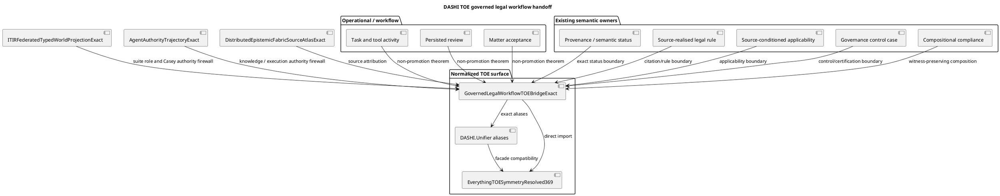

# Governed legal workflow TOE handoff

## O — Objective

Connect existing SensibLaw, matter-workflow, compliance, and governance non-promotion proofs to the focused DASHI TOE root.

## R — Reuse

The implementation reuses these owners.

- `DASHI.Core.CompositionalComplianceExact`
- `DASHI.Core.ITIRGovernanceControlCaseExact`
- `DASHI.Governance.FormalisationGovernanceCapstoneExact`
- `DASHI.Cognition.PNF.SensibLawOperationalSemanticBoundaryExact`
- `DASHI.Cognition.PNF.SensibLawLiveReviewMutationExact`
- `DASHI.Cognition.PNF.SensibLawMatterAcceptanceExact`
- `DASHI.Cognition.PNF.SensibLawProvenanceSemanticStatusOrthogonalityExact`
- `DASHI.Cognition.PNF.SensibLawSourceRealisedLegalRuleExact`
- `DASHI.Cognition.PNF.SensibLawSourceConditionedApplicabilityViolationExact`

PR #1278 already owns kernel-closure versus semantic-closure reuse.
This tranche stacks on that result.

No Actionstep-specific Agda ontology was found.
The existing operational, review, and matter owners already cover the required workflow boundary.

## C — Construction

The normalized surface is:

`DASHI.Unified.GovernedLegalWorkflowTOEBridgeExact`

The regression owner is:

`DASHI.Unified.GovernedLegalWorkflowTOEBridgeRegression`

The focused TOE root imports both modules.

The normalized bridge lives in `DASHI/Unified/`.
The focused TOE root imports it directly.

`DASHI.Unifier` exposes proof aliases only.
It does not use its historical axiom-shaped interfaces as proof authority.

## S — Safety invariants

- Task completion does not create world truth.
- Review persistence does not create semantic authority.
- Accepted review status does not pay applicability.
- Matter acceptance does not create claim truth.
- Source attribution does not create claim truth.
- Legal authority does not create truth status.
- Citation alone does not realise a legal rule.
- A semantic meet alone does not prove legal applicability.
- A source-realised wrong type does not prove violation.
- Control evidence does not create truth.
- A passing control does not create certification.
- Kernel closure does not create semantic closure.
- Compliance composition retains the intermediate witness.

## L — Lane

This lane is disjoint.

It edits the focused TOE root, `Unified/`, `Unifier`, documentation, and the focused TOE workflow only.

It does not edit `dashi_digital_esd`.

It does not edit files whose names contain `digital_esd` or `ESD`.

## P — Preconditions and postconditions

### Preconditions

The exact source theorem owners must exist.

The PR #1278 source-fidelity theorem must remain available.

The existing compliance composition owner must remain canonical.

### Postconditions

The TOE root reaches one legal-workflow non-promotion surface.

The `Unified/` namespace owns the normalized bridge.

The `Unifier` facade exposes aliases to exact proof terms.

No workflow state is promoted to semantic truth by this bridge.

No governance control receipt is promoted to certification by this bridge.

## G — Governance

`DASHI.Core.ITIRGovernanceControlCaseExact` remains the standards-mapping owner.

ITIL, ISO 9000, ISO/IEC 42001, ISO/IEC 27001, ISO/IEC 27701, ISO/IEC 23894, ISO 9241, NIST AI RMF, and Six Sigma remain design and control lenses.

The bridge does not claim certification against those standards.

The bridge does not create a separate standards ontology.

The external repositories `meta-introspector/zkperf`, `meta-introspector/zos-server`, `meta-introspector/erdfa-py`, and `meta-introspector/aristotle-cli-rs` remain attributed tooling and process context only.

No theorem or code from those repositories is copied into this bridge.

`casey-git-clone` is treated as the ITIR-suite observer/workspace subproject.

Its observer-only handoff posture is context only.

`zkSEC` is context only for this tranche.

## F — Verification

The focused TOE workflow installs the existing repository-intelligence package.

It runs `dashi-repo related`, `dashi-repo discover`, and `dashi-repo lineage`.

It runs the focused deterministic Python contract.

It runs `dashi-agda-preflight` on the bridge, regression, TOE root, and Unifier.

It rejects trust escapes.

It rejects ESD path changes.

It kernel-checks the bridge, regression, TOE root, and Unifier.

A workflow definition is not a kernel receipt.
Only an exact-head successful run may be cited as kernel verification.

## C4 / PlantUML view

