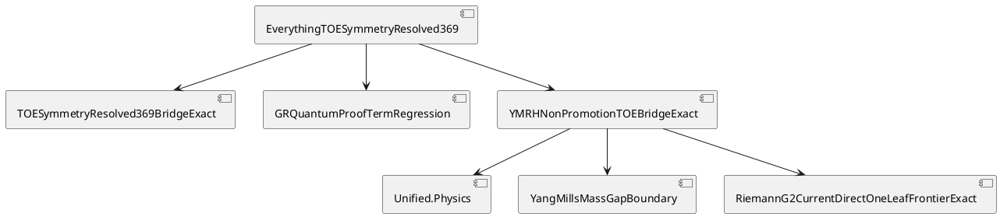

# YM/RH to DASHI TOE convergence — 2026-10-27

## Objective

Reuse current Yang–Mills and Riemann-hypothesis non-promotion theorems in the focused DASHI TOE import graph.

This change does not prove Yang–Mills, RH, GRQFT, or a terminal TOE.

## Search result

Search order was reuse, unify duplicates, extend, then construct.

Existing owners found:

- `DASHI.Unified.Physics.yangMillsObject`
- `DASHI.Physics.Closure.YangMillsMassGapBoundary.canonicalYangMillsMassGapBoundaryReceipt`
- `DASHI.Analysis.RiemannG2CurrentDirectOneLeafFrontierExact.canonicalCurrentDirectOneLeafFrontierBoundary`
- `DASHI.Core.SourceExactFrontierBidiCrossPollination2026`
- `DASHI.Unified.GRQuantumProofTermRegression`
- `DASHI.Physics.Closure.TOESymmetryResolved369BridgeExact`

No existing YM/RH-to-TOE adapter was found in `DASHI/Unified/`.

Searches of the connected meta-introspector repositories did not produce a competing theorem owner for this exact adapter.

The meta-introspector repositories keep their original authorship and code ownership. This lane copies no meta-introspector code.

## O/R/C/S/L/P/G/F

- O: Attach existing theorem-bearing YM and RH non-promotion facts to the focused TOE graph.
- R: Reuse the exact upstream proof owners. Do not restate scientific mathematics.
- C: Add one `DASHI/Unified/` bridge. Import it from `DASHI/EverythingTOESymmetryResolved369.agda`.
- S: Keep YM, RH, GR/quantum, SSP/369, and ESD carriers separate.
- L: This lane owns only the YM/RH TOE adapter, the focused TOE import, this note, and its workflow update.
- P: The focused TOE graph exposes exact fail-closed YM and RH postconditions.
- G: No Clay, RH, GRQFT, external-source, or terminal TOE promotion follows.
- F: If an upstream non-promotion theorem changes, the focused aggregate must fail to elaborate.

## Preconditions

1. The canonical YM mass-gap boundary exists.
2. The current RH direct frontier exists.
3. The unified YM facade object exists.
4. The focused TOE aggregate exists.
5. The imported theorem owners remain the authority for their own statements.

## Invariants

1. A Boolean or receipt does not become a stronger theorem.
2. YM and RH are not identified as the same object.
3. The bridge adds no analytic or physical assumption.
4. `DASHI/Unifier.agda` remains unchanged.
5. `dashi_digital_esd`, `*digital_esd*`, and `*ESD*` surfaces remain unchanged.
6. Meta-introspector source ownership remains unchanged.
7. The TOE aggregate imports theorem-bearing owners, not placeholder axioms.

## Postconditions

1. YM formal projections remain non-promoting in the unified facade.
2. The canonical YM mass-gap promotion bit remains false.
3. The current RH frontier states that RH is not derived.
4. The focused TOE aggregate imports these exact proofs through `DASHI.Unified.YMRHNonPromotionTOEBridgeExact`.
5. The focused TOE workflow typechecks the aggregate and scans the new bridge for trust escapes.

## C4 import view

Context: DASHI focused TOE.

Container: `DASHI/EverythingTOESymmetryResolved369.agda`.

Components:

- symmetry-resolved 369 bridge;
- finite GR/quantum proof-term regression;
- YM/RH non-promotion bridge.

The YM/RH bridge depends on:

- `DASHI.Unified.Physics`;
- `DASHI.Physics.Closure.YangMillsMassGapBoundary`;
- `DASHI.Analysis.RiemannG2CurrentDirectOneLeafFrontierExact`;
- `DASHI.Unified.InvariantSpine`.

## PlantUML

## Process controls

The process mapping uses these ideas only as change-control guidance.

- ITIL: one bounded change lane and one focused verification path.
- ISO 9000: preserve evidence identity and upstream ownership.
- ISO/IEC 42001 and ISO/IEC 23894: keep AI-assisted claim scope explicit and risk bounded.
- ISO/IEC 27001 and ISO/IEC 27701: avoid unrelated mutation and preserve repository boundaries.
- ISO 9241: keep the handoff readable and inspectable.
- NIST AI RMF: keep claim limitations explicit.
- Six Sigma: use one deterministic focused verification route.
- ASD-STE100: use short direct statements.

These mappings are not claims of standards certification.

## Verification contract

The focused workflow is `.github/workflows/toe-symmetry-resolved-369.yml`.

It must:

1. trigger when either upstream YM/RH owner changes;
2. reject trust escapes in the focused new surface;
3. typecheck `DASHI/EverythingTOESymmetryResolved369.agda`.

Do not claim exact-head kernel success until the workflow succeeds on the exact branch head.
