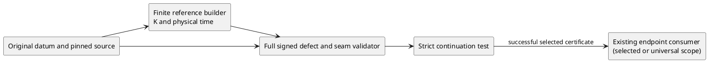

# Four-Clay P0 controlling endpoint reverse-solve and constructor/gap matrix

## 27 November — executable independent NS369 reconstruction

Committed scripts/ns369_similarity_reconstruct.py at 084faab64477650d41aa8bace45a760f3000bb1b (blob 62c601ee46e9aec292320a3fdbd0f265a5a3cd1c; exact remote readback). Independent rational potential basis, original H19 lattice via ns_cell_signed_node, reflection and real-part conjugation, explicit pressure basis, analytic spatial derivatives and coefficient Jacobian, dealiased time/azimuth collocation, seed-residual forced-to-unforced continuation, sampled mass/stiffness/stretch matrices, SVD adjoint directions, residual pairings, shifted holdout grid and atomic checkpoints. Run from root: python scripts/ns369_similarity_reconstruct.py --level 2 --seconds 90 --out Artifacts/ns369_similarity_candidate.json. Requires numpy scipy sympy. This is a fixed-period floating point candidate generator; not original spline discretization, rigorous interval quadrature, global adjoint or actual actuator cancellation, nor all fifteen source conditions. Every certificate field remains unpaid in receipt. A collapse to zero is not acceptance. No local execution or CI this turn; remote readback only. No claim source certificate recovered. Next implementation cuts: genuine original cell basis/continuum enclosures, phase-bordered frequency solve, global adjoint and actuator proof, actual fifteen-field witness assembly. Preserve previous exact conditional producers and tests.

## 27 November — actual source-shaped unforced profile attempt; exact rejected family and pressure-compatible tail

Upstream main remains ad53419de079eb8f95f60313473374624a348546; releases empty; README 1297e1e8515c94a08c4bb4ec56ff609cee98ef51. Recovered original Alpöge–Buckmaster paper text via https://clopen.solutions/submissions/navier-stokes-finite-time-blow-up-navier-stokes/v1/ (20 Nov, pinned GitHub paper). Read §1, Appendix C.1–C.4, §7 outline; PDF screenshot retrieval failed, text accessible. Actual certificate hash 3f7a335b84b6c7631742cacc5343dfcd11cf72f5221ff79b2b9268790b4b22c5; exact hash web search still finds descriptions, not bytes or checker. Paper states approximate gradient L2 norm order 10^4, correction <0.017 in dot H1, m=19, period approx .36, opposite rotational wings, phase exp(i omega k(s-log(1+r²/r_c²))). Nine Newton refinements after continuation from g near .502, small force, axisymmetric swirl/jet; finite waves, half-plane continuation, reflection, exact equator condition, viscosity normalization and m=19. Author method includes pressure least-squares residual on enlarged harmonic support, bordered time phase and period Newton, Lanczos actuator/pin selection, h=3 adjoint fields. These are authors' constructions/claims, not our reproduction. Actual coefficients and all interval receipts absent. No complete certificate reconstruction or convergence claimed. Earlier repo taxonomy scripts/ns_sprint161_critical_profile_taxonomy.py already classify steady backward self-similarity obstruction; no original nonzero DSS seed recovered in targeted searches. Do not use fast-decaying L3-only ansatz or steady-only candidate as a valid endpoint (see paper §1.2, Chae and Wolf, Tsai).

Independent source-shaped family: r²=x²+y²+z², D=1+r², P=Im(x+iy)^19. V=A curl(P D^(-19/2-iω)e_z)+B curl curl(P D^(-9-iω)e_z), W=Wmean+e^(iωs)V+conj, ω>0. Wmean any smooth steady field satisfying the intended symmetries (not needed for second-time-harmonic obstruction). Smooth global potentials, divergence-free, correct 19-fold rotation, half-period+π/19 twist, R*=(x,-y,-z) reflection (P odd and e_z flips), both signed azimuth wings, critical velocity tail O(r^-1), gradients O(r^-2), Hessian O(r^-3). Leading complex exponent homogeneity -1-2iω cancels temporal/dilation at leading order. Independent choice r_c=1 and simple radial shapes, not original spline coefficients. At k_time=2, linear and mean terms absent, pressure curl zero; require curl[(V·∇)V]=0. Exact jets (up to potential derivative4), stripping nonzero D^(-2iω) only after differentiation, at (3/4,0,0) first component proportional to AB(ω-9i)(46ω-1485i). At (3/4,0,1) second component proportional to A²(82ω²+1763iω+24149)-B²(200ω⁴+7388iω³+35780ω²+1734444iω+11810124). Since ω>0, first forces AB=0, second excludes either nonzero single component (positive real A² coefficient, nonzero imaginary B² coefficient). Thus no nonzero oscillatory member for ANY complex A,B of this selected radial family, regardless of steady mean. Does not rule out other radial functions or finite mode sets generally, nor refute authors. For this family correction requires higher modes or different radial shapes; do not let pressure, gauge or unadmitted actuator absorb its physical curl residual. Signed second harmonic includes actual time k=2, azimuth n=0,±38; map through original H19 inverse and preserve zero. Actual mean-only steady profile ruled out under original decay by known Tsai theorem cited in paper; not newly proved here.

Pressure-compatible far-field reverse solve: τ=s−2log r, direction n=y/r, W=r^-1 A(τ,n)+r^-3 B(τ,n)+..., q=r^-2 Q(τ,n)+...; differential identities on r>0, not a convergent expansion claim. Similarity drift annihilates first term and acts as -1 on second. Divergence constraint at leading order is (1−2∂τ) A_rad+div_S A_tan=0. For q, Δ(r^-2 Q)=r^-4 (2+6∂τ+4∂τ²+Δ_S)Q. Source pressure Poisson RHS -div[(U·∇)U], U=r^-1 A. On time k and spherical degree l pressure eigenvalue 2-l(l+1)-4ω²k²+6iωk. At k≠0 imaginary nonzero, at k=0 only l=1 resonance; source 19-fold scalar symmetry and R* eliminate all l=1 (m=±1 forbidden, axial m=0 odd). Thus first tail pressure coefficient unique within invariant harmonics, no pressure gauge identification of physical curl. V=r^-3 B= -ΔU+(U·∇)U+∇q_lead; divergence zero by Poisson and div U, dilation cancels V. Higher-order resonances and log terms not excluded; no general convergence or interior matching. Exact mean example U=z(-y,x,0)/r³, div U=0, Q=-1/15-(4/21)P2(z/r)-(8/105)P4(z/r), pressure Poisson pays actual advective divergence. V homogeneous -3 and curl(y×V)=V; exact symbolic checks of first correction including pressure. Example singular at origin; boundary data only, not a smooth profile. This is a constructive exterior coefficient, not actual original continuum enclosure. Native adjoint differential identity for physical linearization L=∂s+1/2+(y·∇)/2−Δ+W·∇+(∇W) on solenoidal v: L*=−∂s−1−(y·∇)/2−Δ−W·∇+(∇W)^T, with projected pressure and boundary terms. Local Green flux (y/2+W)(a·v)+Σ_i(v_i ∇a_i−a_i ∇v_i), plus time pairing. Retain face orientations and actual pressure/gauge/actuator links; this identity is not a solved adjoint field. No admissible actuator cancellation or actual cell matrices from rejected candidate. Full original seven data objects/15-field condition unpaid; preserve previous conditional signed-node and scalar-budget producers.

scripts/test_ns_similarity_profile.py commit 6a34343543904495e5a422bc2dd1151b2bda7d29 blob fe803cc5fd444a5b711482dad13f84d7fee9ffeb. Exact local SymPy 1.14, normal/-O each 5/5 exit0 (33.190/33.135s), independent direct derivative comparison (initial SymPy power-normalization mismatch resolved by exp/log on positive D), symbolic all-ω second-mode residual, phase and symmetry, local adjoint identity, pressure-compatible mean tail. Local and remote blob exact. No native kernel, CI, full discretization, Newton continuation, cell quadrature or interval replay. No change to other Clay lanes. Actual remaining cut: obtain released hash-matching data or carry out independent continuation on original source-shaped multipole basis, using full signed second harmonics and matched exterior recurrence; only after nonzero small residual solve, assemble physical continuous cell and adjoint/actuator objects and verify fifteen fields. All four requested endpoints remain open, not merely awaiting acceptance. No proof discovery attributed to DASHI for original method.

## 27 November — NS unforced certificate reverse-solve: original harmonic lattice, constrained signed root, three smallness clauses

Upstream tristanbuckmaster/navier-stokes main still ad53419de079eb8f95f60313473374624a348546 (20 Nov); GitHub releases empty, README 1297e1e8515c94a08c4bb4ec56ff609cee98ef51 still states no numerical certificate or Arb/FLINT checker and patched package not rebuilt. Targeted original StatementDefs.lean blob 3fbf0039a716014d23812f4b8cc71f43c293a818 reviewed in depth: labelTime, labelAzimuth, labelFlip, CellMesh/IsCellMesh, ModelPolys, ModelErrors, ModeCharges, CellLayerData, SignedTree, PassesPivotCount, slackRemainder, PassesRealNodeEnclosure, PassesComplexNodeEnclosure, TreeEntry/TreeConditionsGiven, CellHypothesis, CellLayerEntryConditions, CertificateClauses and ReductionEntries. Actual cell hypothesis constants: m>=3, rowWeightMax=400(1+2^-18), weightFn=39/50, coercivity=3/50, pinWeight=1000; these are source constants, not inferred physical invariants. Retain original signs, zero, pressure-gauge kernel, exterior and off-mode cover, resolved/tested/band distinctions and actual fixed profile; do not substitute generic finite mesh for actual source data.

Lattice H_m(a,b)=(2b-a,ma) has image {(k,n): m|n, k+n/m even}; inverse (n/m,(k+n/m)/2), reflection F=(-a,b-a) maps (k,n)->(k,-n), conjugation maps both signs. Exact addition and negation commute, zero retained, axis resolved a=0. Thus no frequency rounding or identification with unrelated 369 counts. Existing indexed hyperfabric can transport these precise labels with physical time and similarity time separate.

Finite signed tree producer: scripts/ns_cell_signed_node.py commit 0e087af071117d90de653034fac38f41a1242c1b blob 4b5274a8b19d0ea74f3e920bbda03f78eeeaa8ad. Original finite real node supports all pivots at single root, base/front zero, weight1, F=0; source slackRemainder M-diag(piv)-Fp Fp^T+Fm Fm^T. For rational symmetric assembled M, actual independent allowed constraint rows C, symmetric nonnegative entrywise input error E, form A=M-diag(rowSum E), Z basis ker C, Y=C^T(CC^T)^-1. Necessary hypothesis for this producer H=Z^T A Z strictly positive (vacuous if no free kernel); no claim actual source has this. S=Y^T A Y-(Z^T A Y)^T H^-1(Z^T A Y). Choose integer s with s²>max absolute row sum S. Then G=A+s² C^T C positive by exact Schur congruence. Fm=s C^T has exactly rank C columns, annihilates ker C, require count<=dim original Free. Reserve delta=1/(2tr G^-1)>0. LDL of G-delta I, approximate positive square roots down dyadically to construct rational Fp with max residual row sum<delta. Explicit sufficient precision uses K=2 max(1,Dii) ||L||∞ ||L^T||∞, 2^bits>K/delta. pivotValue_i=delta+rowSum E_i; radius_i=rowSum |R|_i+rowSum E_i; slack_i=delta-rowSum |R|_i>0. With actual input_lower premise for M,E and same original leaf assembly, one-node real enclosure plus pivot-count conditions are paid mathematically, no new negative columns or synthetic sign flips. The dense one-root option is algebraically sufficient, not scalable or a proof of all TreeEntry gauge/row/freeMap ownership conditions. Do not assert arbitrary C is permitted or claim original certificate. Donors inspected: finite rational quadratic domination (8daab7313fb7ce8c852296dbb7638e31987977a3), existing exact rational LDL script (d917586078386219012b904134f2ded0fe3603c5), NS cross-shell Schur symbolic audit (2bfc2be2b39e1f3d4d82238876c04a99933edb3a). Local implementation uses installed SymPy rational LDL with exact reconstruction, not copied donor code; old cross-shell floating eigensolver not a certificate. Initial n=7 fixture with E=ones/100 correctly failed positivity; positive fixtures use 1/100000, independent overcharge rejection retained. Normal/-O each 3/3 exit0, 2023 harmonic fixtures, 33 matrix fixtures n=2..7 all ranks 0..n, cap/kernel/error/row rank/slack failures. Exact local/remote blob match.

Original CertificateClauses.small_first/second/third reverse solve: w=weight>0, P=periodMax/twist>0, F=1/w+2P formBound, A=actuatorBound/multiplierWeight>=0, C=coerciveTotal>0, H=supBoundFactor(weight)>0, X=sizeBound>=0, D=defectMax>=0. U=supBound; strict cap U<Umax=1/(2CH), U>0; second U²>=B=4X²(F+2PA+2P/C); third U²>=a+bU, a=4X²F+4PX D+8PAX², b=8PHX². For exact scalars both strict cap margins Umax²-B>0 and Umax²-bUmax-a>0 are necessary and sufficient: positive root threshold (b+sqrt(b²+4a))/2, or directly choose epsilon=min(Umax/2,(Umax²-B)/(4Umax),(Umax²-bUmax-a)/(4Umax)), U=Umax-epsilon. Then both inequalities hold with strict positive margins. No repeated search over U. For interval inputs bound entire expressions separately (C appears both directly and reciprocally); failed conservative bounds do not refute actual certificate. This only pays three scalar fields, not nontriviality, size, defect, pin, adjoint or actual profile. scripts/ns_cell_scalar_budget.py final 8fbcc5c4d8ffaaeddbf16ebf6cd2efcd222b31c3 blob d7e105534e0ab7e4b24b4ab10704caf1ca4d9ad6, local normal/-O 3/3 exit0, 18 positive scalar fixtures, exact strict-cap equality rejection, third-only defect rejection, positivity guard, symbolic expansion; exact local/remote match.

Original profile necessary physical check: curl the actual similarity equation to get Ω_s+Ω+(y·∇Ω)/2-ΔΩ+(W·∇)Ω-(Ω·∇)W=0. For the smooth profile with source decay W=O(r^-1), ∇W=O(r^-2), ∇²W=O(r^-3), integrate dot Ω over one rotation-twisted period and whole space via radial cutoff. Rotation/isometry preserves vorticity L² energy (even orientation reversing), temporal seam cancels, divergence advection zero, dilation gives -3/4. Boundary terms vanish using decay, including dilation cutoff O(R^-1). Then int stretch=int |∇Ω|²+(1/4)int |Ω|². Nonzero profile has nonzero Ω (otherwise harmonic decaying W=0). Hence a globally bounded strain maximum <=1/4 cannot be a nonzero profile; no-go for weak stretching, not a proof of profile existence or universal nonexistence. This follows classical vorticity energy algebra, not a new discovery by the original authors or DASHI. Not kernel checked.

Remaining actual P0: reconstruct original continuous nonzero similarity profile and seven data objects or recover their released certificate; produce actual all-jet shapes, pressure/gauge and actuator cancellation, assemble exact source matrices with directed cell/parameter/tail errors, populate valid original constraint rows and free counts; then use existing signed node producer and smallness budget to evaluate actual entries. Full fifteen fields, continuum enclosure and nondegeneracy still open. No actual certificate matrix, candidate profile, complete CellSystemCondition, native kernel or forced C/D re-audit this turn. No external proof admission, CI, new solver claim or merge. RH/BSD/Hodge unchanged; prior external C/D source completion retained. Use existing source owners rather than new infrastructure.

## 27 November — Alpöge–Buckmaster unforced NS source ingress and BCH fidelity gate

The external NS programme now has TWO distinct candidate routes. Do not reopen already source-written forced C/D admission, but supersede the previous "receipt validation only" wording insofar as the human/formal mathematical fidelity audit remains independently necessary. Bastounis, Circelli, Hansen, arXiv:2610.08144v1 (6 Oct 2026), and King's College London notice (27 Oct 2026, https://www.kcl.ac.uk/news/openais-navier-stokes-proof-called-into-question) identify formal/natural-language mismatches, not a proved false terminal theorem or an official Clay rejection. Existing master source audit Docs/research/autoformalisation_bch2026_source_fidelity_pareto_ibrahim.md blob 0a79b9a3d2637be209746d111e0830569bea5b80 and DASHI/Foundations/AutoformalisationBCH2026Exact.agda blob 92100f553c944b023942f8748a815755d353b7f8 already isolate derivative-word xJet(w.length+5) versus uniform derivative claims, and pressure-flux additional dissipation/1/R² coordinates versus paper inequality and time quantifier. Reuse actual source at f9e8bc5b38b6e212696e8a30e3e91517af887bbd, compare complete transitive terminal dependency and force/solution semantics; no inference of a physical counterexample from symbolic RHS differences. Keep independent readable proof review separate from kernel success. CMI rules https://www.claymath.org/millennium-problems/rules/ require qualifying publication, >=2 years since publication and general acceptance before consideration, not simply two years since announcement. No claim of CMI adjudication.

NEW original unforced source: Levent Alpöge and Tristan Buckmaster, Finite-time blow-up for the Navier–Stokes equations, paper dated 20 Nov 2026 (79 pages), https://github.com/tristanbuckmaster/navier-stokes/tree/ad53419de079eb8f95f60313473374624a348546. Upstream main inspected at ad53419de079eb8f95f60313473374624a348546, 2026-11-20T13:33:17Z. README blob 1297e1e8515c94a08c4bb4ec56ff609cee98ef51; lean/README 3190899c1a1ec53d2d5c91754953a8c56edd1b39; lean/NOTICE 30b2bdd4a6a9db6a164751fb8a296672fb4ac8c1; lean/lakefile.toml 7c73cfa0e683050239b5db2538f21128237989cc. Lean v4.33.1, mathlib 0df444a360eaa60ab8c11dca51a86af692955474: separate from existing forced Lean v4.34.0-rc2. The authors disclose that the Nov20 cell-layer patch (weight (|m|+1/2)^2 rather than m²+1/4, zero cell constant allowed, nonvanishing harmonic selection) was not rebuilt. Full numerical data and external 128-bit Arb/FLINT interval check not released. Do not assume a published hash inhabits the predicate. Distinct companion Euler result credits Matei Coiculescu as coauthor; do not transfer authorship or inviscid theorem to NS.

Exact source theorem chain read, not imported/compiled: lean/Challenge.lean 0ad1865e8651e1a136d090b9bafbac7f1f666979 defines BreakdownOnSpace (every ν>0, smooth compactly supported divergence-free datum, no global smooth bounded-energy solution) and BreakdownOnTorus (smooth unit-periodic divergence-free datum, no global smooth periodic-velocity solution regardless of pressure). These are negations of unforced A/B with same-equation, initial, decay, energy and pressure transport still to check against frozen ClaySpec. They imply C/D with zero force if these transports are paid. Do not call them affirmative A/B proofs. Source lean/Solution.lean a70613926acf3ae2e0ecda7ec4fbf59f2a251d0d has actual breakdown_on_space/torus from PeriodicSimilarityProfileExists, breakdown_on_space_of_weak, extended_certificate_orbit and three cell-system terminal terms. lean/CellLayerTheorems.lean 7f0f97b3474ce652c915e413cb529ad8ebb1a738 is a challenge file with sorry, not proof authority; comparator-cell-layer.json 862b92e0a4ede7beb5522d4ce5df53989fbb4c9a targets Solution, permits only propext, Quot.sound, Classical.choice. lean/Breakdown/CertCell/StatementDefs.lean 3fbf0039a716014d23812f4b8cc71f43c293a818 defines the actual fifteen-field CellSystemCondition D X R T Y N B: cell, shape_valueSets, entry_conditions, enclosure_numbers, coerciveL2_ge, coercivePin_ge, certificate, instantiation, offset_expansion, shift_numbers, frozen_form, adjoint_quadratic, adjoint_links, potential_entries, adjoint_defect. lean/Breakdown/CellReduction/CellLayerBreakdownClosed.lean 9d7c3eaf83303b18b59fb7201676129699cc273e calls actual analytic producers for these conditional composition spines. Key endpoint Breakdown.CellLayerSystem.breakdownOnSpaceAndTorus_of_cell_system_condition takes h:CellSystemCondition and returns BreakdownOnSpace ∧ BreakdownOnTorus. Neither h nor the concrete seven data objects is supplied by upstream. No full source graph, paper PDF or certificate verified; news primary paper access incomplete. Original authors credit retained.

Geometry reuse: original similarity time s=-log(T-t), y=(x-x*)/sqrt(T-t), u=(T-t)^(-1/2)W(s,y), p=(T-t)^(-1)q(s,y) at ν=1 produces residual W_s+W/2+(y·∇)W/2−ΔW+(W·∇)W+∇q (literal Challenge.SimilarityResidual); periodic similarity seam W(s+P,y)=R W(s,R^-1 y). Retain physical t and similarity s separately, signed time-frequency and azimuthal order (ℤ×ℤ), radial cell and interface, period/rotation phase, zero modes, physical ν and actual residual. Existing indexed hyperfabric, signed Fourier/Leray columns, normal Gram/adjoint and interval budget geometry are candidate donors for bounded cell verification, not evidence of actual certificate or PDE profile. Intermediate certificate multipliers are not physical forcing; must prove cancellation in terminal zero-force equation, do not set them to zero by decree. Full signed cell conditions and global tails, coercivity and nondegeneracy need actual data.

Execution order: (1) preserve source-written C/D and recover exact existing acceptance receipts, run local pinned audit only if needed; separately check BCH contested derivative/flux claims and their terminal dependence; (2) unforced conditional theorem admission in isolated 4.33.1 environment, exact comparator, axiom and patch replay; build same-object negative A/B -> zero-force C/D adapters reusing existing literal Fefferman owner, no positive regularity proof claim; (3) recover actual seven data objects plus original checker and hash, replay every fifteen-field inequality using independently verified interval arithmetic, preserve all index/zero/tail and strict margins; separately audit numerical-to-formal binding, no invented certificate; (4) if data absent, genuine independent reverse-solve of CellSystemCondition with existing geometry is research, not a replay; (5) independent positive A/B research now conditional on these counterexample candidates failing, prioritize falsification tests and compatibility rather than pursuing universal smoothness and breakdown as simultaneously true. BSD/Hodge/RH unaffected. No kernel run, CI, external vendor import or original proof claim in this source audit.

## 27 November — NS C/D admission archaeology correction (no new theorem construction)

Source-level proof admission is ALREADY implemented and merged in Lean #11, #45 and #53. Do not schedule an admission implementation task. On main, ExternalClayNS/LiteralABCD.lean (ea5d94d76b12ebb33231e4ae8f71a5a55b699a13) has literalClayC, literalClayD, literalAnyOneClayResolution and literalAnyOneClayResolutionViaD, actual unconditional theorem bodies using the pinned imported proof. SubmissionAudit.lean (a7592dcc4a8e430c111a757391f2ef55aeac87fc) independently invokes the original paper-level theorems for directClayC/D, directClauseAuditC/D, roundTrips and dualRouteReceipt; no missing proof-construction or independent-semantic adapter. LeanDojoExactTerminal.lean (c676a0b7c988a6c6eb83509218184342a5311d47) has both exact Fefferman theorem bodies. LeanDojoMaxCut.lean (291ae08fed960a615fc68a0072b80ebe015c9e0c) consumes those and proves both force-decay transports, with actual axiom export commands. The older five-leaf text in LeanDojoCTransportAudit.md (1002194e3b4752c6a88d92d92a2ed305e4326b8a) is superseded at source level, not a current implementation backlog. Main lakefile (a5398abcbf680daddd96b35c00bfa7f7f0c9f2f1) includes both terminal and audit modules and pins f9e8bc5b38b6e212696e8a30e3e91517af887bbd. Existing build/axiom workflow 5191a1f39b529f1af9bba40b083377c3b9bbc32a inspected, not executed.

Exact receipt distinction: main MillenniumExternal/ExternalTargetFrontier.lean (d025d57ceda17027c7ba83a049b7d341c5fc793b) still explicitly proves navierStokes_source_exact_kernel_pending. Merged PR #11 head 59526aecfb0ec31a2d0b2b064e311741300e656f explicitly states no fresh local kernel run; #45 head 9ab3f6a852af95061cd7ba5a890767ba7c1a1817 source-written; #53 head e34477885ad64cb569a17e1a663092cd3fd783d3 says source-exact terms, acceptance separate. Historical #51 and #109 are superseded source transport work. Read-only lookup of existing PR workflow runs at #11/#45/#51/#53 final heads returned no runs; not evidence no historical run anywhere. Relevant past audit records likewise do not furnish exact successful C/D kernel+axiom output. No successful local exact-terminal receipt located in this targeted archaeology; absence not asserted globally. Disposition: SOURCE PROOF AND ADMISSION IMPLEMENTATION COMPLETE; RECEIPT RECOVERY/VALIDATION ONLY (execute existing pinned local build only if no valid archived receipt recovered). Separate independent refereeing and CMI process. No new C/D adapter, PDE theorem, or proof reconstruction required for this external-source path. Keep unforced A/B as independent research. Do not present external-source work as original DASHI discovery. No fresh kernel run, CI, or Lean source edits in this audit.

## 27 November — endpoint-first re-audit: existing admission paths, direct factorial holomorphy, relative Gram dual budget, rank-two exclusion and Clifford volume trace

Entry #1551 bc8ccd2bb333f3da08ee8517218c563b12b02c48, mergeable at entry; #1291 c68b44f37c89b54d9ba0b5ef18ab4753c7dd5f04, #1554 03255e9684c170028d21063c0dcdf67421f0adb5, #1547 d73388b750fb4a4a2c8d78ab418208843b8f4fe1 (nonmergeable at entry), #1533 f2398bfa5266191c81c7a90b44d30b2c6d68bc6c; Lean #116 7f8f4b7cde59cc3937ffeef8af3968b08cc96871, #121 352727809b91c57857f9f98aa369991388ffbadc, #122 64db5f277b5cdbf979527797699b91fc8b4289ca. Targeted source-body audit, not exhaustive all-branch proof search. No merge, CI, external admission or donor edit. YM/PNP separate.

### Literal Clay completion is not the conjunction of every independent research route

RH: existing Lean #121 proofs/alpoge-lean433/RHAdmission.lean (442fcba30672665775e4857e793293695696d6de) really consumes Main.riemannHypothesis, plus original zero and all-Dirichlet-character statements. RHClayAdmission.lean (09b3a54ba03eae5329117b1ac3511a251d6cd11a) actually calls Millennium.ClayRiemannHypothesis.of_mathlib and xi_zeros, with three axiom exports. check_original_p0_admission.sh (06c061135f9e428cd712c4bd5c6597f33f3598d1) verifies pin/dependency hashes, exact vendor Clay statement, allowed axioms, fresh replay. Use original source with GRH_P0_CLAY=1 and GRH_P0_FRESH_REPLAY=1 (not original default); or the separately pinned licensed compact/readable toolchain. Rechecked upstream leanprover-community/riemann-hypothesis main README blob a7a3d71d097a4747913128ca8433c85bccc628ec, 25 Nov switch to readable lsernau/grh-lean 72fead102f663d5c7a407964a13dc0cf9d977207, reports Comparator checks on literal Mathlib statements and Lean/nanoda. Do not equate upstream report with this local exact-head receipt. Source credit Alpöge/Claude, lsernau and Lean community for condensation and verification; DASHI for adapter, not original RH proof. Native Bishop and independent Weil proof are valuable separate objectives, not necessary prerequisites to admitting an already valid external proof. No claim of CMI adjudication.

NS: Lean main ExternalClayNS/Adapter.lean (abbc2b11e85e65bba004e0582333e69a813bff91) directly invokes NavierStokes.Comparator.navier_stokes_breakdown_R3 and navier_stokes_breakdown_periodic. LeanDojoExactTerminal.lean (c676a0b7c988a6c6eb83509218184342a5311d47) actually builds dashiExactFeffermanC/D by contradiction using same-solution transport. Master Docs/papers/live/NavierStokesABCDClaySubmissionSpine.md (2ed377e3ba6e102cd4d6029ac961620b4a2a4ab2) and NSClayFacingCDReleasedAuditFrontier20261007Exact (b6002bdcabb1d546c98f877875041ac63f89baf5) explicitly say C/D discovery is not mandatory. Official alternatives ANY ONE sufficient, so literal endpoint needs a pinned C OR D replay, exact force/initial/energy/pressure clauses and axioms, independent scrutiny, not a proof of unforced A or B. External source https://github.com/openai/NavierStokesAndEuler and SIAM https://www.siam.org/publications/siam-news/articles/openai-s-navier-stokes-construction-what-c-infty-forcing-changes/ (forced C/D scope, not A/B). No fresh local proof replay or adjudication. Do not appropriate upstream discovery. Keep independent unforced A/B.

### RH native R-W2q — recovered factorial and raw-prefix producers, explicit analytic completion path

Actual source reread: BishopComplexExpFactEqualsNativeExpExact 48b6cac6a247de9aa9a6dc2de1bb261afe7bb589 originalBishopExpFactComplexSeriesConvergesToNativeExp consumes finite-binomial capstone; AbelBishopFactorialComplexExpDiskExact 82cbcaeb62ba10e77d06c5763b801a08ee05f79e positive-degree component bounds and canonical limit on unit disk; BishopComplexNormSquarePowerEnvelopeExact 6d79f2f82a92186d0322d8de30b8f82cdfbcf806 actual normSqMultiply/normSqPower/powerEnvelopeFromNormSquare; BishopComplexNormTriangleFromR4Exact 873ffe2e6c4b0d1710e0ab5f377036c507fa3689 actual triangle with configured roots; BishopOriginalEtaRawAllCutoffPrefixExact 685dde7baac156edeaf2e0083d18626d1e5da73c and BishopOriginalEtaRawSeriesOfSameSourceExact 11bd9457cc321c6622bb6f70067a67b6fbdc81d5 provide literal even/odd prefixes and original SeriesOf. OriginalExpOriginDividedDifferenceSeriesExact a1a29cdc5af30be33274a12302fd3f33e1924f67 factor limit; prior negativeExpDropLower. Pinned Bishop RealProperties at 240e38c7f6938f20f865b1f956c5f084da48bd54 confirms <=-resp-left takes OLD ≃ NEW, not opposite. Repaired originalShiftedFactorialAbsoluteBelowExpBall splitQ direction at commit 49a968e14f72624fd32aeaef6495130d96e97a27 blob 8a0a8fd27217a2d986f1f52465a455de1bf91642. Source only, not verified by kernel.

Shorter adjacent log proof: for positive integer n let h_n=ell_(n+1)-ell_n>=0 via original monotonicity. Native exp inverse, cancellation and addition give n exp(h_n)=n+1, and first two factorial terms yield exp(h_n)>=1+h_n. Multiply by positive integer n and cancel, obtaining h_n<=1/n<=1 without a new integral, derivative or logarithm mesh theorem. For constructive h=0 avoidance, prove weak x exp(-x)<=1-exp(-x) for x>=0 by same product proof using exp(-x)>=0 via exp(-x)=exp(-x/2)^2. No trichotomy needed. Use Cartesian l1 submultiplicativity from original four multiplication terms, so |component z^k|<=||z||_1^k. Apply literal factorial term, SeriesOf triangle and order passage to originalBishopExpFactComplexSeriesConvergesToNativeExp; yields ||exp(z)-1||_1<=||z||_1 exp(||z||_1). Then |coord(a_(n+1)-a_n)|<=2 n^-δ R h exp(R), original real drop >=n^-δ δ h exp(-δ), hence existing paired completion with C=2R exp(R+δ)/δ. No new complex square root/FTC necessary. Attach original unmatched odd term by native decay, and existing raw all-cutoff SeriesOf equality. This is explicit mathematical route; the complex and real order compositions, all-index log proof and weak drop variant still need native source bodies/checking. Do not call the prior conditional completion unconditional.

Direct holomorphy route on original same object: at s0 with sigma=Re(s0)>0 and 0<r<sigma, let c_(n,k)=(-1)^k/k! [a_n(s0)ell_n^k-a_(n+1)(s0)ell_(n+1)^k]. Subtract/add a_n(s0)ell_(n+1)^k and use positive powers. Sum r^k|c_(n,k)| over k: <= |a_n-a_(n+1)| exp(r ell_(n+1)) + |a_n|[exp(r ell_(n+1))-exp(r ell_n)] <= e^r(|s0|+r) n^(-1-sigma+r), by prior contractive increment and h_n<=1/n. Thus absolute double-series convergence in local disk; the literal eta paired factorial series is holomorphic without general derivative/FTC on complex domain. For all bases b>=2 group each period as sum of consecutive adjacent differences with weights bounded b-1 (original periodic zero-sum weights); same summable bound times b-1. Use existing finite scale and diamond, take limits; adjacent-base nonzero divisor, local quotient via BishopComplexReciprocalExact (81879762e77cf238ac7149cc83070e6b38b1176a), exact pole retained. Classical mathematical analytic route assembled; native power-series interchange, quotient holomorphy and actual original Mathlib continuation comparison still to implement/verify. Existing original cross-PR script 7d2d70236a3a3005038a878ca08a9090aec391e3 owns sanctioned checks, expand targets to current actual leaves. No fresh native verification here.

### RH Weil R-W3b — concrete dual correction bound on existing frozen amplitude geometry

Lean #116 original primeAperturePhysicalMoment and QuarticFourFrozenPrimeAperture (95b0031cd6cfa07da892a0aefb79712736ec4cfb) inspected: actual half/two response, moments 2,4,6,8, pole and prime ports. Old normalized order52 differential bump remains valid mathematical E0 route, old E2 adaptive prime mass and target floor already source-written notes (t>=19440, r>=1215), do not redo these. Reuse actual 52-box source derivative bounds B_0=3/32, B_j=4λ^(j-1), λ=53248/7, j<=53, support halfwidth 1/32 around ±log p, p=2,3 (within |u|<=5/4). Existing two-sided relative Gram lower bound G>=1/2 in amplitude norm for r>=946. For each amplitude polynomial degree<=8 in u, reproducing-kernel derivative evaluation bound on |u|<=M:
C_j(M)^2 >= sum_(i,k=0..4) |(H^-1)_ik| v_i v_k, v_i=(2i)!/(2i-j)! M^(2i-j) or0. For cosh amplitudes the same constant at least3 suffices all j, since |u|<=5/4 and interval length9/16. Beyond j=8 use 3. Exact integer C_j for M=5/4: [115600,663950,3386495,15025701,56390070,171883710,399096673,627819639,502255711]; for M=21/32: [1679,14842,119705,861557,5382517,28066443,114863497,329605311,502255711]. Integrate by parts m times against original prime bump b. Set S_m=sum_(j=0..m) binom(m,j) B_(m-j) C_j(5/4), m in {4,8,16,24,32,48}; Cauchy Schwarz over six frequency slots gives |d(c)|<=3 S_m/r^m ||c||_*; x=G^-1 d therefore ||x||_*<=6 S_m/r^m, take min m. This uses actual amplitude coordinates, not raw ill-conditioned coefficient inverse.

For actual ContDiff 2 frozen carrier choose even C² correction window ψ with plateau ±[1/16,5/8], support ±[1/32,21/32], quintic smoothstep 10x³-15x⁴+6x⁵ on four transitions width1/32. ∥ψ∥_1<=5/4, ∥ψ'∥_1=4, ∥ψ''∥_1=480. If a later consumer needs C∞, use original convolution bump with its own derivative budget, not this C² patch. Set D_j(r)=sum_(i=0..j) binom(j,i) C_i(21/32)(18r)^(j-i). For correction g=ψ Σ f_k cos(kru),
||g||_1<=3 ||x||_* (5/4)D_0,
||g''||_1<=3 ||x||_* [(5/4)D_2+8D_1+480D_0].
All rational scalar bound terms decrease after multiplication by r^-m for m>=4. Exact bracket controls first sufficient integer r for this particular conservative envelope: 17505 for ||g''||_1<=1, 19348 for <=1/100. This is the correction-only budget, NOT full aperture, not a better threshold than all earlier normalized operator routes, and not signed E3. For any actual t, use exact Gram matrix/dual rather than raw coefficient global worst case where feasible. Remaining actual full FarExact, Gamma/zero signed strict inequality, actual W and native smooth integral realization. No universal RH independent proof.

### NS independent A/B: existing zero-mode transport, actual missing theorem rather than disproved target

Master NSTriadKNLuoPeriodicMeanZeroGalileanReductionExact (29307aef7352b1e0d43c1c037cdc1021e6155603) already has meanZeroSolverAndGalileanRestorationGiveClayB and literal fields for spatialMean and restoration. The source flags continuum integral and Galilean invariance false; mathematically explicit v(x-mt,t)+m, p(x-mt,t) gives time derivative -m·grad v and added convection +m·grad v cancelling; mean conserved by integrating periodic divergence, so native realization, not a new global NS theorem. Reuse existing adapter. Source Docs/roadmaps/ClayNSABCDTOER3OpenAIBidiReconciliation20261115.md (768e408a0dfbe218a873f96c4337599f161c1fca) establishes original universal pointwise W2 false; full-fibre B4 padding no-go also retained. Do not try to prove them or label them mere missing welds. NS canonical B owner 359a855f782e2e2ed94169cf163d25cb0079c793 and R503 ordered oriented budget 79d783e43d47359fc57198ea6e2579437f7efe42 remain. For independent periodic B, strongest valid reverse route is current polarized full signed reference and column validator: arbitrary smooth centered datum -> rational solenoidal finite reference with certified H^s tail -> strict finite path to terminal X^-1<2ν with full residual/seams -> small critical continuation -> pressure and Galilean restoration. Prior B-N2q/2s reverse direction (global smooth -> eventual small by dissipative energy and path approximation) makes search completeness equivalent to global smoothness on this scope. No proof that refinement succeeds on arbitrary input; do not equate computable finite certificate with uniform existence. Any new all-data estimate must preserve physical amplitudes and padding invariance, not old row count observables. Whole-space A retains its separate physical transform/continuation. These are optional for literal forced C/D prize endpoint.

### BSD B-M7t — rank-two exclusion is shorter than reconstructing fourth-order complex derivative from a p-adic jet

Lean main Synthesis/MillenniumBSDUniversalRankWeld (838c4e0877a47461dbdbf11b559825e74d96a868) actually defines analyticOrderNatAt on original LSeries continuation, AddCommGroup.freeRank of actual point group, proves uniqueness of entire continuation and rank factorization. All-curve analytic binding and MW finite generation remain native producers (classically modularity and Mordell-Weil); universal equality not another observer map. Agda BSDUniversalScopeFirewallExact a55ef232a99e5fffc731cde6fc60971aa2974f78 separates prize from refined Sha/leading coefficient. Original projected return bbb080df829901fe9c8adaa5c3c440e00c155323, actual 244 symbols 3026d956440811568911e7011f4540cc8487ac0d, prior rank4 interval and two crossings retained. Historical source https://wstein.org/papers/rank4/intro.html confirms selected equation y²+xy=x³−x²−79x+289, conductor234446, rank4. Use literal equation not database label alone.

The decisive selected proof can be either M1=0 OR a source-realized upper bound r_MW<=2 conditional on M1!=0 (analytic order2). Existing actual four independent points already contradict that bound. Stronger complete rank-two proof (including lower rank or Sha) unnecessary for this selected exclusion. Concrete arithmetic reverse route: assume analytic rank2, choose quadratic twist of actual E with nonzero central value and suitable ordinary prime/Heegner or definite local signs, transfer through actual Kummer and finite extension restriction. Need an actual full classical Selmer control upper bound <=2 (e.g. valid same-object anticyclotomic characteristic degree<=2, mu=0, correct control and local corrections); then r_MW<=corank Sel<=2 contradicts existing rank4. Selected rank4 follows from exact upper4. No equality of p-adic vs complex Taylor variables presumed. Source candidate Xiong Wang, March 2026, DOI 10.13140/RG.2.2.14539.86569, Theorem15.10/Prop16.5: claims anticyclotomic lambda2 via level-raising comparison to rank-zero companion. NOT admitted; actual paper switches sign of auxiliary g/K and uses central-value/characteristic-ideal transfer, so verify definite vs indefinite interpolation, residual congruence and local Selmer conditions before using. No claim its full proof is sound or refuted here. Use independent rank-two theorem only if source proof and actual hypotheses checked. Another route is the existing original fourth-adjoint Mellin pairing: a genuine cohomological period or higher reciprocity theorem comparing the second complex jet, not a universal evaluation of finite p-adic congruences. Low-corank OpenAI manuscript Oct7 actual section introduction blob 8afa7de5ae4ade572e70565d81d624bd34476c4e explicitly restricts s_q in {0,1}; cannot apply to selected rank4. General higher-rank comparison remains real mathematical frontier. Universal rank equality can be decomposed into both inequalities on literal curves, or rank-stratified exclusion; selected rank4 does not cover all. No new BSD proof or arithmetic run this round.

### Hodge H-M2ag — actual conditional two-slot Clifford action -> three-block signed relative volume

Master HodgePrimitiveLefschetzClayReductionExact d240391f0a0c1c6634bafe470b2d5882b2745606 has primitiveLiftGivesHodgeClayCoreAt and literal assembly. HodgeProjectiveKnownCycleResidualBridgeExact a9d443a5e9a61c20ade7c0249aff9cdd66569ba4 already supplies projectiveKnownCycleGivesZeroResidualSplit; primitive residual decomposition 91e3977382cc1d1d9767b0754541183fe893db1c and strictness guard retained. Clifford/SpinFromSignature 9bb10869d740bef4600118f2cca7f4dbc138177f is an abstract generators/relations record, not an algebraic K3 correspondence. Previous extra-CM skew Pfaffian cycle remains valid conditional on its actual carrier, no deformation promotion. Varesco arXiv:2203.09778, Buskin arXiv:1510.02852, Kuga-Satake geometry and Lefschetz (1,1) on abelian varieties credited. Related rStation paper143 search excerpt describes conditional half-spin/curve correspondence; full page fetch failed; no theorem imported from excerpt.

For original rank_F(T)=6, [F:Q]=3, assume an actual abelian carrier A with H¹(A) the full regular even Clifford realization of rational T, and an ALGEBRAIC map B:T(1)⊗T(1)->End H¹(A) realizing (v,w)->L_(vw). Equivalently sufficient algebraic skew bivector map plus metric scalar identity, or full Kuga-Satake algebraicity (using standard v->L_v R_e, fixed e of nonzero norm; product q(e)L_(vw)). We do NOT assume existence of that algebraic map, only Hodge existence of the Clifford realization. The relative projector P_F from existing cubic separability idempotent retains the all-equal embedding, and Alt6 removes ordinary symmetric pairings. Over splitting field, rational T orthogonal sum V_i (i=1..3), each dim6, volume omega_i=e_i1...e_i6. Clifford relations yield omega_i²=(-1)^15 det Q_i=-det Q_i. On full even algebra of dimension 2^17, left multiplication by nonempty blade has trace0, scalar multiplies trace2^17; hence trace(L_omega_i L_omega_j)=0 for i!=j, diagonal -2^17 det Q_i nonzero. Thus relative determinant trace pairing is nondegenerate and rationally descends. For rational Hodge orientation ω in wedge_F^6 T, its Clifford multiplication image gamma=m(ω) is weight-zero Hodge endomorphism of H¹(A); by Lefschetz (1,1) / Hom of abelian varieties it is algebraic, independent of algebraicity of ω on S^6. Compose three algebraic B maps and trace after gamma insertion, then Alt6 P_F on six original K3 factors. This algebraic correspondence gives a functional on T^⊗6(6), nonzero on relative orientation by trace pairing. Via algebraic K3 transcendental projector, duality and algebraic F action obtain nonzero actual orientation cycle and its three-dimensional F orbit. This replaces searching for a sixfold incidence from scratch with the precise algebraic B producer on S² and the abelian H¹ carrier. Noncommuting End-valued pairings retain chirality that scalar symmetric pairings lose; no scalar pairing counterexample evaded by relabeling. Full KS algebraicity would suffice, not necessary; the bivector-only weld may be weaker but remains a genuine new geometric assertion. Need actual curve/abelian incidence or algebraic derived action for selected generic cubic RM; no existing literal algebraic B found in targeted searches. Universal arbitrary-X primitive producer still open even if this selected K3 family closes. No claim of new universal Hodge proof.

### Verification and controlling order

scripts/test_clay_endpoint_reuse.py final da993fc6ed423e76dcc95380010292ba3d942b0e blob c6ca3ee9531f52e3632f4cfc6f18499541f52d39 exact local/remote hash and source readback. Local Python SymPy 1.14.0 normal and -O each 4/4 exit0 (0.236s/0.232s); exact 2160 signed six-volume permutation cases, six cross-block cases, 32 explicit even-algebra trace checks, original log ratio and factorial coefficient identities, exact rational Gram amplitude bounds, quintic derivative norms and correction threshold brackets. Finite controls do NOT prove continuum, actual cycle existence, BSD vanishing or external theorem. No Agda, Lean or lake in local PATH; no native check, CI, full repo suite, independent workers or ITIR proof search. One existing source-order correction plus finite algebra and mathematical conditional derivations. Source audit also encountered inaccessible full rStation paper143, missing paths for some historical docs; do not infer absence from search. No audited standards compliance.

Next execution sequence: (1) RH and NS literal external proof admission with exact pins/axiom/statement replay when compatible kernel available, no new generic interfaces; (2) independent RH original log/factorial bound to actual raw eta and local power-series continuation, and full signed Weil residual using explicit dual budget, keep independent; (3) BSD selected analytic-rank-two exclusion with actual classical Selmer control (or direct M1 period comparison), then higher-rank all-curve theorem; (4) Hodge algebraic B correspondence on original K3/abelian carrier and relative volume trace, then original primitive residual coverage for arbitrary X. Parallel work, no assertion of a guaranteed completion for the genuinely unsolved universal endpoints. Keep sign, zero, field embedding, physical time, cutoff and source identity; existing consumers are not producers of missing mathematics.

## 27 November — four-lane original-source maximum cut: relative Gram, eta scalar, NS column, BSD Mellin, Hodge Pfaffian

Entry #1551 293f2b331e05befb76683bffa941d288734f5965, GitHub mergeable at entry (previous report was nonmergeable). #1291 c68b44f37c89b54d9ba0b5ef18ab4753c7dd5f04; #1554 03255e9684c170028d21063c0dcdf67421f0adb5 (different from last observed head; no assumption about unseen changes); #1547 5783946dc502145af7b5ca74936f8acbab29c0ae (sampled causal dual and cap budget delta); #1533 f2398bfa5266191c81c7a90b44d30b2c6d68bc6c; Lean #116 7f8f4b7cde59cc3937ffeef8af3968b08cc96871, #121 352727809b91c57857f9f98aa369991388ffbadc, #122 64db5f277b5cdbf979527797699b91fc8b4289ca. No merge/rebase/CI or external admission. YM and PNP held. Source attribution and operational notes reread. NS canonical config b054001cf3293cc1da788f71387ca29580a839ae NS-B route and owner 359a855f782e2e2ed94169cf163d25cb0079c793 reread (connector parsed route; full local navigator not run). The physical strict B4 no-go is retained, not overwritten by a selected-path alternative.

### RH native R-W2p: finite-factor comparison, no derivative or reciprocal-of-h

New source bodies: BishopNegativeExponentialGlobalUnitIntervalExact.negativeExpDropLower at b2266e279933d1ed3a00e25bc36b7734ade859b6, blob 691455256d15f57c70eb6a56003df5310d72a97e; BishopOriginalShiftedFactorialUniformModulusExact.originalExpIncrementAbsBelowExpBall at 962fec7541fbc7a436affafe5f4a5a69cf72f617, blob 11eaf6aa1254085dde220be1539536ceb9ff4ca8. From 1+x<=exp_B(x), x>0, multiply by positive exp_B(-x), use literal product=1 and subtract exp_B(-x): x exp_B(-x)<=1-exp_B(-x). From the actual shifted quotient bound and literal finite-factor limit, |exp_B(u)-1|<=|u| exp_B(radius) for |u|<=radius. Both source-written only, no kernel claim. Pinned Bishop/Bridges, Murray and Csimma source owners retained.

Coarse direct analytic alternative to previous subdivision: for Re(s)>=δ>0 and |Re(s)|+|Im(s)|<=R, adjacent log increment h=log((n+1)/n) in (0,1), the literal complex factorial expansion gives each coordinate of 1-exp(-sh) bounded by Rh exp(R). Each coordinate of a_n is bounded by exp(-δ log n); multiply the actual complex pair to get adjacent coordinate magnitude <=2 exp(-δ log n) Rh exp(R). The scalar exponential drop bound yields n^-δ-(n+1)^-δ >= n^-δ δ h exp(-δ). Thus C=2R exp(R+δ)/δ suffices for the existing paired native decay consumer, without division by h, differentiation or subdivision. The sharp classical C=|s|/δ route remains. Remaining native debt: original complex factorial-coordinate increment (not just real), all-index adjacent log bound, literal source complex multiplication and modulus order composition; compact holomorphy and nonzero-divisor overlap quotient. Neither the complete adjacent estimate nor RH is native-proved here.

### RH Weil R-W3: relative Gram preconditioning on original six frequency amplitudes

Keep the exact eight constraints of Lean #116 RiemannSelectedPrimeSensitiveFrozenApertureExact (95b0031cd6cfa07da892a0aefb79712736ec4cfb). Enlarge plateau to I=[1/16,5/8] and its negative, support in ±[1/32,21/32]; still strictly below log2>=2/3. For c in original eight-coordinate space and normalized nonzero response A,B, put f1=c0-B P, f2=c1+A P, P=sum_(j=1..4)c_(j+1)u^(2j); f15=f17=c6 cosh(u/2)/2 and f14=f18=c7 cosh(u/2)/2. These are exactly the amplitudes in sum f_k cos(kru). They retain all original signed coefficients. If A=B=0 drop redundant four moment rows. Use relative norm ||c||_*²=sum_k ||f_k||²_(L²(I)), positive by independence (on reduced carrier in degenerate case).

H_ij=int_I u^(2(i+j))du and D_ij=int_I (u^(2i))'(u^(2j))'du. For arbitrary polynomial in u² of degree <=4, endpoint squares <=17||f||² and <=74||f||² respectively by evaluation vector times H^-1; derivative norm <=53||f|| via tr(H^-1 D)<53². Same bounds hold for scalar cosh(u/2), since cosh<2 on I, cosh>=1 and derivative <=cosh/2. One integration by parts gives |int_I f_k f_l cos(ωu)|<=197||f_k||||f_l||/|ω| for nonzero frequency, with 197=17+74+2*53. Product-to-sum, separating exact diagonal constant 1/2, gives |oscillatory quadratic part| <=(197/(2r))*max row sum *||c||_*². Row sums for k in {1,2,14,15,17,18}, diagonal 1/(2k), off-diagonal 1/|k-l|+1/(k+l), each <12/5. Hence for r>=946 (t>=15136), integral over I >=||c||_*²/4 and both plateaus give G[c,c]>=||c||_*²/2. Positive relative Gram lower bound is independent of the extremely small raw monomial-coordinate eigenvalue. It does not bound unpreconditioned Euclidean inverse by 2. Original E0 correction remains h_p=b_p-ψΣ(G^-1 d)_j w_j. Dual Cauchy Schwarz gives ||G^-1 d||_*<=2||d||_{*,dual}; remaining quantitative port-source dual norm, derivative/zero/Gamma/far ledger and independent strict E3. This improves the conditioning threshold, not a complete E2 admission nor RH proof. Previous order52 route retained. Exact rational H,D, frequency row bound checked by script below. Native tenth bound remains mathematical only.

### NS B-N2s: actual signed Fourier-column envelope

Extend existing ns_polynomial_reference.py blob e4be246a2bf9bf930d48cdbe68cd02491ae494c2 with scripts/ns_signed_column_reference.py commit 1719bf7975e225e20f00916fb6a94966896439d3 blob 1e9df7eb4fd114740975f755a1b87ba4e4affcf4. On literal reference mode a_k and perturbation e_l transverse to l, m=k+l!=0, linearized Leray port is i P_m[(a_k·m)I+a_k m^T]P_l. Use operator norm bounded by exact Frobenius norm divided by |m|, intersect with previous polarized port bound |a_k| (zero output gives zero). For the critical weighted l1 error, column growth at l is bounded by |l| sum_k portBound(k,l)-β|l|², where β=ν-q/2-δ and δ>0 reserved. Bound each port on all Bernstein vertices by max vertex norm bounds (convexity of actual operator norm, NOT of the min of two bounds); use real conjugate columns and enumerate only |l|<V0/β. All higher frequencies have nonpositive growth from the proved polarized scalar bound V0|l|-β|l|². If finite radius exceeds configured maximum, fall back to previous full scalar bound, never omit a potentially positive column. Full residual, jumps, cutoff tail, strict q and dissipation unchanged. Therefore the column validator is a sound refinement of the selected periodic continuation certificate, not a universal R503/B4 estimate. Both local modes pass 25 signed port controls, actual K=2 degree2 four-slab fixture at dt=1/32 and fallback test. Old peak 0.0008094147, new 0.0007894391; old terminal 1.076451599, new 1.0764316234 (<2ν). Existing exact reference blob and new script match local hashes. Larger A=2,b=1/4 16-slab old polarized result peak .0327485866, terminal 1.5348946672; tool interrupted column sweep, no new result claimed. Need improve runtime and actual universal physical signed bound, preserve zero-mode scope (mean-zero; general mean via Galilean transform not implemented). No continuum all-data closure.

### BSD B-M7s: original curve Mellin jet enclosures

Actual 234446.a1 y²+xy=x³−x²−79x+289, N=234446 and positive sign; reuse prior point-count and Hecke recurrence owner check_clay_bsd_234446_two_crossings.py (96852892e46a2655ad808d8af2f326ee03d15309), actual rank-four arithmetic and prior projected return. New script check_clay_bsd_234446_mellin_interval.py commit 3061d5dbdd6ac08e955e6c15b52345e71dd885d4, blob d114fcb9e521f0668085f7b4a48dec1d2f165d79. Normal/-O local exit0, identical intervals; local blank-line normalization brings hash exact. M=4000 point-count coefficients. 38 panels [a,5a/4], positive rational 28-node quadrature (floating nodes proposal only, exact weights and degree27 moments checked). For midpoint m and h=m/9, disk radius m/2, |f_M|<=8/(c_lo m)^2 from sum 2n exp(-cn Re y), and |log y|<=14. Cauchy remainder ratio 2/9, exact tail bound for polynomial quadrature difference <=2 panelWidth B (2/9)^28/(1-2/9). Directed fixed-scale exponential/log interval and Horner, integrated coefficient tail <=(4/c_lo)R^(M+1)/(1-R), R=.988 (using log^k y<=exp(k(y-1)), cn>=2k for omitted n); far tail <=8 exp(-c_lo a) int polynomial exponential bound. Actual outward intervals at scale 10^-12: M1=[-13,13]*10^-12, M2=[8270793387711404,8270793387716678]*10^-12. Errors approx 1.2127445860346424e-11 and 2.6365053890467566e-9. This is rigorous real numerical proximity and positive fourth jet on the normalized Mellin source, not equality of the second derivative. Classical modularity/Hasse/Fricke and known rank premises remain; actual selected a∈{2,4}. Independent arithmetic identity M1=0 and universal BSD remain open. No p-adic-to-complex division or inference from tiny interval.

### Hodge H-M2af: explicit algebraic Pfaffian on extra-CM locus; generic RM residual retained

Use Buskin, Every rational Hodge isometry between two K3 surfaces is algebraic, arXiv:1510.02852, and Zarhin K3 Hodge endomorphism/adjoint theorem. Varesco arXiv:2203.09778 and existing repository determinant reduction supply context; no claim of novel CM all-powers result. For original relative rank6 over cubic F, suppose actual projective S has extra CM endomorphism field E⊃F and algebraic F action (as in existing carrier). Choose nonzero J∈E with J*=-J, e.g. α−bar α. Cayley U=(1+J)/(1−J) is F-linear rational Hodge isometry of T, extend by identity on NS to H²; algebraic correspondence by Buskin. U−U^-1=4J/(1−J²) is nonzero invertible skew-adjoint on T, algebraic by transpose/difference of correspondences and transcendental Künneth projector. Its tensor C∈T⊗T is alternating and nondegenerate on each F embedding. Form literal cycle Alt_6 P_F(C⊠C⊠C) in CH^6(S^6)_Q, with P_F the same-embedding projector. Explicit separability idempotent for primitive θ root of f(X)=X³+X²−2X−1: e(x,y)=((f(x)-f(y))/(x-y))/f'(x) in F⊗F; on equal embeddings 1, distinct 0. Compose e on slots (1,j), j=2..6, using algebraic F action; sign alternation commutes cohomologically with the all-equal projector. Each rank6 skew tensor has nonzero Pfaffian, wedge cube nonzero; alternating tensor normalization factor 2³·3!=48 in raw six-permutation coefficient. Thus a nonzero actual algebraic orientation cycle on every S satisfying these extra-CM premises; F multiplication produces all three rational orientation dimensions. This is an explicit construction with existing algebraic correspondences, not a particular new geometric S or proof for generic End_Hdg(T)=F. In the latter case all F endomorphisms self-adjoint; every two-slot transcendental Hodge tensor symmetric, all products of three such tensors killed by alternation. Need genuinely higher-arity incidence or algebraic half-spin/curve correspondence; special-cycle deformation is not automatic (variational Hodge gap). Recent external rStation paper 143 search excerpt concerned relative rank6 half-spin, full page fetch failed; no theorem imported from snippet. No claim of actual generic orientation cycle. Exact cubic separability, Cayley, Pfaffian and symmetric negative control tested in scripts/test_clay_rh_hodge_geometry.py commit 386aeb80d828c5b3bbf51e1751bdc27763b51dbf blob 0d02a2ae306e256dbf674ed51eee1a5460406b0a, normal/-O 3/3 exit0, exact local/remote hash.

### Verification and disposition

All five fronts advanced mathematically or by source/test implementation. Native eta scalar premises source-written only; no Agda/Lean executables, no codex-native workers, no full suite, CI or kernel admission. The original selected NS path is a verified finite certificate only; selected BSD is exact enclosure not vanishing; Hodge extra-CM algebraic construction is mathematical, not a native Chow proof nor generic RM cycle. No universal Clay endpoint closed. Next max-cut: complex original adjacent coordinate and quotient, Weil quantitative dual residual, genuine NS all-data cutoff uniform bound, BSD exact arithmetic second jet, generic cubic rank6 parity-sensitive cycle. Preserve existing source attribution, signed/zero/time/cutoff coordinates, and prior strict no-go receipts. No standards compliance assertion.

## 26 November — native eta decay completion, Weil tenth remainder and frozen-aperture Gram correction

Parent f8537daa214417c1702185771f17404da500f59c. Latest donor-head review: #1291 c68b44f37c89b54d9ba0b5ef18ab4753c7dd5f04; #1554 5c1d20189c88c9cb5652f7083254e2479a5d729c; #1547 bba77369037c990c56295edf93b9e5de10499e02; #1548 cc11f3a86645cf791572e765638e8ce3cf627988; #1533 f2398bfa5266191c81c7a90b44d30b2c6d68bc6c; Lean #116 7f8f4b7cde59cc3937ffeef8af3968b08cc96871; #121 352727809b91c57857f9f98aa369991388ffbadc; #122 64db5f277b5cdbf979527797699b91fc8b4289ca. #1551 remains separate, nonmergeable at initial check; no merge/rebase or CI attempted. YM/P-NP/external admission remain held.

### Native eta completion: source-written, conditional on original adjacent-coordinate estimates

Reopened exact recorded Bishop vendor pin 240e38c7f6938f20f865b1f956c5f084da48bd54 (Sequence.agda 44d56c67b69b9ed587dc74d0ede112d2697d835a; RealProperties.agda 692ac83b621c56d96f1844bf7b5ab4682d5a3557; direct gitlink fetch unavailable). Used the pinned nonzero-instance API, actual cauchy*, fast-cauchy⇒convergent, lim, power-to-zero and order transport. Structural donor bodies: BishopDirichletUniformBaselTailsExact (0030efa3e4c749e38788b19b1c1a1ea5fb702101), BishopUniformLimitSequentialContinuityExact (784b770747cc2a83e3ab1795635647fe92c00d13), YMClayBishopSU2HaarSeriesLimitExact (9f7d238ea0768de64e6b41be64f470aa67daf3fd; direct completeness structure only, no YM edit).

Corrected directly reviewed operand directions in BishopExponentialCauchyProductExact (e0aee532a4cb8894e1d7e8290a46fbaff6315438, blob 9c8ccaba9ff74ee050b179349b1567b19e4ee662; weak exponential order from nonnegative value added), BishopOriginalNegativeLogTerminalFromMeshExact (43fc249502134f4170ac34c439f779b1cd64b4f4, blob 371045d9b5d8fd4ba1613db3cda95ac0a06e4c67), BishopExponentialPositiveOrderExact (b4a269e6bfb54a03a13300372dd2f961216dc990, blob 6ffd480e1c8dcd4485940cbad9eadc7f8a4363e2), BishopNegativeExponentialGlobalUnitIntervalExact (7dbc906af15650c107c0b5c5fd8bd78da6551587, blob d9344868ed308b6e515254a88db1f5ec4941e3ef). These are source corrections, not kernel certification.

BishopOriginalEtaPairBlockTelescopingExact final 5024865ce2bfcdd551d85af49e4fe91cfbfecc8d, blob 38150876c4aeeb3468adc5c0a623dfe6f6bec5e3: forwardPotentialBound, orderedPotentialBound, potentialDropBelowStart, CompleteScalar, coordinatePrefixStep, CompleteOriginalRound11, originalDecay and dyadic identity, NativeDecay.potentialModulus, CompleteOriginalFromNativeDecay and CompleteOriginalOnCompact. For original paired prefix E_N and P_N=C exp_B(-δ log(2N+1)), C>=0, δ>0, adjacent coordinate bounds telescope to |f(M)-f(N)|<=P_N-P_M<=P_N. Native dyadic log and exponential laws give exp_B(-δ log(2^K))=q^K, 0<q<1, hence one cutoff for C q^K by pinned power-to-zero. Direct Cauchy completion yields actual limit and error <=P_N in each coordinate with common cutoff and uniqueness. No independently supplied convergence witness needed. Remaining exact native inputs: two original adjacent coordinate bounds uniformly on region, with configured C,δ and their positivity. Mathematical choice C=R/δ, Re(s)>=δ, |s|<=R: subdivision yields |1-exp(-sh)|<=(|s|/δ)(1-exp(-δh)) for h>=0, so |a_(n+1)-a_n|<=(R/δ)(n^-δ-(n+1)^-δ). For paired step at 2N+1 and 2N+2 this is <=P_N-P_(N+1). Mathematical bound established; native coordinate estimate, holomorphy and original quotient/continuation transport still open. No claim of kernel acceptance, no native executable available, full graph not audited.

### Weil: exact tenth scalar tail and alternate frozen aperture producer

Reopened actual Lean #116 bodies RiemannProjectiveQuarticFourWindowSignedPoleEighthRemainder (5c12663d8e15fafe77c2a2b0a22482e7a394ee44), FourierTerminal (6fedb4aff92975c9e9ead36b9c35cd4573a21784), RiemannSelectedPrimeSensitiveFrozenApertureExact (95b0031cd6cfa07da892a0aefb79712736ec4cfb). For z=a+ib, |a|,|b|<=1, Re cosh z=cosh a cos b; degree-eight mixed Taylor equals Re sum_{j=0}^4 z^(2j)/(2j)!. Even tail normalized by |z|^10/10! has first ratio <=1/66, subsequent <=1/91. Bound 1+(1/66)/(1-1/91)=6031/5940<66/65 discharges the mathematical scalar premise QuarticSignedPoleTenthTaylorBound in the exact conditional consumer completeJointBeyondEighthRemainder_abs_le_tenth. Native Lean implementation and signed actual zero-sum gap remain open.

Alternative to existing order-52 annihilator (retain original route). For each original endpoint W at t>0, r=t/16, normalize nonzero original on-line response pair A,B to A²+B²=1. Eight real even weights are cos(ru),cos(2ru), u^(2j)(A cos(2ru)-B cos(ru)), j=1..4, and cosh(u/2)cos(tu)cos(ru), cosh(u/2)cos(tu)cos(2ru). If A=B=0 moment constraints vanish, keep four remaining. The two pole weights suffice for original frozen projective pole response. Let ψ be even C∞, 0<=ψ<=1, supported in ±[1/8,5/8], plateau one on ±[1/4,1/2], monotone transitions, ||ψ'||_1=4. Since log2>=2/3>5/8, this correction support misses all positive prime/power ports. Use original even smooth prime bump b_p, with prescribed point value 1 at ±log p and zero other ports. G_ij=∫ψ w_i w_j, d_i=∫b_p w_i; h_p=b_p-ψ Σ_j(G^-1 d)_j w_j. Exactly preserves eight constraints and designated port. G positive definite for every r>0: real analytic exponential-polynomial independence of ±ir,±2ir, and ±1/2±iℓr for ℓ=14,15,17,18 on plateau; online polynomial vanishes if A or B nonzero, then both constant coefficients and pole coefficients vanish. Four-weight case analogous. This is a mathematical E0 construction, not a Lean inhabitant or actual W existence assertion.

For high r, rotate online constants c0,c1 to d=-B c0+A c1,e=A c0+B c1. With P(u)=Σ_{j=1}^4 c_(j+1)u^(2j), limiting quadratic form is (1/2)∫ψ[(d+P)^2+e²]+(1/4)(c6²+c7²)∫ψ cosh²(u/2). H_ij=2∫_(1/4)^(1/2)u^(2(i+j))du, i,j=0..4. Rational SPD bound λ*=min(1/(2 tr H^-1),1/8)=97797873506882/15820595324164641929025015. Each oscillatory entry error <=80/r by product-to-sum and IBP: <=4 mode products, |p|<=1, |p'|<=8, support measure<=1, total variation ψ=4. Operator error <=640/r, hence ||G^-1||<=2/λ* for r>=1280/λ*. This is extremely conservative (~2.07e14 in r), NOT a better finite-height threshold than the existing normalized annihilator. For fixed smooth b_p, repeated IBP gives d_i=O(r^-m) for any fixed m, uniformly in normalized A,B; differentiated correction in W^{k,1} is O(r^{k-m}) for any fixed k,m. Thus no 52nd-order differential operator is needed and the correction is superalgebraically small asymptotically. Quantitative full E2/FarExact and signed strict E3, native smooth/integral/Gram realization and W inhabitation remain open. Do not infer universal positivity or RH from E0, tenth remainder, or finite algebra.

### Acceptance and disposition

scripts/test_bishop_eta_decay.py 7f44f5060209f8d03a25056a0b2f061952e8bbff (585716372f331b00f4ad06c6bc8ae6e1d8a95f52): local SymPy/unittest normal and -O, 5/5 each exit 0 (8.687s/8.614s); 320 real adjacent pair cases, 5610 ordered cutoff pairs with both directions, 32 complex pairs and 144 complex tails with exact rational Taylor/log enclosures, 36 dyadic modulus cases, tenth-tail exact controls. scripts/test_rh_frozen_aperture_gram.py 01291b274bd9c1f191031abd19d29777a9c66d93 (be420e7813eab018ecc6c3c45338731b1ce9d1dc): normal and -O 4/4 each exit 0 (0.077s/0.078s); exact rational Gram minors/floor, four orientations, symbolic rotation, frequency and error-budget algebra. Local hashes match remote readback. These are bounded algebra/enclosure tests, not native Agda/Lean acceptance, continuum integral numerics, or actual Weil sign certificates. No full project suite, CI, codex-native workers or ITIR proof search.

Latest donor deltas checked: H06BishopAffineCocycleExact #1291 blob 5d750ab558e82985f170477a38b77858476c7ef5 (actual coefficient cocycle with supplied chart apartness); #1554 BM correction receipt 9e27a800ac2688451887ac22a799a2d84dd68d1c (numerical only); #1547 source dual budget script 14f6c289f14c080606b2e1e9519ba6fa23f54040 (conditional source bound, matched indices). These support guard-preserving correction strategy, not theorem transfer. Other P0 actual owners rechecked unchanged: NS R503 producer 79d783e43d47359fc57198ea6e2579437f7efe42, BSD universal rank weld 838c4e0877a47461dbdbf11b559825e74d96a868, Hodge primitive decomposition 91e3977382cc1d1d9767b0754541183fe893db1c. This round focused RH; no new NS/BSD/Hodge endpoint. Next mathematical max-cut: native adjacent coordinate comparison and original analytic quotient weld; Gram finite-height preconditioning and actual signed far/Gamma/zero strict budget; preserve literal physical NS budget, BSD rank-four projected pairing, Hodge actual algebraic orientation cycle as unresolved independent P0 endpoints. Attribution: Bishop/Bridges, Murray and Csimma for constructive carrier and prior original owners; DASHI for these source welds and specific Gram correction on existing frozen-aperture weights. No universal Clay result claimed.

## 26 November — signed multi-base refinement diamond, compact convergence and effective divisor selection

Parent ccd57a96c8f0885fc436ccdf0ce4815b71bb784a. Newest-head review at end of round: #1554 4325b354ef22007fdff5ed09b280d3d00ef26f93, #1548 cc11f3a86645cf791572e765638e8ce3cf627988, #1547 4dc83fe5181a1e6e3fba72919e228ddb759da889, #1291 859fe570b65c401da7344f3cff6a2852b0cafc88; Lean #121 352727809b91c57857f9f98aa369991388ffbadc, #122 64db5f277b5cdbf979527797699b91fc8b4289ca, #116 7f8f4b7cde59cc3937ffeef8af3968b08cc96871. #1551 head immediately before roadmap write 5dc2c9bf6b4576e620cdcd49d80b4954b62e9b38 reported nonmergeable; this is not a resolved conflict. No merge/rebase or changes to donor branches, CI, external admission, publication or kernel promotion.

### Donor inspiration, not transport by analogy

Read actual latest Hopf369PhaseRetainingObserverCubeExact (blob 24f13d3db8741af777e4bf586334ed6dd259df4e) on #1554: signed helicity eigenvalue, original complex coefficient and zeroDatum retained through cut/reopen and indexed advancement. Read actual #1548 scripts/check_p0_budgeted_residual_20261125.py blob 1ff1a0d9a7f8bf17b301eb88896467a530888071: budgeted states with omitted contributions explicitly charged, no inference from discarded state. Read actual #1547 scripts/check_f8_d34_signed_refinement.py blob e78da5f3e32f08b5f01105e7c9b8733d87aac7ff: matched physical boundaries/clocks and source+transport signed defect equal total, reverse ledger retains both pieces. These motivate retaining literal finite residual, original phases and independent base/cutoff addresses rather than quotienting through an uncertain denominator. These are structural donors, not a proof that their physical or complexity theorems imply RH. Lean #116 and #121 remain separate frozen aperture/admission owners; no changes or claim of native solver execution. #1554 and #1547 also reported nonmergeable at final query. Four-P0 architecture unchanged; keep YM and PNP separate. Only RH endpoint advanced in this round; NS/BSD/Hodge unresolved rows remain in the preceding controlling matrix.

### R-W2m — literal positive-integer scaling and two-base signed refinement

For positive integer n use ell_n=L(n-1) and a_n(s)=exp(-s ell_n). Let S_N=sum_(n=1..N) a_n. For b>=1 retain base B_b=b a_b, signed residual D_b(N)=S_(bN)-B_b S_N. Zero cutoff N=0 and b=1 retain the actual zero residual. Previous canonical Nat-log all-product law plus original grouped Round11 signed factorial exp-add owner gives a_(bn)=a_b a_n for all positive integer b,n. In the actual zero-based source, product index is j+i*suc j, b=suc i. Therefore the literal finite multiple subsequence prefix equals a_b S_N; the signed residual equals sum_(n=1..bN) (1-b*1_(b|n)) a_n. For b=2 it is the original alternating eta. No replacement analytic function or complex carrier.

On the original source and SAME common terminal cutoff bcN, both refinement orders give

    D_b(cN)+B_b D_c(N) = S_(bcN)-B_b B_c S_N
                      = D_c(bN)+B_c D_b(N).

This retains both signed residuals before taking limits or dividing. Actual [existing native eta owner](../../DASHI/Analysis/BishopOriginalEtaNativeTrigSelectedSourceWeldExact.agda) extended, no parallel theorem owner: 81a2e655c3da633288368422445185781654fd05 supplies originalRound11AllProductScale, baseScale, baseResidual, residualDiamondAlgebra, sameProductCutoff and originalRound11BaseResidualDiamond; 640421da99d303b3070de64ceae559cd4b65f062 supplies baseMultiplePrefix, originalRound11BaseMultiplePrefixScale and originalRound11BaseMultipleNativeScale by existing prefix induction/distribution and literal SeriesOf transport. Final source blob efc302bb1a69cb00083e201e92fe43364b6fc603 exact remote readback. Reuses canonical log terminal and grouped signed factorial theorem; no new assumption in these finite signatures beyond existing configured inputs. Native proof terms are source-written, not kernel accepted. The additional periodic-weight reindexing is mathematical at this stage, not a new elaborated native proof. Existing dyadic endpoint retained.

### R-W2n — derivative-free sharp uniform tail and overlap gluing

Classical analysis on literal Dirichlet terms; no new classical analytic result or RH claim. For fixed s with sigma=Re(s)>0 and h>=0, split h into m equal pieces. Native exponential product gives a geometric sum and hence, for h>0,

    |1-exp(-s h)| <= |1-exp(-s h/m)|/(1-exp(-sigma h/m)) * (1-exp(-sigma h)).

The absolute factorial-series estimate bounds numerator by |s|h/m * exp(|s|h/m). The first-order factorial expansion of the real denominator gives its ratio to sigma h/m tending to 1. Passing m->infinity gives the exact contractive variation comparison

    |1-exp(-s h)| <= (|s|/sigma) (1-exp(-sigma h)).

For h=0 both sides zero. Applying h=ell_(n+1)-ell_n>=0 (the original monotonicity) and |a_n|=n^(-sigma) (original unit phase) gives

    |a_(n+1)-a_n| <= (|s|/sigma) [n^(-sigma)-(n+1)^(-sigma)].

No continuous real-variable FTC, pointwise increment bound, independent complex logarithm, phase periodicity or derivative-integral producer needed for this estimate. For b>=2, periodic signed weights w_b(n)=1-b*1_(b|n) have zero complete-period sum, and every contiguous partial sum has absolute value <=b-1 (prefix values in [0,b-1]). Finite Abel summation for any 1<=N<=M yields endpoint plus variations. Since |s|/sigma>=1, telescoping yields the sharper all-raw-cutoff inequality on each compact sigma>=delta>0, |s|<=R:

    |sum_(n=N..M) w_b(n) a_n(s)| <= (b-1) (R/delta) N^(-delta).

In particular N>=2^K and q=2/(2+delta), with ell_2>=1/2 and exp(x)>=1+x for x>=0, gives <=(b-1)(R/delta)q^K. This replaces the previous dyadic-shell geometric factor, including its extra endpoint term, without discarding any signed terms. All bases converge compact-uniformly; their limits F_b are holomorphic for Re(s)>0 by the classical locally uniform limit theorem. On Re(s)>1, F_b=(1-b^(1-s))*zeta from the original convergent Dirichlet series. Taking limits in the same common-cutoff diamond, without division, gives

    (1-B_c) F_b = (1-B_b) F_c.

Thus all admissible nonzero-divisor quotient charts agree on overlap by actual source finite identity, rather than a separately selected zeta. This proof is mathematical/classical; native periodic-weight prefix, real/complex norm, subdivision-limit, Abel/SeriesOf completion and holomorphy transports remain unpaid. Do not mark the Bishop analytic construction closed just because this classical argument exists.

### R-W2o — effective adjacent charts without a pi period or irrational-log-ratio premise

For s!=1 let w=1-s, choose integer b>=max(2,2|w|), h=ell_(b+1)-ell_b=log(1+1/b). Elementary original real log bounds give 1/(b+1)<=h<=1/b; e.g. use the positive log series at 1/(b+1), its first term and geometric envelope. Set A=exp(w ell_b), C=exp(w ell_(b+1)). Then |wh|<=1/2, and the absolute factorial tail implies |exp(z)-1-z|<=|z|^2 for |z|<=1/2, hence |exp(wh)-1|>=|w|h/2. Let d=max(|1-A|,|1-C|). If d>=1/2, the bound below already holds. Otherwise |A|>=1/2 and

    2d >= |C-A| = |A| |exp(wh)-1| >= |w|h/4.

Therefore

    max(|1-b^(1-s)|, |1-(b+1)^(1-s)|) >= |1-s|/[8(b+1)] > 0.

No transcendence, pi-period identification or reliance on fixed dyadic divisor. This gives an effective local chart choice even where the dyadic factor is zero. For rational sigma,tau choose b=max(2,ceil(2*(|1-sigma|+|tau|))) and lower gap=max(|1-sigma|,|tau|)/(8*(b+1)). At s=1 the actual harmonic residual F_b(1)=lim(H_(bN)-H_N)=ell_b (classical elementary harmonic/integral squeeze). The divisor 1-b^(1-s) has a simple zero with derivative ell_b>0, so the glued meromorphic continuation on Re(s)>0 has a simple pole at 1 of residue 1. This is the ordinary known continuation of zeta, with an explicit original-source chart construction; it does not exclude zeros in the critical strip, identify all external configured realizations or prove RH. For a native proof still attach the literal local factorial lower bound, strict apartness, numerator value/limit and quotient holomorphy on the original carrier. No universal Clay endpoint promotion.

### Implementation / verification

New [exact rational selector](../../scripts/bishop_eta_multibase.py) commit 35dc1ba9c1c235971e7764927baf90349c7771de blob f7706890aa0007d5ee1d87480e7eea6637cf62d9; [tests](../../scripts/test_bishop_eta_multibase.py) commit 5dc2c9bf6b4576e620cdcd49d80b4954b62e9b38 blob ae4660505d8d60d5a01831714a5febd76e34e3bb. Actual rational log enclosure uses dyadic range reduction and atanh series with exact positive remainder, then Gaussian rational Taylor expansion with absolute l1 tail and log-input perturbation controlled by exp(radius)<=3^ceil(radius). Selected base returns strict positive lower bound using a component of the actual divisor, never a floating estimate. Reject true pole, invalid exact data, insufficient term/cutoff budget; computational resource caps can reject valid points. Rational tail bound and binary search for the smallest allowed dyadic exponent attaining that bound are implemented; not an entire certified zeta-value evaluator, not a native kernel certificate. All finite arithmetic uses Fraction, SymPy symbolic diamond test. Seven unittest methods normal 24.547s and -O 23.372s, each clean exit 0 after separate local execution; exact local git blob hashes match committed remote readback. Cases: 750 original integer-s finite base pairs/cutoffs each checked for periodic residual and diamond, 19 nested log enclosures, 36 exact real divisor controls, 6 positive adjacent selectors incl. nonreal and near pole, 36 cutoff minimization checks, 360 integer-s signed raw tails, 6 rejection checks; symbolic polynomial identity. First selector regression initially failed because the independent fixed 64-term enclosure was too wide (not a counterexample to selector); improved independent enclosure to 128 and reran both modes. Tests validate finite algebra and rational enclosures, not arbitrary complex holomorphy, native Bishop elaboration, or RH. No CI/native Lean or Agda kernel/worker execution. No new source in Lean. Classical provenance: standard Dirichlet/Abel summation, power-series exponential, analytic continuation and harmonic bounds; original Bishop/Bridges, Murray/Csimma and existing DASHI owners retained; cross-lane donors credited for actual structural inspiration only. Next cut: original Bishop periodic-weight/Abel completion and actual selected Weil zero exclusion, NS original physical signed uniform budget, BSD arithmetic-complex comparison and Hodge actual cycle witness. Preserve literal endpoints; no new generic quotient carrier.

## 26 November — original Nat-log multiplication, recovered grouped factorial owner, finite eta source closure

Parent 7735f28991a9b7cd3284f5d2e8f8424751840f35; at initial API read #1551 mergeable, as were #1291 859fe570b65c, #1533 f2398bfa5266, #1552 fe44b21d43dc, #1553 37a665f0513e, Lean #121 352727809b91, #116 7f8f4b7cde59 and #122 64db5f277b5c. No merge/rebase, publication or donor-branch edit. External admission held; no native kernel, CI, Codex-native workers or ITIR proof search available. Existing architecture and governance, K/time/history/sign/zero-mode and attribution boundaries retained. This round focuses on RH source implementation; no speculative promotion of NS/BSD/Hodge.

### RH R-W2k — all-positive-natural original log law, exact indexing, located order

Actual prior owners reread: BishopK04dNatLogFromOriginalGapExact efe3320c91828172eae85b52863e6bb43d41304b, BishopOriginalNegativeLogTerminalFromMeshExact d78f41353eacc78307084d342123ba8c2829a908, BishopExponentialCauchyProductExact 117a4bd216aca7f77fdf5f31005118ca5924e965, BishopExponentialPositiveOrderExact 8c24c382495cfc69c8afd86bb42812cd0bf1dd00, BishopCubicTranslationIteratedExact 0254eafce929ba964abc84b4a509d72e15c28743, BishopNatEmbeddingMonotoneExact 5d7cf1ae7d6d4b03a9b8e26896e2e9a0b660f44b, BishopNegativeExponentialGlobalUnitIntervalExact bc4140a5694efe6ef61577d4883692351e03a18b, and literal canonical source BishopRiemannDirichletExponentialTermExact 1728533ba6550ba67e6cdc254f3670336b4bbdbf. No alternative classical log carrier.

If exp_B(x)=exp_B(y) and x<y, then d=y-x>0. Exp addition and cancellation yield exp_B(d)=exp_B(y)exp_B(-x)=1, contradicting already-owned strict exp_B(d)>1. Reverse inequality likewise excluded; located-order reflection and antisymmetry give x~=y without classical trichotomy. More generally if exp_B(x)>0 and x<y, the same positive difference and product law give exp_B(x)<exp_B(y). Applied to original L(i)=log candidate at positive integer i+1, the actual mesh terminal supplies exp_B(L(i))=natReal(i+1); positivity follows from original successor log positivity or exp_B(0)=1, and Nat embedding monotonicity plus strict order gives L(i)<=L(j) for i<=j.

Given positive integer indexing suc k = suc i * suc j, exp_B(L(k))=(i+1)(j+1)=exp_B(L(i)+L(j)), hence L(k)=L(i)+L(j). For every i,j the exact product index is k=j+i*(j+1); for i=1, k=2j+1, physical positive integers are 2, j+1, 2(j+1). Nat equality is transported through literal natReal, not a floating log identity.

Source-written changes, exact remote readback:
- [Native real exponential owner](../../DASHI/Foundations/BishopExponentialCauchyProductExact.agda), initial injectivity commit 7438f0683c74dfe52f0ee7c8476f0ef4a80b6b7b, strict order 7a624488ab1fdfd4767adb2a5386adb29cd78af5, reviewed final order direction and explicit arguments b4029618933bf3b83ca76ec9637d709fc5d9b097, final blob 1aec6bf78aa33a714ce337abe2f22f893c8a56ba. Declarations bishopExpEqualityExcludesStrictOrder, bishopExpInjective, bishopExpStrictOrderFromPositiveValue.
- [Original mesh terminal](../../DASHI/Analysis/BishopOriginalNegativeLogTerminalFromMeshExact.agda), all-product/dyadic commit 824fd223ec89cee8987ab434b3e5259a9c95a788, monotonicity bc96bb30be399a2a40638197023f4c536aac5bc7, reviewed final explicit arguments and left order-respect direction 04be1b0f0d4ebb6b2a5a96aaeb39c312fcddb943, blob 4d6c813e0c0ad9ec7d5930d0db41e71ef910ec7e. Actual source declarations canonicalNatLogExpInverse, canonicalNatLogProduct, canonicalNatLogAllProducts, dyadicNatLogIndices, canonicalNatLogDyadic, canonicalNatLogExpPositive, canonicalNatLogMonotone. No cycle introduced by importing the terminal into its earlier K04d inverse compiler; the new product law resides on the terminal owner itself. Native typing, proof search, transitive --safe audit and kernel acceptance remain outstanding.

### Recover the prior specialized grouped factorial theorem rather than duplicate it

Further actual source inspection recovered BishopMachinCayleyNativeProductFirstZeroExact 85250c34e4fd3dd55ebba8880371964a4ae84189, BishopSignedFactorialDegreeBinomialExact 8587d66bb0f47825e25d8c069308a8fe98bc70ad and BishopNativeComplexRectangleExact 592ddc3adfe6c80bfc87222df9e55234e2573418. The earlier audit incorrectly treated the selected Round11 imaginary product as lacking an existing source-written proof. The actual older originalImaginaryExponentialMultiplicative body calls round11ProductFromOriginalFactorialDegreeSplits with original even and odd signed degree identities, retaining the odd/odd one-degree shift. The existing originalSineCosineAdditionFromNativeFactorials consumes it. Earlier grouped rectangle already transports exact signed coefficients to original expC, and original above-two zeta owner e1594956f8a4829c282c9873e328a7f3d3600c99 already consumes the mesh log and grouped phase modulus via BishopOriginalZetaAboveTwoFromMeshLogExact 607766de24eaccee72eb65cbbbb984f117cb844e. Do not claim that the earlier generic imaginary-product implementation is the only route, or that the original above-two value needs a new constructor.

Actual defect: grouped rectangle and signed binomial source referred to missing imaginaryExponentialIsPhase, BishopSineAdditionAt and BishopCosineAdditionAt in the literal native complex owner. Restore exact interface aliases, using already-written same-carrier phase equality, with no new hypothesis. [Native complex owner](../../DASHI/Analysis/BishopSetoidComplexExact.agda) commit 29e0f63aaf33b5f0288c89f1b4fcf16461af71ab, blob 9b8954c3d8aeef636b51a2705ad5b65ca580131b. [Selected eta consumer](../../DASHI/Analysis/BishopOriginalEtaNativeTrigSelectedSourceWeldExact.agda) initial no-explicit-law commit 6365314719b259f1473e8a732d09a195346da80b, final donor reconciliation 4e45eb1d3cc7815dd6ab0d8c1e2225e5f6c29867, blob 24d2e3b5a6727a3d89dd09d375bd5b6307387488. originalRound11FiniteEtaZetaFromOriginalSources now takes only original configured inputs, s and cutoff n, consumes canonicalNatLogDyadic and the recovered actual grouped Round11 sine/cosine laws, retains the general configured factorial route as alternative. Exact finite selected identity eta_(2N)(s)=S_(2N)(s)-2^(1-s) S_N(s), on original zero-based terms. No extra analytic input in this theorem signature beyond the existing configured Round11 object. No assertion of successful native elaboration or transitive absence of axioms/holes from Python.

### RH R-W2l — derivative-free compact-uniform eta mathematical bound

Rechecked [original eta all-cutoff roadmap](BishopEtaOriginalAllCutoffsAndNatLogMaxCut20261114.md) 6e01f6ddd5438217cabf38dd663a8a242cd3e843 and [prior maximum cut](BishopEtaRHA2G3MaximumCutRound20261114.md) f23cc65279b4991f8f6a28ea16ba2081edb7db7e, actual finite Abel source 33d41d991b2b8b065f63f159919bf7518de41a5c, original trig modulus 3dde3dece007059a5c5b0e42683447a48c7f7ec7 and anti-diagonal producer d2cfcfd8658ab2dd32e1fc0cb57ec58f48fe7394. Prior route demanded upper/lower adjacent increment sandwich and coarse exp(R) loss. Exact log multiplication and monotonicity allow direct total dyadic variation instead. In this paragraph use positive integer n and ell_n=L(n-1), not zero-based source index. On 2^j<=n<2^(j+1), ell_n>=j ell_2 and sum of nonnegative increments ell_(n+1)-ell_n=ell_2 exactly across the complete shell. Original negative-log series at 1/2 gives 1/2<=ell_2<=1 (first term and geometric majorant). Hence no individual 1/n increment bound is needed for this route.

Mathematical no-FTC complex estimate: for Re(w)<=0 and positive integer m, use native exponential product law iterated m times; exp(w)-1=(exp(w/m)-1)*sum_(r=0..m-1) exp(rw/m). Unit phase via original Pythagorean gives |exp(rw/m)|<=1. Absolute factorial expansion gives |exp(w/m)-1|<=|w|exp(|w|/m)/m. Taking m->infinity proves |exp(w)-1|<=|w| without a derivative/FTC theorem. For original a_n(s)=exp(-s ell_n) on compact Re(s)>=delta>0, |s|<=R, choose rational positive delta and rational upper R. Put q=2/(2+delta)<1; exp(-delta ell_2)<=1/(1+delta/2)=q by exp positive order and inverse. On shell j, |a_n|<=q^j, |a_(n+1)-a_n|<=R q^j (ell_(n+1)-ell_n). Total shell variation <= R q^j (since ell_2<=1). Finite Abel/summation by parts for alternating signs, all raw cutoffs M>=N>=2^K, now gives

    |sum_(n=N..M) (-1)^(n-1) a_n(s)|
       <= [1+R/(1-q)] q^K.

Choose K by exact rational power comparison with tolerance, N=2^K; no transcendental tolerance evaluation. This is a classical constructive mathematical bound on the literal source terms (using the mathematical log/exp identities), sharper than prior dyadic proof with exp(R) prefactor, not a native setoid/complex norm proof. The remaining source obligations are: original norm-square/Pythagorean assembly using actual grouped product, contractive subdivision estimate and rational shell-order/finite sum bound, raw cutoff Cauchy and Bishop completion/holomorphy and exact selected zeta comparison. Classical locally uniform convergence yields holomorphy, but that analytic theorem still needs original Bishop transport. Lattice divisor points and RH zero exclusion separate, no claim RH.

### Verification / scope

Extended [existing exact factorial test suite](../../scripts/test_bishop_imaginary_factorial.py) commit 15c40ef8798ec6208c7d690a21995fd1f313869c, blob 57be62f1d10654d506e416d83eb177b8785e5068, local hash and exact remote text match. Local Python/SymPy 1.14.0 normal and -O each six unittest cases PASS, shell exit 0, 0.352s/0.409s. Original two cases retained (symbolic degrees 0..12 and 275 signed rectangle fixtures); added 4096 all-product index cases +128 dyadic indices; 144 original log argument product identities and 720 exact rational finite enclosure cases, including n=1; ten literal shell ratio telescopes; 288 genuine integer-s eta-tail cases. These validate finite algebra and selected exact integer tail checks, not kernel elaboration or the arbitrary-complex analytic limit. Self-review checked both order-respect directions and explicit implicit arguments; no independent worker, full project test suite or native solver. No new files outside existing owners except existing test modification; prior documentation linked by relative path and existing C4/PlantUML architecture unchanged. Attribution classical exponential/Cauchy, Bishop/Bridges, Murray/Csimma, original prior grouped signed-factorial source, DASHI new source assembly only.

Other lanes: actual master ordered R503 producer 79d783e43d47359fc57198ea6e2579437f7efe42 rechecked (cutoff-uniform signed budget explicitly open), selected paired-Leray NS certificate unchanged, no new trajectory campaign. Lean main literal BSD rank weld 838c4e0877a47461dbdbf11b559825e74d96a868 and actual projected return bbb080df829901fe9c8adaa5c3c440e00c155323 reread, actual complex pairing still unpaid. Master primitive Hodge cycle residual owner 91e3977382cc1d1d9767b0754541183fe893db1c reread; no actual algebraic orientation witness. No new Lean write; don't confuse four-P0 audit with four endpoint proofs. Next substantive RH cut is same-object compact-uniform eta convergence and divisor/continuation, not another logarithmic carrier or new finite identity. NS universal, BSD and Hodge original mathematical producers remain open. All new native proofs source-written/intermediate, not closed; no Clay submission or standards certification.

## 26 November — paired Leray critical geometry and original native imaginary exponential weld

Parent 0332463124b155d43df63527cb90325cea228dd1; #1551 reported nonmergeable on initial read. Agda #1291 859fe570b65c, #1533 f2398bfa5266, #1552 fe44b21d43dc, #1553 37a665f0513e, Lean #121 352727809b91, #116 7f8f4b7cde59, #122 advanced to 64db5f277b5c (changed paths Integration/DASHITOE/Everything.lean and HopfMonsterSourceCut.lean, not direct RH/BSD/NS/Hodge endpoint evidence). Existing four-P0 governance, source attribution, K/time/history/zero/sign invariants and held external-admission lanes retained. No merge/rebase, publish, CI or native Agda/Lean run. Codex-native subagents and ITIR proof search unavailable; inline execution. Architecture unchanged; existing PlantUML and parent roadmap retained. Local exact Python/SymPy tests, not kernel proof.

### NS B-N2s — paired Leray projection before absolute value

For nonzero output k and p+q=k, put n=k/|k|, and take arbitrary complex Fourier amplitudes a,b. With bilinear dot against real n, write a=a_parallel n+a_perp, b=b_parallel n+b_perp. The paired tensor contraction followed by actual Leray projection is P_k[(a dot n)b+(b dot n)a]=a_parallel b_perp+b_parallel a_perp. Its Hermitian Euclidean norm is <= |a_parallel||b_perp|+|b_parallel||a_perp| <= |a||b| by two-component Cauchy-Schwarz and orthogonal Pythagoras (valid for complex amplitudes). In actual divergence-free convolution, a dot q=a dot k and b dot p=b dot k; B(v,e)+B(e,v) sums exactly the paired interaction once per ordered v,e input. B(e,e) equals half the same paired ordered sum, including diagonal terms; zero output is zero by solenoidality. Therefore ||B(v,e)+B(e,v)||_-1<=V0 G and ||B(e,e)||_-1<=G²/2, not the prior separate-triangle bounds 2V0 G and G². Consequently E'+(nu-E/2)H<=V0 G+c. This is an elementary direct Fourier/Leray calculation on the selected normalized periodic carrier. Classical Lei-Lin critical norm attribution DOI 10.1002/cpa.20361, arXiv:1203.2699 retained; no claim of priority for this inequality.

Take q<2nu, delta=min(nu/8,(nu-q/2)/2), beta=nu-q/2-delta>0. While E<=q, E'+delta H<=lambda E+c, lambda=max(0,sup_(x>=1)(V0*x-beta*x²))=growth(V0/2,beta) in the existing implementation. Default q=nu/4 gives beta=3nu/4. Same first exit, positive dissipation, initial tail, seam charging and H1 continuation as B-N2q/r. For zero reference the differential inequality E'+(nu-E/2)H<=0 establishes global selected smooth continuation for strict critical norm <2nu (same normalized Fourier convention, smooth mean-zero initial data, uniform Galerkin estimates). Indeed choose q strictly between initial norm and 2nu, then E cannot increase beyond q, integrated H and G² bounded, and uniform H1 follows as before. Does not establish arbitrary-data regularity; rejected certificates remain inconclusive.

Extend existing [validator](../../scripts/ns_polynomial_reference.py), preserve legacy validate_tight API/results; shared Bernstein validation loop and new validate_polarized. Commit 6b3cf3660d77bcde6dce54f648023b9b62d5ac05 blob e4be246a2bf9bf930d48cdbe68cd02491ae494c2 exact local hash/readback. [Regression tests](../../scripts/test_ns_polarized.py) commit 7a4d62abf4e74faca8a25ca5be6602e693622ce0 blob 8c2def9493a76538f8fdc410cf149cd6f6ec2dc4. Actual three campaigns, exact initial u0=(A cos y,b cos(x+z),b cos x), K=2, nu=1, dt=1/32, degree=2, all exit 0:

| A | b | steps | peak critical error | terminal critical upper | outcome |
|---:|---:|---:|---:|---:|---|
|2|1/4|16|0.0327485866|1.5348946672|selected global|
|3|1/4|24|0.1439119085|1.7637414997|selected global|
|4|1/8|28|0.2004952673|1.9335400718|selected global|

Exact terminating decimals are rational upper bounds, all terminal <2, all peak <1/4. Previous A=2,b=1/4 rejection recovered without increasing cutoff; largest initial critical norm 4+1/8+1/(8 sqrt(2))>4.21. No arbitrary-data claim. Full prior 14 and new 5 tests printed 19/19 OK in normal (49.861s) and optimized (50.112s); tool wrapper interrupted before independent shell exit status, so report observed complete unittest output, not exit status. The new focused 4-test run before adding previous-rejection case had clean exit 0; missing API red was AttributeError, not behavioral failure. No full repo checkout/suite; local copied files matched previous Git blobs; separate self-review, not an independent worker. All campaigns independently had clean process exit.

### RH R-W2j — actual native imaginary-pair proof composition and source API repair

Read actual original owners on this branch: BishopComplexTriangleTailsVanishingExact 240ad9518e530f292c244cee01fa95f2fb80aeb4, BishopComplexCauchyTriangleLimitTransportExact e97b2ed7416a77769be47ce18c37fc0a57c6679b, BishopComplexFactorialBinomialCapstoneExact 0065a2bd0a8443478b752813babbc1e17708b639, BishopComplexFiniteRectangleProductExact 31cf0594e74b81752bbbf79cb289a5a537247151, BishopComplexExpFactFiniteBinomialReductionExact 56a02d3edfdd602debf36608de10e2b17eca9b4c, BishopComplexAlgebraExact 556e27298023e20361984272a4bf8d914e8ce5bf, BishopSetoidComplexExact 739af368ced4b730225db4177529b281f4e8c493, original native expFact 904fcc2ee2c022131e81886b0d751ca215bd4a2f and selected eta consumer d1f256dd6101d782684659d4e9431ea48ede9922. Found concrete wrong argument order of powCCongruent in prior binomial capstone (takes equivalence then degree, not degree then equivalence). Found pureImaginary and imaginaryExponentialProductGivesAddition required by existing BishopImaginaryProductPythagoreanReuseExact but absent from actual BishopSetoidComplexExact source. Repaired both on the actual owner rather than import an unrelated trig theorem.

Source-written implementations (exact readback verified, NO kernel certification):
- [Actual imaginary pair tails](../../DASHI/Analysis/BishopComplexTriangleTailsVanishingExact.agda), 6e55a5adc7d136d6ab6fbc58c02512840828fd8a, blob 303c6b663d04536837c0570e58352e4cbdc30bab: both real/imag upper-wing convergence, four coordinate majorants from already-owned imaginary bounds and existing positive factorial tail.
- [Original factorial capstone fix](../../DASHI/Analysis/BishopComplexFactorialBinomialCapstoneExact.agda), a0e60f1fb0c6e509ad5aaaf6b7630a866e005790, blob 40c11df8f0ee058296a9fd2acbf401cb3eb09e98: corrected exact API argument order.
- [Native imaginary factorial product](../../DASHI/Analysis/BishopComplexExpFactEqualsNativeExpExact.agda), 982b7763dbe189c9792abd4ae5af3bb84f39dcd2, blob 48b6cac6a247de9aa9a6dc2de1bb261afe7bb589: literal factorial binomial coefficient -> same imaginary sum -> finite prefix; rectangle convergence via four scalar products, subtraction/addition; existing wing transport; uniqueness of both coordinate limits; originalBishopImaginaryExpMultiplicative transports to original native Cartesian carrier.
- [Native coordinate helpers](../../DASHI/Analysis/BishopSetoidComplexExact.agda), a1ce8cddf3f64b0c19bb2ae9142e57616e5f0cf9, blob fb32236d194600eb8beb55cf5af5796a0d28619b: literal pureImaginary, exp(0)=1 coordinate projection and sine/cosine addition from actual imaginary product; restores old consumer's missing declarations. No added postulate.
- [Native general analytic exponential addition](../../DASHI/Analysis/BishopOriginalNativeComplexExpAdditionFromTrigExact.agda), e6f897a0d3d635e78c8928b663c4dca0d5bbe75c, blob ab8eb20a18d7ad5d9a6d7eb43e0e9e7b441d08c6: existing conditional trig+real exp-add compiler now consumes source-written factorial law.
- [Selected finite eta consumer](../../DASHI/Analysis/BishopOriginalEtaNativeTrigSelectedSourceWeldExact.agda), 421fa611d353fd2f4437e960521bc069cd17939c, blob 78fbccb5bccb6f3c1be48110dfe71bab6d5a55c2: originalRound11FiniteEtaZetaFromNativeFactorial consumes same original analytic add law; only dyadic Nat-log input remains explicit. Uniform compact convergence, genuine zero exclusion and external admission still not closed.

[Finite mathematical tests](../../scripts/test_bishop_imaginary_factorial.py), 2f568819abc42086183a5e7c6258327c64def0c5, blob 9c3848f33a9a0c4e4af2ac60e41f85d393a6c6bf byte-matched. Two unittest cases normal and -O each exit 0 (0.274/0.279s), symbolic degrees 0..12 and 275 exact signed rational rectangle/triangle/wing fixtures with zero and nonzero phases. These verify finite mathematics, not Agda typing, dependency closure, native setoid elaboration, or analytic theorem acceptance. New proof bodies are intermediate/source-written and may require further native fixes; no full Agda graph or --safe audit. Original attribution Bishop/Bridges, Murray/Csimma and earlier source owners retained. Remaining selected finite eta premise: original dyadic Nat-log identity, using existing canonical negative-log exp inverse, real exp add/strict order and Nat embedding; actual full eta compact uniform and RH endpoint separate.

### Remaining lanes

BSD selected actual projected unit-factor return bbb080df829901fe9c8adaa5c3c440e00c155323 reread: no new complex period annihilation or universal rank equality. Hodge primitive cycle residual owner 91e3977382cc1d1d9767b0754541183fe893db1c reread: no actual orientation cycle constructed. Do not call these paid or repeat unchanged symmetry restrictions as progress. This round prioritized two substantive gains over six superficial changes. Highest next targets: original dyadic Nat-log source assembly and exact same-object eta continuation; arbitrary-data NS reference existence (not just another selected case); BSD actual arithmetic–complex comparison and Hodge genuine algebraic producer. External native admission held. No standards certification claimed.

## 26 November — tighter critical Fourier validation, certified initial tail, smaller analytic and incidence cuts

Parent fe4579c3cc2f01867be77c49278c108b26b7c878. #1551 remains nonmergeable on API read; no rebase/merge, no publication or donor edits. Agda #1291 859fe570b65c, #1533 f2398bfa5266, #1552 fe44b21d43dc, #1553 advanced to 37a665f0513e (changed-file inventory reviewed, Shem work not substituted for Clay), Lean #121 352727809b91, #116 7f8f4b7cde59, #122 12c5f4cef8c6 rechecked. Existing six-lane contract above retained, with current execution concentrated on NS numerical/analytic implementation. No Codex-native workers or ITIR tool, no full checkout or native kernel. Earlier source and operational policy retained. No claim of standards certification.

NS B-N2r — sharpen the actual critical estimate of B-N2q. While E<=q<nu, retain delta=min(nu/8,(nu-q)/2)>0 and beta=nu-q-delta>0. For each nonzero wavevector magnitude x>=1, subtract beta*x² from the mixed coefficient 2 V0*x on the critical norm weight. Thus E'+delta H<=lambda E+c, lambda=max(0,sup_(x>=1)(2V0*x-beta*x²))=max(0,2V0-beta) for V0<=beta and V0²/beta otherwise. Positive delta gives the uniform integral H bound, then int G²<=q int H and the same H1 continuation as B-N2q. Default q=nu/8 yields beta=3nu/4. First-exit bound uses nonnegative lambda, hence bounds the entire interval rather than merely its endpoint; initial seams charged before exponentiation. This is the same mean-zero solenoidal source, not a replacement PDE. Retain K, source and time indices.

For a degree d power polynomial p(s)=sum a_j s^j on normalized local time s∈[0,1], exact Bernstein coefficients b_i=sum_(j<=i) binom(i,j)/binom(d,j) a_j. Nonnegative partition of unity bounds max norm by max_i ||b_i||, and integral by sum_i ||b_i||/(d+1). Apply to the reference and FULL signed residual separately before absolute value. This captures intra-interval cancellations without changing trajectory or omitting discarded modes. Existing [validator](../../scripts/ns_polynomial_reference.py) extended, not duplicated; original API and old tests retained. New implementation commit 11f242cabd0a96f555dab4b824ef6c463434756f, blob 10d64f0b20d61b6165a1639368dd1b3df257e262; new [tests](../../scripts/test_ns_bernstein.py) commit 7a23b2308fccc6a69658c92c3fca6c6610cddc90, blob 7a5b7bf7599da204c997ce8fb5dabd5d3148c8b6. Both exact remote readback and local git hash matched. Classical Bernstein basis, Lei-Lin critical norm and scalar comparison retain original attribution (Lei-Lin DOI 10.1002/cpa.20361); DASHI-specific exact reference bounds and implementation.

Actual selected campaign at nu=1, u0=(A cos y,b cos(x+z),b cos x), K=2, degree2, dt=1/32:
| A | b | steps | peak error upper | terminal critical upper | outcome |
|---|---|---:|---:|---:|---|
|1|1/8|16|0.0049342045|0.7412541252|global selected|
|1|1/4|20|0.0192763545|0.7814646891|global selected|
|1|3/8|24|0.0554045899|0.8252325280|global selected|
|2|1/8|32|0.0848497071|0.8926362043|global selected|
|2|1/4|32|strict error budget exceeded|not evaluated|reject this reference, not blowup|

All inputs exact rationals; reported terminating decimals are exact upper bounds. The initial critical norm is A+b+b/sqrt(2). Largest accepted 2+1/8+1/(8 sqrt(2)) exceeds the prior 1+1/8+1/(8 sqrt(2)); actual global consequence follows from selected finite-path proof and terminal norm <1, not universal Clay B. Same Fourier support and full residual, no extra hidden forcing. Campaign output observed locally; the large case and original are direct regression tests. No claim of maximal stability radius or arbitrary-data coverage.

Initial tail: if a smooth source has known finite cube coefficients |k|_infty<=R and a CERTIFIED squared homogeneous H^s norm bound B² on the omitted tail (or entire datum), integer R,s>=1, then Cauchy-Schwarz gives ||tail||_-1²<=B² sum_(|k|_infty>R)|k|^(-2s-2). The exact cube shell count 24m²+2<=26m² gives sum<=26 sum_(m>R)m^(-2s)<=26/((2s-1)R^(2s-1)). Thus initial_tail=sqrt_upper(26 B²/((2s-1)R^(2s-1))) is supported by new cube_tail_upper. The validator charges this nonnegative supplied bound even for an empty path, rejects it at or beyond the strict budget and adds exact finite seam differences. Applies to all Galerkin M containing known finite datum and reference support, with source smoothness and actual tail premise retained. The helper does not certify an unknown source Sobolev norm; caller responsibility. No arbitrary smooth source tail computation claimed.

RH R-W2i — native closure further narrows to pure-imaginary multiplication, not generic complex addition from scratch. Actual master BishopComplexFactorialRectangleLimitExact 63376652a7e79a0d877ebedcf1f528e9ed992174 (real-axis x imag-axis rectangle), BishopComplexTriangleTailsVanishingExact 240ad9518e530f292c244cee01fa95f2fb80aeb4 (both original imaginary coordinate absolute bounds and generic originalBishopDominatedByDoubleFactorialTailVanishes), BishopComplexFiniteSquareTriangleDifferenceExact be5d58520fe23f0714c53db0906a85cffe1f34f5 (generic real/imag wing bounds), BishopComplexCauchyTriangleLimitTransportExact e97b2ed7416a77769be47ce18c37fc0a57c6679b, BishopComplexExpFactEqualsNativeExpExact 904fcc2ee2c022131e81886b0d751ca215bd4a2f (arbitrary x,y factorial to actual native exp), BishopImaginaryProductPythagoreanReuseExact f91b52dd31af08a7cb90fc857e03c01757ef6ff1 (Round11ImaginaryExpMultiplicative is exact single consumer) reread. In the imag x imag case each of the four coordinate wing majorants is <= same positive scalar factorial wing by the two already source-written imaginary term bounds; real wing sum and imag wing sum each <= double positive wing tail. Existing generic vanishing transport applies. Rectangle coordinates converge to cos x cos y - sin x sin y and cos x sin y + sin x cos y by existing scalar sum/product convergence. Finite binomial capstone and native factorial convergence identify triangle limit with native exp(i(x+y)); uniqueness supplies the exact pure-imaginary multiplication law. Existing consumer yields both trig addition and Pythagorean identity; earlier source-native negative-log inverse retained. This is the precise mathematical composition, not a new source-written or kernel-checked Agda proof. Source assembly remains open; RH external lane held. No more generic analytic carrier.

BSD: Lean main Synthesis/MillenniumBSDUniversalRankWeld.lean 838c4e0877a47461dbdbf11b559825e74d96a868 actual source rechecked: literal rational curve, LSeries continuation order and free rank. No new selected complex pairing annihilation, no new arithmetic data or universal equality. Prior Fricke-centered fourth adjoint obstruction remains; do not count duplicate reformulations as progress.

Hodge H-M2ae — refine selected degree-nine intermediate cubic constraint from split to equivariantly filtrable trace-free bundle. In prior setting B=S³, connected normal finite cover Y with rational singularities and rank-two trace-free sheaf E, suppose it admits a base-C3 invariant exact sequence 0→L1→E→L2→0 with both L_i line bundles. This includes nonsplit extensions, not just direct sums. Invariance and Pic(S³)=Pic(S)^3 give L_i=M_i external tensor M_i external tensor M_i. Since H0(E)=0, H0(L1)=0, hence H0(M1)=0. Kunneth kills H^j(L1) for j=0,1,2 (at least one zero-degree factor). The long exact sequence now gives H0(L2)=0, so H0(M2)=0 and the same H^j vanishing for L2. Consequently H²(E)=0; h²(O_Y)=3 and rational-singularity resolution has h^(2,0)=3, contradicting four required invariant coordinate forms. Therefore an equivariantly filtrable nonsplit extension by line bundles also fails under the same hypotheses. A surviving candidate must lack such a filtration (rank-one torsion-free quotient or non-invariant filtration not excluded) or evade rational singularities. This is classical Kunneth/trace and exact cohomology, not an actual orientation cycle construction. Actual master HodgePrimitiveAlgebraicResidualDecompositionExact 91e3977382cc1d1d9767b0754541183fe893db1c reread; no replacement consumer. Universal Hodge remains open.

Verification: initial focused feature tests failed due to absent API; added feature then 4/4 focused passed; expanded to 6 new tests plus 8 old. Both full unittest normal and -O outputs show 14 tests, OK (35.323s and 33.934s); tool wrapper timed out before independent process exit status captured, so report suite output rather than clean shell exit. Campaign four passes and one strict rejection separately observed. No full checkout/project suite, native Agda/Lean, CI, independent reviewer, or kernel receipt. Same six-lane governance, relative links and existing PlantUML retained because architecture did not change. Main acceptance gain is larger actual certified data scope and initial-tail support; RH/Hodge mathematical reductions and BSD unchanged endpoint are NOT closed. Next advance only when genuine endpoint progress or larger certified physical data (e.g. rejected A=2,b=1/4 with materially better path), not more redundant controls.

## 26 November — critical Fourier path validation and six-lane convergence

Parent cf1c5baa5a74d5e64eb2d1c2b893e094fa36cce7. PR #1551 reported nonmergeable at initial read; no rebase, merge, publication or donor edits. Read [agent instructions](../../AGENTS.md), [operational notes](../AgentOperationalNotes.md), [source attribution](../SourceAttributionPolicy.md), the canonical NS registry (b054001cf3293cc1da788f71387ca29580a839ae), its NS-B owner (359a855f782e2e2ed94169cf163d25cb0079c793) and R735 local/late certificate (f99dad36bee74ee8107168c4baf5b83f5b6815bb). The full project checkout and its venv were not available in this runtime; canonical route inspected from the actual registry rather than claiming a local navigation execution. PR metadata rechecked Agda #1291, #1533, #1552, #1553 and Lean #121, #116, #122. Targeted searches and actual source-body reads, not exhaustive absence claims. Lean main actual NS terminal c676a0b7c988a6c6eb83509218184342a5311d47, RH #121 terminal 09b3a54ba03eae5329117b1ac3511a251d6cd11a, BSD universal rank consumer 838c4e0877a47461dbdbf11b559825e74d96a868. Native kernel-admission lanes held, no native solver run. No Codex-native worker launcher, requested ZKP skills or ITIR proof-similarity tool available; local execution, no fabricated agent delegation. Four P0 retained; YM and PNP separate.

### Six disjoint lanes and acceptance contract

| Lane | Outcome in this round | Remaining acceptance |
|---|---|---|
| NS critical continuation | New mathematical sufficient estimate and converse for smooth finite intervals | Universal existence of successful certificate |
| NS implementation | Actual rational polynomial reference builder/validator and nontrivial global selected datum | General smooth-source tail evaluator and arbitrary-data successful search |
| RH native | Existing original log inverse and finite factorial convolution composed mathematically | Exact setoid source attachment and kernel checking |
| BSD selected/universal | Fricke-centered quotient and genuine symmetry obstruction | Actual complex pairing zero, then universal rank |
| Hodge selected/universal | Non-Galois cubic split trace-bundle obstruction and precise rational-relation argument | Actual surviving algebraic cycle and universal detector |
| Integration | Exact source audit, independent SymPy check, normal/optimized tests, byte readback | Native acceptance and external proof review held |

Local formal framing: O = four-P0 programme; R = literal endpoint obligations; C = existing source owners plus the concrete validator; S = pinned source data, exact rational time path, evidence state; L = independently indexed refinement/physical time/history/ramification and claim-status order; P = proposed endpoint witness; G = original endpoint predicate; F = remaining signed source defect. This is a review framing, not a cryptographic proof. Preconditions: literal same-data normalized mean-zero periodic NS; source-specific arithmetic and Hodge hypotheses below. Invariants: zero mode, sign, complex phases, indices, source version, attribution, strict inequality, no unsupported promotion. Postconditions: reproducible selected certificate or explicit rejection; independent tests and unchanged source digest. Unpaid/open, intermediate/conditional, discharged/closed (requires kernel acceptance), and blocked/refuted are distinct. Mathematical derivation or finite computation does not silently set closed.

### NS B-N2q: scale-critical polynomial reference

On the normalized 2pi periodic torus, take any piecewise time-polynomial solenoidal, real, mean-zero finite Fourier path v, not necessarily an exact Galerkin trajectory. For every actual finer u_M containing the reference support, e=u_M-v. Define E=sum |ehat(k)|/|k|, G=sum |ehat(k)|, H=sum |k||ehat(k)| (k nonzero), V0=sum |vhat(k)|. The full signed defect is r=v_t+nu A v+B(v,v), without output cutoff. Divergence-form convection for solenoidal advectors moves the derivative to output k, so multiplying the modewise norm derivative by 1/|k| gives E'+nu H<=2V0 G+G²+||r||_-1. Here Leray has Euclidean norm at most one; G²<=E H. Young yields 2V0 G<=nu H/2+2V0² E/nu. Thus while E<=nu/2, E'<=2V0² E/nu+||r||_-1. If the verified error peak is q<nu/2, retain positive coefficient nu/2-q on H. Finite jump seams are charged by the actual critical norm of the difference between adjacent polynomial endpoints. Consequently int H bounded uniformly, int G²<=q int H, and int ||u_M||_infty² finite uniformly since v finite. The standard H1 energy/continuation estimate then controls all finer Galerkin trajectories and yields strong smooth continuation. On a final section with ||u||_-1<nu, the zero-reference inequality E'+(nu-E)H<=0 gives global small critical-norm continuation. Classical critical Fourier norm attribution: Zhen Lei and Fang-Hua Lin, Global mild solutions of Navier–Stokes equations, DOI 10.1002/cpa.20361, arXiv:1203.2699; periodic setting see DOI 10.1090/proc/16615. The above periodic Fourier calculation is supplied directly, not an import of the whole-space theorem by analogy.

[Actual rational validator](../../scripts/ns_polynomial_reference.py) (commit 335ed8c8577797ff7bf1d6b343f616426b26cb57; blob 3f53fa768c5d45e7b8ac3b34102161b226eee2c2) stores signed Gaussian rational velocity coefficients, evaluates full projected convolution, and constructs exact finite Taylor polynomials on normalized local time s in [0,1]. Endpoint rounding is reprojected to the solenoidal subspace, and every seam is explicitly charged. For each polynomial coefficient use outward rational square-root enclosures to bound Euclidean mode magnitudes and inverse frequencies. Bound V0 by sum of coefficient norms and integrated residual by dt times sum of residual coefficient critical norms divided by degree+1. Exponential upper bound is (1-x/n)^(-n) with n>x, exact rational, rounded upward. Accumulated error is rounded outward at each step. Reject non-real, non-solenoidal, zero-mode, non-exact input, invalid time interval or strict-budget failure. No hidden high-mode residual truncation. The API accepts finite exact Fourier initial data; general infinite source tails are not implemented.

Actual selected datum u0=(cos y, (1/8)cos(x+z), (1/8)cos x), viscosity one. Wavevectors span three dimensions, exact initial critical norm 1+1/8+1/(8 sqrt(2))>1, so initial small-critical-norm test alone fails. K=2, 16 intervals of duration 1/32, degree two. Full residual has nonzero output modes outside K. On [0,1/2] rigorous rational upper bound for peak critical refinement error is 15978457/2500000000=0.0063913828; terminal critical norm upper bound is 1485422607/2000000000=0.7427113035<1. Hence selected smooth global solution by the preceding inequality and continuation, not an unrestricted Clay B proof. This is actual validated time-path arithmetic, not just an instantaneous RHS fixture. The earlier very small perturbation family is not the only accepted example.

Reverse direction: on any already smooth compact time interval, truncate the actual solution at K; tails including time derivative tend uniformly to zero in every fixed Wiener weight. Approximate that finite C1 path by rational real-solenoidal piecewise polynomials with arbitrary C1 accuracy, preserving conjugation and projecting exactly. Initial discrepancy, residual and seam errors tend to zero, V0 remains bounded. Thus a strict successful critical certificate exists for each smooth finite interval (with a suitably bounded original tail). For exact finite rational initial data, all rational piecewise-polynomial reference paths are enumerable; strict verified success is a semidecision for the smooth interval, not a decision or a uniform termination theorem. For global smoothness on the torus, existing late H1 decay implies eventual small critical norm by Cauchy-Schwarz and summability of |k|^-4 in 3D; so eventual small terminal certificate also necessary in this class. No implication from failed finite searches to blowup. Existing signed R503 producer still open; no identity between its budget and this one claimed.

### RH R-W2h: all-natural multiplication and complex exponential without a new carrier

Read actual BishopK04dNatLogFromOriginalGapExact (efe3320c91828172eae85b52863e6bb43d41304b), BishopComplexFactorialBinomialCapstoneExact (0065a2bd0a8443478b752813babbc1e17708b639), previous actual original negative-log inhabitant and positive exponential order source. On the same original real carrier let ell_n=canonical log(n), n>=1. Existing log-exp inverse, exp-add, Nat embedding multiplication and positive-side exponential strictness imply exp_B(ell_m+ell_n)=mn=exp_B(ell_(mn)); injectivity as in R-W2g gives all-natural multiplicativity, including original dyadic law, not just adjacent log. For complex source, arbitrary z,w have finite factorial convolution capstone already source-written. In Cartesian l1 norm choose rational bounds a>=||z||, b>=||w||. The omitted square-to-total-degree-N triangle is bounded by sum_(m>N)(a+b)^m/m!, at most 2(a+b)^(N+1)/(N+1)! when N+2>=2(a+b). This is an explicit constructive uniform tail; rectangle convergence follows coordinatewise scalar multiplication and addition from the existing native factorial convergence. Uniqueness yields native exp_C(z+w)=exp_C(z)exp_C(w), hence the two trig laws on the original axis without importing a second trig source. Mathematical composition established, not new checked Agda implementation; exact source attachment, norm/tail and uniqueness proof assembly still required. No RH zero-exclusion claim or external admission change.

### BSD B-M7r: centered fourth adjoint and original Fricke obstruction

Reread actual [Mellin family](ClayBSDRankFourMellinDistributionDeterminant20261125.md) blob 285c58b36b7d6b08b78f472a87ee88d8e63a719e and [projected period return](ClayBSDRankFourProjectedPeriodUnitFactor20261126.md) bbb080df829901fe9c8adaa5c3c440e00c155323. Actual central Fricke reflection is P(X)=X^h P(X^-1) (h here is the retained address shift, NOT group order), P=(X-1)^4 V, V the unique algebraic zero-augmentation quotient. Since (X^-1-1)^4=X^-4(X-1)^4, uniqueness on augmentation ideal gives V(X)=X^(h-4)V(X^-1). Thus the actual weighted fourth-adjoint pairing uses precisely the symmetrized kernel under j->h-4-j, not j->h-j. On odd-order cyclic address group this shifts the quotient center by -2. Uniform gauge remains annihilated. This reduces the actual pairing to the even component but does not force zero.

Moreover the even component is genuinely nonzero asymptotically. In the projected-return notation L(x)=sum_(i=0)^4 (-1)^(4-i) binom(4,i) K_p(g^i x), a continuous even mean-zero nonzero periodic function, and W(j)=P_H L(g^j/q). The reflected address corresponds on unit residues to a->c a^-1 with c=g^-4(-N^-1) mod q (up to tame multipliers). Expand continuous L by uniformly approximating trigonometric polynomials of mean zero. For each nonzero pair of fixed frequencies, the correlation average of L(zeta a/q)L(eta c a^-1/q) tends to zero by the classical prime-power Kloosterman bound, with bounded gcd since fixed nonzero frequencies multiplied by units have fixed p-valuations. Single zero frequency terms absent by mean-zero approximation; uniform approximation transfers the limit. This holds for every pair of tame multipliers, whose p-adic unit nature is all the bound needs. Thus average W(j) W(h-4-j) ->0. Previous actual mean-square limit of W is 2/(p-1) int L². The reflection is a permutation, hence average |(W(j)+W(h-4-j))/2|² ->1/(p-1) int L²>0. Fricke symmetry cannot annihilate the actual kernel; it only eliminates its odd part. Classical Kloosterman/Fricke attribution as in existing projected return. No new cusp evaluation and no proof of actual selected M1=0 or universal rank equality. Do not continue generic symmetry receipts in place of genuine complex arithmetic comparison.

### Hodge H-M2ad: non-Galois cubic split trace-bundle exclusion

For the selected ordered sixfold Z with A6 action and dominant triple projection degree nine, normalize B=S³ in C(Z)^C3 as Y. This intermediate cover has degree three, not assumed Galois. Characteristic zero trace splits pi_*O_Y=O_B plus trace-zero rank-two reflexive sheaf E. If E splits into two line bundles, the commuting C3 cycling the three base factors permutes their isomorphism classes (Krull-Schmidt on proper B). Its order-three permutation on at most two classes is trivial. Pic(S³)=Pic(S)^3 implies each is L external tensor L external tensor L. Connectedness gives no H0 of either nontrivial summand, hence H0(S,L)=0. Kunneth kills H² of each by the zero-degree factor, so h²(O_Y)=3. If Y has rational singularities (automatic for smooth Z with finite triple projection), the resolution has h^(2,0)=3, contradicting four independent invariant coordinate forms. Thus a surviving degree-nine non-Galois cubic in that scope must have nonsplit trace-free sheaf or evade rational singularities. This is not a general degree-nine exclusion.

Precision for six-form necessity: on equivariant smooth projective resolution, coordinate pullbacks of the simple rational K3 transcendental Hodge structure T give six rational Hodge morphisms. Under full A6, the complex permutation representation is trivial plus irreducible standard five-dimensional summand. Dependence of holomorphic pullbacks forces either their sum zero or all their differences zero. The corresponding rational Hodge morphism kills the nonzero H^(2,0) line, hence is zero by simplicity of T. Therefore a nontrivial rational relation of the coordinate maps holds. The six-input alternating cup map is alternating in these maps (degree two cup product commutes, permutation signs come from alternation); rational dependence forces its vanishing, including restriction to the embedded relative exterior orientation summand. This justifies the necessity in the stated A6/simple-T setting, without claiming that arbitrary complex linear relations between forms imply arbitrary rational relations of Hodge morphisms. Actual orientation cycle and nonzero alternating pairing not produced; existing primitive residual detector consumer unchanged.

### Verification and change controls

[Independent tests](../../scripts/test_clay_four_residual.py) commit 28aad21b9b4420f253f5bdeea18216f8fc0325e3, blob 2e2b5c04a9affc47e8fc91407e431bb324941143. Fresh local normal and optimized Python 3.13.5 / SymPy 1.14.0: 8 unittest cases passed each (9.456s and 9.936s), including full selected path, independent SymPy complex convolution, norm enclosures, actual seam and intra-step residual, full discarded-mode and invalid input rejection. Both implementation and test blobs matched exact remote readback. Initial test run before implementation failed because module not yet present; do not call it a behavioral red test. Earlier script check_clay_indexed_refinement_stability.py exact blob e752d59dda15c84eb131baef9ec486787be5d8ea, previous optimized timeout now resolved: fresh timeout90 optimized exit 0, 2064/2064 (RH1536 BSD240 NS288). No full project suite, native kernel, independent human/subagent review, CI or standards certification. Self-review checked signs, exact residual outside support, seam charging, source reality/transversality, strict failure boundary, and distinction between selected and universal claims.

ITIL/ISO 9000: one controlled change, existing owners, explicit verification; ISO 42001/23894 and NIST AI RMF: fail closed on unverified theorem claims; ISO 27001/27701: source access and provenance boundaries, no private-data export; named ISO 9241 series, ISO 24552/16817/24505/22727: readable plain-language scope, clear labels, accessible text and diagram alternative; Six Sigma: defect prevention and bounded refinement measured by actual endpoint reduction, strict certificate margin, rejection coverage, duplicate owners (zero). These are operational design controls, not audited compliance. No architecture change or publish request; retain existing roadmap and one compact C4-style PlantUML component view (source, not rendered/validated here).

Text equivalent: source and finite reference feed the full signed-defect validator; strict passing results feed the existing continuation consumer, with source-specific scope retained. No universal guarantee is inferred from one pass. Next refine only on materially increased accepted datum scope or an original mathematical endpoint obligation, not on counts of synthetic checks or new generic interfaces.

## 26 November — finite-reference regularity BIDI, nonzero-residual 3D family, source-native log recut, symmetry no-go

Parent 466eeae6f90dc6b27c9c8421d807e7ad87b29657, #1551 API reports nonmergeable at initial read; retain branch, no merge/rebase or donor edits. Recovered interrupted prior pass: scripts/check_clay_indexed_refinement_stability.py blob e752d59dda15c84eb131baef9ec486787be5d8ea (normal 2064/2064, optimized timed out, not rerun this pass), prior roadmap blob a6f12280c1a841bb3985a08a2c851df43f5a5806. PR #1291 head 859fe570b65c and Lean #121 352727809b91 rechecked. Actual master source bodies reread: DASHI/Core/GovernedIndexedResidualCubeExact.agda 42b70ebb7376813076934f2245ce6011b76f10c8, DASHI/Information/PNFHistoryTimeHyperfabricDeltaExact.agda 2e2638fb8ab7f6be2ccc10302e5cb4056731f9df, scripts/ns_r735_local_w1_h1_majorant.py f99dad36bee74ee8107168c4baf5b83f5b6815bb (actual local/late common-entry H1 formulas), DASHI/Analysis/BishopComplexFactorialBinomialCapstoneExact.agda 0065a2bd0a8443478b752813babbc1e17708b639, DASHI/Analysis/BishopK04dNatLogFromOriginalGapExact.agda efe3320c91828172eae85b52863e6bb43d41304b, DASHI/Analysis/BishopOriginalNegativeLogTerminalFromMeshExact.agda d78f41353eacc78307084d342123ba8c2829a908, DASHI/Foundations/BishopExponentialCauchyProductExact.agda 117a4bd216aca7f77fdf5f31005118ca5924e965, DASHI/Foundations/BishopExponentialPositiveOrderExact.agda 8c24c382495cfc69c8afd86bb42812cd0bf1dd00, DASHI/Analysis/BishopImaginaryProductPythagoreanReuseExact.agda f91b52dd31af08a7cb90fc857e03c01757ef6ff1. Lean main ExternalClayNS/LeanDojoExactTerminal c676a0b7c988a6c6eb83509218184342a5311d47 and #121 RHClayAdmission 09b3a54ba03eae5329117b1ac3511a251d6cd11a actual bodies reread. Selected BSD two-crossing roadmap blob 3b3800f4c2f6a17416f27d5a67d511774044975d and prior Teichmuller/geometry 79d9f31c5f3f9684dde70c4c358d59b235c2ad38 rechecked. Prior actual signed R503 consumer and projected BSD kernel remain the authorities, not rebuilt. Targeted search, not exhaustive. K/refinement, history, physical time, source versions, sign and zero mode retained; no new carrier.

NS B-N2p — explicit Wiener finite-reference criterion and its converse. Actual mean-zero solenoidal periodic Galerkin trajectories u_M and v=u_K, same smooth datum, M>=K, e=u_M-v, difference equation as B-N2o. Define F=sum|ehat|, G=sum|k||ehat|, H=sum|k|²|ehat| on normalized 2pi torus, V0=sum|vhat|, V1=sum|k||vhat|. Leray multiplier has Euclidean operator norm<=1; absolute convolution gives ||B(a,b)||_l1<=||a||_l1 sum|k||bhat|. Modewise upper derivative (at zero use norm derivative inequality) gives F'+nu H<=V0 G+V1 F+F G+||r_(M,K)||_l1. Mean-zero implies G<=H, Cauchy G²<=F H. If F<=nu/4, absorb F G<=nu H/4 and V0 sqrt(FH)<=nu H/4+V0² F/nu; hence F'+nu H/2<=a_K F+c_K with a_K=V0²/nu+V1 and c_K=||r_(infty,K)||_l1, r actual discarded nonlinear force supported K<|k|<=2K. Set A_K(T)=int a_K, eta_K(T)=||(I-P_K)u0||_l1+int c_K. Strict exp(A_K(T))*eta_K(T)<nu/4 is a finite-reference sufficient certificate: first exit cannot occur, F<=exp(A_K(T))*eta_K(T) uniformly M>=K,t<=T. L-infinity physical velocity <=V0+F; direct H1 pairing ||u||_infty sqrt(D Z)<=nu Z/2+||u||_infty² D/(2nu) gives uniform H1 on finite T and strong continuation/compactness by standard periodic theory. No unknown numerical Sobolev constant in the certificate itself.

Converse on any fixed smooth interval [0,T]: first use finite reference v=P_K u of the already smooth exact solution, not assumed Galerkin. Its defect inside cutoff is P_K[B(v,v)-B(u,u)] up to sign; its l1 norm is bounded by ||u-v||_l1 times weighted l1 norm of u plus ||v||_l1 times weighted l1 tail of u-v. Smoothness on compact time interval implies uniform Fourier weighted tails O(K^-m) for arbitrary m, uniformly bounded V0,V1, initial discrepancy zero. Same first-exit comparison gives ||u_K-P_Ku||_l1=O(K^-m) for all m, hence weighted l1 error <=K times that error. Thus u_K converges in both Wiener norms and actual r_(infty,K)= -P_>K B(u_K,u_K) tends to zero uniformly (compare B(u,u) in l1 using bilinear bounds and its smooth Fourier tail). A_K bounded, eta_K->0; sufficiently large K satisfies strict criterion. So for each fixed smooth datum and finite T, actual smooth existence on [0,T] iff some finite same-data reference passes the criterion. This is classical a posteriori regularity reasoning, not a universal guarantee or decision algorithm. Strictness permits certified upper bounds for computable reference ODE, initial tail and time integrals, but no general validated integration performed. R735 existing late-time common-entry bound lets the all-data periodic problem reduce to existence of successful finite reference for the finite middle gap up to that common entry time; selected no all-data proof. No asserted equality with R503 signed budget. Each physical reference trajectory remains indexed by K, actual t and same datum; residuals do not become exact commuting faces automatically.

Actual selected nonzero-residual genuinely 3D family, viscosity nu=1: K=1 spherical cutoff, v(t)=e^-t (A cos y,0,b cos x), A positive integer, b>0. P_1 B(v,v)=0 because all nonzero interactions at (+/-1,+/-1,0), so v is EXACT finite Galerkin heat trajectory with nonzero discarded force (third component), each of four Fourier coefficient magnitudes Ab e^-2t/4. V0=V1=(A+b)e^-t, c=Ab e^-2t, A_K(infty)=(A+b)^2/2+(A+b), int c=Ab/2. Choose full u0=(A cos y, epsilon cos(x+z), b cos x) with b=epsilon. All divergence free, mean zero, source wavevectors (0,1,0),(1,0,0),(1,0,1) span R³ and each nonzero amplitude; not the 2D3C invariant ansatz. Set m=ceil((A+1)^2/2+(A+1)), epsilon=3^(-m-8-bit_length(A)). Then 0<epsilon<1, A_K(infty)<=m, exp(m)<3^m, eta=epsilon(1+A/2); strict Q=3^m eta<1/4 follows A<2^bit_length(A)<=3^bit_length(A) and 1+A/2<=3^bit_length(A). Thus actual uniform global finite-reference stability for an arbitrary-amplitude selected shear with small genuinely 3D perturbation and NONZERO discarded reference force. For example A=4, m=18, epsilon=3^-29, Q=3^-10. Global H1 follows on each finite horizon; no all-data claim, no simulation substituted for proof, no numerical Sobolev coefficient. Standard Fourier a posteriori stability and near-shear regularity retain classical attribution; this explicit source-indexed fixture/criterion composition is DASHI-specific.

RH R-W2g — native adjacent logarithm does not need a newly constructed Cayley log carrier. Recovered actual source-written originalBishopNegativeLogExponentialGap in BishopOriginalNegativeLogTerminalFromMeshExact; its earlier conditional consumer sourceCanonicalNatLogAllIndicesExpInverse is already in BishopK04dNatLogFromOriginalGapExact. For n>=1, let ell_n=sourceCanonicalNatLogCandidate(n-1), and use ORIGINAL sourceNegativeLogValue at x=1/(n+1) as h_n. Gap and reciprocal compiler give exp_B(h_n)=(n+1)/n, and exp_B(ell_n)=n on same carrier. Existing bishopExpAdd and bishopExpTimesNegativeIsOne give exp_B(ell_(n+1)-ell_n)=same ratio. Injectivity on Bishop reals reduces to existing bishopExpStrictlyAboveOneOnPositive: if exp_B(d)=1 then positive d impossible; negative d impossible since exp_B(-d)=1 by cancellation. Tightness of Bishop order/apartness yields d~=0. Therefore classical constructive algebra derives ell_(n+1)-ell_n~=h_n once existing source proof bodies and tightness/reciprocal congruence are assembled and kernel checked. No claim native new lemma implemented. Direct positive series h_n=sum_(j>=1)x^j/j yields rational bounds prefix<=h_n<=prefix+x^(J+1)/((J+1)(1-x)), with total <=1/n; no new log producer. Existing real exp, generic complex factorial finite convolution already source-written; actual arbitrary-complex wing limit and same-carrier addition attachment remain, not trig axioms. Original external RH admission/independent verification remains separate; no assertion of validated external theorem or new zero exclusion.

BSD B-M7q — exact obstruction to all-shift annihilation of the actual projected weighted pairing. On selected curve 234446.a1, p=5 or11, h=p^m, actual algebraic central D=P_m in Q(alpha)[C_h] has augmentation zero and every nontrivial Fourier character nonzero by the previous unit-factor/ramification result. Under fixed complex embedding, cyclic translates tau^j D span exactly augmentation ideal (circulant diagonalized by finite Fourier; rank h-1, constant kernel). Thus for any complex weight vector K, all pairings C_j=sum_i d_(i-j)K_i vanish iff K is constant. Exact DFT convention hat f(l)=sum_i f_i exp(-2pi i li/h): hat C(l)=hat D(-l)hat K(l), hence sum_j |C_j|²=(1/h)sum_l |hat D(-l)|²|hat K(l)|² and sum_j C_j=0. Actual projected Mellin kernel is not constant at sufficiently fine levels by prior nonzero adjoint mean-square limit. Therefore no strategy proving annihilation of ALL shifts can work for this source; the selected C_0 (or its normalized limit) may still vanish. Arithmetic weight alignment, not averaging/translation invariance, is necessary for that route; do not discard original address shift or sign. This does not prove or disprove actual M1=Lambda''(1)/2=0; finite rank fixtures are not new modular symbols or selected period measurements. Universal rank comparison unchanged.

Hodge H-M2ac — extend degree-six obstruction to cyclic intermediate covers of higher degree. In selected A6 ordered sixfold with dominant labelled triple projection degree 3d, G=C3 fixes first triple, Y normalization of B=S³ in C(Z)^G has degree d over B; H=C3 cycling first triple commutes with G and acts on Y over cyclic base permutation. Suppose Y/B is cyclic Galois with deck group C_d, 3 does not divide phi(d), and Y has rational singularities. Conjugation by H induces order dividing 3 on Aut(C_d), hence trivial. Each deck character eigensheaf in pi_*O_Y is invariant under base cyclic permutation, rank-one reflexive (normal finite source is S2, direct summands S2; smooth base), hence invertible. Since Pic(S³)=Pic(S)^3, every eigensheaf is external tensor of the same line bundle on S three times. Nontrivial character summands have no H0 on B because Y connected normal projective has only constants, hence their common line factor has no H0 on S. Kunneth kills H² of each such summand, as three nonnegative indices summing to 2 must include zero. Thus h²(O_Y)=3; on resolution rational singularities imply h^(2,0)=3, contradicting the required four independent G-invariant coordinate pullbacks in successful six-form detector. In particular selected degree-nine projection with CYCLIC intermediate cubic is excluded (Aut(C3)=C2); non-Galois cubic is not excluded. If Z smooth and projection finite, Y=Z/G has quotient rational singularities, so that assumption is automatic. More generally abelian Galois intermediate with trivial base conjugation on character group gives same proof. Does not assert all candidates are finite smooth, cyclic or possess rational singularities. No actual orientation cycle, nonzero alternating cup pairing, universal primitive residual detector or Hodge proof supplied. Existing HodgePrimitiveAlgebraicResidualDecompositionExact consumer remains.

Execution: scripts/check_clay_four_reference_bidi.py commit f51793068bd43a4ee73079439fb2734418912900, blob c83a568631e79828e439ceca5b21a432cad8e06f. Actual local Python 3.13.5/SymPy 1.14.0 normal and -O timeout90 each 2043/2043 PASS: RH1792 exact adjacent-ratio/series bounds; BSD96 rational circulant rank/Gram controls; NS139 exact Fourier residual, rational amplitude family A=1..32, scalar Young checks; Hodge16 finite automorphism/invariant/Kunneth index checks. Local git hash-object matches exact remote readback. No Agda/Lean/Lake executable, no CI, no kernel acceptance, no external proof verification. Classical analysis, cyclic Fourier, finite covers, Hodge theory retained attribution. All four P0 active; YM/PNP separate.

## 26 November — actual K/time Galerkin refinement certificate; explicit cyclic inverse and rational adjacent-log bound

Parent 8ce5211915d705ae63faf43c5cb178bafde2ee42; #1551 currently reports mergeable. No merge/rebase or donor edits. PR metadata rechecked #1291 859fe570b65c, #1533 f2398bfa5266, #1552 fe44b21d43dc, #1553 68f777e8f8db, Lean #121 352727809b91 and #116 7f8f4b7cde59. Reopened actual master NSTriadKNOrderedOrientedForceToR503BidiExact 79d783e43d47359fc57198ea6e2579437f7efe42 (existing signed budget consumer, estimate explicitly unpaid), BishopOriginalNativeComplexExpAdditionFromTrigExact 329616e2b16c90913c8cb8cd8d1a3ae368cdec5b (two trig premises, real exp addition already constructed), BishopComplexCauchyTriangleLimitTransportExact e97b2ed7416a77769be47ce18c37fc0a57c6679b (source axis tail specialization, generic transport with supplied wings). Lean #121 RHClayAdmission.lean 09b3a54ba03eae5329117b1ac3511a251d6cd11a (actual Mathlib/Clay/xi roundtrip). Reopened selected BSD ClayBSDRankFourMellinDistributionDeterminant20261125 blob 285c58b36b7d6b08b78f472a87ee88d8e63a719e and ClayBSDRankFourProjectedPeriodUnitFactor20261126 bbb080df829901fe9c8adaa5c3c440e00c155323: actual complex Hecke family, central algebraic symbols, nonzero adjoint kernel and full-branch determination already paid as stated; no replacement. Existing K/time hyperfabric, history, zero, signed residual and ramification distinct; targeted search not exhaustive.

NS B-N2o — a posteriori reference/refinement certificate on actual same-data periodic Galerkin trajectories, not an assumed uniform arbitrary-field estimate. For v=u_K, u=u_M, M>=K, e=u-v, A=-Delta on mean-zero solenoidal fields, B_M(a,b)=P_M P_div(a dot grad b), literal subtraction gives e'+nu Ae=-B_M(v,e)-B_M(e,v)-B_M(e,e)+r_(M,K), where r=-(P_M-P_K)P_div(v dot grad v). Reference support |k|<=K implies residual support K<|k|<=2K, hence independent of M once M>=2K. Retain signed r, actual time and both cutoff indices; do not identify projected u_M with u_K. Let X=||grad e||², Y=||Ae||², L=||v||_infty+lambda1^(-1/2)||grad v||_infty, lambda1 periodic first positive Laplace eigenvalue. Standard periodic Sobolev and interpolation give ||B_M(e,e)||_2 <= C X^(3/4)Y^(1/4) with C independent of M, and mixed terms sum <=L sqrt X. Pair with Ae, and use L sqrt(XY)<=nu Y/4+L² X/nu, ||r||sqrt Y<=nu Y/4+||r||²/nu, and C X^(3/4)Y^(3/4)<=nu Y/4+27 C^4 X³/(4nu³) (maximize over Y). Then X'/2+nu Y/4<=L² X/nu+27 C^4 X³/(4nu³)+||r||²/nu. Thus X'<=a(t)X+bX³+c(t), a=2L²/nu, b=27 C^4/(2nu³), c=2||r_(infty,K)||²/nu. Put A0(t)=int_0^t a, eta=||grad (I-P_K)u0||²+int_0^T exp(-A0)c, J=int_0^T b exp(2 A0). If 2 eta² J<1 then comparison after integrating factor gives X(t)<=exp(A0(t)) eta/sqrt(1-2eta² J) for every M>=K (eta=0 trivial by uniqueness). Proof: z=exp(-A0)X<=eta+int b exp(2A0) z³, majorizing solution of y'=b exp(2A0)y³ with y(0)=eta is explicit. Hence uniform H1 and finite horizon regular continuation by standard Galerkin compactness/strong continuation; no all-data uniform existence of reference K satisfying certificate, no circular assertion. Reference trajectory norms may be upper-bounded by Fourier absolute sums and residual via exact finite convolution plus rigorous temporal enclosures, and initial tail must be paid on same datum. No temporal enclosure campaign run here. This is a concrete finite reference validation route alongside original signed R503 budget; no claimed equivalence to R503. No new generic hyperfabric owner.

Actual selected nontrivial shear/passive-scalar sector: u=(U(y,t),0,w(x,y,t)) on torus, no z dependence, smooth periodic mean-zero U and w. Invariant under each spherical Galerkin cutoff; U solves heat equation, w solves projected advection-diffusion w_t+P_M(U partial_x w)=nu Delta w. Nonlinear force has only third component, solenoidal already. ||N||²<=||U||_infty² D, hence previous signed energy-clock gamma_+²/D <= ||U||_infty². Uniform heat bound ||U_M(t)||_infty<=exp(-nu t) sum_{k!=0}|Uhat_0(k)| on normalized 2pi torus, fixed source smooth U; integral <= (sum |Uhat_0|)²/(2nu). Thus actual directional budget is uniformly paid for this arbitrary-amplitude selected sector even for arbitrarily long time. This is standard shear/passive scalar regularity, not new unrestricted Clay theorem. Retain signed nonlinear term (not identically zero), physical time and common initial datum; 2D3C ansatz excludes generic 3D couplings. Finite tests evaluate actual algebraic RHS/energy cancellation, not integrated numerical trajectory. For generic data next task is find/verify reference on finite horizon satisfying above strict residual criterion, or prove original signed uniform ordered budget. External C/D dependency and kernel review separate.

RH R-W2f — explicit rational log enclosure for h_n=log(1+1/n), x=1/n, y=x/(2+x), using classical Cayley identity h=2 atanh y =2 sum_{j>=0} y^(2j+1)/(2j+1). This identity follows by integrating geometric series on |y|<=1/3, or algebraic real-log identity; to consume original Bishop log must prove same-source equality, not assume it. For J>=1 L_J=2 sum_{j<J} y^(2j+1)/(2j+1), U_J=L_J+2 y^(2J+1)/((2J+1)(1-y²)); direct nonnegative geometric comparison gives L_J<=h<=U_J, U_J decreases, and L_1>=x-x²/2, U_1<=x-x²/2+x³/3, U_1<=x, by elementary rational simplification for 0<x<=1. Explicit rational modulus geometric in J, independent of Dirichlet refinement n. This pays classical logarithmic remainder bound for symmetric residual R-W2e, not native log identity or exp addition. Existing Bishop negative-log/series owners remain; native same-carrier attachment and external RH admission still separate. No new universal zero theorem.

BSD B-M7p — explicit O(h) prefix algorithm for finite cyclic antidifference, no dense Smith solve in production. For d with aug d=0 and prescribed aug a, define w_0=0, w_i=w_(i-1)-d_i. Then (X-1)w=d including seam i=0 by zero augmentation. All solutions w+c N_h; prescribed augmentation uniquely fixes c=(a-aug w)/h, integral over Z_p iff a-aug w divisible by h. Repeat four times, using zero augmentation on intermediate three inverse images (since they must themselves be in augmentation ideal) and either final coefficient-zero gauge or canonical augmentation a from prior inverse limit theorem. For actual D_m known in T^4 R_m every intermediate step exists; for generic input failed divisibility or zero mode is an exact rejection, no promotion. Complexity four linear scans, source indices/zero/ramification retained. This is computational reconstruction of existing unit-factor geometry, not a new selected complex rank proof; actual weighted adjoint annihilation M1=0 remains unpaid. No new cusp data or full-branch reconstruction.

Hodge H-M2ab — finite degree-six caveat made explicit. If selected ordered Z is smooth projective and its dominant triple projection is FINITE, intermediate quotient Z/C3 is normal finite over S³ and is its normalization in the intermediate function field. Finite quotient of smooth complex variety has quotient, hence rational, singularities; prior degree-six exclusion then applies unconditionally within this finite smooth candidate class. If projection merely generically finite, intermediate normalization can have other singularities, so do not transfer rational-singularity conclusion without proof. For any degree-six surviving candidate, previous h²(O_Y)=3 plus descent of four independent invariant forms on resolution requires additional coherent cohomology on resolution. No new cycle or nonzero alternating cup pairing found; universal primitive detector unchanged. Existing primitive cycle-addition consumer reused. This is a restriction on selected orientation route only.

Execution: scripts/check_clay_indexed_refinement_stability.py commit 54475c6dd71fa94a3eeb5ca4ba14c91b5707fd16, blob e752d59dda15c84eb131baef9ec486787be5d8ea, exact remote readback equals locally hashed executed script. Actual normal Python 3.13.5/SymPy 1.14.0 run returned 2064/2064 (RH1536 rational enclosures; BSD240 cyclic inverse and rejection; NS288 actual finite Fourier difference, support, cancellation, shear bound and Young checks). Combined command timed out during optimized rerun; no -O pass claimed. No fresh Hodge finite check, full Galerkin temporal numerical run, rigorous interval certificate, Agda/Lean/Lake executable (command -v empty), CI or kernel receipt. Standard a posteriori energy comparison, shear heat/advection, real logarithm, cyclic difference, quotient singularity mathematics retain classical attribution. DASHI source-specific composition and checks only. No universal endpoint solved here; four P0 roadmap maintained.

## 26 November — symmetric RH boundary, canonical BSD inverse limit, signed NS spectral variance, Hodge degree-six descent

Parent ed34edbd9c9e268da96ddb48ef8a1eb993ceff56. #1551 currently reports nonmergeable; no rebase, merge or donor edits. #1291 859fe570b65c, #1533 f2398bfa5266, #1552 fe44b21d43dc, #1553 68f777e8f8db, Lean #121 352727809b91 and #116 7f8f4b7cde59 metadata rechecked. Read master ClayNSProofRoadmap blob 797a0383b12d7c979a8fb1302e6a08d15b9c7819 and actual NSTriadKNOrderedOrientedForceToR503BidiExact blob 79d783e43d47359fc57198ea6e2579437f7efe42: OrderedOrientedSpacetimeBudget, orderedBudgetBuildsR503 and exact fourIntegratedDirectIsTwoOrdered transport are already source-written, cutoffUniformSignedOrderedBudgetClosed=false. Do not reopen R503 or require absolute forcing norm. Read Lean #121 actual RHAdmission blob 442fcba30672665775e4857e793293695696d6de and RHClayAdmission blob 09b3a54ba03eae5329117b1ac3511a251d6cd11a: original_mathlib_rh, original_clay_rh, original_clay_xi and original_clay_mathlib_roundtrip already source-written. Runner check_original_p0_admission.sh blob 06c061135f9e428cd712c4bd5c6597f33f3598d1 pins vendor commit/tree/blob, actual package revisions and audit allowlist; original source mode defaults Clay/fresh replay OFF whereas licensed compact/readable default ON. Next original invocation, from Lean repo root: GRH_P0_SOURCE=original GRH_P0_CLAY=1 GRH_P0_FRESH_REPLAY=1 bash proofs/alpoge-lean433/check_original_p0_admission.sh. Not executed because local lake/Lean absent; no claim of actual upstream theorem truth or successful proof acceptance from aliases. Existing K/time/hyperfabric and endpoint consumers from preceding audits retained; no new framework or generic theorem surface.

RH R-W2e: symmetric endpoint correction on actual Dirichlet sum, G_N(s)=(s-1)(sum_(n=1)^N n^(-s)-N^(-s)/2)+N^(1-s). Exact telescope G_N=(s+1)/2+sum_(n=1)^(N-1) r_n, r_n=(s-1)(n^(-s)+(n+1)^(-s))/2+(n+1)^(1-s)-n^(1-s). With b=1-s, x=1/n, h=log(1+x), r_n=n^(1-s)[exp(bh)-1-bx(1+exp((b-1)h))/2]. First and second orders cancel; coefficient of x^j for j>=2 is (2-j)/2 binom(b,j), first order zero separately. Direct weighted coefficient norm proof: on local chart s=s0+z, norm_rho=sum |coeff|rho^k, M=|1-s0|+rho, sigma=Re s0-rho>-1. Real log bounds 0<=h<=x, |h-x|<=x²/2, |h-x+x²/2|<=x³/3, |h²-x²|<=x³. Then ||exp(bh)-1-bx-b(b-1)x²/2||<=x³[M/3+M²/2+M³ exp(M)/6] by factorial remainder. Also ||exp((b-1)h)-1-(b-1)x||<=x²[(M+1)+(M+1)² exp(M+1)]/2. Combining yields a constant depending only on M times x³, and ||n^(1-s)||=n^(1-sigma), hence ||r_n||<=C n^(-2-sigma). Absolute double-series convergence and cofinal N/J bounds as R-W2d, with N-tail exponent 1+sigma>0. This constructs same pole-normalized zeta on Re s>-1, without complex FTC/period; overlap Re s>1 follows by limits. Exact finite G_N(0)=1/2, G_N(1)=1, hence zeta(0)=-1/2 and residue 1. Classical trapezoid/Euler-Maclaurin continuation, not RH; native log quadratic remainder, exp-add and coefficient/limit attachment remain. External direct admission separate.

BSD B-M7o: canonical integral inverse-limit quotient from the previous finite fourth-difference image test. For h_m=p^m, R_m=Z_p[C_hm], T=X-1, actual compatible D_m in T^4 R_m, N_m=sum X^j. Each solution to T^4 U_m=D_m differs by Z_p N_m (character decomposition over fraction field, then integrality); choose unique W_m with coefficient at X^0 zero. Let pi_m be pushforward under reduction of cyclic addresses. Since D compatible, pi_m W_(m+1)-W_m=c_m N_m. Hence a_m=aug W_m satisfies a_(m+1) congruent a_m mod h_m. Define a=lim a_m in Z_p, with precision a=a_m mod p^m. Set U_m=W_m+[(a-a_m)/h_m]N_m; integral, augmentation a, and T^4 U_m=D_m. Projection of U_(m+1) differs from U_m only by uniform line, but has same aug, so equality. Unique compatible U: difference c_m N_m with c_m=p c_(m+1), so every c_m=0 by p-adic separation. Thus finite gauges canonically reassemble whole unit-factor tower without independent choices or generic compactness machinery; a unit iff a_1 nonzero mod p. On actual selected projected branch this recovers existing U_p; no assertion of additional data or rank. Signed adjoint pairing still annihilates uniform line, not whole U. Remaining selected M1=Lambda''(1)/2=0 is actual weighted complex annihilation. Universal rank equality unchanged; stronger leading coefficient/Sha claim separate. Existing finite image and ramification tests retained.

NS B-N2n: actual spectral variance and signed radial-work identity, not another instantaneous universal stress bound. For mean-zero finite Galerkin unforced physical trajectory, write u'=-nu A u+N(u), A=-Delta self-adjoint, N=-P_C P(u dot grad u), real inner product Re, <u,N>=0. E=||u||²>0, D=<u,Au>, Z=||Au||², W=<Au,N>. Let R=D/E, v=(A-R)u, V=||v||²=Z-D²/E, <u,v>=0. Exact E'=-2nu D, D'=2W-2nu Z, W=<v,N>, R'=2(W-nu V)/E. Hence on nonzero mean-zero trajectories log R derivative=2(W-nu V)/D. For V>0 let gamma=<v,N>/sqrt(V), zero when V=0. Completing square in sqrt(V)>=0 gives W-nu V<=gamma_+²/(4nu). Consequently log R(t)-log R(0)<= (1/(2nu)) int_0^t gamma_+²/D dt = (1/(2nu)) int_0^t (gamma_+/D)² D dt. With fixed source smooth initial data and uniform R(0) for sufficiently large cutoff, a cutoff-uniform bound on this energy-clock integral suffices for uniform R and hence D<=E0 R. Energy alone pays only total clock int D dt, not its squared normalized directional integrand. On V=0 both W and R' are zero; pure spectral shell has no instantaneous radial transfer. Unlike previous stress norm, gamma sees only actual signed radial component orthogonal to u, not arbitrary stress modes. If R doubles then the positive directional energy-clock budget on that interval is at least 2nu log2. Thus divergence of R on finite horizon necessitates divergent budget, and actual time ordering must remain. This criterion is sufficient, not proved for unrestricted data or claimed equivalent to R568/R653/R503; no formal transport between these scalar budgets and the original ordered kernel supplied. Continue existing signed ordered producer in parallel; C/D external admission independent. Classical Dirichlet/Rayleigh quotient and Young inequality credited, DASHI-specific original-source indexing and recut only.

Hodge H-M2aa: conditional exclusion of degree-six dominant triple projection when the intermediate double cover has rational singularities, including smooth case. In actual A6 candidate geometry let base B=S³, G=C3 fixing first three coordinates, H=C3 cycling first three and fixing last three, commute. If deg(Z->B)=6, normalized intermediate Y over B for field C(Z)^G is connected normal finite double cover, H acts equivariantly over cyclic base permutation. In characteristic zero trace split gives pi_*O_Y=O_B plus L^-1: rank-one trace-zero sheaf is reflexive by normality/finite pushforward S2, hence invertible on smooth B. Multiplication defines branch section of L². Pic(S³)=Pic(S)^3 since H¹(O_S)=0 and no cross H¹, so base cyclic symmetry forces L=L0 external tensor L0 external tensor L0. Connected cover implies L0 nontrivial: if trivial branch section constant nonzero then splits (zero section incompatible with normal integral degree2), no connected etale double cover of simply connected S³. Nonzero section of L² implies H0(S,L0²) nonzero; hence H0(S,L0^-1)=0 (otherwise multiply squared inverse section with positive section to force trivial torsion-free line bundle). Kunneth: any triple cohomological degrees summing to 2 has a zero entry, therefore H²(B,L^-1)=0. So h²(O_Y)=h²(O_B)=3. If Y has rational singularities, every smooth projective resolution has h^(2,0)=3. But G-invariant coordinate form span of successful six independent forms has dimension4 and descends to resolution Y, contradiction. Thus selected successful A6 degree-six candidate must have NON-rational singularities in this intermediate normalization producing extra H²(O) on resolution; otherwise minimal degree at least9. This excludes even smooth non-ample branch using base symmetry, not all double covers or all Hodge candidates. Still need actual orientation cycle, nonzero alternating cup and universal primitive detector, existing field-orbit and primitive consumers unchanged. Classical finite-cover trace, Kunneth, Picard and rational singularity facts retained.

Execution: scripts/check_clay_four_indexed_endpoint_welds.py commit 93ac703f32745efed797ce57d6b1d44501e5a2e1, blob fed18f81ccf614c3284441813c9eeb6b2250020f. Actual local SymPy 1.14.0 normal and -O timeout90 each 2140/2140 PASS: RH226 finite coefficients/telescopes, BSD1560 finite compatible gauge checks, NS288 rational Fourier nonlinear/variance identities, Hodge66 subgroup/Kunneth-index checks. Initial planar velocity fixture gave W=0 (two-dimensional enstrophy cancellation); replaced with transverse third-component velocity on same wavevectors to exercise nonzero work, then both complete runs passed. Git hash-object matches committed readback. Finite models are not actual selected period evaluations, evolving continuum PDE trajectories, algebraic cover constructions or kernel certificates. command -v lean/agda/lake found none; no CI, kernel, external proof promotion, prize or universal solution claimed. Four active endpoints retained.

## 26 November — K/time-indexed native reuse, exact BSD augmentation obstruction, NS concentration no-go and Hodge invariant descent

Parent 9659313c7d5ed0d35aa2e376dc14efd087d332ca. #1551 currently mergeable per PR API; #1291 859fe570b65c, #1552 fe44b21d43dc, #1553 68f777e8f8db, #1533 f2398bfa5266, Lean #121 352727809b91 and #116 7f8f4b7cde59 metadata checked. No rebase, merge, donor edits or full-tree claim. User explicitly requests K- and time-indexed hyperfabric where necessary, original object, signed residual, zero, scale, ramification, history and provenance. Actual source owners reread: master DASHI/Reasoning/TypedHyperfabricCore.agda 0511dffc291fc7c336e8b5a73433dc06b9167a5f (GlobalSection requires literal restriction equality), DASHI/Information/PNFHistoryTimeHyperfabricDeltaExact.agda 2e2638fb8ab7f6be2ccc10302e5cb4056731f9df (TimedHyperformalSections, applyCoherentDelta; observedUpdateIsDerived requires actual source transition), #1291 DASHI/Core/GovernedIndexedResidualCubeExact.agda 42b70ebb7376813076934f2245ce6011b76f10c8 (Index History Time Depth Frob Version, IndexedCube K; exact six faces imply same endpoint, residual faces alone do not), controlling H05 roadmap blob 5cbadf7d2677b8742b5d59aa0b33639eae1f8974, master scripts/check_rh_hyperfabric_k_time_spatial_intertwiner_20261123.py aa602be307004bf7aa52e4d22fdf35cd2be43f50 (transported graph and dual, NOT fixed-graph Singer invariance), #1533 DASHI/Analysis/RHFourWindowC26NativeHyperfabricSquareExact.agda 43369cf8e8d8ab043362bcf202cbf3129b8416bc (nonidentity signed grade, identity action on RH source, no original zeta transport). Also master BishopComplexExpFactEqualsNativeExpExact 904fcc2ee2c022131e81886b0d751ca215bd4a2f, BSDUniversalScopeFirewallExact a55ef232a99e5fffc731cde6fc60971aa2974f78, NSClayLiteralABCDExact 8e474fd3d6ab0ff19f5ed982b8628a21b598d369, HodgePrimitiveAlgebraicResidualDecompositionExact 91e3977382cc1d1d9767b0754541183fe893db1c. These actual existing consumers are to be reused. No source theorem transport merely by matching counts.

K/time exact transport: for reversible source charts C_k and actual time step U_t, use C_(k') U_t C_k^-1; composing over independently changing k and ordered times telescopes intermediate charts, not time operators. Applies to nonlinear U_t as composition also. Smooth moving linear charts add connection dot(C) C^-1 to transported evolution; orthogonal chart connection is skew and contributes zero quadratic energy work. If charts are not isometric use transported metric and its derivative; do not assume native grade transport is an isometry of actual continuum state. Existing H05 and timed-delta constructors consume these identities once actual source edges/values/restrictions and observed transition are supplied. Independent refinement errors must not be identified with physical evolution. No generic replacement.

RH R-W2d: eliminate the nested bracket-coefficient factorial series of R-W2c using the original three-term residual. Set s=s0+z, a=1-s0, x=1/n, L=log n, h=log(1+1/n), A=exp(a h). Factor n^(1-s0) from r_n; then exact expression (z-a)x exp(-L z)+A exp(-(L+h)z)-exp(-L z). Thus kth coefficient equals n^(1-s0) times [(-a x-1)(-L)^k/k! + A(-L-h)^k/k! + 1_(k>=1) x(-L)^(k-1)/(k-1)!]. Keep the combined coefficient (signed cancellation); bound using R-W2c, not separate divergent n-sums. For rho<Re s0, sigma=Re s0-rho, previous ||r_n||_rho<=C n^(-1-sigma) and B=1+C sum n^(-1-sigma) bound total weighted norm. At evaluation |z|<=r<rho, finite rectangle n<=N, k<=J differs from full G by <= C N^(-sigma)/sigma + B(r/rho)^(J+1). This supplies explicit cofinal two-index limit with independent error budgets, no need for arbitrary interchange of conditionally convergent sums. Compact chart changes preserve analytic function by same-source representation, not same coefficients. Remaining original Bishop exp addition, adjacent Nat-log identity, weighted coefficient/limit attachment as before; no generic holomorphy theorem or complex period necessary. Native code not implemented here. External RH admission and optional independent arithmetic positivity distinct.

BSD B-M7n: exact integral BIDI for the fourth-augmentation image at every level, retaining trivial character separately. For h=p^m with p>=5, R=Z_p[X]/(X^h-1), T=X-1, augmentation ideal I=(T). Quotient I/T^4 R presented by T,T^2,T^3 and triangular relation matrix with columns (h,binom(h,2),binom(h,3)), (0,h,binom(h,2)), (0,0,h). Because p>=5 and h coprime to 6, both binomials divisible by h even integrally; matrix=h times integral unimodular matrix. Therefore I/T^4 R is exactly (Z_p/h Z_p)^3 (also Z/h over integer ring). For D(X)=sum_(j=0)^(h-1) d_j X^j, D in T^4 R iff sum d_j=0 AND each binomial moment sum binom(j,r)d_j=0 mod h for r=1,2,3. This is a necessary AND sufficient finite image test, not just a valuation bound. Original measure refinement X at level m+1 maps to X at m, binomial moment mod h commutes because j congruent mod h and r! is unit. Thus finite obstruction coordinates carry refinement exactly. The trivial character zero, uniform kernel ambiguity and actual unit U remain separate. It recovers exact obstruction to a fourth-difference representation without solving weighted complex pairing M1=0 or universal rank equality. Character ramification result R-W prior remains valid. No assertion these finite congruences imply a weighted complex numerator divisibility or proof of BSD.

NS B-N2m: correct the large-enstrophy repaired universal estimate, not only low-amplitude issue. On normalized periodic torus construct finite Fourier fields using real even smooth compact frequency packet U(xi) in small balls about +/-p,+/-q, p=(1,2,0), q=(0,2,0), U near p proportional to P_xi a (a=(2,-1,0)), near q to P_xi b (b=(1,0,0)), nonnegative smooth even bump weights. All divergence-free and no zero mode. At output kappa=p-q=(1,0,0) the only cross packet pairs are p,-q and -q,p. Projected symmetrized stress symbol -dot(P_xi a,P_eta b)*(xi eta^T+eta xi^T) has positive e2 component after applying P_kappa and multiplying by kappa, at centers equal 4; by continuity choose balls so all relevant terms keep positive sign. Hence projected continuum convolution nonzero on open output ball about kappa, whose norm is strictly below minimum input frequency radius. For integer N use finite periodic coefficients uhat_N(k)=N^(-3/2) U(k/N), so normalized Haar energy tends to positive constant, D_N asymptotic positive constant*N^2, by Riemann sums. Actual stress Fourier coefficient at k/N in output ball divided by N^2 tends uniformly on smaller ball to continuum convolution, by smooth compact supports. At least c N^3 modes there have projected coefficient norm >=c' N^2. Thus projected low stress L2 >=c'' N^(7/2). Multiply by bounded positive normalizers to fix energy exactly E chosen with sqrt(E) above high-tail L3 threshold; if cutoff R below minimum support then high field is entire u_N and L3>=L2=sqrt(E), violating admissibility. Consequently every admissible R includes entire output ball for large N. D_N^(3/2) scales N^3, so ratio grows at least c N^(1/2), even at same fixed energy and arbitrarily large enstrophy. This refutes any instantaneous universal bound C(E,nu)D+K(E,nu)D^(3/2) over unrestricted fields, including adaptive cutoff. It does NOT refute bounds with fixed initial datum, signed work cancellation, time integrated estimates, or regularity; these are different initial fields, no singular PDE trajectory claimed. New priority independent NS: prove actual time-indexed signed budget with physical trajectory, retaining viscous Z/D and all scale/history data rather than a static stress norm estimate. At D>0 exact log D identity from full enstrophy, or prior signed low work after high absorption, may be integrated between actual hitting times, not replaced by instantaneous arbitrary-field bound. Original C/D proof review independent; existing literal any-one consumer unchanged.

Hodge H-M2z: strengthen degree-three exclusion WITHOUT assuming ample smooth cyclic cover. If ordered irreducible sixfold Z with full A6 monodromy and dominant labelled triple projection pi to S^3 has generic degree 3, the C3 subgroup fixing first three coordinates has quotient birational to S^3 (free generic action, degree of extension =3). On equivariant smooth projective resolution, six independent pulled-back holomorphic 2-forms imply their C3-invariant span has dimension 4: first three plus sum of remaining three. But invariant holomorphic forms descend to smooth projective model of quotient (standard trace/descent in characteristic zero: generically finite quotient, trace of regular forms and equality on dense free locus); h^(2,0)(S^3)=3 by Kunneth. Contradiction. Therefore any such successful detector with a dominant labelled triple projection has degree divisible by 3 AND >=6. Applies even to non-ample/singular degree-three covers after resolution. More generally for any even stabilizer fixing a dominant triple, if quotient birational to S^3 its coordinate-orbit invariant span has dimension >=4, so quotient must retain positive degree >1 over S^3. Still conditional candidate exclusions, not a cycle or universal obstruction. Non-dominant triples or other constructions remain; need actual nonzero alternating cup pairing and universal primitive residual producer.

Acceptance: scripts/check_clay_four_indexed_recut.py committed 8a51bf663e7f1b4ffabb0fe318fef0590326cfc0, blob ceb2dbceefed65f1b5d5477ce913e0ae97f9bb42; exact remote readback matched local git hash. Local SymPy 1.14.0 normal and optimized under timeout90 each 9200/9200: RH35 direct finite coefficient formulas, BSD6890 triangular Smith form and cyclic/refinement moment checks, transport28 noncommuting source time steps, NS2187 rational packet symbol point checks, Hodge60 subgroup Reynolds ranks. The NS asymptotic packet obstruction is a mathematical Riemann-sum argument, not inferred from sampled symbols. No actual Galerkin time evolution or arithmetic period/cycle computation. Agda/Lean/Lake unavailable (command -v), no CI, no native kernel acceptance or prize claim. Four P0 retained. Classical algebra/analysis, group actions, Hodge descent and Fourier concentration credited as established mathematics; specific combinations and controls DASHI, no ungrounded JMD attribution.

## 26 November — direct local coefficients, cyclotomic ramification, stress homogeneity correction and Hodge cover exclusion

Parent bc078f281388c8f95ead2845c63ce6237915fd3d; #1551 now reports mergeable, no merge or rebase. #1533 f2398bfa5266, #1552 fe44b21d43dc, #1553 68f777e8f8db, #1291 859fe570b65c, Lean #121 352727809b91, #116 7f8f4b7cde59, #122 12c5f4cef8c6 checked PR metadata and recent titles, not full donor proof audits. Actual master/main bodies rechecked: BishopComplexExpFactEqualsNativeExpExact blob 904fcc2ee2c022131e81886b0d751ca215bd4a2f (arbitrary complex factorial convergence), BishopComplexNormSquareUpperPowerEnvelopeExact 55b14f387cc01382ddb9f74a91763fdc8422ca78 (realPowerUpper/imagPowerUpper), BishopOriginalEtaFiniteAbelSourceExact 33d41d991b2b8b065f63f159919bf7518de41a5c (originalBishopAbelFinite), HodgePrimitiveAlgebraicResidualDecompositionExact 91e3977382cc1d1d9767b0754541183fe893db1c (same-object split), Lean Synthesis/MillenniumBSDUniversalRankWeld 838c4e0877a47461dbdbf11b559825e74d96a868 (original continuation/free rank), ExternalClayNS/LeanDojoExactTerminal c676a0b7c988a6c6eb83509218184342a5311d47 (actual Fefferman C/D source bodies). Default branch search found BishopOriginalExponentialUniformCompactTailExact (real uniform tail), BishopComplexCauchyTriangleLimitTransportExact, BishopFiniteDegreeOneGeometricBoundExact; Monster3BCyclotomicNormSeparationExact is Q(zeta3) only, not arbitrary p-adic field, LegendreExceptionalPadicHenselConstructionExact is a Hensel authority socket. No assertion of repo-wide absence or paid kernel. Retain four P0 endpoints, signed residual, zero, scale/time and ramification.

RH R-W2c: directly construct local Taylor coefficients of previous G=(s-1)zeta, rather than require a generic holomorphic-limit theorem. For Re s0>rho>0, z=s-s0, a=1-s0, h_n=log(1+1/n), x_n=1/n, L_n=log n, original r_n(s0+z)=n^(1-s0) exp(-L_n z) [(a-z)(h_n-x_n)+sum_(j>=2) (a-z)^j h_n^j/j!]. Weighted absolutely summable power series norm ||f||_rho=sum_k |[z^k]f| rho^k is submultiplicative by finite convolution and nonnegative sums. Set M=|a|+rho, sigma=Re s0-rho>0. Then ||bracket||_rho <= (M+M^2 exp(M))/(2 n^2), ||exp(-L_n z)||_rho=n^rho, hence ||r_n||_rho<=C n^(-1-sigma). Sum over n>=2^J bounded by C*2^(-J sigma)/(1-2^(-sigma)) by dyadic blocks. Each bracket coefficient B_nk=(h_n-x_n)(a*1_(k=0)-1_(k=1))+(-1)^k sum_(j>=max(2,k)) binom(j,k) a^(j-k) h_n^j/j!, and [z^k]r_n=n^(1-s0) sum_(ell=0)^k B_nell (-L_n)^(k-ell)/(k-ell)!. Absolute double sum permits interchange, producing c_k=1_(k=0)+sum_n [z^k]r_n and representation on disk; no need for Cauchy integral or generic uniform holomorphic limit in this classical argument. Native remaining: literal exponential addition, Nat-log identity and quadratic bound, absolute coefficient estimates, power series summation with actual Bishop moduli and local analytic predicate attachment. Existing component power and factorial owners should be consumed. Same original overlap and pole identity, no claim of completed native source or RH. External admission primary, independent Weil arithmetic positivity optional proof route.

BSD B-M7m: exact ramification of the actual fourth augmentation factor at primitive characters. Existing selected E=234446.a1 trivial tame branch L_p(T)=T^4 U_p(T), U_p integral unit, p=5 or 11, actual finite image P_m(X) in Z_p[C_(p^m)]. For any nontrivial p-power root xi of exact order p^j, j<=m, evaluate P_m(xi)=(xi-1)^4 U_p(xi-1). Since xi-1 lies in the maximal ideal and U_p(0) unit, U_p(xi-1) unit. Normalize v_p(p)=1: Phi_(p^j)(1+T) Eisenstein, hence v_p(xi-1)=1/phi(p^j), v_p(P_m(xi))=4/phi(p^j). Equivalently valuation 4 in the local cyclotomic uniformizer. Absolute norm of the multiplier (xi-1)^4 in Q(xi) is p^4 at EVERY level, from Phi_(p^j)(1)=p; this is not a norm assertion about U or actual P in its possibly larger field. The normalized valuation tends to zero at increasing conductor: no growing p-divisibility of individual nontrivial Fourier components follows from T^4. Trivial character exactly zero and must remain distinct; preserve j, local uniformizer and normalized valuation. This rules out a proposed componentwise increasing-divisibility route to the Archimedean pairing; does not refute the actual weighted-numerator route, which still needs simultaneous divisibility and full conjugate heights. Existing selected M1=Lambda''(1)/2 annihilation and universal rank equality unpaid. No new p-adic L-function, selected curve computation or claimed BSD.

NS B-N2l: correct earlier proposed uniform stress estimate for unrestricted data. On 2pi-periodic torus normalized Haar measure, u_lambda=lambda[(1,-1,0)cos(x+y)+(1,0,0)cos y], real smooth divergence-free, cutoff R=1, high part lambda times first mode, admissible for sufficiently small lambda>0 by L3 smallness (minimum dyadic cutoff 1). Actual D=5 lambda^2/2; projected stress at k=+/- (1,0,0) has offdiagonal xy Fourier coefficients lambda^2/4, no other nonzero low modes, so ||Pi_<=1 A||_2^2=lambda^4/4. Ratio ||Pi A||_2^2/D^3=2/(125 lambda^2) diverges. Thus no universal all-data K in ||Pi A||_2<=K D^(3/2); this counterexample does not rule out K depending on fixed initial datum or a large-enstrophy estimate. No PDE singularity asserted. Repair: for D<=d0 (d0 chosen from periodic Sobolev and high-tail absorption threshold), cutoff 1 is admissible since ||P_>1 u||_3<=C sqrt D, and each finite low Fourier coefficient bounded by ||A||_1<=D, giving ||Pi_<=1 A||_2<=C D and |b|<=C sqrt D. This contribution is time integrable via energy and finite T. On D>d0 retain previous two-polarization target ||Pi_<=R_C A||_2<=K D^(3/2) or weaker actual signed time budget. Equivalent sufficient unified estimate C D+K D^(3/2) gives |b|<=C sqrt D+K D. Only high-enstrophy stress estimate is genuinely unpaid for this route; no claim of unrestricted uniform bound. External C/D admission remains independent; do not reopen existing adapters.

Hodge H-M2y: strengthen A6 candidate filter by actual cover degree and holomorphic two-form obstruction. For a genuine ordered irreducible sixfold Z with full A6 monodromy on distinct configurations, A6 acts on Z by permuting factors. If a labelled triple projection Z->S^3 is dominant (not assumed for every candidate), it is generically finite by dimensions, and subgroup fixing those three coordinates is A3=C3, acts freely on generic distinct tuples and preserves projection. Degree is divisible by 3. Degree 3 forces function-field extension cyclic of degree 3 (fixed field equals base by degree). If the actual cover is a smooth cyclic triple cover of S^3 built from an ample line bundle L with smooth branch divisor in |L^3|, then pi_* O_Z = O ⊕ L^-1 ⊕ L^-2. Serre duality and Kodaira vanishing on smooth projective sixfold S^3 imply H^2(L^-i)=0 for i=1,2. Kunneth gives h^(2,0)(S^3)=3 (K3 h^1,0=0); hence h^(2,0)(Z)=3, excluding six independent pulled-back holomorphic forms. Same exclusion holds for any smooth projective birational model of such smooth cover. Conditional candidate exclusion only: singular or non-ample branch, higher degree, nondominant triple projections, smaller monodromy need separate treatment; no assertion all covers have ample branch or any given candidate constructed. Full A6 parity and trace/difference filters remain. Actual nonzero alternating cup pairing and universal primitive detector still mathematical obligations. No new Chow cycle or algebraicity inferred.

Execution: scripts/check_clay_four_endpoint_saturation.py commit 1db6c07c1e62352096676356988a5ad7bd7ae0b4, blob cdcbf893b0912cab28fc083fb23298fbb2e177d8, local Git hash matches remote and exact readback. Local SymPy 1.14.0 normal and -O under timeout90 each 334/334 PASS: RH77 (truncated coefficient/convolution formulas); BSD72 (cyclotomic resultant and Eisenstein coefficients for p3,5,7,11, levels1..3); NS80 (exact Fourier amplitude counterexample); Hodge105 (A6 stabilizers). Classical derivations not inferred from finite checks. No Agda/Lean/Lake executable found, no CI, no kernel acceptance, no universal theorem or prize claim. Classical power series, cyclotomic ramification, Fourier scaling, finite group action, cyclic covers, Serre/Kodaira retain established attribution; DASHI-specific integration and controls, no new JMD claim without provenance.

## 26 November — pole-normalized RH, BSD moment-sign BIDI, NS strain-range projection, Hodge A6 form rank

Parent rollup 86a22b2a39d456749521b50caf4f779b3c1f8004. Existing #1551 branch retained; PR API reports nonmergeable, no rebase or merge. GRH #1533 f2398bfa5266, #1546 d12e87b78035, #1478 fb374e50e59a, Lean #121 352727809b91, #116 7f8f4b7cde59. Inspected changed filename inventories of #1552, #1553, #1554, #1291, #1547, not full proofs. Reopened actual master BishopComplexExpFactEqualsNativeExpExact blob 904fcc2ee2c022131e81886b0d751ca215bd4a2f: arbitrary complex input literal factorial convergence in both coordinates is source-written, including originalBishopExpFactComplexSeriesConvergesToNativeExp; no new carrier needed. Lean main ExternalClayNS/LeanDojoExactTerminal.lean blob c676a0b7c988a6c6eb83509218184342a5311d47 contains actual C/D theorem bodies using comparator transport; imported proof, exact scope and kernel audit remain. Reopened selected BSD two-crossing and projected unit-factor roadmaps. Preserve original sources and all signed residuals, time/scale, ramification and zero mode. All four endpoints active, YM and PNP separate.

RH R-W2b: bypass artificial poles AND the complex-period proof for the native continuation. Set G_N(s)=(s-1)S_N(s)+(N+1)^(1-s), S_N=sum_{n=1}^N n^(-s). Exactly G_N=1+sum_{n=1}^N r_n(s), r_n=(s-1)n^(-s)+(n+1)^(1-s)-n^(1-s). Factor with original adjacent Nat-log h=log(1+1/n), x=1/n: r_n=n^(1-s)[(s-1)x+exp((1-s)h)-1]. On compact Re s>=sigma>0, |1-s|<=M, use 0<=h<=x and |h-x|<=x^2/2 (elementary real log integral or existing log series), plus |exp(v)-1-v|<=|v|^2 exp(|v|)/2. Thus |r_n| <= (M+M^2 exp(M))/2 * n^(-1-sigma). This provides locally uniform convergence to holomorphic G on Re s>0 by classical Weierstrass. On Re s>1 G=(s-1)zeta(s), and G_N(1)=1 exactly for every N. Thus G/(s-1) gives continuation with literal simple pole residue 1, no artificial denominator zeros, no sine/cosine period, no complex FTC or sum-integral machinery required. Classical continuation not new RH. Native remaining: source exp-add, adjacent Nat-log add and quadratic log remainder, shifted factorial remainder, real modulus/decay and compact-uniform holomorphic limit; literal equality to source Dirichlet terms on overlap. Keep dual-base route as independent consistency check, not serial prerequisite. Primary external admission remains independent; no full-line analytic or all-character claim from this argument.

BSD B-M7l: exact moment-sign propagation on actual two-crossing signed measure from ClayBSDRankFourTwoCrossingMartingale20261125. M_j=int x^j dmu, x=log^2(t), M0=0, x1<x2 two positive crossings, signs +,-,+, positive mass unbounded above, exponential t-tail. For every j>=0, M_{j+2}-(x1+x2)M_{j+1}+x1*x2*M_j>0 by strict positivity of x^j(x-x1)(x-x2)dmu. If M_j<=0<M_{j+1}, then M_{j+2}>x2 M_{j+1}; once M_{j+1}>0 and M_{j+1}>=x2 M_j, induction retains strict growth in that ratio. If M1=0 then M2>0 and all subsequent moments positive; if M1>0 all moments from 1 positive; if M1<0 eventual positivity follows by comparing a positive tail interval x>=b>x2 with negative compact middle x<=x2. Let J first positive moment. If a zero occurs before positivity, previous nonpositive plus recurrence forces next positive (M0=0). Hence coefficient sequence has at most one negative-to-positive change. Even entire function Lambda(1+z)/2=sum M_j z^(2j)/(2j)! by actual Mellin dominated integration. With y=z^2, divide by y^J for y>0: negative lower terms strictly increase, positive upper terms strictly increase, so when M1<0 this quotient is strictly increasing from -infinity to +infinity (all higher moments positive), hence exactly one positive real root, simple. If M1>=0 all real z!=0 give positive Lambda. Thus M1<0 iff noncentral real zero exists (and symmetric pair unique and simple). M1=0 still equivalent to rank four under prior exact upper-bound/central-zero premises; absence of real noncentral zero only proves M1>=0, cannot distinguish rank two positive from rank four. This is an exact original Mellin sign diagnostic, NOT arithmetic annihilation. Retain same weighted numerator norm/divisibility and unit-factor adjoint; no new Selmer or Mellin representation. Universal rank equality open.

NS B-N2k: exact orthogonal projection to the actual two-dimensional incompressible strain range per Fourier frequency, not five arbitrary STF components. For k!=0, P_k=I-kk^T/|k|^2, any complex symmetric Fourier coefficient Ahat of A_{ij}=sum_l partial_i u_l partial_j u_l, b=P_k Ahat k/|k|^2, Pi_k Ahat=k b^T+b k^T. This is Hermitian-Frobenius orthogonal projection onto {k c^T+c k^T : k.c=0}, because residual satisfies P_k(Ahat-Pi_k Ahat)k=0. Norm squared=2 |P_k Ahat k|^2/|k|^2. k=0 projection zero; uniform stress does no work because mean strain zero. Actual S(v) Fourier coefficient lies in this range (i/2 times k tensor v+v tensor k); hence integral S(v):A equals integral S(v):Pi_{<=R} A exactly, retaining complex phase/reality and signed inner product. In particular on periodic mean-zero Galerkin, ||S(v)||_2 <= ||grad v||_2 <= sqrt D. A sufficient energy-budget gate is ||Pi_{<=R_C} A_C||_2 <= K D_C^(3/2) uniformly in cutoff/time, giving |low work|<=K D_C^2, b_C<=K D_C; ordinary energy pays int D_C, yielding uniform H1 and standard continuation provided adaptive high absorption and initial/limit hypotheses. More generally integral ||Pi A||_2/sqrt D_C bounded or signed inner product budget as prior. No claim this gate follows from energy; it is an explicit two-polarization physical stress estimate (not a scalar positivity or all-data bound). All orthogonal stress components can be discarded only for this contraction, not BIDI to full A. Existing C/D external proof/kernel review independent.

Hodge H-M2x: for actual irreducible ordered sixfold over unordered incidence Y, consider H=A6 monodromy (more general doubly transitive even H works). On an equivariant smooth projective resolution, let omega_i=f_i^*omega. The H-equivariant map C^6 -> H^0(Z,Omega^2), e_i -> omega_i decomposes into trivial line and standard sum-zero module. For doubly transitive H the standard module is irreducible (commutant dimension two by two orbits on ordered pairs; semisimplicity). A6 double transitivity follows by correcting any ordered-pair permutation parity on remaining four letters. Therefore rank=0,1,5,6; six-form independence iff sum_i omega_i !=0 AND some omega_i!=omega_j. For any H, orbit-sums are invariant forms; for transitive H the sum is the trace to Y on the distinct-point cover and descends to smooth projective resolution of Y by the standard trace of holomorphic forms for generically finite maps. In particular h^(2,0)(Y_resolution)=0 excludes independence, even for a split orientation cover. The trace and nontrivial standard direction must both survive. For H not doubly transitive one must retain actual module decomposition; parity alone insufficient. This improves candidate filter but neither constructs actual cycle nor proves sixfold alternating cup pairing. Existing field orbit and primitive residual consumers unchanged; universal Hodge still requires actual cycles.

Execution: scripts/check_clay_four_endpoint_geometric_recut.py commit 6a9bfcd30c6b185d2c0aa36d96e5e34af1e9d491, blob cdb0d77f39fe19b695d341f68eaec16cb3cc6fea; remote readback exact. Local normal and -O each 3972/3972 PASS under timeout90: RH41 (finite telescope and Taylor), BSD3402 (finite signed three-atom moment controls, not actual curve evaluation), NS468 (rational projections, not PDE evolution), Hodge61 (A6 ordered-pair orbits and standard span, not algebraic cycles). Mathematical derivations separate from finite controls. Agda, Lean, Lake unavailable locally; no CI, kernel, new external proof verification, prize or endpoint closure claim. Classical analytic continuation, signed moment variation, Fourier strain geometry, finite group representation and Hodge theory retain established attribution; DASHI-specific reductions and fixtures only, no unsupported new JMD attribution.

## 26 November — dual-base analytic atlas, signed strain and orientation-cover recut

Source reconciliation for #1551 head c3312762faf7 before this tranche. Agda default-branch search snapshots resolve to 4c9310a4d94783595499a27cc9c8fe4c929920cd (distinct from the PR API's reported base SHA; no synchronized full-tree audit claimed). Actual bodies reread: BishopComplexTriangleTailsVanishingExact 240ad9518e530f292c244cee01fa95f2fb80aeb4 (positive finite monotonicity/axis-specific wing), BishopComplexFactorialTriangleNativeExpExact d09c42034a66fef9caed755c79371ccee3af859b (actual axis triangle to source expC), BishopOriginalNativeComplexExpAdditionFromTrigExact 329616e2b16c90913c8cb8cd8d1a3ae368cdec5b (real-exp addition plus TWO trig premises, exact analytic consumer), HodgePrimitiveAlgebraicResidualDecompositionExact 91e3977382cc1d1d9767b0754541183fe893db1c (literal cycle-addition and same-object split), Lean main Synthesis/MillenniumBSDUniversalRankWeld.lean 838c4e0877a47461dbdbf11b559825e74d96a868 (literal W.LSeries continuation, finite order, uniqueness, free rank; universal equality not inhabited), ExternalClayNS/LeanDojoMaxCut.lean 291ae08fed960a615fc68a0072b80ebe015c9e0c (actual paid force-decay source bodies and terminal checks). Lean #121 352727809b91, #116 7f8f4b7cde59; #1533 f2398bfa5266 reported not mergeable on this check, #1551 mergeable. No reopening already-owned adapters. No full native/external kernel review.

RH R-W2a — classical two-base continuation on the SAME Dirichlet source, no artificial poles. Let S_N(s)=sum_{k=1}^N k^(-s), E_m(N,s)=S_{mN}(s)-m^(1-s) S_N(s). Finite identity by exp/log multiplicativity: E_m=sum_{k<=mN}(1-m 1_{m|k}) k^(-s), zero-sum blocks of size m. Each complete block equals sum_{r=1}^{m-1}[(mn+r)^(-s)-(mn+m)^(-s)] for n>=0. Previous derivative-free adjacent difference bound on Re s>=sigma>0, |s|<=M, telescoped over at most m-1 terms gives O_{m,M}(n^(-1-sigma)) for n>=1; incomplete block O_m(n^(-sigma)). Thus E_m converges locally uniformly, and finite entire terms + classical Weierstrass theorem give holomorphic E_m(s) on Re s>0. At finite aligned cutoffs EXACT commuting identity E_2(3N)-3^(1-s) E_2(N)=E_3(2N)-2^(1-s) E_3(N); limit yields (1-3^(1-s)) E_2=(1-2^(1-s)) E_3. Both quotient charts match the original zeta on Re s>1. Their denominators have no common zero except 1: if s=1+it, t log 2 and t log 3 are integral multiples of 2pi, and for t!=0 this would make log2/log3 rational, contradicting unique prime factorization. Consequently the two charts glue holomorphically on Re s>0 excluding 1 without needing separate removable-zero proofs; E_m(1)=lim(H_{mN}-H_N)=log m, denominator derivative at 1 log m, so pole simple with residue 1. This is standard classical Dirichlet continuation, not RH proof. Native implementation should reuse BishopRiemannDirichletExponentialTermExact, existing finite eta pairing/Abel prefix and dyadic log/exp owners, generalize zero-sum block reindex once, then attach holomorphic uniform-limit theorem and actual exponential period/nonzero chart evidence (native period is NOT assumed). Alternative direct sum-integral continuation avoids period if actual integral owner shorter. Primary original external RH admission remains independent; no claim of completed native analysis or local admission.

BSD B-M7k — product-formula height gate, explicit CRT countercontrol. For actual same-source algebraic integral numerator A in number field K, if A belongs to prod_{P in I} P^(e_P) and A!=0, |Norm_{K/Q} A|=prod_embeddings |sigma(A)|>=prod_{P in I} (Norm P)^(e_P). Thus strict upper bound on the COMPLETE conjugate product forces A=0, including all embeddings (a single selected Archimedean bound is insufficient); rational case is previous common-numerator lemma. If denominators are cleared, their local factors must be included. Simultaneous divisibility alone does not imply a zero real limit: for M_n=55^n, B_n=M_n^2+1 (coprime to 55), A_n=M_n floor(r B_n/M_n), r any real, A_n/B_n->r with error < M_n/B_n and both 5^n and 11^n dividing A_n. This remains true with unbounded valuations at both primes and unit denominators there. Therefore do not promote order-four of the projected branches or approximate rationalized complex kernels to annihilation. Need actual weighted numerator in common algebraic field, its valuations AND conjugate-height ledger (or independent higher-rank complex proof); selected M1=Lambda''(1)/2 remains open. This is a precise falsifier of weak bridge criteria, not an obstruction to BSD or to a stronger same-source proof. Universal all-curve inequalities remain open.

NS B-N2j — retain actual signed, time-integrated low strain rather than its norm. On the actual mean-zero periodic Galerkin trajectory let D=||grad u||_2^2, Z=||Delta u||_2^2; v=P_<=R u, w=u-v; admissible adaptive R makes high-advector work <=nu Z/4 by Holder/Sobolev as in existing N2. A_{ij}=sum_l(partial_i u_l)(partial_j u_l) is positive semidefinite; S(v)=(grad v+grad v^T)/2 (with consistent indices). Integration by parts and div v=0 give low work in enstrophy equation exactly -int S(v):A. Skew part vanishes; trace of A integrates to D. Define b_C(t)=-int S(v):A/D if D>0, zero on D=0 (mean-zero finite Galerkin zero remains zero). Then D'/2+3nu Z/4<=b_C(t) D. Hence D(t)<=D(0) exp(2 int_0^t b_C) for each fixed trajectory; a UNIFORM upper bound on sup_{C,0<=t<=T} int_0^t b_C is sufficient for uniform H1 and standard continuation, retaining negative contributions across time. It is weaker than uniform L1 of absolute strain or of the positive part; no time derivative of adaptive projection occurs. Pointwise upper alternative b_C<=esssup_x lambda_max(-S(v)(x)); integrated H2 follows from standard enstrophy once uniform H1 is obtained. This is a sufficient signed continuation criterion, not a proof of that uniform bound, not a new Galerkin model, not equivalent to original C1/C2. Must prove cancellation on the same physical trajectory; scalar enstrophy and finite matrices do not pay it. External C/D source proof/kernel scrutiny still independent.

Hodge H-M2w — exact geometric parity filter and candidate cover. For selected cubic RM K3 S, W=wedge_F^6 T in H^12(S^6,Q) carries sign of the six-factor permutation (degree two Koszul sign is +, exterior projection supplies sign). Consider irreducible algebraic sixfold Z not lying in partial diagonals (diagonal equality is already an alternating zero). Let Y be its image in Sym^6 S; over a dense normal connected distinct-point open in Y, ordered lift is finite etale S6-torsor; H is monodromy subgroup up to conjugacy, equivalently stabilizer of a chosen irreducible component in ordered lift. Over this open, distinct component cycles correspond to cosets gH, with coefficient sign(g) sum_{h in H} sign(h) in the unnormalized alternating sum of translates of Z. If H contains odd permutation, sum=0 (pair by that element); by taking closures the alternating cycle is zero, so all W pairings vanish. If H subset A6, each coefficient is +/-|H| and Alt Z is the signed difference of the two parity families, nonzero as a FORMAL cycle, not necessarily Chow or cohomology. Equivalently the degree-two ordering/orientation cover (distinct ordered configurations modulo A6) splits over Y's generic point. This gives a necessary geometric filter and explicit candidate cycle construction from an actual parity-split incidence family; cannot promote splitting to a nonzero cohomology class. Also retain prior six independent pulled-back holomorphic 2-forms and actual nonzero sixfold alternating cup pairing. If any such cycle detects W, existing algebraic field-action/projector orbit recovers all three rational orientation directions. Universal primitive detector remains open. Group finite checks are not actual cycles; do not assert existence of parity-split family with nonzero W pairing.

Exact finite regression script scripts/check_clay_four_dual_base_signed_parity.py, blob 9da9dff21a94cec0106fb9608ca4859f2d36d0f2, commit 79e5d55408a82651c4b037ea9e996115df2da12e. Local SymPy 1.14 normal and -O each 2181/2181 (RH 81, BSD 48, NS 45, Hodge 2007; explicit failures under -O, timeout90). Local git hash matches remote blob; source readback exact. Checks are finite identities/countercontrols only, not analytic or native theorem certificates. Classical Dirichlet continuation, product formula, low strain identity and sign-representation/cover theory retain established attribution; DASHI-specific endpoint reuse and exact controls, no new JMD attribution inferred. Agda/Lean unavailable locally, no CI, no external proof or prize promotion. Remaining max cut: RH original admission or independent full arithmetic positivity; BSD actual weighted complex annihilation and universal rank theorem; NS original C/D admission or signed uniform continuation; Hodge actual parity-sensitive cycle pairing and universal primitive detection. Do not build new generic infrastructure.

## 26 November — four-P0 weld-first refinement (all four active)

Rechecked Agda master f3af3c036c58fd2cf858df7b89c3f5df92eb8fdf, Lean main 9ba8f00cf2941850268bc927c0e1a6112996f4d8, rollup head aa357f9f72866271b6a0ef9d08cc1e0958f12667 and GRH head f2398bfa5266191c81c7a90b44d30b2c6d68bc6c; both PRs reported mergeable on this check (advisory, no merge performed). Agda recursive trees complete, Lean recursive tree truncated. Maintain weld/geometry-forward, steelman, BIDI, reverse-solve, signed residual, zero mode and relevant indices. YM/PNP separate. No new generic owners; distinguish mathematical closure, native source, kernel acceptance and independent external review.

RH native exact recut: master BishopComplexNormSquareUpperPowerEnvelopeExact blob 55b14f387cc01382ddb9f74a91763fdc8422ca78 provides realPowerUpper/imagPowerUpper for any radius certificate normSq(z)<=r²; BishopComplexNormSquarePowerEnvelopeExact 6d79f2f82a92186d0322d8de30b8f82cdfbcf806 owns normSqMultiply. Set r=|Re z|+|Im z| (no sqrt); component envelope plus inverse-factorial positivity. Alternatively use the submultiplicative L1 complex coordinate norm directly. For inclusive square 0<=j,k<=N versus triangle j+k<=N, L1 omitted-wing norm <= sum_(n=N+1)^(2N) (r_z+r_w)^n/n!, by positive term comparison and finite binomial. Match exclusive SeriesOf cutoff convention explicitly in native code. For a coordinate-only envelope use factor 2 for each complex product, or L1 bound with factor 4; these fixed factors preserve vanishing. Existing BishopComplexTriangleTailsVanishingExact 240ad9518e530f292c244cee01fa95f2fb80aeb4 and BishopConvergentDoubleTailExact 07d95c93c70c074d2885ab2339fc5efbe34fac88 consume positive tail; BishopComplexFactorialRectangleLimitExact 63376652a7e79a0d877ebedcf1f528e9ed992174 axis-only, generalize its four coordinate products by Sequence multiplication/addition convergence. BishopComplexExpFactEqualsNativeExpExact 904fcc2ee2c022131e81886b0d751ca215bd4a2f already supplies arbitrary input factorial convergence; finite binomial capstone identifies triangle; uniqueness yields original complex exp addition. GRH commit 359b4cd33d8f32da4e2cfcf84acd771aa46b7907 supplies Nat-log dyadic leaf source-written; do not re-open it as mathematical conjecture. Native proof not compiled. Uniform eta derivative-free candidate: for h=log(1+1/j), 0<=h<=1/j, exp addition yields j^-s-(j+1)^-s=j^-s(1-exp(-sh)); factorial majorant |exp(v)-1|<=|v| exp(|v|) gives <=M exp(M) j^(-sigma0-1) on Re s>=sigma0>0, |s|<=M. Tail integral or dyadic geometric blocks supply uniform Cauchy modulus; no complex derivative/FTC needed for this convergence cut. Need actual adjacent-log addition and bound, complex modulus (or L1 constants), real-power decay and native uniform comparison; existing Abel finite identity blob 33d41d991b2b8b065f63f159919bf7518de41a5c. Holomorphy/continuation separate, including removable zeros of 1-2^(1-s) away from s=1; eta quotient alone is not complete analytic continuation. Original external RH admission remains primary; no independent RH theorem claimed.

BSD exact universal Lean owner MillenniumBSDUniversalRankWeld blob 838c4e0877a47461dbdbf11b559825e74d96a868 actual continuation uniqueness, finite order, factorization and MW free rank source confirmed. No new Selmer or Mellin representation. Selected 234446.a1 remains M1=0 (complex second derivative), previous rank-four arithmetic and sign upper bound subject to their existing hypotheses. Retain actual projected fourth-difference real kernel; common-numerator alternative precise sufficient gate: rational approximants A_n/B_n to normalized M1 with B_n>0, p^k_n | A_n and |A_n|<p^k_n for all sufficiently large n imply A_n=0 and M1=0. Weaker nonzero possibility excluded if a bounded sequence has B_n/p^k_n ->0 and integral A_n with p^k_n divisibility. Must prove actual same-object divisibility of the WEIGHTED numerator and denominator/real-height bound; p-adic measure augmentation order alone does not give either. This refines prior A3 as sufficient arithmetic separation, not evidence it holds. Universal two rank inequalities unchanged.

NS main ExternalClayNS/LeanDojoMaxCut.lean blob 291ae08fed960a615fc68a0072b80ebe015c9e0c actual paid force clauses and checks of dashiExactFeffermanC/D; use pinned exact terminal/source build and independent statement/axiom review, not old five missing source leaves. Independent periodic positive lane: dyadic critical high-tail S_j=sum_(q>=j) 2^q ||u_q||_2² using Littlewood-Paley/Sobolev constants; choose first j with S_j<=tau~nu². Then 2^j=1+sum_(k<j)2^k <=1+tau^-1 sum_k 2^k S_k <=1+2 tau^-1 sum_q 2^(2q)||u_q||². This recovers classical enstrophy-squared sufficient budget, NOT a new unconditional estimate. Use actual adaptive weighted crossing sum rather than this coarse bound if seeking weaker criterion; exact outstanding uniform time integral remains. Preserve low/zero modes and physical energy; no C/D resolution or A/B closure asserted.

Hodge master HodgePrimitiveAlgebraicResidualDecompositionExact 91e3977382cc1d1d9767b0754541183fe893db1c actual same-object split and residual lift consumer confirmed. Selected W rank1 over totally real cubic F: if genuine algebraic projector and field correspondences act on W and one actual cycle gives nonzero w, then {w,theta w,theta² w} is a Q basis for primitive generator theta. To test nonzero via a known basis of W, use any nondegenerate rational pairing and three contractions; at least one nonzero iff w nonzero. Gram inversion constructs rational coefficients but cannot generate the missing algebraic cycle. For conductor-7 cubic illustrative generator theta³+theta²-2theta-1=0 the trace Gram in 1,theta,theta² has determinant 49; a nonzero multiplication element has invertible 3x3 matrix. This is an arithmetic orbit control, not actual incidence/cycle realization. Genuine cycle producer and all-X primitive detector remain; no generic Hodge framework needed.

Local inline SymPy 1.14 executed 117 exact regression controls: 72 Gaussian-integer factorial envelope/binomial checks, 24 rectangle-triangle wing inequalities, 16 finite dyadic-tail radius bounds, 5 cubic trace/multiplication controls. No actual modular symbol recalculation, cycle computation, universal PDE inequality, native Agda/Lean kernel or CI. Tool executables agda/lean/lake unavailable in this runtime. No external proof acceptance asserted. These are analytic derivations/roadmap refinement only; no new theorem source bodies written in this tranche.

## 26 November — exact source-body re-audit / endpoint dependency cut (controlling)

User explicitly requests steelman/BIDI/reverse-solve/geometry, verify supposed gaps against PRs and master before introducing any owner. Starting #1551 head 7f3646197f38c2b4968fd2ee08fba1677e18b52f; inventories of recent 30 PRs in both repos, source PRs Agda #1543/#1542/#1541/#1538/#1552/#1549, Lean #107/#108/#40/#110 and existing #113/#115/#109. Historical comments are superseded by later theorem bodies; neither closed PR status nor existence of a conditional record implies an accepted proof. All four P0, YM separate, PNP donor.

RH R1 source provenance: original five author theorems and external independent receipt already recovered; full fork/export identity with audited original (not merely Main/Statements hashes) if claiming exact local proof. R2 run existing isolated 4.33.1 Main + RHAdmission with actual standard-axiom receipts and independent kernel/comparator evidence. NEW actual blocker identified and repaired: old proofs/alpoge-lean433/check_original_p0_admission.sh blob e08464dcf4c51978d9d6799289d6f4e0f9fe2c0c regex expected 'axioms of NAME: [...]', while pinned leanprover/lean4@v4.33.1 src/Lean/Elab/Print.lean blob 8bdbae57a80b5eb963b38beef630040a3f4c28ff printAxiomsOf literally emits quoted full name + 'depends on axioms: [...]' or 'does not depend on any axioms'. Thus old parser fixtures used wrong format, could reject a successful real build. Existing checker repaired on Lean draft #121 head 5d5c479dc52b77fa9f70b0486c20267012e0ec3f blob d2db3c276d597ee34b3246cff38a4b68eb103185, anchored actual output, one receipt per theorem, standard three axioms, rejects missing/duplicate/unknown/warning/malformed. Parent toolchain comment corrected to 4.28. Local actual-format parser fixture controls 13/13 normal and -O, parser source 1353 bytes, local embedded body blob d46fc58b83fa283d84c354bd6180c917d6d33c1c. Not a real kernel log, no full build or independent kernel replay performed. R3 existing clay_iff_mathlib and clay_of_admitted_mathlib consume actual RH in compatible environment (4.28 root vs 4.33.1 original, no incompatible olean import); preserve same exact LeanDojo source target. R4 only if native Agda desired: actual AnalyticSubstrate zeta carrier, two coordinate maps and four zero/line predicate transports already typed in AlpogeRHOriginalClayEndpointBidiExact; proof-bearing original witness, not hash or Boolean. No independent Weil positivity, Bishop reconstruction, or GRH proof required as a serial Clay task.

NS N1 original forced breakdown review: actual upstream f9e8bc5b38b6e212696e8a30e3e91517af887bbd NavierStokes/R3/Theorem.lean blob 4151e7c90a9de31d8454fc49932b066d475bed08 theorem_1_1_with_initial_rest and theorem_1_1; periodic theorem source e7cdc29594f635a0eebf6967352a148be1b818e9, actual candidate clauses and same-force no-global-solution consumer. Existing direct C/D proof/source/statement review remains; no assumption that external mathematical review is complete. N2 existing nested exact project and actual source-written transports already paid as implementation (subject to compiler), LeanDojoTargetBridge.lean a6a8ce874f97c05b7be965f50ecc403e35e1893a explicitly supersedes old proposition-equivalence seam; LeanDojoMaxCut.lean 291ae08fed960a615fc68a0072b80ebe015c9e0c consumes actual quantitative force proofs. N2 concrete build dependency: nested lakefile pins OpenAI, upstream lakefile 9ebc030daf98b40aeb90636ef2016d791ad5dd3a requires mathlib/comparator 4.34.0-rc2, no explicit LeanDojo Problems package. Existing root vendor_millennium_targets.sh 2a4c4c0d398296d1f8230027df2dd9f76a439591 pins actual LeanDojo 603053dc267cf3efe422f438eb78098c0ececd6f; .VENDOR 8fa9f7cacea1b69f6a50a0e6 native 4.31. Existing .github/workflows/millennium-external-targets.yml 5191a1f39b529f1af9bba40b083377c3b9bbc32a already sets LEAN_PATH to vendor for nested exact target probe. Reuse recipe LOCALLY, source compile dependencies under nested 4.34.0-rc2, not 4.31/4.28 oleans; plain paired runner's lake build does not establish vendor path itself. Vendor target materialization and exact resolved dependency graph remain to verify, no new representation type. N3 review actual complete official C or D clauses and all transitive axioms (workflow only rejects sorryAx; independent standard-axiom allowlist and actual kernel log needed; source grep is not sufficient). N4 existing dashiExactFeffermanC/D and literalAnyOneClayResolution; either accepted C or D suffices. N5 only for Agda native attachment: existing AgdaContract and canonical runTargetFromC/D consume actual proof on FeffermanAnalyticKernel; no foreign hash as proof. Independent A/B, R568/R653, adaptive shell continuation optional. No CI invoked.

BSD B1 selected 234446.a1 only novel missing Lambda''(1)=0 (given existing selected certificates and theorem hypotheses). B1a reverse analytic order2 -> Selmer dimension <=2 via actual complex-derived class reciprocity/obstruction and original Kummer local/global descent (unpaid, not assumed generalized Kato class theorem). B1b alternative exact arithmetic annihilation of existing fourth quotient/real adjoint kernel (same complete trivial tame branch, integral gauge and negative uniform valuation already paid), no additional generic reconstruction. Existing signed polynomial yields fourth derivative >0 once balanced. Universal B2 r<=a and B3 a<=r (or direct equality), equivalently actual rank-indexed lower derivatives zero and leading nonzero. Lean MillenniumBSDUniversalRankWeld already owns canonical order, rank_factorization, actual free rank, uniqueness and terminal. Stoll original adapter Integration/MillenniumBSDStollMordellWeilAdapter.lean blob 2cd1c40f5ddc684acb99eefc0888a8e94ce51360 consumes actual number-field finite generation for selected original affine/projective point group; donor pin bad38e242a187dea006fc302a0ef0fd53eedd4ba, Lean/mathlib4.35, version integration separate. Native universal background (modularity/analytic continuation and finite generation), actual same original LSeries and projective rank, BSDLeanDojoSameObjectWeld.rankExistence_of_dashi in ExactTargetSurface (finite-rank already derived) are formal certification gates. Existing #107/#108 Kummer/Sha/explicit selected E32, #115 same curve Euler and eta, Agda #1538 selected S4 classical positivity known; not universal. Full Sha/leading coefficient separate. No completed universal BSD found in inspected sources.

Hodge H1 selected P1 cycle-side source closure recovered on Lean main: MillenniumHodgeFundamentalCycleExact e56af30a7a36f0ec55b3f24bfed3cb2f87586949 fundamentalCycle at genericPoint (coefficient one for selected reduced irreducible P1); MillenniumHodgeCycleIsoPostcompositionExact ea6b5e16142256a935ee3f78b1a4daf884d58e37 actualCyclePushforward_postcompose_iso with actual residueDegree; MillenniumHodgeP1QRulingCyclesExact be530d38aebbcf0761fa30254d5d9d610d7f82d4 genuine D_i; MillenniumHodgeP1QGeometryInstancesExact 4b10bb98d1708f891cba84b410a3c490d4aaa1b2 separated/closed immersion/QuasiCompact; MillenniumHodgeP1QIrreducibleExact b6fc11573a4f408328493ce191875373fdb5018d actual irreducibility and p1QRulingDifference_antiInvariant_paid with no local geometric premises; MillenniumHodgeActualIsoPointCycleTransportExact 4ec02af7051666cd4448660b564e7fb40ae1e2cc general scheme point/difference transport. This supersedes older missing fundamental cycle, swap and instances comments, SOURCE-WRITTEN not fresh kernel. Remaining selected native cohomological background: literal Q -> C base change, genuine codimension-one fundamental classes in rational singular cohomology, proper pushforward and cycle-class compatibility, standard Kunneth and primitive decomposition. Classical selected P1/P1xP1/Schubert results already known and do not need new discovery. Pinned LeanDojo Hodge target explicitly statement_incomplete (.VENDOR); use stronger literal Agda HodgeAlgebraicCycleClayCoreExact a70ab7e37a3b4dcfacaeae99d83a0ade8c4bf48d with actual rational algebraicRepresentative and equality, not placeholder external target.
H2 selected cubic RM K3 under previous actual source/algebraic projector hypotheses: W=wedge_F^6 T dimension1 over F (3 over Q); need ONE actual codim6 cycle on S^6 with nonzero W projection; F-orbit spans W, known algebraic projectors/action + invariant theory consume. Alternative sufficient H2a non-isotropic parity-sensitive incidence with six independent pullback forms AND nonzero alternating integral; H2b actual coupled codim3 cycle on S²×B² realizing restricted bivector map, with original relative Clifford/polarization/projector hypotheses explicitly retained; existing alternating product and F-orbit consume. H2c other actual algebraic symmetry-breaking correspondence, no need full KS if sufficient restriction. Exclude generic paired/divisor/diagonal and O_F generator tensor algebra (reflection no-go), even scalar AltTr and isotropic/constant-cycle sources. These are method exclusions not counterexamples to rational HC. Recent external special-family results are not evidence of this selected relative-rank6/rational-rank18 case (do not confuse rank6 over Q with rank6 over F).
H3 universal actual primitive detector: for every smooth projective X, p<=dim X/2, induction on lower p; Hodge-Riemann positive Q on primitive rational Hodge classes, project onto known algebraic span A; for each nonzero residual r in A^perp produce actual codim-p Z with Q(r,cl Z)!=0. Under lower-p induction its primitive projection algebraic (subtract h times lower Hodge class). Each successful detector enlarges A; finite-dimensional induction, Hodge Lefschetz reduction covers upper p. Conversely HC implies detector by positivity. Existing HodgePrimitiveAlgebraicResidualDecompositionExact 91e3977382cc1d1d9767b0754541183fe893db1c PrimitiveAlgebraicResidualSplit, residualLiftReconstructsPrimitive and restrictedResidualLiftGivesPrimitiveLift consume actual split/lift and background cycle addition. No new generic representation, but actual arbitrary-X detector existence is the conjectural mathematical obligation, not deducible from positivity. H4 native actual all-variety rational singular/de Rham/cycle-class naturality, background Hodge/Lefschetz realization and exact kernel/axiom review. H2 selected success not all-X coverage.

Priorities: RH/NS consume existing proof and local receipts first; new mathematical effort BSD B1/B2/B3 and Hodge H2/H3. Separate established background formalization and optional stronger routes from theorem-discovery. Exact endpoint dependency cut, not enumeration of unknown future proof internals. No kernel tool installed, no proof of universal BSD/Hodge, no assertion of Clay prize acceptance. Audit limited to inspected current and relevant donor sources; no source duplication. Actual RH harness correction on Lean #121 only; no default branch edits or CI invoked.

## 26 November — controlling external-proof-first correction (supersedes older open-math labels)

User explicitly directs reuse of Alpöge RH/GRH and OpenAI NS proofs already in repositories; do not independently re-prove them as compulsory Clay gates. Actual master/main and PR source reread, not only historical status text. Four P0 lanes remain, but distinguish proof consumption/verification from genuine novel mathematics. RH and NS independent DASHI variants are optional research, not serial prerequisites for their literal Clay endpoints.

**RH:** original fork chboishabba/riemann-hypothesis-lean@7cbf7a0c32fca1badf05931879a37c3f8a2b03b4, src/Main.lean dbd5db70bc11b35f18fa5751216ab335321e7bfc and src/Statements.lean 1cd1bce93344065936b2b392b23306254e0785ef read directly and match dashi_lean4 main proofs/alpoge-lean433/fork_pin.json b3f265ea53e0d125720a9c79e83c537b09b3a69e. All five original theorem bodies present: riemannHypothesis, riemannZeta_eq_zero_re, LFunction_ne_zero_of_half_lt_re, LFunction_eq_zero_re, LFunction_eq_zero_re_of_isPrimitive. Lean #113 closed, RHAdmission.lean 43a3f106e09a013fada4d1868f3bf9b0ba7dbf87 direct aliases all five, check_original_p0_admission.sh e08464dcf4c51978d9d6799289d6f4e0f9fe2c0c existing fail-closed local build/axiom driver; no duplicate. Main MillenniumExternal/AlpogeRHBoundaryExact.lean cdbaace36cd1416c339de2ddd8ee047040a39590 and ExactTargetSurface.lean e271dba4d806aa5b168c527697ab03f78acba3fa already give actual Clay iff Mathlib. Agda master AlpogeRHOriginalClayEndpointBidiExact.agda 53225870ae9b87c7ca2faeb98edcdaf283f9cd0b provides both original zero/line transports and forward/reverse consumers, conditional on actual proof/semantic witnesses. #1533 open at 07e71d1e168e408fe2797cc0158ae21684095a62; Lean #116 independent Weil route open, optional.
External mathematical authority updated: Andrew Sutherland MIT https://math.mit.edu/~drew/grh/ last updated 25 Nov 22:05 UTC, all 175187 modules, original kernel replay, standard three axioms, independent sandbox rebuild/export match, independent kernels, paranoid kernel and canonical challenge lake comparator v4.36 pass (25 Nov 21:49 UTC). Lean FRO/Mathlib Initiative joint statement 21 Nov https://leanprover-community.github.io/blog/posts/riemann-hypothesis/ explicitly certifies statement and proof. Thus treat RH and Dirichlet GRH as externally verified original theorem for research reuse, not an open independent proof obligation. No need for E3, all-test positivity, C3 determinant law, additional GRH proof, or arithmetic separator as Clay-critical mathematics. Remaining DASHI-local tasks ONLY: compare full fork provenance/export with audited original if required (two entry blobs alone do not prove entire archive identity), execute existing isolated 4.33.1 admission harness and audit actual receipts, attach exact root/Agda same-object proof without fabricating cross-kernel inhabitant. Main root 4.28.0 confirmed, not 4.35 (older harness comment stale); do not directly import incompatible oleans. Full root/Agda port optional for a classical/source-side theorem citation, mandatory if claiming native acceptance. No local kernels available; external verification not our execution or prize award.

**NS:** dashi_lean4 main ExternalClayNS/lakefile.toml a5398abcbf680daddd96b35c00bfa7f7f0c9f2f1 pins openai/NavierStokesAndEuler@f9e8bc5b38b6e212696e8a30e3e91517af887bbd; lean-toolchain b814d987e0c93cb99938be934d9b277778495ba1 pins v4.34.0-rc2. README 2e54387bc7b9acb6bf8e4b263a65e3c64f1e3119 names existing local build. Adapter.lean abbc2b11e85e65bba004e0582333e69a813bff91 directly consumes upstream comparator C/D. LiteralABCD.lean ea5d94d76b12ebb33231e4ae8f71a5a55b699a13 already contains literalClayC, literalClayD, literalAnyOneClayResolution and literalAnyOneClayResolutionViaD. SubmissionAudit.lean a7592dcc4a8e430c111a757391f2ef55aeac87fc directly consumes original NavierStokesR3.theorem_1_1 and PeriodicPaper.periodic_corollary, independently converts to ClaySpec and clause audits. ProvenanceAudit.lean 7c19dbeb6dcb2c4aaa3760cb53239351df3454aa retains upstream spine. LeanDojoExactTerminal.lean c676a0b7c988a6c6eb83509218184342a5311d47 contains source-written dashiExactFeffermanC and dashiExactFeffermanD and both solution transport proofs. Old #51/#109 five missing transport leaves superseded as source implementation: LeanDojoForceDecayQuantitative 782bfb103a04a4cdd45bb044fd456ecf3cc162fd (coordinate words and full jet), LeanDojoMomentumTransport c35173c0892683c1ee10311ed48e0ce54d313e30, LeanDojoDivergenceTransport 85774b895cb4b2c6a9424d9ad684c41dce2430a0, LeanDojoEnergyTransport a403c36b4db702efba671e4c4bf77ae8c89e6a3f (norm, measurability, MemLp, bound), LeanDojoSolutionTransport 7194f0ff0d6ce0c1c2ec4767ef9dd5e41d0d7e29. Actual source bodies reread, not kernel-accepted by this audit. AgdaContract.lean 9abe798b76354462ebbb799fdb80eb77cfca5177 gives concrete history/space-time same-object semantics. Agda master NSConcreteLiteralClayABCDRunTargetExact.agda e7642f9a0513c1915376a7549324f0d372d4461f runTargetFromC/D accepts either alone; native kernel bridge remains proof-bearing. Existing Agda paired driver scripts/check_ns_toe_abcd_pinned_local_20261115.sh f66e99a6d37bc98ee8a06076a8f6ca2db9120efd already pins and checks nested source; use actual kernel mode if available and audit transitive axioms rather than trust status/grep. No new generic transport, no CI. No need for R568/R653 or adaptive continuation to prove C/D, no simultaneous four-alternative obligation. Forced C/D and unforced A/B logically distinct. OpenAI original announcement https://openai.com/index/navier-stokes-solution/ (8 Sep); CMI announcement https://www.claymath.org/news/navier-stokes-announcement/ (11 Sep). Source and theorem routes exist, but current independent public review includes disputes about written proof vs Lean, see https://math.observer/problems/navier-stokes-existence-and-smoothness/; no claim final mathematical/prize acceptance or independently rechecked upstream proof here. Shortest gate is existing nested exact build + source axiom/statement/semantic audit + independent scrutiny of actual original proof, then any-one terminal, not another fluid estimate. Native Agda proof attachment only if desired, not mathematical prerequisite for using valid external theorem. Missing nested lake-manifest.json at queried main path; pin in lakefile present; record actual resolved dependency manifest at local execution.

**BSD and Hodge:** actual Agda master BSDUniversalScopeFirewallExact a55ef232a99e5fffc731cde6fc60971aa2974f78 is target interface, not universal inhabitant. Lean main MillenniumBSDUniversalRankWeld 838c4e0877a47461dbdbf11b559825e74d96a868 core last flag false; exact continuation/order, free rank, same-background compiler already owned. ExactTargetSurface e271dba4d806aa5b168c527697ab03f78acba3fa already derives LeanDojo finite rank via projective fg; residual same-object rank-existence transport explicitly conditional, not new BSD mathematics. #115 selected E32 good/bad Euler source and classical S4 separate; not universal. Selected 234446.a1 complex second derivative and universal rank comparison remain the actual novel target; no more generic Teichmuller/Selmer/period reconstruction. Agda master HodgeAlgebraicCycleClayCoreExact a70ab7e37a3b4dcfacaeae99d83a0ade8c4bf48d literal algebraicRepresentative and exact rational cycle class required; universal flag false. Lean #110 actual scheme pushforward point/difference source-written, not universal rational cohomological cycle map. Prior selected cubic RM orientation detector still needs actual nonzero cycle, arbitrary X primitive detection still open; do not rebuild known cycle addition, semisimplicity, primitive residual or finite Hodge carrier. No universal BSD/Hodge proof identified in inspected sources and recent PRs; not exhaustive all branches.

Priority correction: retain all four P0 but RH = external theorem consumption/certification; NS = existing C/D source and independent acceptance/consumption; BSD/Hodge = new mathematical proof work. Native acceptance, external mathematical evidence, and CMI prize recognition separate. No Lean/lake/Agda installed in current runtime, no kernel execution or fresh finite checks, no donor edits or CI. Read actual current source and selected historical PRs, not exhaustive proof audit of every file. Prior 104-test result unchanged. Attribution original Alpöge/Claude, OpenAI and independent verification authors; DASHI exact transport/consumer and novel actual contributions only.

## 26 November — four-P0 coordinated geometric continuation (controlling)

[Full derivations and local controls](ClayFourTeichmullerSeparatorAdaptiveOrientation20261126.md). User explicitly requires simultaneous RH/BSD/NS/Hodge progress and Teichmuller reuse. YM and P vs NP separate. 
- BSD B-M7j: actual Hensel socket, existing finite ternary arithmetic and ramified/residue valuation owners recovered; limited exact Teich searches found no dedicated theorem, not exhaustive absence. Witt implementation frontier not promoted. Actual finite normalized fourth quotient V_m=U_m-u0 N_m/p^m has EVERY coefficient valuation -m; integral algebraic gauge V_m-v_(m,0) N_m, unit augmentation mod p^m intrinsically determined, uniform component pairs zero with adjoint fourth difference. No reconstruction or extra tame sectors needed. Actual complex second derivative/annihilation still open, universal rank inequalities open.
- RH R-M1s: explicit classical all-zero strict separator for hypothetical actual off-line pair, interpolate prescribed +/-1 and zero other nearby zeros/poles, Gaussian tail O(exp(-3tau/2)), negative pair -2m exp(2tau a²); compact cutoff before applying polynomial differential operator preserves exact pole zeros and full spectral Q convergence. This pays classical mathematical separator direction of existing WeilOffLineSeparator socket, NOT actual native test realization or arithmetic positivity. R-W1 external compatible source/kernel/axiom ingress independent and not reaccepted.
- NS B-M3a: actual periodic Galerkin high tail threshold ||P_>R u||3<=nu/(4 C_S), time-adaptive R_C(t), low signed integration by parts and retained viscosity D'/2+nu Z/2<=min(||grad v||inf,nu^-1||v||inf²)D. Uniform integral of min(R^(3/2)sqrt D,R D/nu) sufficient for H1 and periodic B. Exact energy-weighted dyadic crossing budget int R D=int D+sum 2^j int_{R>2^j}D; min dyadic radius reduces to high-tail exceptional-time bound. This is genuinely weaker than fixed cutoff criterion, but NOT proven for arbitrary data; ordinary energy only insufficient. Original R568/R653 two leaves and external C/D audit independent.
- Hodge H-M2v: for actual selected cubic RM K3 T, six coordinate pullbacks of holomorphic omega independent iff six maps h_i:T->H²(Z) F-independent, by T-isotypic semisimplicity. Any complex linear relation forces zero pairing against entire relative W. Lagrangian/isotropic Hilb6 images or weighted constant-cycle loci excluded by actual symplectic pullback and Mumford. Need non-isotropic parity-sensitive incidence and nonzero alternating cup, not just independent forms. No actual cycle/algebraicity or universal primitive detection proved.
Local normal/-O 104/104 each, BSD72 RH6 NS18 Hodge8, checker blob f00854474c870d890647100d425bcc4035026287 byte-matched. RH/Hodge fixtures only; NS actual finite Fourier field not PDE trajectory; BSD previously computed residues not new cusp evaluations. Classical source attribution retained, no new native kernels/CI/donor edits/universal promotion. All four remain P0.

## 26 November — projected period return / fourth-difference unit-factor cut (current BSD)

[Source-specific reconstruction and exact controls](ClayBSDRankFourProjectedPeriodUnitFactor20261126.md). Luo–Ramakrishnan Theorems A/D already establish determination of actual newform by one suitable tame branch; weight2 tame0 covered. Prior finite-vector Teichmuller collision remains valid only on its declared generic domain, not obstruction on actual full projected tower. For q=p^n, h=q/p, p-unit k, nonrational tame alias m≡±k*zeta mod h has homogeneous norm divisible by h and (m+k)^e>=h (e<=D=2 at5,4 at11). Combined with prior unbalanced Fricke heights and Weil–Estermann bound this gives Cbar_q(k)->a_k/((p-1)k Omega_E), weighted error O(q^-delta), delta=min(1/4-3eps/2,(1/2-eps)/D). Actual M1 recovered from projected D_n by multiplying previous full evaluator by (p-1)/2. No nontrivial tame branch reconstruction required. At finite level actual P_n=(X-1)^4 V_n with unique algebraic zero-augmentation quotient; differs from p-adic U_n by uniform line, not necessarily integral unit. Exact transpose yields M1=lim ((p-1)/2) Omega_E alpha^n/phi(q) sum_j v_j Delta_g^4 Kbar_n(j). Actual adjoint kernel mean-square limit 2/(p-1)*int |Delta_g^4 K_p|²>0 via pair equidistribution and least nonzero Fourier mode; multiplicative fourth difference not small under real refinement. Unit-factor arithmetic cancellation still open; no more reconstruction needed. Local normal/-O 20870/20870 each, blob 60c95417512f7dc22cb46d4b21eb880176e91ceb, exact tame norm/height controls through n10 and actual previously computed mod-p quotient, not new cusp evaluations. Complex rank {2,4}, universal B-M1/M2 unchanged, no kernel/CI/donor edits or other-lane promotion.

## 26 November — actual additive period return / retained Teichmuller residual (current BSD)

[Derivation and exact controls](ClayBSDRankFourAdditivePeriodReturn20261126.md). Reuse original Fricke cusp split at unbalanced heights y=q^(-3/2), y'=1/(N sqrt q); actual Ramanujan direct alias and reflected Kloosterman contraction, Weil–Estermann plus coefficient bound give C_q(k)->a_k/(2k Omega_E), uniform weighted error O(q^(-1/4+3eps/2)), 0<eps<1/6. On p-unit additive frequencies, alpha^n D_n contracts to raw lambda exactly (lower-level lifts sum zero). Group p-power coefficients via original Hecke recurrence; actual analytic kernel K_p(x)=2 sum_(p not dividing k) k Wtilde_(p,k) cos(2pi kx), Wtilde=sum_j a_(p^j) int_1^infty exp(-c k p^j t)log²t dt. Thus actual missing Mellin moment M1=lim Omega_E alpha^n/phi(q) sum_a D_n(a)K_p(a/q), using full ordinary measure at p5 or11, not merely trivial Teichmuller projection. Explicit evaluator paid, arithmetic annihilation unpaid. K_p nonconstant; four-torus equidistribution of a,zeta a,J(a),zeta^-1 J(a) via same Kloosterman bound gives actual-kernel non-factorization through trivial Teich projection even on arbitrary even/Fricke-invariant signed rational source vectors (not actual modular-form collision). Retain both sectors, ramification and actual character labels. Previous actual finite determinant central corank1 forbids rank4 kernel injection there. Local normal/-O 441/441 exact coefficient/address controls, blob 413446b0d5b2e7f91d0fb5afc5ba583bc4b887cc; no new cusp values, complex derivative evaluation, native kernel, CI or universal theorem. Selected complex rank still {2,4}; A2 needs actual arithmetic annihilation of concrete full kernel or A1 independent higher-rank descent. B-M1/M2 and other Clay lanes unchanged.

## 25 November — actual Mellin-parametrized distribution and determinant (current BSD A2/A4)

[Original-source analytic derivation and executed reflection/Hecke controls](ClayBSDRankFourMellinDistributionDeterminant20261125.md). Additive Mellin A_s and B_n=p^(nz)A_(1+z)^+/Omega give exact all-complex-parameter Hecke refinement sum children B=a_p B_n−B_(n−1). Actual stabilized D_n=alpha^-n B_n−alpha^(-n−1)B_(n−1) is compatible on cylinders; z=0 algebraic specialization recovers original p-adic symbols under ordinary embedding; no p-adic holomorphic comparison for other z assumed. Total mass C_p(z)L(E,1+z)/Omega with C_p=(1−alpha^-1 p^z)(1−alpha^-1 p^-z), unit near0. Completed family has actual Fricke J(a)=−(Na)^-1, centered address reflection jointly z->−z and k->−k, shifts h=1,16,9 on computed levels. A4 actual finite group-ring multiplication determinant = analytic unit times original Lambda, all nontrivial characters units at center; central kernel EXACTLY dimension1, cannot inject MW dimension4. Need DIFFERENT original operator/derived geometry, not more Schur machinery. Complex/rational inverse limit group ring has compatible Reynolds e and augmentation I=(1−e)R=I²; integral p-adic augmentation retains jets, so no naive field replacement. Actual complex second derivative still unknown, selected order {2,4}; original arithmetic annihilation remains. Local normal/-O 311+1611=1922/1922 each, blob cb31cbca84a9a5a3a5efde7f9dcbcccc893666d7; no complex derivative computation, native kernel, CI, donor edits, other-lane promotion.

## 25 November — BSD exact endpoint-first remaining lemma cut (controlling)

[Complete dependency audit and geometric proof alternatives](ClayBSDEndpointFirstRemainingLemmaCut20261125.md). Selected 234446.a1 only novel missing S: Lambda''(1)=0, equivalently M1=0 or actual mean-preserving barycentre weight; existing signed polynomial implies strict fourth derivative. Four ALTERNATIVE sufficient routes, not serial obligations: A1 original analytic order2 -> arithmetic rank<=2 obstruction/derived-cycle descent (complex reciprocity not paid by generalized Kato classes); A2 actual same-source weighted period annihilator with correct boundary and archimedean evaluator; A3 common rational numerator divisibility and real height separation, not separate p-adic residues; A4 actual holomorphic determinant realization det B_E=unit*Lambda_E and independent arithmetic kernel injection (Schur complement lower bound, transversality optional for selected upper4). No such original realization proved. Universal only B-M1 r<=a and B-M2 a<=r or direct equality; parity+M0..M_(h-1)=0 and M_h!=0 at h=(r-delta)/2 equivalent. Sign-crossing polynomial upper sufficient but not necessary; rank-indexed crossings not established. Selmer correction d_p, admissible prime coverage, height degeneracy, main-conjecture and archimedean comparison only mandatory IF taking corresponding stronger route; no full Sha or refined formula required by rank endpoint. Existing exact Lean terminal reread, FactorsThrough and measure/Schur donor bodies reread; conditional sockets not actual new source geometry. New low-corank 2-converse preprint concerns corank0/1, not higher ranks; no acceptance assertion. Native background import and kernel receipts separate. This is logical max-cut, not an enumerated unknown proof. No execution or promotion; other lanes unchanged.

## 25 November — full actual cyclotomic tower rigidity (current BSD)

[Derivation and exact original symbol norm/Smith replay](ClayBSDRankFourCyclotomicTowerRigidity20261125.md). Actual 234446.a1 L_p=T^4 U_p at p5,11 with unit U_p: every nontrivial primitive cyclotomic character of conductor p^(n+1) gives valuation 4/phi(p^n) and nonzero complex central twisted L-value, doubled symbol field norm valuation4. Artin factorization retains SAME unresolved complex order {2,4} at all layers. Kato char X | L_p and rank>=4 force char X=(T^4), mu0, lambda4, without reverse divisibility. Greenberg arXiv:math/9809206 Prop4.14 applies also anomalous p5 because E(Q)[p^infty]=0; no finite Lambda submodule, X free Z_p^4. Inflation-restriction injectivity from every layer (no p-torsion anywhere in pro-p extension), base MW tensor divisible full corank image equals entire Selmer, hence trivial Gamma action, X=(Lambda/(T))^4, rank4 and Sha[p^infty]=0 at every layer including base, both primes. Supersedes p5 finiteness only. Reg_gamma valuation -2 at5, 0 at11; no computed height matrix. Finite L_p multiplication cokernel R_n/(T^4) ~= Z_p plus (Z/p^n)^3, NOT actual Selmer dual Z_p^4; same ideals not same modules. Actual doubled symbol norms 10000,10109184639631360000,14992384, three finite Smith profiles. Local normal/-O imported 311+70=381/381 each, blob d2507e5753edb1bc192bacde47f813b8112cdc2a. Complex barycentre M1=0 remains genuinely unproved, no new infrastructure, full Sha, mixed-prime extension, native kernel, CI or other-lane promotion.

## 25 November — actual rank-four cyclotomic symbols and unit leading terms (current BSD)

[Exact cusp/period/distribution derivation](ClayBSDRankFourActualCyclotomicSymbols20261125.md). Reuse original Fricke, Hecke, Mellin, Selmer, complex order and barycentre. Actual 234446.a1: singleton optimal semistable curve, Manin constant one; torsion zero; least real period Omega0 via rational AGM, full Neron period 2 Omega0. Exact Fricke split and outward rational/integer Horner-style residue buckets, 150000 actual coefficients, 244 cusp symbol isolations at q=5,25,125,11,121. Canonical fourth binomial coefficient mod p^m: 1 mod5 (m1), 11 mod25 (m2), 2 mod11 (m1); lower moments satisfy predicted congruences, exact lower vanishing from prior Kato. Thus ord_T L_p=4, L_p=T^4 times integral unit at both p=5,11, mu=0, lambda=4, independent rank upper4 and exact rank4. Existing Theorem6.1 gives nondegenerate p-adic height and finite p-primary Sha at both; main conjecture char ideal (T^4). At11 #E(F11)=18 and bad Tamagawa 2,1 allow prime-to11 multiple 18 into formal/identity groups; height logarithm lies in 11Z11, normalized regulator integral, unit leading term forces Sha[11^infty]=0 and normalized regulator unit. At5 only finiteness asserted (anomalous). No full Sha or actual height matrix claimed. Complex order remains {2,4}: no transport of twisted central values to untwisted complex second derivative established. Local normal/-O 311/311 PASS, byte-matched blob c80eadad4a84a5fdfe16733cdd763dd54c50865d; no CI/native kernel, other-lane changes or generic infrastructure.

## 25 November — actual rank-four cyclotomic vanishing / complex comparison (current BSD)

[Source-pinned derivation and exact controls](ClayBSDRankFourCyclotomicJetComparison20261125.md). For actual 234446.a1, good ordinary p=5,11 with traces -4,-6 and #E=10,18; Frobenius at3 discriminant -3 nonsquare, inertia transvection at117223 (vDelta=1), determinant surjective imply GL2(F_p) image, hence full p-adic image. Stein–Wuthrich Thms 6.1,7.3,7.5 (Schneider/Perrin-Riou, Kato, Skinner–Urban) apply: actual four independent points force ord_T L_p>=4, equality of cyclotomic characteristic and analytic orders under main conjecture, not complex order. Euler multiplier v=2 at5 and 0 at11; preserve anomalous valuation, not exceptional zero. For integral scaled original finite level polynomial Q_m=p^c P_m, w_m=(1+T)^(p^m)-1, Q_m(0)=0 and coefficients j=1..3 divisible by p^m; actual binomial moment congruences, not evaluated. Reciprocal group-algebra R_m=X^(p^m)+X^(-p^m)-2 has eventual zero finite-character evaluations and p-adic jet limit zero but complex log-coordinate second derivative 2p^(2m); no naive cross-topology transport. Actual complex rank still {2,4}, arithmetic-to-Archimedean M1=0 remains. Reuse existing barycentre/Gram, Selmer, complex-order terminal; no new generic interfaces. Local normal/-O 481/481, blob e8fdee8ad89fe4b5030af9ded9849af45a172574; no actual modular-symbol values, regulator, native kernels or CI. No other-lane promotion.

## 25 November — existing barycentre / weighted Gram owners (controlling reuse)

User correction: repo already has barycentre. Source bodies reread at #1551 parent 33d6a43ae8e3398acdeb168f24e1d2bcd30a5887:
- DASHI/Physics/Closure/NSTriadKNLuoFiniteWeightedJensenExact.agda blob 10210099c35c9f8d7195b9278c94970d3254092d: WeightedValue nonnegative rational weight, mass, firstMoment, secondMoment, jensenDefect, weightedGramIdentity proving M Q=S²+sum_{i<j}w_i w_j(x_i−x_j)², jensenDefectNonnegative and finiteWeightedJensenSquare. Actual finite proof bodies; classical Jensen/Luo attribution retained.
- NSTriadKNLuoFiniteNormalizedWeightedJensenExact 6dfd67445897201599a7e75120adfc7632247ffd normalizedWeightedJensen; NSTriadKNLuoFiniteWeightedMeanValueSelectionExact a611ba5a10d99f28235c72613ee41593aef9336e lowerTimesMassBelowMoment and finiteWeightedMeanValueSelection. NSTriadKNFixedOutputCenteredMultiplierVectorCovarianceExact 3c6a948da5678fe9e94607c8df9aa6187a16e9c7 centeredMultiplierResidual and pairDifferenceIsCenteredMultiplierWork. These are finite rational/source-specific owners, not a proof about actual Mellin continuous integrals by definitional equality.
- Cross-PR #1291 head db8815f06ffa489bf394bd507b7f116b7d5a56ab: DASHI/Analysis/StrictKernelMomentRatioTwoSupportExact f68835148c7890ac1930df9554e3d99ec10f0e07 twoSupportTP2MomentIdentity (actual rational determinant), NonArchimedeanMeanZeroInvariantCompilerExact 54c99a4f792232100d8ab99cefd723000f0b67fa zeroFibreInvariant (preservation premise explicit). Docs/roadmaps/IndexedResidualCube369NineDOFMaxCut20261120.md f48289a66772fbc0b54a11e7dc2817e564a4a9d7: original cyclotomic barycentre and zero-sum residual retained, division-free 3x−sum(x)1 split, characteristic-three failure of equivariant retraction. No identification of F3 mean with real weighted measure. RH RiemannG2TargetCenteredScalarCancellationAssemblyExact 4b7a93b1a8f9aae9996fd80197057995545f4c62 already has target-relative moments and conditional consumer, not actual BSD balance. Karcher YM barycentre modules 63f9fdbbd9de50e3af6b83bbd0a8a2c27e02fba3 / 7888f1b27c3e537d65ad5ee617ce68361f1d7d9e and astronomy/mesh owners inspected: radius/observation contexts not the same signed measure. No donor edits or new generic barycentre machinery.

Apply existing Gram identity separately to the two positive measures P=mu_L+mu_R, N=nu of the original rank-four Mellin pushforward, never pass signed weights to the nonnegative-weight theorem. Both have mass m>0 by exact L(1)=0. S±=int x dP,N; Q±=int x² dP,N; D±=(1/2)int int (x−y)² dP(x)dP(y) or dN(x)dN(y). The continuum version follows by Fubini and finite moments, and for finite rational restrictions is literally the existing weightedGramIdentity. Hence m M2=(S+−S−)(S++S−)+D+−D−. M1=S+−S−, Lambda''=2 M1. On the sought zero fibre, m M2=D+−D−>0 by the already proved two-crossing sign-polynomial identity. No new barycentre, variance or martingale interface required. Division-free exact cross-pair comparator int int(x−y)dP(x)dN(y)=m M1: zero iff barycentre agreement, retaining sign and mass. A generic preserved-observable compiler can carry this zero through source transport only once preservation and initial zero have been proved; it cannot supply them. Negative control (1−p)delta_0+p delta_2−delta_1 has fixed mass zero and identical two-crossing ordered sign structure for all 0<p<1, but M1=2p−1 (positive, negative, or zero); this is an abstract measure fixture, not an elliptic curve. Thus neither mass balance, sign symmetry, centered residual construction nor finite Jensen establishes actual BSD barycentre equality. Original rational point group / height / Kummer must furnish independent source constraint forcing M1=0 on 234446.a1, or direct exact second derivative vanishing. This is the actual novel missing theorem, no replacement infrastructure. Universal BSD remains open, selected rank4 analytic order remains {2,4}. No new execution or native kernel claim; this is source reconciliation and elementary composition, no changes to other P0 lanes.

## 25 November — actual rank-four two-crossing certificate and exact remaining transport (current BSD)

[Full derivation and executed original-curve controls](ClayBSDRankFourTwoCrossingMartingale20261125.md). 234446.a1 y²+xy=x³−x²−79x+289, known arithmetic rank4; independent four-point lower bound via mod5 local determinant -4 at 13,23,59,71. Exact conductor and root sign +, first 4000 coefficients, rational tail bounds and outward integer interval Horner certify exactly two simple interior sign crossings with four accepted intervals. Classical low-rank exclusion and parity plus crossing bound give a∈{2,4}, NOT a=4. Central moment exactly zero; split original signed Mellin pushforward by x=log²t into two positive outer laws and negative middle law. Explicit conditional mean-preserving kernel to outer laws produces weight p*=(b_N−b_L)/(b_R−b_L); actual outer weight p differs by M1/[m(b_R−b_L)]. BIDI: p=p* iff Lambda''(1)=0 iff a=4, then strict positive second moment. Exact geometric residual, not a proof that arithmetic rank4 forces it. Existing complex jet, Selmer and terminal reused; no generic rebuild. Local normal/-O 24/24 PASS, blob 96852892e46a2655ad808d8af2f326ee03d15309. Previous 389 and 5077 committed certificates reverified 3208 and 9172. Universal higher-order vanishing and rank comparison remain genuinely open; no full Sha, native kernel, CI, donor edits or other-lane promotion.

## 25 November — actual selected rank-two and rank-three signed crossing certificates (current)

[Full derivations and exact executed controls](ClayBSDActualRankTwoThreeSignedCrossing20261125.md). Reuse existing Mellin, Hecke, complex order and Kummer/Selmer owners. 389.a1: actual mod5 Manin plus common eigenspace dimension1 on 390 symbols, 3120 relations, normalized Kurihara contraction at 41*61 =3 mod5; canonical nonvanishing and arithmetic upper bound from Kim v5 §8(1), no canonical period scale independently computed. Actual two-point local reduction determinant nonzero. Exact 160 Fourier coefficients and rational interval Horner show (f/q)'<-1 for q in [0,.73], at most one interior crossing; positive Fricke sign and classical low-rank exclusion give analytic rank2. 5077.a1: actual three-point local reduction determinant -2 mod5 at 71,401,631; published Kim §8(2) nonzero Kurihara input (not recomputed). Exact 550 coefficients and outward integer Horner show G'<0 [0,.4], G<0 [.4,.9], G'>0 [.9,.916], exact negative Fricke fixed-point zero; one interior crossing gives analytic rank<=3, classical low-rank exclusion and odd sign give exactly3. In both cases rank equality and trivial 5-primary Sha using published Kim theorem; no full Sha claim. These known ranks independently certified by signed crossing geometry, not universal proof. Executed both normal/-O timeout90: 3208/3208 and 9172/9172; byte-matched blobs 03aeb096686159197fdcae63b3d25c225c9fd05a and d9d2cebd78e2e32661c7884ceae4fca945323ddf. Universal B-M1/M2 remain, specifically higher-order vanishing lower bound beyond classical rank<=1 exclusion and actual rank-indexed analytic upper bound for arbitrary curves. No CI/native kernel/donor edits; RH/NS/Hodge gates unchanged.

## 25 November — Hecke-translated modular-symbol analytic-source recovery (current BSD cut)

[Derivation and exact execution](ClayBSDHeckeTranslatedSymbolJet20261125.md). Existing Hecke prime-power, E32 Sturm, Mellin, complex-order and Selmer machinery reused. For actual plus symbol lambda and nonzero rational lift D=D_m(lambda) of an admissible Kurihara contraction, retain H_l=D_m(T_l lambda)=a_l D, with actual good/bad cusp paths. At precision p^K and anchor valuation v<K, division only after factoring p^v gives a_l mod p^(K-v). For weight-two Sturm bound B, prime-only recovery requires p^(K-v)>2 floor(2 sqrt B); original recurrences recover all n<=B, Sturm identifies the same whole newform and complex jet. For selected N=8840664, B=3369600, p=5 unit-anchor sufficient precision K=6 rather than all-n linear bound K=11. Not actual symbol evaluations or a rank proof. Correct Kim reference: arXiv:2203.12159v5 Theorem 1.8; Corollary 1.12 gives parity, not equality. k=ord(delta)=r+d, exact remaining k=a+d with divisible Sha corank d. Full same-source recovery is paid classically; the universal vanishing-order comparison is not. No new generic interfaces. Local normal/-O 15570/15570 finite exact controls, blob ec4d8522c833e934a7414e1cd635248040242f94. No CI/native kernels or donor edits. Hodge/RH/NS frontier unchanged.

## 25 November — existing complex order / Selmer / literal BSD terminal reconciliation (controlling)

User correction: BOTH complex jet and Selmer already exist. Do not create replacements. On Lean main actual source reread:
- [MillenniumBSDUniversalRankWeld](https://github.com/chboishabba/dashi_lean4/blob/main/Synthesis/MillenniumBSDUniversalRankWeld.lean), blob 838c4e0877a47461dbdbf11b559825e74d96a868: BSDEllipticLContinuation.analyticRank = analyticOrderNatAt on literal Mathlib W.LSeries continuation, finiteOrderAtOne, rank_factorization (actual local analytic unit times (s−1)^a), ext_fun, analyticRank_eq, BSDMordellWeilFiniteGeneration.rank on actual affine point group, rank_eq, bsdClayCoreObligation_congr, universalBSDRankTheorem_of_background. Existing bsdClayCoreStatus explicitly marks representation/background boundary paid and universal rank equality unpaid. The universal analytic continuation and finite generation are classical established background, native admission separate. Do not reimplement local analytic order, jet factorization, free rank, coverage wrappers, or a new BSD terminal.
- MillenniumBSDProjectiveRankWeld.lean cc9ea033aac0d6d3e78f2cfeb2f62e16012b3beb: projectiveAffinePointEquiv, projective_fg, projective_freeRank_eq_affine. Affine/projective seam already source-written.
- BSDCohomology/EllipticShaTarget.lean b565e7f5314ea9a0d3419f4965ff75a54a966484: actual E[2] H1 and geometric E H1 distinct, EllipticSha and internal EllipticShaTwoTorsion, localization membership. GenuineDegreeOneShaTwoTorsion.lean 3c6968cc8134466c42608be5a0460e77446300a9 generic actual H1 kernel; its older E[2] comparison comment is superseded by EllipticShaTarget's correct geometric-point ambient. Synthesis/MillenniumBSDCohomologicalShaLocalizationExact.lean 450ef900511c6370b43c1b898ded628b440637a7 full localization response/kernel.
- MillenniumBSDCMOriginalEbarTopRepUnderlyingExact.lean d35b627a94a42a084d97b6ef74952daa0a123b31: cmEbarActualKummerShortExact_CLM actual selected geometric module short exactness, not yet continuous-H1 LES. MillenniumBSDCMOriginalExplicitCokernelZeroExact.lean 0c113f773f27a893f91d05cea49bd58003e21b24: cmGlobalKummerQuotientToSelmer_surjective, cmGlobalKummerQuotientEquivExplicitSelmer, explicit cokernel singleton. Explicit selected arithmetic subgroup vs cohomological comparison distinct. MillenniumBSDTwoSelmerDimensionArithmeticMaxCut.lean ab87caca823feee5422a247cdf02161c566654c5: existing conditional numerical dimension formula, rank bound and minimality BIDI. Lean #39/#107/#108/#115 file inventories checked.
- Agda EllipticRationalPlaceSelmerExact 3a9c1ec65cdb987c644863f305bc5f9ca06fac6c (rationalConditionsGiveSelmerElement, all primes and infinity); EllipticOriginalSelmerCohomologyExhaustionExact e8a2d7507a91502b7829da8120cb21eac5ca9c45 (selected originalSelmerGlobalH1ExhaustedByActualTorsion conditional on realization); EllipticFiniteSeedToSelmerExact 95253382f1a59d3a6c067a986546f5f35e686b27. Actual compatible towers and isogeny/cor norm maps already derived classically in ClayFourSelmerTowerSharpHelicityRelativeSpin20261125.md e83027268f470850cd87322c7b448ca38d43de4f and ClayBSDUniversalPrizeVersusStrongScopeExact20261117.md 5ad44811f03bb6b9b22238cb542224de5dc539d0. Do not treat those as new Selmer work.
- Complex jet donor: #1533 Docs/proofs/RHActualXiCriticalLineSignedJetWindingAndYMSameSourceAudit20261123.md 4c86d2e28d358fe10abcf012fdf9bf911876229c distinguishes actual zero order, reflection sign and local winding vs observed cancellation. PowerSeriesTermwiseDifferentiationSourceAuthorityExact 8f55a6036f5675fca87f7dd23ea2d9c728039ead is source authority only, not constructive derivative proof. Existing Mellin owners remain as previous audit; original BSD-specific analytic order is the Lean owner above, not RH proxy.

Exact remaining mathematical max-cut: use BSDClayCoreObligation bg, then universalBSDRankTheorem_of_background. At actual E and any prime p, the existing classical Kummer exact sequence gives normalized finite length r = (log_p |Sel_{p^n}| − log_p |Sha[p^n]| − log_p |E(Q)[p^n]|)/n. The existing complex factorization gives for m>=a=analyticRank, dim_C C[z]/(z^m,L_E(1+z))=a, using the local analytic unit; equivalently local analytic ring quotient by germ L has length a. Compare these integer lengths on the SAME curve: actual new theorem is equality, not construction of either observer, not assumed equality of complex and p-adic modules. For every E, it suffices to prove the equality for one p,n>0 with a finite actual Kummer receipt, or use the direct arithmetic rank against analytic order. Any one proof of BSDClayCoreObligation suffices; Kim/Kurihara, Mellin path, derived Heegner, Selmer tower and height routes are alternatives, not serial gates. The above length restatement is elementary, not a proof of comparison. No full Sha finiteness, CM-selected rerun, new generic jet or Selmer wrapper required. No located source inhabits the universal equality; targeted historical PR/source audit is not exhaustive. No local execution or kernels claimed for this reconciliation, no donor edits.

## 25 November — structural modular-symbol and incidence multiplicity cuts (current)

[Source-pinned mathematical derivation and exact controls](ClayFourKuriharaIncidenceMultiplicity20261125.md). BSD: Kim Theorem 1.9 arXiv:2203.12159, under actual residual surjectivity, p>=5, p-unit Manin constant, nonzero Kurihara collection, gives Selmer corank = first nonzero squarefree prime-index degree. Any nonzero delta_n bounds r_MW+d_p<=nu(n); nu(n) independent points then force exact rank and finite p-primary Sha. Ordinary traced Heegner point torsion at complex analytic rank>=2 under Heegner hypothesis; Kim's structural higher Gross–Zagier is not complex higher derivative formula. Exact residual k=a+d_p; do not silently identify real Mellin logarithms with finite discrete logs or require Sha finite for literal rank equality. Use original modular-symbol producer, Ghitza donor audit, original Kummer and height consumers. Hodge: H-M2u necessary six independent coordinate pullback Hodge maps over F, h20(Z)>=6, all dominant; exact alternating sixfold cup functional contracts exterior minors. Actual ample complete intersection gives independence but zero W detector. Need genuine nonzero incidence cup, not another dimension match. RH/NS shortest acceptance unchanged. Local 7645/7645 exact algebra normal/-O, blob 070884e397ec5d76c30e886433ecaef490da450e, no actual modular symbols/Chow computation or universal proof, no native CI or donor edits.

## 25 November — original Mellin recovery and actual logarithmic path (current)

[Original source owners, primitive-deflation proof, Abel–Jacobi path and exact residual](ClayFourMellinOriginalOwnersPathPrimitive20261125.md). **Do not rebuild Mellin**: existing `MellinSplitFunctionalEquationExact`, `EllipticCMLevel32FrickeMellinExact`, original BSD convergence root, Bishop Xi and Mellin/Weil action transports, already explicitly inventoried in GRH 21 Nov source audit. B-M6a: on actual F, H(u)=exp(u)F(exp u), signed reflection H(-u)=eps H(u). If first k central derivatives (orders 0..k−1) vanish, tail primitive T_k decays at both ends, reflects with eps*(-1)^k, and Lambda(1+z)=z^k int exp(zu)T_k(u)du; exact first surviving mass gives rank. Universal eventual positive tail F>=19q/49 for q<=1/8. B-M6b: T_1 is the actual scaled Abel–Jacobi lift of modular path, not merely its period-lattice endpoint; cusp difference torsion in J_Q cannot distinguish central vanishing from nonzero period. B-M6c actual arbitrary-rank rational divisor/height/primitive mass comparison remains M. Existing selected rank2 and E32 classical proofs retained, no fresh replay. Local 650/650 exact compact polynomial and winding controls normal/-O, byte-matched blob fd78f5eabf6e504cd8646a26797b1a62c6ad015c; no native kernel/CI. Hodge actual alternating incidence cycle and universal primitive producer, RH/NS shortest acceptance gates unchanged. No new universal endpoint or donor edits.

## 25 November — endpoint-first geometric reverse-solve (current)

[Full proofs, exact owner matrix and acceptance](ClayFourSignedMellinAlternatingQuotient20261125.md). **BSD:** B-M5 establishes r_an ≤ 2m+δ ≤ 2g(X0(N))−2 using the actual signed Fricke path, sign-matching polynomial and distinct zero divisor points. B-M6 actual modular Jacobian push/pull satisfies q i=[deg phi], yielding rational point BIDI via e=i q/deg phi; missing universal arithmetic rank ↔ signed Mellin jet comparison, not another rank-two example. Parity/vanishing/nonvanishing must be proved, no assumption finite Sha. **Hodge:** H-M2t exact Chow identity e_alt Γ^t Γ e_alt=360 e_alt on S^6→resolution(S^6/A6); ordinary symmetric quotient kills sign, diagonal correction cycles annihilated; actual producer now seek dimension-six parity-split subvariety on unordered distinct configurations whose signed lift projects nontrivially to original relative determinant. Direct/Pfaffian/half-spin routes alternatives. Recovered literal projective compiler and exact singular known-cycle bridge already source-written. **RH/NS:** existing exact terminal source unchanged; compatible admission/statement/axiom scrutiny shortest route, independent mathematical routes optional. Full universal primitive/rank gaps remain. Local 230/230 normal/-O exact finite controls, blob 95a9f7493e07b81e0577ea25ec590780d0c69a50; not a Chow/kernel/PDE/actual modular zero computation. No CI/donor edits or new universal proof.

## 25 November — selected rank-two analytic closure (current status supersedes previous selected analytic debt)

[Proof, exact Mellin certificate and Hodge donor applicability](ClayFourSelectedRankTwoMellinHodgeDonor20261125.md). **B-W2p retired:** original E:y²=x³−66x+289 has rank E(Q)=ord L(E,s)|s=1=2. Tate minimal conductor 8840664 (III at2, II at3, nonsplit I1 at7, split I1 at1949); exact Fricke fixed point 79<F(1)<80 forces sign+1; existing independent algebraic rank2 plus Kolyvagin excludes central nonzero; exact signed second Mellin moment 8571≤J≤8694 gives Λ''(1)>0. Checker 20000 coefficients, 896 dyadic midpoint intervals, rigorous rational quadrature and both tails; 2272/2272 PASS normal/-O, executed and committed blob 054e9c876fa01cdb8e981c1ba6ce5423c71a87fa. Prior Sel2 and Sha[2^infinity] unchanged. Universal rank equality remains M; odd Sha/refined BSD/3-primary norm residual separate, not mandatory. **Hodge H-M2s:** read actual public rank4 curve-product donor #106 and rank3 triangle donor #25; distinct from original conditional rank6 cubic RM. Generic SO6 dimension15 cannot factor through entire 2×3 tensor representation (image dimension12). No actual rank6 coupled cycle or arbitrary-X detector produced; do not repeat pure tensor factorization. Existing half-spin/Pfaffian/direct alternatives retained. RH/NS admission unchanged. No CI, native kernels, donor edits or new universal Clay proof.

## 25 November — controlling outstanding-step reconciliation (supersedes earlier live-status entries)

[Full verified source-owner reconciliation and remaining lemma matrix](ClayFourOutstandingSourceReconciliation20261125.md). **Read this first; historical entries below are provenance, not a current task queue.**

- **RH:** original proof independently certified by Lean FRO/Mathlib and MIT (Nov21/24); merged #113 already supplies actual theorem aliases and Mathlib↔Clay BIDI. Remaining shortest-route work is compatible proof admission, exact trust/axiom and cross-version semantic transport. Independent Weil/E3 and all-character native formalization are alternatives/extensions, not prerequisites.
- **NS:** current Lean main already contains unconditional declaration bodies `dashiExactFeffermanC` and `dashiExactFeffermanD` and actual force, momentum, divergence, energy and solution adapters. Retire old five-leaf implementation queue from the mandatory route. External proof scrutiny and exact-head kernel/axiom/statement audit remain. Internal A/B are parallel research; B has two new analytic inequalities C1 R568 and C2 R653, not a third leaf. Standard source instantiation/FTC and continuum remain separate; R854 real interval consumer already written.
- **BSD:** E32 explicit Selmer exhaustion, global Kummer quotient equivalence, trivial explicit cokernel, geometric and underlying continuous-module Kummer exactness already source-written in merged #107. Classical selected rank-zero and S4 positivity already established. Remaining native work: actual H1 LES, local comparison, explicit/cohomological Selmer and genuine Sha comparison, arithmetic reduction/L-function bridge and kernel verification. Independent local reconstruction rechecked the new rank-two curve's 75 ideal generators, 74 independent relations and mod3 point independence; rank2, Sel2 and Sha[2^infinity] result retained. Analytic rank of that curve and universal equality remain; full Sha/refined BSD and 3-primary norm residual are not mandatory for literal rank equality.
- **Hodge:** merged #40 and current main discharge Proj irreducibility, ruling closed immersion/quasicompactness, actual ruling cycles and signed swap via `p1QRulingDifference_antiInvariant_paid`. Retire those mathematical/source-construction tasks, retain kernel verification. Chow rational equivalence/intersection, Q→C base change and singular class compatibility are source welds; complete owner not located by targeted search. Actual cubic RM orientation producer (direct cycle OR internal Pfaffian OR mixed coupled/Chern/determinantal cycle) and arbitrary primitive detection remain mathematical. Existing residual lift consumer reused; do not require all alternative producers.
- No native kernels or CI; local reconstructed BSD/Hopf controls passed, not byte-identical committed checker runs. External RH/NS status and official CMI recognition separate. P0 four lanes, PNP donor only, YM separate. No new original universal DASHI endpoint claimed. Preserve zero, signed residual and original indices.

25 November 2026, parent 28d47c4c54080e7641cb55597805c7468cf63784. User explicitly directs steelman/BIDI/reverse-solve/geometry-forward, identify remaining gaps, existing constructors and exact remaining lemmas/welds. Standing rule: P0 RH, BSD, NS, Hodge; P vs NP donor only, YM separate. Preserve zero, signed residual, indexed hyperfabric with independent source/time/scale/ramification/precision/degree labels. No generic scaffolding unless it pays an endpoint. Original authors retain theorem credit, JMD actual SSP/path/geometry contributions, DASHI actual source adaptations. New proposed lemma labels below are roadmap obligations, not existing declarations or proofs. No presumption the conjectures are true or that every gap is a routine weld. This is a consolidated audit of known active routes, not exhaustive search of every repository file or all possible mathematics.

Evidence labels: E=established classical or independently reported external result (state scope); C=existing conditional constructor/consumer; W=actual source/semantic/verification weld; M=unpaid mathematical theorem; N=negative control. Kernel/axiom receipts separate from mathematical arguments. Official CMI status separate from source acceptance, original DASHI endpoint count 0/6. Live MIT report https://math.mit.edu/~drew/grh/ last updated 24 Nov 05:25 UTC; all five accepted by multiple kernels and exact comparison, Comparator 4.36 still running at timestamp. CMI RH and NS pages both Active as viewed 25 Nov; CMI 11 Sep NS announcement acknowledges apparent settlement but evaluation ongoing. No new independent kernel/CI request.

## 25 November — compatible Selmer norm tower / sharp helical pair / relative spin abelian source

[Mathematical derivations, latest actual donor audit and exact controls](ClayFourSelmerTowerSharpHelicityRelativeSpin20261125.md). BSD A_n=3^(n−1)A, C A_n=3^n pi, D=6A^-1 gives genuine compatible lifts of point norm classes and entire Cor Sel_(3^n)(E_L) into projected Sel_A_n; E37 all levels, two independent norm points yield rank2 submodules at all levels; no arbitrary corestriction surjectivity or Sha computation. NS exact transverse helical normalized pair factor and sharp universal cap1, zero output separate; actual heat budget sharper, all-data unpaid. Hodge conditional split relative Clifford and hermitian reversion construct actual polarizable K^4 weight-one carrier, abelian dimension12, relative adjoint target rank15 on selected rank4 H1 instead of End64; actual coupled cycle remains missing, not KS direct factor claim or arbitrary HC. Latest #1553/#1554/#1545/#1548 actual changed source documents inspected, others metadata/unchanged. RH independent report unchanged, compatible native ingress open. Local normal/-O PASS, matching blob c9e4418f91ca439cea5dec51133b92d25df446eb; no CI/kernel/general Selmer/PDE/Chow or universal theorem. Original signed indexed geometry retained.

## 25 November — rank-two norm witness subspace / critical signed heat defect / Pfaffian orientation

[Derivations and actual exact controls](ClayFourRankTwoHeatPfaffian20261125.md). BSD E:y²=x³−66x+289 two actual cubic norm points (61/9,−334/27),(12,−35); p5 excludes 3-torsion, p11/41 exclude all eight nonzero combinations modulo3, rank>=2 and all nine classes in their Sel3 subspace lift; exact rank/full Selmer/Sha and universal comparison open. Bounded integral search on 389a1 did not find lifts, not a no-go. NS actual critical X^-1 heat-defect continuation with signed eigenvalue difference and divergence cap, heat-time integrals, scale-invariant sufficient bound only; all-data unpaid. Hodge symmetric adjoint multiplication/Pfaffian cubic exact BIDI to orientation; reflection-invariant bracket/metric alone cannot produce it, actual coupled or symmetric multiplication cycle open, all-X separate. RH MIT report unchanged, native ingress blocked. Live donor metadata checked, #1545 source roadmap reread. Local normal/-O PASS, Git blob 1a6aafc5656eabe84bbda2cc8703ae543634fe1f. No CI/kernel/full Selmer/PDE/Chow or universal proof. Original 369 and four P0 retained.

## 25 November — complete nonzero 37a1 Selmer projection / separated signed shells / rank15 adjoint detection

[Actual derivations, source audit and executed checker](ClayFour37a1MixedHelicityAdjoint20261125.md). BSD explicit P=(alpha-1,1-alpha²) on 37a1, additive norm=(0,-1) generator; published rank1/Kolyvagin odd-Sha exclusion gives Sel3=Z/3, all three classes lift globally through original A. Higher 3^n ordinary Selmer cyclic, no higher A-kernel lift claimed. General Sha-sensitive lifting/universal rank remain. NS finite many separated Schwartz near-Beltrami heat packets with arbitrary signs/radii/masses; exact signed cross defect (lambda_j-lambda_i) U_i cross U_j + residual terms, cross L1_t H1 tends zero under translations, previous bootstrap closes actual selected mixed-helicity large-data whole-space class, not arbitrary data. Hodge conditional generic RM group gives multiplicity-one rank15 adjoint in End64 decomposition (1,3x15,3x225,3375); any nonzero actual projected coupled cycle suffices, explicit trace inverse linear only, separated product cycles vanish. Actual coupled cycle and arbitrary detector unpaid. RH external MIT report unchanged, native admission blocked. Latest #1549/#1554 actual roadmap tails read; #1291/#1552 unchanged. Local normal/-O PASS, blob e5dd217e0e5dbcff88c02f0ac3b6ca5506e3abaf; no CI/kernel/Sage rerun/PDE/Chow or universal proof. Original signed indexed geometry and four P0 retained.

## 25 November — infinite nonzero norm family / Euclidean helical shell / 64-dimensional spin summand

[Full geometric derivations, actual donor audit and consolidated exact gates](ClayFourNormFamilyShellSpinMaxCut20261125.md). BSD t=2+70k explicit cubic norm family, reduction orders4/6 at5/7 imply non-torsion and non-3-divisibility, infinite distinct j, each actual nonzero global Selmer lift; not full Selmer/rank comparison. NS actual real finite-energy narrow-shell helical initial data arbitrary M, signed curl defect O(delta M), background W2infty O(sqrt(delta) M), H1 forcing O(delta^1.5 M²), small defect bootstrap gives global regularity in selected whole-space sector (classical near-Beltrami direction), no all-data result. Hodge conditional candidate split rank18 Clifford, algebraic right primitive idempotent and three relative chirality projectors give 64-dimensional coefficient summand, sufficient projected bivector B_i^P, alternating trace ±6!64 s_i det; actual correspondence unpaid. RH current MIT independent report unchanged; no duplicate proof or local admission. Latest #1291/#1552/#1554 actual roadmaps read, others metadata only. Local normal/-O PASS, matching blob 2024d530488879c959303c55cbade2e5099f683d. Exact all-lane gap matrix in linked ledger, original 369 geometry and signed residual retained. No CI/kernel/universal proof.

## 25 November — E32 Selmer closure / actual helical stability / algebraic chirality and bivector route

[Mathematical derivations, original theorem/source audit and local checks](ClayFourE32ClosedHelicalBivector20261125.md). Latest #1554 actual aligned/reflection geometry, #1545 signed sparse parity fixture, #1548 projected witness exit read-only. BSD original E32 (32a2) Burungale–Flach CM analytic-rank-zero theorem + actual local data c2=2 + rigorous coarse central value 0<L<56/81, period>4, #Sha<112/81 imply Sha=1, Sel3^n=0. E32 simultaneous adjustment is vacuous (dual group NOT computed); previous positive nonzero and negative examples retained, general dual pairing/universal rank remain. NS actual arbitrary-amplitude periodic ABC Beltrami heat solution, 48 signed curl transports and explicit small-H1 perturbation global stability proof, not all-data or whole-space result. Hodge algebraic coefficient chirality projectors ranks 2^16 each; suffices actual even bivector correspondence B_i and three products with inserted volume trace, not yet algebraic B_i or generic orientation. RH actual original Agda source-written forward/reverse consumers reread; local compatible admission/semantics still blocked. Local normal/-O PASS, matching Git blob 109a4521453c6402abd338318cebae49e59f6fb6. Four P0, no CI, native kernels or universal proof.

## 25 November — nonzero global norm lift / weighted signed pair / algebraic volume detector / spectral moments

[Mathematical derivations and local acceptance](ClayFourGlobalNormWeightedPairVolume20261125.md). BSD actual E:y²=x³-6x+10 cubic point P=(alpha,alpha²+2alpha-2), norm=(-3,-1) not in 3E(F7), gives a nonzero global isogeny Selmer lift meeting all places simultaneously; general affine local adjustment iff annihilation of dual Selmer under Poitou-Tate, E32 actual dual pairing and universal rank remain. NS weaker vorticity-weighted paired positive depletion, integral ||K omega||2² sufficient (not proved all data). Hodge actual KS H1 volume endomorphism algebraic by Lefschetz, inserted trace recovers orientation conditional on original algebraic vector map h_i, no generic cycle; new candidate rStation159 uniform deformation twist remains open. RH under external theorem exact repeated-frequency mean-square and opposite sign lower bound, local admission still blocked. Local normal/-O PASS, byte-identical script a7204fb61bfc30846f21f620faa06825bdffd0c1; no native kernel, CI, general Selmer/PDE/Chow execution. Four P0 and original 369 geometry preserved.

## 25 November — cubic norm Kummer image / signed physical pairs / cyclotomic split / spectral return

[Mathematical derivations, donor audit and actual local receipt](ClayFourNormPairCyclotomicSplit20261125.md). Latest actual #1291 signed seam cocycle, #1552 coupled phase action, #1549 spectral twist-cover descent and #1545 source Hom inspected as read-only inspiration. BSD exact integral row C=3 pi A^-1 descends to difference of cubic elliptic norms, local isogeny Kummer image projects precisely onto norm Kummer subgroup; E32 all places surjective modulo3, including wild3 via formal log trace 3 mod9, simultaneous global adjustment and universal rank remain. NS exact signed pair symmetrization exposes longitudinal vorticity increment and oriented triple, weaker paired-positive depletion criterion, actual all-data bound open. Hodge candidate #141 reported relative form hyperbolic over Q(zeta7) by local-global, abstract even Clifford M4(K) split; actual algebraic Hodge half-spin realization and generic orientation remain. RH under independently reported theorem exact sharp liminf centered prime error=-C(0), limsup absolute=C(0) by spectral recurrence; native admission still blocked. Local normal/-O PASS, byte-identical blob d2caedc26ef9b2dbe9c5fb00e5c94b6b05b127a3. Four P0, actual 369 geometry, signed residual, independent indices, no CI/kernel/universal proof.

## 25 November — original RH source-tree identity / all-prime localization / signed geometric depletion / half-spin interleaving

[Mathematical derivations, source audit and executed local controls](ClayFourSourceIdentityPrimeLocalDepletionHalfSpin20261125.md). RH entire pinned src tree and all original build files exactly match unmodified release 40e56bab026552e089d7afcfeff08d2defb9c005; MIT reported archive SHA matches existing pin. Local kernel/import/semantics blocked by resources/toolchain, no fresh verification. BSD all prime-level Sha^2 localization detection via cyclic Sylow; at good p!=ell Kummer cup with [a] is valuation mod ell times perfect Frobenius coinvariant duality (injective if nonzero), actual bad/ell and simultaneous adjustment remain. NS actual one-sided positive angular Biot-Savart kernel with near Phi_+<=K sqrt(r), integral K^2 D finite sufficient for continuation, not established for all data; C/D source adapters reread no new kernel. Hodge rank4 candidate donors distinct from rank6, reproduced signed half-spin Casimir shift values 0,-2880,0,0,0,2880, actual algebraic half-spin realization still missing. Local normal/-O checker PASS, byte-identical blob f6be474c75c427b14dd840cb21b81a8f652fe0e8. No CI, native kernels or universal endpoint promotion; actual 369 source geometry retained.

## 25 November — causal prime inverse / universal localization detection / signed-cube strain / cycle spread

[Mathematical derivations and actual local receipt](ClayFourCausalLocalStrainCycleSpread20261125.md). RH exact causal inverse A(t)=sum k S(t-k), original prime-power atom recovery, five existing Lean #113 alias statements/pin blobs match verified report, actual archive/kernel/BIDI unpaid. BSD universal mod3 Sha^2 localization detection via cyclic Sylow and Poitou-Tate, actual E:y^2+y=x^3 rational 3-torsion Kummer class gives NONZERO local cup at2, so no universal ambient lift. NS actual full O_h symmetry mixed enstrophy coefficient -700800, 144 centers/48 resonances, smooth continuum argument and signed low-strain obstruction, cumulative criterion equivalent to uniform H1 not a proof. Hodge determinant sign monodromy finite, exact bounded-degree effective orientation cycle on dense CM fibres implies generic spread under actual relative family premises; uniformly bounded-degree skew S^2 graph seed cannot dominate generic RM family. Candidate/new family distinction retained. Normal/-O local PASS, byte-identical blob 46b50824da32898b2ee2abd326315fb315be2a10; no CI, native kernels or universal endpoint. Four P0, actual 369 geometry and original terminal owners unchanged.

## 25 November — quantitative RH / E32 connecting obstruction / signed strain / full-rank CM period

[Mathematical derivations and exact local acceptance](ClayFourXiMassE32SignedStrainCMPeriods20261125.md). RH from external theorem: uniform xi-mass bound .1963135262 and prime-only centered limsup (correct sign +1/2); independent signed bound and native admission distinct. BSD actual E32: local connecting map vanishes on Sel3 everywhere (good unramified; 2/3 no stable line by division polynomial), global Sha^2 obstruction zero by CM prime-to3 image and Poitou-Tate; every Sel3 class lifts to ambient H1 of actual kernel, simultaneous isogeny Selmer localization still open, all-rank comparison untouched. NS isolate actual high STRAIN alone and absorb by critical shell smallness, cumulative signed low alignment rate sufficient, strictly less information than absolute L; actual uniform bound open. Hodge finite F13 nonsplit skew chart x^6+2 and weak approximation yield full-rank CM periods dense in relative domain; conditional on candidate #141 open period image actual CM members exist, Buskin Cayley and wedge cube algebraic seed; no explicit member or generic variational propagation. New source and original family not identified. Local normal/-O PASS, byte-identical blob 37bcb0f51f908551312af8252711e0ef6d4b6bba. No CI, kernels, actual Selmer/PDE/Chow execution or universal proof. Four P0, original 369 and endpoint owners retained.

## 25 November — prime-only RH / actual Kummer residual / moving dissipation boundary / cyclotomic orientation

[Derived mathematical reductions and local receipt](ClayFourPrimeKummerMovingTailCyclotomic20261125.md). RH: prime squares contribute 1/2+o(1), higher powers vanish, either one-sided bound on prime-only triangular error equivalent to RH. BSD: coefficient extension is Kummer [2], explicit local splitting at 2/3 and unramified places, connecting cup-product consumer (actual E-specific local/global residual still open). NS: moving critical boundary, uniform time integral of low stretching sum suffices; energy only bounds integral Lambda and does not imply integral low stretching, scalar no-go. Hodge: recent separate conductor-seven family candidate rStation 141 determinant pi=2-theta leads to exact order7 middle-exterior Hodge operator Z, inverse and skew orientation equivalence, NOT algebraicity or identification with original family. Actual coupled correspondence and arbitrary X remain. Local normal/-O PASS, verified script blob de04ce29ffb199f6179cbea049c7e7a797d9c768. Four P0, original constructor/369 geometry preserved; no CI, native kernel or universal endpoint.

## 25 November — triangular prime consumer / exceptional kernel / critical shell tail / dihedral obstruction

[Mathematical derivations and exact local acceptance](ClayFourTriangleKernelCriticalTailDihedral20261125.md). RH: elementary sinc box and triangular prime weight, one-sided second difference criterion retains full source; external theorem admission separate. BSD: actual A mod2 trivial and mod3 nonsplit sign-by-trivial coefficient kernel, tensor E[p] with true Galois action; uniform Selmer tower length defect bounded by fixed Sel_p dimensions at 2/3, no finite full Sha assumption. NS: all second merger sizes on same comparable smooth original shell controlled by C nu^-3 Q^2 D, Q=sup R E_R; new direct sufficient uniform small critical high shell amplitude by LP enstrophy triad estimate, no critical l1 tail required, actual smallness open. Hodge: compressed original D7^3 product graphs and permutations give only self-adjoint scalar on relative middle exterior; conditional positive CM skew graph wedge-cube producer, no actual selected CM member or variational lift asserted. Local normal/-O exact checker PASS blob 89ec521005f2f2660aca54ee415b435128a552ad; no kernel/CI/universal endpoint. Genuine symmetry, source indices, signed residuals and previous gap ledger retained.

## 25 November — one-sided RH / integral S3 / second-Volterra sextic sectors / middle exterior

[Mathematical derivations and exact local acceptance](ClayFourOneSidedIntegralSexticExterior20261125.md). Genuine source symmetries, no numerical label assignment. RH one-sided scaled smoothed prime-error criterion equivalent to zero-free strip, either sign sufficient by Landau argument, external admission separate. BSD actual S3 integral permutation map and inverse up to [6], SNF 1^6,3,6; descends to paired actual Weil-restriction isogenies, 2/3-primary residual exponent controlled, sizes and analytic/arithmetic comparison open. NS three new smooth comparable second-Volterra sextic sectors paid with C nu^-3 E^2 D: low advected and signed low advector <=R^(1/5), far high-high P>=C R^2. Intermediate, fully comparable critical, noncomparable original, cutoff/continuum and periodic/external lanes remain. Hodge original cubic RM orientation equivalent to algebraic middle exterior skew operator on S^3 under actual algebraic field/projector and full SO hypotheses; exact wedge reverse /20, no actual skew cycle yet. Current local normal/-O checker PASS, byte-identical blob ca7fd07d1a2aba9e39e4ca28e3f37c019e5a046c; finite checks only, no new kernel/CI/universal endpoint. Preserve four P0 and earlier source/369 owner ledgers.

## 25 November — actual four-P0 symmetry-reduced endpoint consumers

[Complete mathematical derivations and acceptance](ClayFourSymmetryReducedEndpointConsumers20261125.md). RH: explicit compact smooth infinite-uniform-convolution test with transform zeros only real, RH iff translated signed correlation bounded, equivalently single uniform smoothed Mangoldt cancellation; external admission separate. BSD: actual S3 splitting-field restriction/induction, exact MW/Selmer/Sha/torsion finite-primary identities away from 2,3 and rank-gap Brauer relation; universal comparison unpaid. NS: full signed cube symmetric Schwartz source and actual small-data trajectory existence with nonzero broad-shell functional; 240 centres, only 48 common-action resonances, signed terms reinforce, energy-only instantaneous/integrated estimates ruled out even symmetric. Hodge: actual F-linear reflection fixes known tensor generator algebra but negates relative determinant W, proving generator-only orientation no-go; require actual additional algebraic detector, not reflection as a cycle. Exact local script normal/-O PASS blob d4168cadda954c18dd9169a9cb79ebb246a1f2d4. No native kernel/CI or universal endpoint closure. Four P0 active.

## 25 November — symmetry-first native 369 correction (controlling proof-finding route)

[Native 369 geometry and four-Clay transport ledger](ClayFour369SymmetryTransportProofFinding20261125.md). User explicitly clarifies: variants efficiently connect original problems to worked geometry for proof finding, not arbitrary 3/6/9/27 labels. Actual latest #1291/#1552/#1545 sources, #1549 R268–274 and #1548 compare inspected. Distinguish T³ 27 support strata, P3³ vs C3³, antipodal 13 directions, H05 eight vertices/twelve arrows/six faces, independent indexed nine-coordinate routes A/B/C, transported metric/graph, actual Singer primal-dual and signed FRACTRAN history, ramified carry cocycle, linear weight frame. Recover actual BSD zero-aware isogeny/twist/sign/Frobenius H05 cube previously missed; dedicated Hodge variant still archaeology gap. Per-lane exact transport/consumer gates and symmetry-based proof-finding, negative controls and universal scope retained. No new kernel/test or theorem closure; do not relabel numerical patterns.

## 25 November — mandatory original ↔ 369 variant archaeology and transport

User explicitly reminds us all Clay programmes have 369 variants. Treat those pre-existing variants as a parallel source of endpoint mathematics, not optional decoration or newly invented analogues. Before new producer work, search actual Base369/TOE roots, canonical and historical lane owners, and #1291 indexed hyperfabric; recover original variant statement, hypotheses, constructor, proof level, forward map and reverse residual/consumer. If exact variant owner not yet located, mark archaeology gap rather than manufacture an endpoint or infer equivalence from labels. Four-P0 scope unchanged. P vs NP and YM variant donors remain independent, Poincare established; do not expand P0 or edit donor branches.

Actual parent source reread:
- `DASHI/Core/Clay369ResidualSufficiencyDichotomyExact.agda` 45f0e400680486b67970e84aec0ef34428a16450: existing consumer-sufficiency/non-descent rule; RH fixed determinant and post-Schur pair sufficient, NS signed shell residual and YM recovery non-descent.
- `DASHI/Core/ClayMonster369CrossPollination2026Exact.agda` 1b0271b8ab1c6948dbba821546b0ade76be92a05: actual relation-strength firewall and C3RelationUpgradeGate (same-object attachment, induced determinant action, nontrivial scalar/phase theorem). No direct transfer by analogy.
- `DASHI/Physics/Closure/TOESymmetryResolved369BridgeExact.agda` 2fb07730da2b8f2e4483e25ef3e2c839d993bb87: existing signed orientation and residual reopenability, native NS imports, no positive-viscosity PDE promotion.
- `DASHI/Unified/TOE369C3RealizationGraphExact.agda` 86bb85ed4d8e7aaac33e072563f09402d6e44cf2: distinct literal C3 realizations, no universal physical identity.
- `Docs/roadmaps/IndexedResidualCube369NineDOFMaxCut20261120.md` parent blob 0caccbaa1e2b268da3d8d227e1d9f7dc9213f4f3: existing H05 time/chart/geometry, signed 27=1+2*13 and P3^9 versus C3^9 incidence; separate C2/C3/C4/C13/C26, no relabelled group actions. Latest donor branch #1291 not edited or reverified in this tranche.

| Lane | Recovered actual 369-relevant source | Exact next same-object gate |
|---|---|---|
| RH | RiemannG2DeterminantConsumerQuotient369Exact; RiemannG2PostSchurDeterminantSufficiency369Exact; C3RiemannConjugationBridgeExact; G2HighestAlphaAfter369Exact; actual source ledger AlpogeRHOriginalSourceBidiMonster369P0P1MaxCut20261121.md blob 9ad06e706f92aa2afe0ee8125af54583966927e5 | Fixed nuisance q=det(n1,n2,h) and determinant pair are sufficient for named consumers. Need literal common action on all three rows and a nontrivial signed scalar law, not mere q-invariance. Existing H05 C3×C4 and real-q source ledger distinguishes integer residue from full real frequency. Reopen true variant and compare its full zero/Weil consumer to R-M1 or R-W1/W2; no unnecessary second proof for external RH. |
| NS | NSTriadKNStage3Ternary369Ledger, NSCross369OrientationBridgeExact, NSTriadKN369HighHighGramBridgeReceipt, NSCriticalConeResidualFibre369CrossPollinationExact, TOE bridge above; Docs/research/ns369_toe_existing_owner_convergence_20261027.md 29236a21cbce092c7de002817aee03f15db4c362 | Actual Fourier sign quotient, retain magnitudes/zero, signed phase/helicity, time, cutoff and triad incidence; finite C3^3 or complex three-coordinate carrier not actual continuum solution. Existing Beltrami and Leray identities and non-descent no-go feed B-M1/B-M2; uniform physical Rayleigh margin, original R568/R653 and full continuation remain genuine math. External C/D separate. |
| BSD | EisensteinJZeroCubicSymmetryExact bb79d2f2e057bf3763649cb0b850470d856c5b49 proves x→omega x and cube preservation on actual j=0-type affine source; prior CM twist and isogeny squares in BSDOriginalLevel32P0PositiveTailLowerBound20261121.md e3b7f5662aff24c6016bdf892b2bbf8b789fedeb; actual rational square class/Kummer and cubical donor audit 6766540187886193457bc94b7e999ed9e853ac78 | Recover exact dedicated BSD-369 variant endpoint/owner (not yet located). Preserve original curve/model, extension/Galois descent, all-place Selmer and Sha, true CM j=0 versus E32 j=1728 and arbitrary E. Use signed 369 fibre only via actual operation/localization squares; no C3 action on every E/Q presumed. Need B-M1/M2 original all-rank comparison, not simply finite residue or cubical equivalence. |
| Hodge | FiniteHodgeEnergyExact 5f574697bb4cf54d05b209e6f6e15bd0fdc91bbd: exact finite rational Laplacian energy identity from adjointness; P0ClayFiniteHodgeNSTopologicalStackReceipt 3475f2b2d66477d656858560124156c30316e6dd fail-closed; existing actual K3 dihedral and F-relative determinant geometry in prior ledger | Recover exact dedicated Hodge-369 variant endpoint/owner (not yet located). Distinguish finite harmonic cochains, Hodge star, algebraic (p,p) and Chow cycle; actual rational comparison and cycle detection H-M1/H-M2 are required. Explore original incidence/algebraic correspondence and operator-valued determinant before trace; even-m trace no-go retained. |
| P vs NP (donor) | Docs/ConwayPrimorialC3369KarpCrosswalk.md 8ece8bc5c1462b637d687f43078a9d63ca121775, ConwayPrime369ComplexityBridgeExact and existing Karp/Cook-Levin owners | Actual standard-machine polynomial cost and two-way satisfaction transport; symbolic exponent or fixed 27-carrier not universal SAT obstruction. Separate #1548. |
| YM (separate) | BalabanSourceResidualConsumerNonDescent369Exact and actual original Wilson C3/time-mirror incidence in #1291 ledger | Same SU(N) source, physical activity/continuum/gap; finite labelled C3 and recovery readiness not same-H spectrum. Separate active YM track. |

Standing BIDI rule for every variant: encode original object to indexed 369 chart; decode with retained residual to the SAME object or prove exact consumer factorization (no universal requirement to retain consumer-invisible fine data). Commutation of actual operators, normalization, domains/limits, quantifier coverage and any necessary uniform bound must be proved. Reverse solve from literal Clay proposition: a 369 theorem may pay a missing mathematical gate only when the actual consumer factors/transport preserves it under original hypotheses. Preserve zero mode, signed residual, time/scale/ramification/degree/precision and source history; where a negative control exists, retain it. Original authors/JMD actual geometry/DASHI actual extensions credited separately. No new math proof, finite tests, kernel or external acceptance in this audit; searched current default branch index and reread named parent source/ledgers. This is not exhaustive variant recovery and no missing result is inferred from search absence.

## 1 RH: shortest actual source route, independent geometric route parallel

Actual owners reread on parent: DASHI/Analysis/AlpogeRHOriginalClayEndpointBidiExact.agda blob 53225870ae9b87c7ca2faeb98edcdaf283f9cd0b, OriginalRHClayEndpointWeld has toStrip/fromStrip and both zero and line transport; analyticRHToClayWitness, clayWitnessToAnalyticRH, alpogeExternalToOriginalClayWitness, originalClayWitnessToSameOriginalRH already exist. WeilTestSpace df18e4d9c2dc97b56fdc99d5b18695aa0a3cae74 is abstract, not actual classical test class. RiemannVonMangoldtSpecification f206bef413fb051256fb810a2e1eb2ca48c49b0e is relational log p weight. Prior actual Lean #113 merged RHAdmission.lean, root AlpogeRHBoundaryExact, RHGRHP0DirectionalSourceCut, isolated 4.33.1 source; do not duplicate. Earlier full classical convolution-square Weil consequence is conditional on externally reported theorem, not independent positivity proof.

- R-W1 (W) match verified source tree, original theorem statements and dependency pin to existing RHAdmission; compile on compatible kernel, exact axioms, no sorry or arbitrary receipt Boolean; transport exact proposition to root and existing Agda OriginalRHClayEndpointWeld. Mathlib actual pole convention and trivial zeros, actual nontrivial-zero predicate, real part and same zeta must agree both directions. Do not make all-character GRH a prerequisite for literal RH; it is already externally reported and useful extra.
- R-W2 (W) actual complete test function space, Fourier-Mellin normalization, involution/convolution, actual zero multiset, finite prime powers, Gamma/pole integrals and complete convergence; instantiate existing G2/WeilTestSpace and original Mellin. Analytic classical formula and RH-implied positivity established under the stated theorem. Test density must be in a topology controlling the ENTIRE signed functional, not just point samples.
- R-M1 (M, optional independent proof route) all-admissible-test positivity OR actual strict off-line-zero separator including conjugation, reflection, multiplicity, all other zeros and pole/prime/Gamma/far residuals, using original #1533/#116 R2-HM6r and E0-E3. Explicit prime aperture and E2 local amplitude positivity are available; complete signed E3 inequality and cofinal zero/Gamma tails open. A finite Gram or selected prime aperture is not a reverse Weil criterion. Negative test: an off-line conjugate zero pair has signed bilinear contribution 2 Re(F(z) conj F(conj z)); isolated by a suitable test it can be negative, not a squared norm. Need global compensation/separation, not assume spectral positivity off line. No independent proof asserted.
- R-W3 (optional) all-character source/per-modulus L-identification and root-compatible GRH admission, primitive/nonprimitive, pole/trivial factors, cyclotomic Dedekind consequence. Not arbitrary Hecke/automorphic GRH. Original Robin/Lagarias checked external consequences can audit semantic consistency but not replace actual theorem.
Reverse: literal zeta RH <- existing Clay BIDI <- original independently verified external theorem OR genuine classical all-test Weil positivity. Forward: exact source -> semantic zero equivalence -> existing constructor. Do not require second proof to consume first.

## 2 BSD: arbitrary curve, all ranks, same original motive

Actual reread DASHI/Mathematics/Arithmetic/BSDUniversalScopeFirewallExact.agda a55ef232a99e5fffc731cde6fc60971aa2974f78: UniversalBSDRankInterface supplies mordellWeil, analytic, rankForEveryCurve; refined separate. This is a target record, not inhabitation. EllipticOriginalSelmerCohomologyExhaustionExact e8a2d7507a91502b7829da8120cb21eac5ca9c45 has OriginalSelmerCohomologyRealization, actualTorsionSelmerElement and originalSelmerGlobalH1ExhaustedByActualTorsion with genuine realization hypotheses on selected source. Existing EllipticTwoDescentRoadExact, selected E32 dual isogenies, Tate rank formula, Kummer/Selmer/Sha, Fricke/Mellin, rank-one Q(sqrt5), selected 389a1 rank-two central zero/positive second derivative certificate and external arithmetic rank are prior receipts, not arbitrary curve. Lean #108/#115 actual E32 source adapters. Prior Selmer converse preprint remains attributed and unadmitted, no extrapolation.

- B-W1 (W) every nonsingular E/Q, arbitrary Weierstrass including rational isomorphisms and minimal local models; actual group law including O/torsion, reduction/ramified/bad-prime local factors, modular form attached by modularity, meromorphic continuation and order at 1 on SAME curve. Selected rank zero native S1-S4/ K1-K5 may be welded to existing producers; no need to repeat selected descent. General cohomological Kummer exactness classical, literal source realization is a weld.
- B-W2 (W) compatible genuine all-place Kummer localization at each ell^n, transitions, torsion, rational points, Sha, restriction/corestriction and isogeny. Preserve bad/infinite places and ell dividing degree. Existing odd-degree/eigenspace and signed norm-one residual results show why norm/sign/global count alone not faithful.
- B-M1/B-M2 (M) prove actual two inequalities for all E: r_an<=r_MW and r_MW<=r_an, or produce ONE theorem giving equality. Exact reverse consumer: let s_n=log_ell|Sel_ell^n|, z_n=log_ell|Sha[ell^n]|, t_n=log_ell|E(Q)[ell^n]|. Kummer gives s_n-z_n-t_n=n r_MW. Need s_n-z_n-t_n=n r_an for all E (equivalently one positive n for each E with actual same-source dimensions). This is not a proof; it pinpoints missing analytic/arithmetic comparison. No free assumption z_n bounded, finite Sha, or independence of local conditions.
- B-M3 (alternative sufficient stronger route) from actual tower, s_n-t_n=n(r+d)+2 sum_j m_j min(n,j) by prior Cassels-Tate pairing. A rank-only theorem can be obtained from lim (s_n-t_n)/n=r_an AND d=0 for some ell for every E. These two are sufficient, not necessary for rank equality: if BSD rank equality held and divisible Sha remained, slope would still be larger. Pairing/parity/finite reduced multiplicities do not distinguish r and d; slope-only proof is invalid. Try higher-rank global cycle/height or Euler-system/derived Selmer regulator with nondegenerate leading-order comparison both ways, not assume a higher-rank Gross-Zagier formula. Audit actual hypotheses of recent Selmer-converse proof before applying.
- B-M4 (optional stronger refined BSD) entire Sha finite and leading coefficient with real periods, regulator, Tamagawa, torsion factors on same model. Not additional prize prerequisite to literal rank equality. Keep CM/non-CM and arbitrary rank, including rank>=2; selected examples not universal.
Steelman reverse: actual nonzero derivative order vs independent MW generators and all global relations; opposite candidate possible parity-compatible rank gap or divisible Sha invisible to finite pairing. Need construct or rule out such a gap on actual curve, not abstract groups alone.

## 3 NS: all four alternatives and exact internal positive-route gap

Reread DASHI/Physics/Closure/NSClayFacingAPureAnalysisFrontier20261007Exact.agda 495261525daeb276897ee8426383277ddef686f9 and NSClayFacingBPureAnalysisFrontier20261005Exact 359a855f782e2e2ed94169cf163d25cb0079c793. Status records/Bool flags are not proof inhabitants. Existing NSConcreteFeffermanSemanticsExact, NSClayLiteralABCDExact, NSConcreteLiteralClayABCDRunTargetExact runTargetFromA/B/C/D, FourLaneProofProgramExact and literal any-one consumer. Do not require all four mutually competing alternatives. External OpenAI forced C/D existing Lean ExternalClayNS/LeanDojoExactTerminal dashiExactFeffermanC/D and SubmissionAudit; prior transport leaves source-written, independent proof scrutiny and compatible exact kernel/axiom receipt open. CMI September announcement apparent result, page Active. Unforced Alpoge-Buckmaster AB0-AB5 prior source audit conditional absent certificate and verifier; no fresh full upstream source or certificate verification here. Forced breakdown does not negate unforced A/B.

A (whole-space unforced) original canonical pair N_alpha, G, s/(a(a+s)), NSWholeSpaceCanonicalPairSaturationOriginExact -> CanonicalSignedPairCarrier -> LowHighConvolutionProducer -> PhysicalMajorantDominationProducer -> ActualPhysicalCompensatedField -> ActualSignedLebesgueEndgame -> runTargetFromA.
- A-W1 actual real Fourier solution/pressure/projector/measure and original signed pair population; zero output, diagonal, time and normalization. Existing low/high compiler not an analytic proof.
- A-M1 actual high heat envelope, low/high physical majorant domination, unweighted inverse-sixth or another weaker criterion accepted by actual continuation. Inner/far, low advector and advected sectors paid under prior hypotheses; noncomparable original masks, sharp Galerkin boundaries, middle and full continuum still open. Original Euclidean A currency separate from periodic helical B.
- A-M2 second Volterra identity (prior) gains initial E0^(7/4)D0^(3/4); fully comparable sextic bound <=C(sup_R R E_R)^2 D conditional. Exact signed sextic, noncomparable merger, cutoff corrections, full signed aggregation or alternative critical spacetime control open. Prior broad-shell scaling refutes instantaneous AND all-data energy-only integrated bounds, not full-partition or fixed-data bounds, no blowup. Do not infer critical shell bound from energy. In particular uniform small sup_R R E_R alone does not ensure L3 tail small via triangle/Bernstein: sum_R (R E_R)^1/2 may diverge. Need actual summability or another continuation theorem, not replace sum by sup.
- A-M3 original a3ContinuationCriterionLiteralNS and limit: prove required uniform strong/critical criterion for all prescribed smooth data; actual compactness, nonlinear limit, initial trace, energy/decay, smoothness and pressure. No circular assumption global smoothness.

B (periodic unforced) actual R240/R405 real Galerkin, R225/224 mixed M=4 projected u+ cross u-, R388/R560 live tangent, R596/R597 Cauchy identity, R565 FTC; original R568 C1 and R653 C2. Let Q_C positive Cauchy Gram, H_C=||sum M||², F_C original full forcing, J_C original R557 integrated diagonal self term, S_delta original retained R648 margin. Prior exact N0: 4 int F=Q_C(T)-Q_C(0)+2 int H. Therefore both terminal inequalities are precisely
2 S_delta + J_C + Q_C(0) <= Q_C(T)+2 int H_C <= B(u0,nu,T)+Q_C(0)
with genuine strictly positive margin. Initial Q_C(0) bounded for smooth mean-zero data by N2. Distinguish J_C diagonal vs full signed flux, and auxiliary heat coordinate from physical time.
- B-W1 actual real/algebraic helicity carrier, nonzero mean Galilean chart, finite real time, differentiation/FTC, sqrt(|k|) and reality, all cutoff outputs and source normalization. Do not identify rational finite fixtures with real flow. Existing R596 math identity; native live FTC and R853/R854 actual rate/time weld still open.
- B-M1 uniform terminal Q_C(T) AND integrated physical mixed trace H_C. Existing R682/R683 vector normal form, R624/R628/R634/R686 signed work; positive Gram and weighted/time-average shell estimates not unweighted pointwise/first moment. Exact required uniform first dyadic moment or alternate direct bounds. Reverse from actual N1 proves both necessary for THIS C1 route.
- B-M2 independent strict C2 retained margin on SAME trajectory, actual R440 noncore-core defect below half after paid Core-Core principal half, R648/R645/R652/R653. b1/b2/b3 physical shell population and signed estimates, b4 physical R440 payment, q4 integrated leaf; status labels not actual inequalities. Do not use refuted R687 sign or R823 unrestricted positive estimate.
- B-M3 actual all-cutoff and all-time continuation into R503/R504/R415/R571 or genuine alternative critical criterion; limit to official B. B-N2f tail criterion: if for every finite T there is R independent of C,t with ||P_>R u_C(t)||_3 <= nu/(2C_S), enstrophy energy high-advector absorbed, low finite modes controlled by ||u0||2, Gronwall gives uniform H1 then classical continuation. Sufficient explicit target (not proven); ordinary energy or shell sup alone does not pay it. Keep N2g/h/i exceptional-time and crossing ledgers as candidate paths.
C/D (breakdown) steelman both forced original external and unforced stronger candidate independently. External forced: exact source statement/kernel/axiom comparison and independent mathematical scrutiny, existing decay, word derivative, momentum, divergence and energy adapters source-written; do not reopen old five leaves as if absent. Unforced: AB0 actual certificate data/provenance; AB1 joined cell/extended-coercive original inequalities; AB2 interval verifier rigor and numerical margins; AB3 rebuilt original conditional chain; AB4 same original whole-space localization and torus far-field handoff; AB5 literal every nu/zero forcing/initial datum and nonexistence of global admissible solutions. Names are audit groups; prior original AB ledger controls detailed source contracts. No proof or certificate claimed. If actual zero-force breakdown admitted it negates corresponding A/B; if ordinary forced accepted it settles literal C/D without negating A/B. Do not need prove regularity and blowup together.

## 4 Hodge: primitive detection, actual orientation producer and arbitrary X

Reread DASHI/Mathematics/AlgebraicGeometry/HodgePrimitiveAlgebraicResidualDecompositionExact.agda 91e3977382cc1d1d9767b0754541183fe893db1c: PrimitiveAlgebraicResidualSplit contains knownCycle, residualPrimitive, residualRestricted, sameObjectDecomposition; RestrictedResidualAlgebraicLift -> residualLiftReconstructsPrimitive -> restrictedResidualLiftGivesPrimitiveLift. HodgeAlgebraicCycleClayCoreExact a70ab7e37a3b4dcfacaeae99d83a0ade8c4bf48d actual HodgeEstablishedBackgroundAt and HodgeClayCoreAtCodimensionAlgebraicExact with algebraicRepresentative/exact rational class. These are existing consumers, not all-variety algebraic lifts. Existing actual H1 comparison classical, H2 Schubert/P1/cellular/projective bundle BIDI, actual K3 NS/T projector, Buskin isometry/CM field generation, van Geemen-Schutt dihedral RM field, Kummer alternating trace and F-relative determinant, conditional Clifford reverse transport.

- H-W1 literal every smooth projective complex X, rational singular/de Rham/Hodge comparison, actual Chow cycle map, rational intersection, Poincare/Lefschetz/primitive decomposition and source projectors. Native realization and actual selected Schubert/Kummer correspondences still open; do not replace with finite rank record.
- H-M1 exact arbitrary primitive producer (inductive reverse-solve). For n=dim X, p<=n/2, assume lower codimensions already algebraic. Rational Hodge classes in H^(2p) split into primitive H_p and h times lower Hodge classes by classical hard Lefschetz/Hodge decomposition. Lower piece already algebraic. For an algebraic codim-p class beta its primitive projection is algebraic under this inductive hypothesis: subtract h times its lower rational Hodge component (already algebraic); no general algebraic inverse Lefschetz presumed. On primitive rational (p,p), signed Q(alpha,beta)=(-1)^p int alpha beta h^(n-2p) positive definite by Hodge-Riemann. Known actual primitive cycle span A, exact inverse Gram projection and residual r in A^perp. It suffices to produce ONE actual codim-p cycle beta with Q(r,beta)!=0 for every nonzero r (primitive projection by above). Its projected primitive class extends A; after <=dim H_p extensions all r vanish and existing restrictedResidualLiftGivesPrimitiveLift consumes the result. Conversely if all Hodge classes algebraic, choose beta=r and positivity. Thus detection criterion equivalent to primitive HC under induction; not a proof of detector existence. For p>n/2, hard Lefschetz from lower codim n-p gives algebraic lift by multiplying by h^(2p-n), no algebraic inverse required if lower HC proved. Start p=0,1 classical; this covers all codimensions if H-M1 proven on every X. Can alternatively use geometric family specialization/deformation only with genuine cycles and algebraic correspondences; no inference from Hodge locus to cycle existence.
- H-M2 actual cubic RM K3 determinant producer. Existing conductor7 T rank18, F cubic, m=6, algebraic F-action via actual dihedral graph; P_T and relative P_det=Alt times separability idempotent; W=wedge_F^6 T rank1 over F. Prior one nonzero algebraic functional + adjoint + F-orbit recovers W. Need real nonzero algebraic restriction on W (any suitable correspondence, not necessarily whole KS tensor). Kummer donor has m=5 and actual abelian H1 realization. NEW exact negative control: for even m, Alt Tr(M_1...M_m)=0 for every square matrix tuple, since cyclic permutation is odd and trace invariant. Consequently the Kummer scalar alternating-trace formula CANNOT simply be reused at m=6, irrespective of precision or matrix sizes. Inserting a fixed commuting field scalar still vanishes by same cyclicity. Preserve operator-valued alternating product instead: existing Clifford J_m(omega)=L_omega R_(w^m), recover omega=J_m(omega)(1)w^-m (PBW). A nonzero J_6(v) can be detected by trace against its Rosati adjoint on actual abelian KS H1, which is algebraic as an endomorphism when J_6 is Hodge; BUT this does not make the restricted map algebraic. Need actual graph/correspondence realizing a nonzero restriction, or direct orientation cycle from geometry of the dihedral cover. Investigate actual ramified primitive character sector, cup, cycle correspondence and orientation (not character dimensions alone). Do not assume full KS algebraicity in cubic rank18 or use withdrawn general KS manuscripts. Even trace no-go is elementary proof, not nonalgebraicity of W.
- H-M3 all noncellular X, all remaining primitive classes and mixed varieties: H-M1 remains original universal theorem; selected K3 self-powers, family members and products not coverage. Test possible nonzero orthogonal residual, preserve exact rational class. Algebraicity of a projector onto Hodge subspace alone does NOT imply each vector represented by cycle (identity on a pure Hodge space illustrates missing maps from Tate); actual cycle source or detection necessary. No reliance on integral Hodge counterexamples for rational endpoint.
Steelman: construct actual cycles via incidence/family/diagonal/abelian geometry, or detect obstruction to specific constructor (even trace, totally-real isometry only), replace weaker sufficient route. Negative controls not counterexamples to rational HC.

## 5 execution ordering and acceptance

Parallel four major cuts: (RH) original external admission and literal BIDI, independent E3 only optional; (BSD) actual all-rank comparison with torsion/Sha retained, attack both inequalities; (NS) actual C/D ingress and unforced certificate audit in parallel with independent positive A/B source bounds, prioritise terminal Q/H/strict margin or genuinely sufficient weaker continuation not infinite normal-form iteration; (Hodge) actual cubic orientation detector and general primitive induction/detection. Reuse named constructors, no new generic frameworks. Exact source ownership pinned above; prior mathematical derivations are retained as prior claims, not rerun. This tranche is a roadmap audit plus elementary reverse/detection and even-trace derivations; no new numerical test, kernel, external certificate, universal proof or prize assertion. No donor branches/ESD changed. Source boundary: reread seven core Agda files and controlling roadmap, not a line-by-line proof audit of the full repo or actual external kernel export. 
