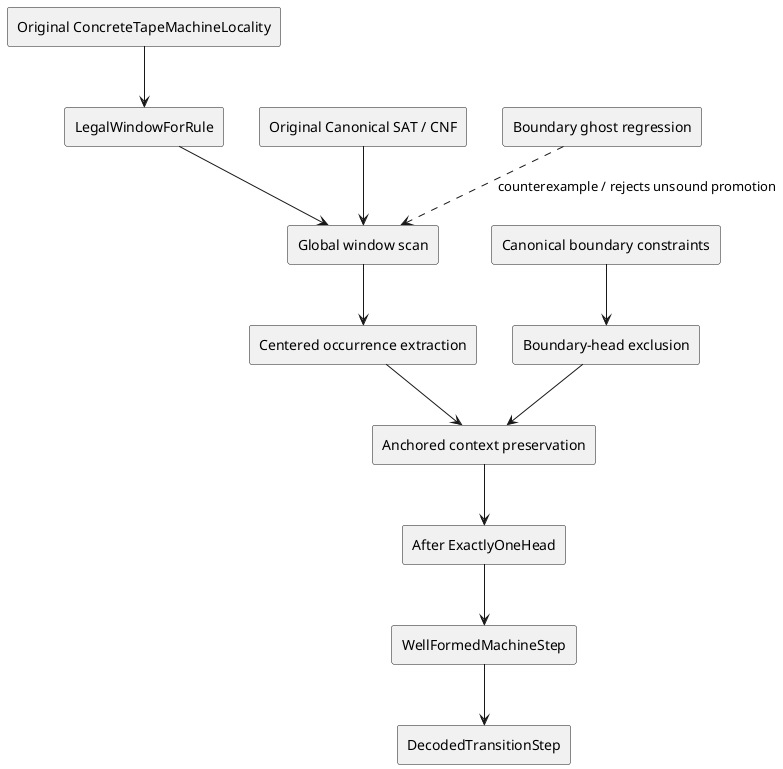
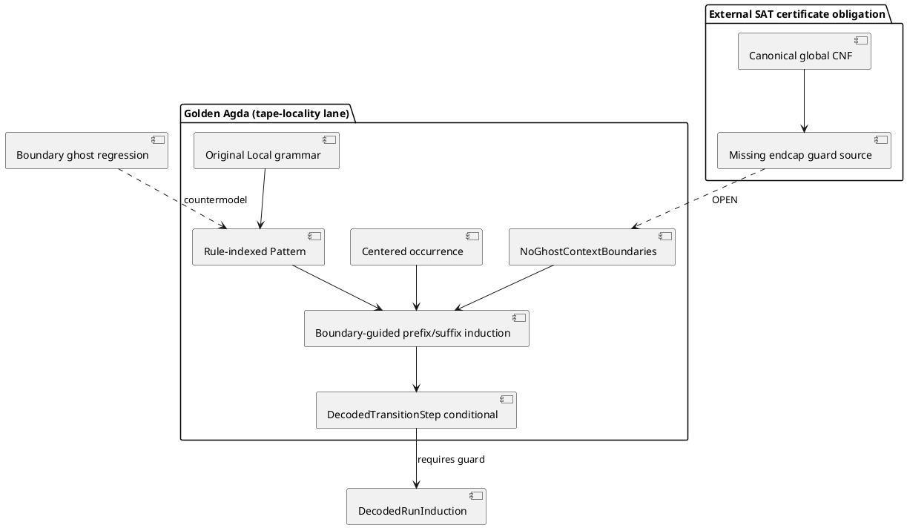

# Cook–Levin tape-locality boundary ghost — exact obstruction and repair contract

## 2026-11-06 — current max-cut implementation: endcap witness route (Agda source written)

**Authority and scope:** Golden candidate sources are the ORIGINAL `ConcreteTapeAfterUniqueFromLocalityExact.agda` and `ConcreteTapeCanonicalEndcapCNFExact.agda`; the focused `ConcreteTapeBoundaryGuardFocusedRootExact.agda` imports both. The previously reported `NoGhostContextBoundaries` remains proof relevant. `dashi_lean4` AuthorityBoundary/Loom relation status is diagnostic comparison, never the Agda compiler receipt.

**G1 (new, source-written):** `ConcreteTapeCanonicalEndcapCNFExact.plainEndcapPredicate` selects the original canonical cell-code headed flag (first bit), and `canonicalPlainEndcapCNFSound` / `canonicalPlainEndcapCNFComplete` prove literal equivalence with decoded `Pattern.IsPlainCell`. The `placedPlainEndcapSound` and `globalRowCellPlainSound` proofs transport that same literal predicate through `Rename.pullbackBits`, `Global.globalRowRename`, `Global.blockRename` and `Endpoint.liftBaseIndex`. `lastPhysicalColumn` selects an actual rightmost slot, and `globalAllRowsEndcapsCNF` compiles both physical endcaps across `allPhysicalRows (suc steps)`, with `globalAllRowsEndcapsSound` furnishing a proof-relevant per-row conjunction certificate. No alternative row codec, imaginary guard Boolean or arbitrary endcap index is used.

**G2-a (new, source-written):** `ConcreteTapeAfterUniqueFromLocalityExact.frontPlainPrefixOfAppend`, `endPlainTail`, `endPlainSuffixOfAppend` and `endPlainAfterTriple` prove that *global* decoded after-row first/last plainness entails exactly the existing, extracted-centered `NoGhostContextBoundaries` through `noGhostFromAfterRowEndcaps`. The corollary `localityScanWithInteriorAndEndcapsGivesWellFormedStep` derives the ORIGINAL `WF.WellFormedMachineStep` without accepting the false unrestricted scan lemma.

**G2-b (OPEN, decisive):** (i) use existing same-object fixed row decoder and global `Fin` block identities to transport `globalRowCellPlainSound` at first/last columns to `Pattern.FrontPlain` and `Pattern.EndPlain` on *each actual* `Step.decodedAfterRow`; (ii) conjoin `globalAllRowsEndcapsCNF` into the original `GlobalCNF.globalCookLevinCNF`, adapt both `GlobalFormulaPartsTrue` directions and `GlobalFormulaSemantics`, and prove the new guarded SAT↔run completeness over the same encoding. Its mere definition is not yet a conjunct of the old global formula.

**G3–G5 (OPEN):** furnish the resulting `NoGhostContextBoundaries` to `Step.decodedAdjacentRowsFormMachineStep` and every time-slice in `ConcreteTapeDecodedRunInductionExact`; then finish `ConcreteTapeSATToAcceptingRunExact` and the costed machine reduction. G0 exact-head Agda 2.9 focused-root kernel acceptance is still OPEN. No local Agda installation is present here.

**Finite test:** `scripts/check_karp21_canonical_endcap_cnf.py` now participates in referee preflight and its no-Agda fixture. An independent local Python equivalent exercised 33,020 exhaustive tag/payload and endcap assignments successfully. It is not an Agda compiler receipt or a proof of G2-b.


**Attribution:** Original Cook (1971) / Levin (1973) tableau method and DASHI-owned Agda original sources. The specific finite counterexample and missing boundary-anchoring distinction are DASHI audit results of 2026-11-06; do not attribute a claimed Clay result to this work. The source-related Lean `AgdaMirror/AuthorityBoundary.lean` and `AgdaMirror/LoomRelationAlgebra.lean` are auxiliary evidence/governance parallels only. **Golden:** exact source Agda 2.9 `--safe` kernel acceptance.

## O / R / C / S / L / P / G / F as a ZKP-style verification contract

- **O (organisation):** DASHI, Karp-21 / Cook–Levin machine locality proof lane.
- **R (request):** PR #1445, establish reverse whole-row locality and decoded SAT step without postulates or unsound weakening.
- **C (code):** original `ConcreteTapeMachineLocalityExact`, `ConcreteTapeLocalWindowPatternsExact`, `ConcreteTapeWholeRowLocalityExact`, `ConcreteTapeCenteredWindowExtractionExact`, `ConcreteTapeAfterUniqueFromLocalityExact`, `ConcreteTapeDecodedTransitionStepExact`; new `ConcreteTapeBoundaryGhostNoGoExact`, `scripts/check_karp21_tape_boundary_ghost.py`.
- **S (state):** user reports Agda 2.9.0/ `--safe` dependency successes and compilation halted on `ConcreteTapeLocalWindowPatternsExact` and `ConcreteTapeAfterUniqueFromLocalityExact`. These two original modules are **not** certified.
- **L (lattice):** observation → explicit counterexample / source-owned defect → repair contract → proved boundary invariant → exact-head kernel accepted → typed downstream `localityScanWithInteriorGivesWellFormedStep`. No promotion by a status string.
- **P (proposal):** distinguish locally legal windows from globally anchored overlaps; carry *boundary exclusion of phantom heads* (or equivalently a globally coherent unique rewrite anchor) as a proved SAT/tableau invariant, not a postulate. Only then reconstruct prefix/suffix plainness and the existing decoded transition step.
- **G (governance):** fail closed. Never inhabit the false universal `legalOldLeftPlainForcesNewLeftPlain`/right version. Never use `TERMINATING`, `NON_TERMINATING`, `postulate`, `trustMe`, `refl` at non-definitional equalities or status-flag promotion to evade a counterexample.
- **F (gap):** a missing **global boundary/anchoring invariant**, not merely an Agda pattern-match elaboration error.

### Preconditions as actually supplied by the original source

1. `Character.InteriorHeadConfiguration machine before`, hence `WF.ExactlyOneHead (Local.cells before)`.
2. `Character.TransitionLocalityScan machine rule before after`: the original selected rule occurs, row lengths agree, and the literal `Whole.scanWindowsCells` emits only `Pattern.LegalWindowForRule` windows.
3. The centered window is extracted by the actual `Whole.ContainsCenteredRuleWindow` / `Center.AlignedCenteredOccurrence`.

The *desired* postcondition is `WF.ExactlyOneHead (Local.cells after)`, consumed by `Character.localityCharacterizationGivesWellFormedStep` and then `ConcreteTapeDecodedTransitionStepExact.decodedAdjacentRowsFormMachineStep`. **That implication is false for the current three preconditions.**

### Exact finite counterexample

For any inhabited state/symbol carrier choose `q,q',a`, right rule `Local.tape-rule q a q' a Local.moveRight`, `P=Local.plain a`, and `H(q)=Local.headed q a`. Indices are 0..8:

```text
old: P P P P P H(q) P P P
new: H(q') P P P P P H(q') P P
start 0: right-overlap-plus-two   -- boundary phantom
start 1: legal-unchanged
start 2: legal-unchanged
start 3: right-overlap-minus-one
start 4: legal-centered realizes-right
start 5: right-overlap-plus-one
start 6: right-overlap-plus-two   -- legitimate new head
```

Both rows have length nine; the old head is interior and unique. All seven source-defined 2×3 window patterns are legal for that same rule. The new row has two headed cells, at positions zero and six, and so cannot inhabit original `WF.ExactlyOneHead`. This is not an artifact of an alternative parser or encoding.

`scripts/check_karp21_tape_boundary_ghost.py` is a deterministic executable regression on the literal constructors; the preflight referee invokes it. `ConcreteTapeBoundaryGhostNoGoExact.agda` separately uses the **original** `Local.TapeCell` and `WF.ExactlyOneHead` to construct the old uniqueness witness and refute the new one, with source literals for the centralized actual left/right rules. This finite no-go module has **not yet received a separate Agda 2.9 kernel receipt**. Avoid importing currently failing `Pattern` into this isolated owner merely to manufacture a proof result.

### Why the previously requested two-module unconditional replacement cannot exist

The original lemma

```agda
legalOldLeftPlainForcesNewLeftPlain :
  LegalWindowForRule machine rule
    (Local.six-cell-window (Local.plain a) b c d e f) →
  IsPlainCell d
```

is false for **`legal-centered Local.realizes-left`** and **`right-overlap-plus-two`**. Its right-edge analogue fails for `legal-centered Local.realizes-right` and `left-overlap-minus-two`. Changing the `rule` data *parameter* into a rule *index* fixes constructor unification, but does not repair these logical counterexamples. The recursive `afterPrefixPlainFromLegalScan` and `afterSuffixPlainFromLegalTail` then cannot be justified with their old premises. Furthermore, the nine-cell counterexample refutes the intended unconditional main `globalTransitionScanAfterUnique` theorem itself.

**Consequence:** it is mathematically impossible to preserve *all* current source semantics *and* the exact downstream unconditional `AfterUnique.localityScanWithInteriorGivesWellFormedStep` type using only replacements of the two indicated files. An attempted proof would either be inconsistent, silently change the original SAT language, or hide an unproved boundary premise.

### Concrete correction path, separated by disjoint interfaces

1. **P0 semantic grammar:** change `LegalWindowForRule` to rule-*indexed* constructors as indicated by Agda's diagnostic. Preserve genuinely true `legalPlainLeftSymbolAgreement` and `legalPlainRightSymbolAgreement`. Remove the two false universal plainness assertions; replace them with direction-sensitive cases that identify potential newly headed cells.
2. **P1 global row boundary:** define and **prove from actual canonical SAT/CNF constraints** an invariant excluding an unanchored new head at the first/last boundary (or a stronger global coherent rewrite/sentinel invariant). `ConcreteTapeHeadMarginExact` already proves motion margins **for a known well-formed step**, but cannot be used backwards to assert uniqueness under only local window legality.
3. **P2 anchored induction:** for the extracted `Center.AlignedCenteredOccurrence`, derive exact context preservation using genuine overlap adjacency plus the P1 boundary rule. Only then construct `WF.PlainCells (Center.afterPrefix extracted)` and `WF.PlainCells (Center.afterSuffix extracted)` and call the existing `WF.prependPlain`/directional `WF.headHere` constructors.
4. **P3 same-object consumer:** keep the existing public semantics `AfterUnique.localityScanWithInteriorGivesWellFormedStep` *only if* the additional boundary invariant has been proved within the source definition of the original `Character.TransitionLocalityScan` / original compiled predicate. Otherwise explicitly add a premise at the consumer and charge it to the SAT construction. Do not patch it in as an assumption.

### C4-style topology / proof-flow



### Verification / quality alignment (not claims of external certification)

Normalize owner/source/test/receipt and nonconformance logs as internal controls: ITIL incident/problem resolution; ISO 9000 corrective-action evidence; ISO/IEC 42001 and ISO/IEC 23894 model-risk governance; ISO/IEC 27001/27701 integrity and privacy provenance; ISO 9241 comprehensible error reports; Six Sigma defect reproduction and prevention; NIST AI RMF **Govern–Map–Measure–Manage** to separate the counterexample and future remediation. These are *engineering crosswalks*, not normative or certification claims.

**Current gate:** fail-closed; no Agda 2.9 exact-head receipt for two requested modules. No source-written but false theorem is promoted to Golden.

## Concurrent source update: guarded reverse-locality repair now present

At the latest source readback, a separate worker had committed updates to both requested original modules. `ConcreteTapeLocalWindowPatternsExact.agda` now declares rule-**indexed** `LegalWindowForRule` and directional classifiers `legalPlainTripleNewLeftClassified` / `legalPlainTripleNewRightClassified`, plus the true adjacent-middle propagation lemmas. It no longer claims the two false unqualified old-plain/new-plain implications. Its `FrontPlain` proves the first cell plain and `EndPlain` the final cell plain (each with a vacuous empty-row case). The previous public plain-symbol agreement theorems are retained.

`ConcreteTapeAfterUniqueFromLocalityExact.agda` now performs separate left-to-right prefix and right-to-left suffix inductions, using those classified windows. Its `globalTransitionScanAfterUnique` and `localityScanWithInteriorGivesWellFormedStep` are **conditional** on the extracted after-prefix `Pattern.FrontPlain` and after-suffix `Pattern.EndPlain`. This is a mathematically sensible strengthening: it excludes exactly the boundary-ghost family shown by the regression, without presupposing the entire new context plain. However, it changes the latter theorem's signature, and **`ConcreteTapeDecodedTransitionStepExact.agda` was still calling it with only the original scan/interior witnesses** at this readback. The exact missing same-object proof is that the actual compiled SAT/tableau source supplies the two end guards, or that those guards are already consequences of a stronger existing canonical boundary condition. Do not create an arbitrary guard oracle.

Until exact Agda 2.9 `--safe` receipts confirm the two repaired modules **and** the decoded consumer supplies verified guards, the `e20` proof root remains BLOCKED. The companion no-go remains a regression for the unguarded theorem, not a claim that the newly guarded theorem is false. The disjoint no-go lane leaves the concurrently modified original two modules untouched.

## Further concurrent interface normalization

A subsequent exact readback found the original `AfterUnique` source now packages the two required proof fields as `NoGhostContextBoundaries scan interior`, and the original `ConcreteTapeDecodedTransitionStepExact.decodedAdjacentRowsFormMachineStep` now **accepts and passes that typed record**. This supersedes the earlier observation that the decoded caller still supplied only two arguments. The typed record is a *requirement*, not its constructor or a proof that the current CNF enforces the requirement. The unresolved cut has therefore moved **upstream**: construct `NoGhostContextBoundaries` from the actual decoded row / canonical SAT boundary constraints and thread it through every SAT-to-run and polynomial-clock consumer. No such exact-head acceptance result has been observed in this session.

## 2026-11-06 guarded repair cut — original owners, no phantom-head axiom

**This section supersedes the earlier unconditional-construction proposal; the finite no-go remains valid.** The in-place `ConcreteTapeLocalWindowPatternsExact.agda` constructor has now been indexed by the actual `rule` instead of parameterised by it. The two false universal `legalOldLeftPlainForcesNewLeftPlain` and `legalOldRightPlainForcesNewRightPlain` assertions have been removed. Genuine source-level replacement lemmas `legalPlainTripleNewLeftClassified`, `legalPlainTripleNewRightClassified`, `legalPlainTripleNewLeftPlainForcesMiddlePlain` and `legalPlainTripleNewRightPlainForcesMiddlePlain` identify exactly how the original direction-indexed grammar treats an all-plain old triple.

**ZKP-style corrected judgement (preconditions / invariants / postcondition):**

```text
O = DASHI/Karp-21; R = PR #1445; C = original Local, Pattern, Whole, Center, AfterUnique, Step
S = earlier Agda 2.9 failure + deterministic boundary-ghost counterexample
L = countermodel -> explicit missing premise -> source proof -> kernel receipt
P = boundary-anchored reverse locality; G = never promote conditional proof to unconditional
F = missing canonical SAT boundary-guard producer plus exact-head compiler acceptance

PRE:
  scan     : Character.TransitionLocalityScan machine rule before after
  interior : Character.InteriorHeadConfiguration machine before
  boundary : AfterUnique.NoGhostContextBoundaries scan interior

INVARIANTS:
  old beforePrefix/suffix are PlainCells (original reconstruction owner)
  extracted centered rule has plain oldLeft and oldRight
  each all-plain old triple, given plain new outer cell, forces plain new middle
  prefix induction propagates FrontPlain from first new prefix cell forwards
  suffix induction propagates EndPlain from final new suffix cell backwards

POST:
  WF.ExactlyOneHead (Local.cells after)
  WF.WellFormedMachineStep machine before after
```

The new `AfterUnique.NoGhostContextBoundaries` is **proof-relevant**, requiring only the front cell of the aligned **after-prefix** and the last cell of the aligned **after-suffix** to be plain (vacuously satisfied for empty contexts). These are weaker than assuming all new context cells are plain. `afterPrefixPlainFromLegalScan` and `afterSuffixPlainFromLegalTail` have source-written structural proofs using them, and `localityScanWithInteriorGivesWellFormedStep` now explicitly accepts this boundary record. The genuine, intended centered move is permitted even if its new head touches a tape endpoint; guards apply only outside the selected 3-cell window.

**Same-object downstream:** `ConcreteTapeDecodedTransitionStepExact.decodedAdjacentRowsFormMachineStep` and `decodedStepAfterUnique` have been retyped to require the proof-relevant boundary record for the **same** `decodedTimeLocalityScan` and original `interior`. Their status fields were demoted to `false` until the actual canonical CNF proves the guard. `ConcreteTapeDecodedRunInductionExact` and `ConcreteTapeSATToAcceptingRunExact` also have downstream promotion flags demoted; their present invocations still need the boundary witness, and **do not kernel-typecheck unconditionally**. The focused independent `ConcreteTapeBoundaryGuardFocusedRootExact.agda` now gives the next exact compiler cut. The remaining semantic defect has been sharply localized to **CNF-derived boundary-guard production**, not generic prefix induction.

**Deterministic finite referee:** `scripts/check_karp21_tape_guarded_uniqueness_small.py` enumerates all length-3 through length-12 one-state/one-symbol pre-rows with exactly one interior head, all two-valued after-rows, all three directional grammars, and exact centered windows. An independently executed equivalent model found **237 legal centered cases** and **zero** non-unique after-rows satisfying the two boundary guards; unguarded counterexamples remain. The script is included in the actual `referee_karp21_maxcut.sh` preflight and its isolated no-Agda mock fixture. These are exhaustive *finite* computations, not an Agda 2.9 kernel proof or universal SAT boundary-CNF derivation.

**Cross-repository and normalized evidence:** Lean `AgdaMirror/AuthorityBoundary.lean` demonstrates that citation authority and artifact acceptance differ; `AgdaMirror/LoomRelationAlgebra.lean` separates evidence status and promotion, while Golden Agda remains the theorem carrier. Treat the source-owner/path, precise precondition, falsifying fixture, local test, exact compiler head, and postcondition as the normalized evidence tuple. ITIL incident/problem and ISO 9000 corrective actions represent defect lifecycle; ISO/IEC 42001, 23894 and NIST AI RMF Govern/Map/Measure/Manage represent risk tracking; ISO/IEC 27001/27701 represent integrity/privacy provenance; ISO 9241 supports understandable diagnostic presentation; Six Sigma provides reproducible regression/defect controls. These are **engineering analogies only**, not claims of conformance or certification.



**Acceptance discipline:** neither newly patched Agda source nor the new focused root has an actual latest-head Agda 2.9 `--safe` transitive acceptance receipt in this execution environment. In particular, original dependencies are not all marked `--safe`; a module import is not a receipt. No arbitrary `NoGhostContextBoundaries` witness is manufactured. The SAT-to-run and P0 Cook-Levin completeness gates must remain OPEN until the actual compiler, wire encoding, and proof producer are accepted.

## Pareto / snowball / Ibrahim donor reconciliation (existing originals only)

Cross-pollination reused **existing, typed repository governance**, without importing unrelated domain theorems into the tape proof root: `DASHI.Core.SnowballAttributionProvenanceInvariantExact` retains author, title, publication, DOI, canonical URL, source kind, formalisation relationship, proof-import status and authority status and explicitly proves that citation cannot create proof or authority. `DASHI.Wikimedia.IbrahimSnowballParetoFrontierExact` defines source-owned `ParetoFrontierLeaf` coordinates `rank`, `status`, `surface`, `paidBy`, `survivingResidual`, `completionTest`, `unlocks` and `requiresNewOntology`. `DASHI.Unified.BalabanIbrahimParetoSnowballTOEExact` separates search priority from proved results and source availability from actual receipts. These are **governance donors**; do not import their huge transitive mathematical dependencies into `ConcreteTapeBoundaryGuardFocusedRootExact`.

Apply their normalization policy here: **one disjoint tape-locality worker lane**, a single current source of truth for the `NoGhostContextBoundaries` proof producer, a finite counterexample regression shared by all affected consumers, and the minimum new source after quotienting existing `Local`, `Pattern`, `Whole`, `Center`, `AfterUnique` and `Step` owners. The high-value unpaid residual is the canonical global-CNF endcap guard. Repeatedly repairing contextual plain lemmas without that producer is dominated in the Pareto order; it cannot close SAT→run. The primary Cook/Levin historical attribution and original Agda source ownership remain intact. Compiler acceptance is a separate artifact and must be tied to exact commit and options.
