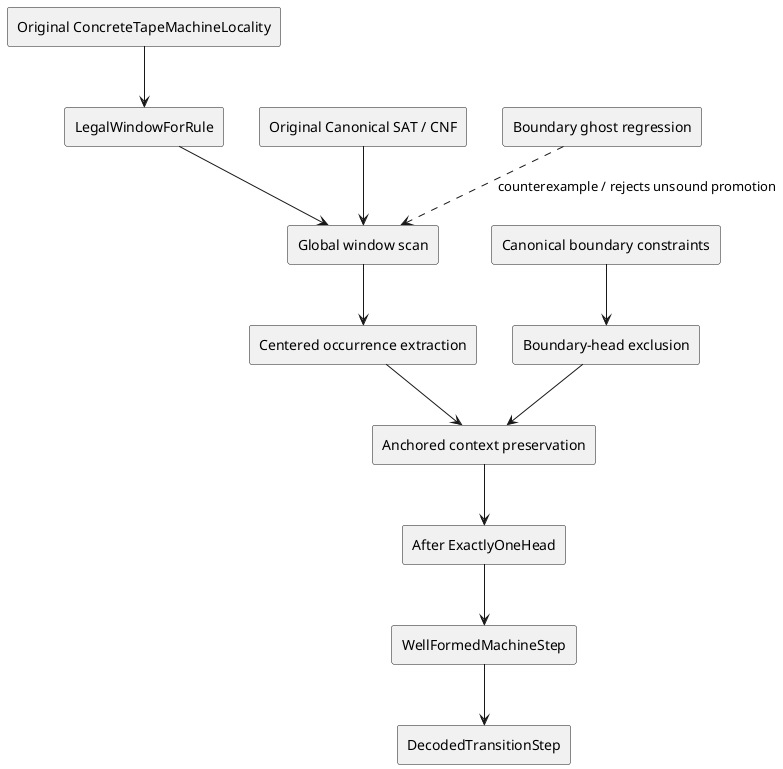

# Cook–Levin tape-locality boundary ghost — exact obstruction and repair contract

**Attribution:** Original Cook (1971) / Levin (1973) tableau method and DASHI-owned Agda original sources. The specific finite counterexample and missing boundary-anchoring distinction are DASHI audit results of 2026-11-06; do not attribute a claimed Clay result to this work. The source-related Lean `AgdaMirror/AuthorityBoundary.lean` and `AgdaMirror/LoomRelationAlgebra.lean` are auxiliary evidence/governance parallels only. **Golden:** exact source Agda 2.9 `--safe` kernel acceptance.

## O / R / C / S / L / P / G / F as a ZKP-style verification contract

- **O (organisation):** DASHI, Karp-21 / Cook–Levin machine locality proof lane.
- **R (request):** PR #1445, establish reverse whole-row locality and decoded SAT step without postulates or unsound weakening.
- **C (code):** original `ConcreteTapeMachineLocalityExact`, `ConcreteTapeLocalWindowPatternsExact`, `ConcreteTapeWholeRowLocalityExact`, `ConcreteTapeCenteredWindowExtractionExact`, `ConcreteTapeAfterUniqueFromLocalityExact`, `ConcreteTapeDecodedTransitionStepExact`; new `ConcreteTapeBoundaryGhostNoGoExact`, `scripts/check_karp21_tape_boundary_ghost.py`.
- **S (state):** user reports Agda 2.9.0/ `--safe` dependency successes and compilation halted on `ConcreteTapeLocalWindowPatternsExact` and `ConcreteTapeAfterUniqueFromLocalityExact`. These two original modules are **not** certified.
- **L (lattice):** observation → explicit counterexample / source-owned defect → repair contract → proved boundary invariant → exact-head kernel accepted → typed downstream `localityScanWithInteriorGivesWellFormedStep`. No promotion by a status string.
- **P (proposal):** distinguish locally legal windows from globally anchored overlaps; carry *boundary exclusion of phantom heads* (or equivalently a globally coherent unique rewrite anchor) as a proved SAT/tableau invariant, not a postulate. Only then reconstruct prefix/suffix plainness and the existing decoded transition step.
- **G (governance):** fail closed. Never inhabit the false universal `legalOldLeftPlainForcesNewLeftPlain`/right version. Never use `TERMINATING`, `NON_TERMINATING`, `postulate`, `trustMe`, `refl` at non-definitional equalities or status-flag promotion to evade a counterexample.
- **F (gap):** a missing **global boundary/anchoring invariant**, not merely an Agda pattern-match elaboration error.

### Preconditions as actually supplied by the original source

1. `Character.InteriorHeadConfiguration machine before`, hence `WF.ExactlyOneHead (Local.cells before)`.
2. `Character.TransitionLocalityScan machine rule before after`: the original selected rule occurs, row lengths agree, and the literal `Whole.scanWindowsCells` emits only `Pattern.LegalWindowForRule` windows.
3. The centered window is extracted by the actual `Whole.ContainsCenteredRuleWindow` / `Center.AlignedCenteredOccurrence`.

The *desired* postcondition is `WF.ExactlyOneHead (Local.cells after)`, consumed by `Character.localityCharacterizationGivesWellFormedStep` and then `ConcreteTapeDecodedTransitionStepExact.decodedAdjacentRowsFormMachineStep`. **That implication is false for the current three preconditions.**

### Exact finite counterexample

For any inhabited state/symbol carrier choose `q,q',a`, right rule `Local.tape-rule q a q' a Local.moveRight`, `P=Local.plain a`, and `H(q)=Local.headed q a`. Indices are 0..8:

```text
old: P P P P P H(q) P P P
new: H(q') P P P P P H(q') P P
start 0: right-overlap-plus-two   -- boundary phantom
start 1: legal-unchanged
start 2: legal-unchanged
start 3: right-overlap-minus-one
start 4: legal-centered realizes-right
start 5: right-overlap-plus-one
start 6: right-overlap-plus-two   -- legitimate new head
```

Both rows have length nine; the old head is interior and unique. All seven source-defined 2×3 window patterns are legal for that same rule. The new row has two headed cells, at positions zero and six, and so cannot inhabit original `WF.ExactlyOneHead`. This is not an artifact of an alternative parser or encoding.

`scripts/check_karp21_tape_boundary_ghost.py` is a deterministic executable regression on the literal constructors; the preflight referee invokes it. `ConcreteTapeBoundaryGhostNoGoExact.agda` separately uses the **original** `Local.TapeCell` and `WF.ExactlyOneHead` to construct the old uniqueness witness and refute the new one, with source literals for the centralized actual left/right rules. This finite no-go module has **not yet received a separate Agda 2.9 kernel receipt**. Avoid importing currently failing `Pattern` into this isolated owner merely to manufacture a proof result.

### Why the previously requested two-module unconditional replacement cannot exist

The original lemma

```agda
legalOldLeftPlainForcesNewLeftPlain :
  LegalWindowForRule machine rule
    (Local.six-cell-window (Local.plain a) b c d e f) →
  IsPlainCell d
```

is false for **`legal-centered Local.realizes-left`** and **`right-overlap-plus-two`**. Its right-edge analogue fails for `legal-centered Local.realizes-right` and `left-overlap-minus-two`. Changing the `rule` data *parameter* into a rule *index* fixes constructor unification, but does not repair these logical counterexamples. The recursive `afterPrefixPlainFromLegalScan` and `afterSuffixPlainFromLegalTail` then cannot be justified with their old premises. Furthermore, the nine-cell counterexample refutes the intended unconditional main `globalTransitionScanAfterUnique` theorem itself.

**Consequence:** it is mathematically impossible to preserve *all* current source semantics *and* the exact downstream unconditional `AfterUnique.localityScanWithInteriorGivesWellFormedStep` type using only replacements of the two indicated files. An attempted proof would either be inconsistent, silently change the original SAT language, or hide an unproved boundary premise.

### Concrete correction path, separated by disjoint interfaces

1. **P0 semantic grammar:** change `LegalWindowForRule` to rule-*indexed* constructors as indicated by Agda's diagnostic. Preserve genuinely true `legalPlainLeftSymbolAgreement` and `legalPlainRightSymbolAgreement`. Remove the two false universal plainness assertions; replace them with direction-sensitive cases that identify potential newly headed cells.
2. **P1 global row boundary:** define and **prove from actual canonical SAT/CNF constraints** an invariant excluding an unanchored new head at the first/last boundary (or a stronger global coherent rewrite/sentinel invariant). `ConcreteTapeHeadMarginExact` already proves motion margins **for a known well-formed step**, but cannot be used backwards to assert uniqueness under only local window legality.
3. **P2 anchored induction:** for the extracted `Center.AlignedCenteredOccurrence`, derive exact context preservation using genuine overlap adjacency plus the P1 boundary rule. Only then construct `WF.PlainCells (Center.afterPrefix extracted)` and `WF.PlainCells (Center.afterSuffix extracted)` and call the existing `WF.prependPlain`/directional `WF.headHere` constructors.
4. **P3 same-object consumer:** keep the existing public semantics `AfterUnique.localityScanWithInteriorGivesWellFormedStep` *only if* the additional boundary invariant has been proved within the source definition of the original `Character.TransitionLocalityScan` / original compiled predicate. Otherwise explicitly add a premise at the consumer and charge it to the SAT construction. Do not patch it in as an assumption.

### C4-style topology / proof-flow



### Verification / quality alignment (not claims of external certification)

Normalize owner/source/test/receipt and nonconformance logs as internal controls: ITIL incident/problem resolution; ISO 9000 corrective-action evidence; ISO/IEC 42001 and ISO/IEC 23894 model-risk governance; ISO/IEC 27001/27701 integrity and privacy provenance; ISO 9241 comprehensible error reports; Six Sigma defect reproduction and prevention; NIST AI RMF **Govern–Map–Measure–Manage** to separate the counterexample and future remediation. These are *engineering crosswalks*, not normative or certification claims.

**Current gate:** fail-closed; no Agda 2.9 exact-head receipt for two requested modules. No source-written but false theorem is promoted to Golden.

## Concurrent source update: guarded reverse-locality repair now present

At the latest source readback, a separate worker had committed updates to both requested original modules. `ConcreteTapeLocalWindowPatternsExact.agda` now declares rule-**indexed** `LegalWindowForRule` and directional classifiers `legalPlainTripleNewLeftClassified` / `legalPlainTripleNewRightClassified`, plus the true adjacent-middle propagation lemmas. It no longer claims the two false unqualified old-plain/new-plain implications. Its `FrontPlain` proves the first cell plain and `EndPlain` the final cell plain (each with a vacuous empty-row case). The previous public plain-symbol agreement theorems are retained.

`ConcreteTapeAfterUniqueFromLocalityExact.agda` now performs separate left-to-right prefix and right-to-left suffix inductions, using those classified windows. Its `globalTransitionScanAfterUnique` and `localityScanWithInteriorGivesWellFormedStep` are **conditional** on the extracted after-prefix `Pattern.FrontPlain` and after-suffix `Pattern.EndPlain`. This is a mathematically sensible strengthening: it excludes exactly the boundary-ghost family shown by the regression, without presupposing the entire new context plain. However, it changes the latter theorem's signature, and **`ConcreteTapeDecodedTransitionStepExact.agda` was still calling it with only the original scan/interior witnesses** at this readback. The exact missing same-object proof is that the actual compiled SAT/tableau source supplies the two end guards, or that those guards are already consequences of a stronger existing canonical boundary condition. Do not create an arbitrary guard oracle.

Until exact Agda 2.9 `--safe` receipts confirm the two repaired modules **and** the decoded consumer supplies verified guards, the `e20` proof root remains BLOCKED. The companion no-go remains a regression for the unguarded theorem, not a claim that the newly guarded theorem is false. The disjoint no-go lane leaves the concurrently modified original two modules untouched.
