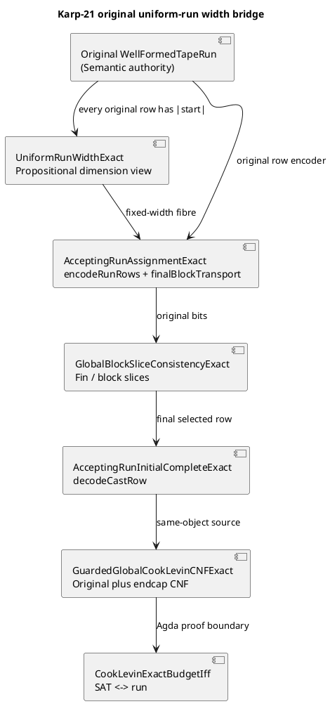

# Karp-21 original-run uniform-width proof and acceptance ledger — 2026-11-06

## O/R/C/S/L/P/G/F (proof-relevant, fail-closed)

| Key | Source-normalized value |
| --- | --- |
| **O — Organization** | DASHI / Karp-21; Agda originals are the Golden mathematical authorities; Lean mirrors are non-promoting donors |
| **R — Request / PR** | [PR #1445](https://github.com/chboishabba/dashi_agda/pull/1445), `chatgpt/karp21-reduction-transport`; compiler diagnostic: ill-typed free-row homogeneous equality and stuck `rewrite stepCanonicalLength` |
| **C — Code** | `ConcreteTapeAcceptingRunAssignmentExact`, `ConcreteTapeAcceptingRunInitialCompleteExact`, `ConcreteTapeUniformRunWidthExact`, `ConcreteTapeEncodedPaddedRunRowsExact`; `ConcreteTapeBoundaryGuardFocusedRootExact` |
| **S — State** | Source-written; original 2026-11-06 local Golden/e20 dependency receipts predate these commits. **No exact-head Agda 2.9 kernel acceptance yet.** |
| **L — Lattice** | Original run \(R\) → original time-indexed row \(R_t\) → length equality \(|R_t|=|R_0|\) → fixed-width block in original `RowsTraceWidth` → `decodeRow` / original CNF |
| **P — Proposal realized** | A one-point canonical width adaptor over the original run; no global change to `TapeRow`, `WellFormedTapeRun`, original `Fin` and CNF |
| **G — Governance** | Every Agda source owner and original theorem retained; no postulates, unsafe equality axiom, arbitrary row-width coercion, Lean-to-Agda promotion, Boolean audit flag promotion, or regression-as-proof |
| **F — Gap function** | Exact-head Agda 2.9 check of the modified originals; resolve any further elaboration diagnostics; full binary cost/remaining Karp-21 completeness separate |

## Mathematical defect and canonical design

The original `encodeRunRows` yields a vector in the fibre
\[
\operatorname{Bits}((T+1)\cdot (|R_0|\cdot w_M)).
\]
The selected final block has type \(\operatorname{Bits}(|R_0|\cdot w_M)\), while
\(\operatorname{Flat.encodeRow}(R_T)\) has type
\(\operatorname{Bits}(|R_T|\cdot w_M)\). The original step theorem supplies
propositional equality \(p:|R_0|\equiv|R_T|\), **not** judgmental equality. The previous homogeneous uncast equality was ill-typed.

Treat `Canonical.listLength ∘ Local.cells` as the **dimension functor** on the original category of rows and well-formed steps. Each original step carries an equality `stepCanonicalLength`; their composition is `runFinishCanonicalLength`. The SAT trace sits in one selected fixed-width fibre, based at the first row. This is a proof-relevant *pullback/view* rather than a replacement run type or an assumption that type indices are definitionally equal.

The canonical final-block statement is:
```agda
Slice.blockSliceBits (finalRunRowSlot run) (encodeRunRows ... run)
  ≡ Assignment.castBits
      (cong (λ n → n * Canonical.CellWidth machine)
        (sym (Assignment.runFinishCanonicalLength run)))
      (Flat.encodeRow ... finish)
```
The actual original owner `ConcreteTapeAcceptingRunAssignmentExact` implements this as `encodeRunRows_finalBlock`, with `finalBlockTransport` discharging the successor case by equality elimination (`refl`), rather than `rewrite` generalising away the original dimension. `ConcreteTapeAcceptingRunInitialCompleteExact` transports the same equality through original global trace `Fin` slices and `decodeCastRow`, then applies `Initial.decodeRow_encodeRow`.

The original `ConcreteTapeEncodedPaddedRunRowsExact.encodedPaddedRunRowAt` similarly uses `encodedTailBlockTransport` with both original equalities (the step and the selected source row), rather than abstracting a free row width while constructing the dependent pair. The proof-relevant view `ConcreteTapeUniformRunWidthExact.originalRowAt`, `everyOriginalRowHasTableauWidth`, `originalFixedWidthRowAt`, `originalFinalRowAtFinalSlot`, and `originalRunToFixedWidth` exposes each original row at the same selected column index.

## ZKP: preconditions, invariants, postconditions

**Preconditions**: `Run.WellFormedTapeRun machine start rows finish`, original `WF.WellFormedMachineStep` for every transition, `Assignment.stepCanonicalLength` and `Assignment.runFinishCanonicalLength`, selected `Global.Slot`, source `Flat.encodeRow`, and the original `Canonical.CellWidth machine`. For guarded completeness, separately provide the proven `Margin.HeadMargin` and accepting-run witness.

**Invariants**: (1) all selected source rows have the same canonical cell count **propositionally**; (2) every bit vector is extracted from the identical original SAT assignment; (3) the only cast is justified by a source-generated equality and is eliminated by matching `refl`; (4) row indices and number of physical rows remain unchanged; (5) actual base/selector/accepting-witness layout is preserved.

**Postconditions**: final original block equals the final row encoding transported into the start fibre; final decoded row equals the actual final row; every `Global.Slot` yields a source-original row with a width certificate. These are **Agda source-written** proof candidates until the exact source SHA is accepted by the Agda 2.9 kernel.

## C4 / PlantUML component diagram



## Quality, risk and standard reference mapping (not certification claims)

- **ITIL / ISO 9000**: stable original module ownership, change record, reproducible acceptance criteria and first-real-error triage.
- **ISO/IEC 42001, ISO/IEC 23894 and NIST AI RMF**: explicit risk of promoting a source proof or bounded test as a certified theorem; fail-closed governance and test evidence separation.
- **ISO/IEC 27001 / 27701**: retained revision provenance and minimisation of unnecessary row/input material; no claim of compliance or handling of sensitive inputs here.
- **ISO 9241**: diagnostics/receipts expressed as clear human-reviewable preconditions, invariants, postconditions and next exact lemma.
- **Six Sigma**: defect = an ill-typed equality; root cause = fibre-index mismatch; containment = one canonical width adaptor; control = original focused root and static referee regression.

## Disjoint nonblocking lanes (one source owner per worker)

1. **A / Dimension lane**: `AcceptingRunAssignmentExact` and `UniformRunWidthExact`. Owns the canonical start/finish equality and row-slot fibre. Never changes SAT semantics or cost roots.
2. **B / Decode lane**: `AcceptingRunInitialCompleteExact` and `EncodedPaddedRunRowsExact`. Owns original `Fin`/block-slice and dependent decode compatibility. Never introduces new bits or widths.
3. **C / SAT/clock lane**: `CookLevinExactBudgetIff`, `CookLevinSizeClosedExact` and original bit-tape clocks. Uses A/B proofs as dependencies; cannot promote them without Agda acceptance.
4. **Verification/Governance lane**: `referee_karp21_maxcut.sh`, full original roots, roadmap/attribution. Does not alter mathematical proof terms.

These are **disjoint proposed ownership boundaries**, not a claim that independent workers executed in this turn.

## Verification ledger

- Existing supplied local receipts: `preflight` / `golden` and the listed previously accepted Agda dependencies. These precede this exact-head edit; they do **not** certify the changed final-row owners.
- This turn: deterministic bounded indexed-row slicing model, 1,008 fixed-width physical-row cases passed independently. `scripts/check_karp21_uniform_row_width.py` is wired into preflight as source/finite-regression guard.
- Required for promotion: `bash scripts/referee_karp21_maxcut.sh all` at a pinned SHA with Agda 2.9, including `ConcreteTapeBoundaryGuardFocusedRootExact` and `Karp21Everything`. First subsequent Agda error determines the next mathematical adjustment.
- Unpaid separately: actual compiler machine-time polynomial bounds; remaining N21/E20 native verification and E01–E19/P3 certified network closure.

## Attribution and external technique

The original SAT hardness and reduction work is attributed to Cook and Levin; McBride's with-abstraction and the Agda 2.9 official documentation explain the elaboration phenomenon, without being an in-repo theorem. Cross-lane reuse of the Lean `AgdaMirror/AuthorityBoundary.lean` and `AgdaMirror/LoomRelationAlgebra.lean` is for governance modeling only. No Lean evidence is promoted into Agda. See official Agda 2.9 `with` documentation: https://agda.readthedocs.io/en/latest/language/with-abstraction.html .
