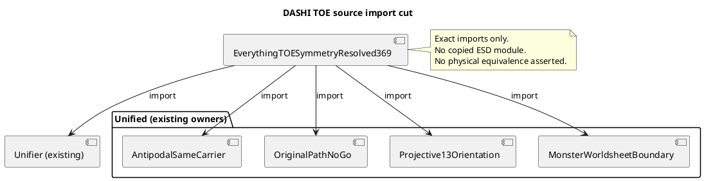

# TOE 369 source import convergence — O/R/C/S/L/P/G/F

Date: 2026-10-27. Owning branch: Agda PR #1249. Status: exact GitHub import/source audit passed; Agda kernel and local preflight unavailable.

## O — Objective

Connect the existing original 27-site, punctured-26, projective-13 and Monster-worldsheet *boundary* proofs to the existing `DASHI.EverythingTOESymmetryResolved369` aggregate. Reuse `DASHI.Unifier`. Do not construct new data carriers. Do not make ESD changes.

## R — Resources and original owners

- Root: `DASHI/EverythingTOESymmetryResolved369.agda`; existing source already imports `DASHI.Unifier`, `DASHI.Unified.PNFHyperfabric` and `DASHI.Unified.Physics`.
- Existing source `DASHI.Unified.Hyperfabric27MinusOneAntipodalSameCarrierCutExact`: original centered ternary 27-point antipodal graph.
- Existing source `DASHI.Unified.Hyperfabric27MinusOneOriginalPathInvariantNoGoExact`: original nonorigin 26-site path closure counterexample.
- Existing source `DASHI.Unified.HyperfabricPunctured27Projective13OrientationExact`: native finite 13-axis signed orientation and odd graph-cover holonomy.
- Existing source `DASHI.Unified.HyperfabricMonsterBosonicWorldsheetExistingOwnerCutExact`: source-dependent chiral central-charge bookkeeping, explicitly not BRST or physical evidence.
- Historical external original mathematical authors remain Robert L. Griess Jr. (1990) for the original exceptional algebra, Sah (1974) and Griess (1976) for splitting, Gross (1974)/Gross–Tucker (1977) for classical voltage graph terminology, and Chen–Lam–Shimakura for the genuine separate VOA. Do not transfer their achievements to a meta-introspector or DASHI implementation. Keep each repository's own code authorship. No external meta-introspector content was copied in this change.
- Source-search result: searches for `EverythingTOESymmetryResolved369`, `Unifier`, existing Unified proof owners and `related_symbols` were completed before this change. The preflight source implementation exists under `tools/agda_preflight`, but its running service was **not** accessible here; no preflight `related_symbols` / `discover` / `round_lineage` result is claimed.
- Latest PRs inspected: #1266 observer source no-go; #1271 NS local estimate; #1241 KK/LARES observable discriminator; #1249 native graph. They are different consumer lanes and must not be silently merged.

## C — Constraints

1. Do not edit any `ESD`, `digital_esd` or `dashi_digital_esd` path. Imports may consume read-only sources only.
2. Avoid a new copy of `Unifier`, cube, Jordan algebra, Monster VOA or preflight service.
3. Keep direct imports acyclic. A source module does not imply a physical interpretation.
4. Do not promote a source-written `refl` or a local Python pass to a kernel proof.
5. Use active, unambiguous statements. Each result must have one source owner.

## S — State and invariant

Before: the TOE aggregate already imported the common unifier, physics, PNF, and Horn/topology donors. It did not import four already implemented Unified owner modules listed above.

Invariant: all existing definitions remain unchanged. Each new edge is one `import` of an existing module. The aggregate owns no duplicate domain definition. The ESD write set is empty. Existing negative gates stay negative.

## L — Lanes (disjoint, nonblocking)

- **Lane 1: native graph.** Owner: PR #1249 and `DASHI/Unified/`. Action: four already existing proof-owner imports. No ESD changes.
- **Lane 2: published algebra.** Owner: PR #1239 and Lean #52. Action: read-only source and independent finite receipts. No new Albert-to-TOE physics theorem.
- **Lane 3: unrelated physical observers.** Owners: PRs #1266, #1271 and #1241. Action: source audit only. No merge or new dependency unless a same-operator witness is proved.
- **Lane 4: meta-introspector and casey-git-clone/zkSEC.** Preserve external repository author credits and provenance. No content copied without a verified owner and a concrete necessary import.

## P — Preconditions and postconditions

Precondition: the root and all five checked existing modules have exact matching `module` declarations and lie on the same PR #1249 branch.

Postcondition: the root contains imports of `DASHI.Unifier` and all four above Unified proof owners, and GitHub file lookup confirms their paths. The ESD diff is empty.

Acceptance receipt (GitHub exact-path audit on current PR #1249 branch):
- Five source paths fetched.
- Five import statements present in TOE root.
- Five module declarations matched their paths.
- Zero missing imports.
- Root contains 12 direct imports after change.
- Commit: `9247081a80bb86e73ed18660c6ba5a70d9e5aede`.
- Root blob checked after commit: `efb327909940af74fbc69e3a58ebbac5fd088e20`.

This is **import-graph structural verification**, not Agda typechecking or full dependency compilation.

## G — Governance and risk controls

Apply as **process objectives**, not certificates of compliance: ITIL change and configuration records; ISO 9000 evidence trace; ISO/IEC 42001 AI management ownership; ISO/IEC 27001 access/change boundaries; ISO/IEC 27701 privacy scope; ISO/IEC 23894 AI-risk register; ISO 9241 plain usability and task wording; NIST AI RMF Govern/Map/Measure/Manage; Six Sigma measured defect checks.

Defect metrics for this limited change: zero direct import duplicates, zero missing exact target module declarations, zero edited ESD files. These checks do not measure type-correctness or satisfy a complete standard.

## F — Formal/physical boundary

The existing original spatial 26-site subset is not path-closed because a nonzero site is adjacent to the removed origin. The 13-axis signed quotient retains its sign information. Original finite cubic labels, rational Albert J0, Weyl E8 root representations and true Monster Moonshine VOA are distinct carriers. A central-charge sum is only bookkeeping. No experimental, continuum, TOE-completeness, BRST or same-object physical theorem follows from import visibility.

### C4/PlantUML import diagram

## Next highest-value acceptance gate

Run `dashi-agda-preflight` related-symbol discovery and lineage over these four module names in the local referee's indexed checkout. Then run the Agda compiler on the root. If either fails, repair the **existing original owner module** or revert only the failing import. Do not add an alternate surrogate proof or claim completion of the TOE.
