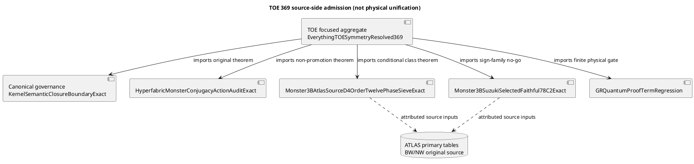

# TOE 369 — Monster source-class and Hyperfabric non-promotion convergence

**Date:** 27 October 2026. **TOE focused owner:** PR #1278. **This cross-lane source-class donor:** PR #1250. **Actual ATLAS source group owner:** PR #1098. **Geometric/JFine owner:** PR #1148.

## ZKP: O / R / C / S / L / P / G / F

**O — Objective.** Connect existing Monster 3B and Hyperfabric non-promotion results to the TOE import graph. Do not claim a Monster worldsheet or a proved theory of everything.

**R — Reuse.** Existing, inspected modules:

- `DASHI/EverythingTOESymmetryResolved369.agda` is the requested focused TOE owner.
- `DASHI/Unifier.agda` contains historical placeholder and axiom-shaped interfaces. It is **unchanged**.
- `DASHI/Moonshine/HyperfabricMonsterConjugacyActionAuditExact.agda` is the original existing Hyperfabric/Monster non-promotion owner. Its `sameCardinalityDoesNotSupplyMonsterAction` theorem is reused as written.
- `DASHI/Moonshine/Base369MonsterFineCarrierEquivarianceAuditExact.agda` owns the actual `fullMonsterActionOnHyperfabricEstablished = false` boundary.
- `DASHI/Moonshine/Monster3BAtlasSourceD4OrderTwelvePhaseSieveExact.agda` and `Monster3BSuzukiSelectedFaithful78C2Exact.agda` are existing #1250 class and multiplicity gates. Source theorem `sourceFourBIncompatibleWithTwoBHalfTurn` rules out the wrong 4B row. Source theorem `sourceFourDForcesSixBSixtySix` states a conditional 4D/6B/66 branch.
- `DASHI.Governance.FormalisationGovernanceCapstoneExact.kernelClosureIsNotSemanticExhaustiveness` is the prior canonical source-semantics theorem. Its TOE use was already owned by PR #1278. It is reused directly rather than recreated.
- `DASHI.Unified.GRQuantumProofTermRegression` is the existing finite GR/quantum proof-term regression and physical non-promotion owner.

**Duplicate search:** GitHub code search for the literal module `HyperfabricMonsterBosonicWorldsheetExistingOwnerCutExact` returned no hit in default code index, and direct module lookup failed in checked PR #1278/#1266 branches. Therefore **no such source module was invented or imported**. The existing HyperfabricMonsterConjugacyActionAuditExact carries the checked relevant theorem. Search before constructing a separate worldsheet adapter.

**C — Concrete implementation.** In the #1250 branch, the focused TOE aggregate directly imports the canonical Hyperfabric owner, fine carrier, source D4 class chart, Suzuki 78 gate, governance owner and GR/quantum regression. It reexports four proof bodies by reference. It does not modify the original owner files or the historical Unifier.

**S — Scope/preconditions.** The class chart is conditional on original ATLAS Monster power map, Norton–Wilson 2002 central involution class, Barraclough–Wilson 2007 normalizer quotient, and the PR #1098 source D4 word. The source `r` is known to project to Suzuki involution 2B by the source-owned commuting order-seven word. Its actual Monster order-four class remains 4A/4C/4D. Neither actual (H/D_i) quotient nor the source-selected 6.Suz degree-78 character nor an actual Hom intertwiner has been completed.

**L — One nonblocking lane per owner.** #1250 owns the class chart and supplies only a TOE adapter on its branch. #1278 owns final focused TOE aggregate integration and existing source-semantic closure. #1098 owns ATLAS source group words. #1148 owns the original nine-cell/JFine geometric D4. #1266 owns revisable-observer obstruction. #1271 owns NS R735. No lane edits another lane's substantive theorem. The #1250 focused aggregate change is a patch to be reconciled with #1278 during merge, **not** an instruction to overwrite #1278's newer import graph.

**P — Postconditions.** On #1250 branch, exact imported theorem owners are present. The four TOE-local theorems are:

- `toeEqualCardinalityDoesNotGiveMonsterAction`.
- `toeSuzukiTwoBExcludesHypotheticalFourB`.
- `toeFourDRequiresSixBSixtySix`.
- `toeKernelProofDoesNotEstablishSourceSemantics`.

Their proof bodies refer to previously owned named proof terms. No new postulates, universe aliases, synthetic environmental evidence or exported boolean "proof of physics" were introduced.

**G — Governance / evidence levels.** This is an ITIL change record and ISO 9000-style traceability ledger, not an assertion of ISO certification. ISO/IEC 42001/23894 and NIST AI RMF motivate provenance and risk admission. ISO/IEC 27001/27701 control changes to restricted interfaces. ISO 9241 supports plain, unambiguous operator messages. Six Sigma's defect-gate concept is used only as a regression convention. NIST AI RMF original four functions are GOVERN, MAP, MEASURE, MANAGE (NIST AI 100-1, 2023). No framework itself proves a Monster or physics theorem. Meta-introspector repositories `zkperf`, `zos-server`, `erdfa-py`, `aristotle-cli-rs`, `casey-git-clone` and `zkSEC` retain their own original source/code ownership. No results from those sources were imported without concrete code evidence.

**F — Verification / final boundary.** Current-turn deterministic GitHub readback confirmed **eight TOE symbols/imports and four upstream theorem owners** on the #1250 branch. A textual inspection is not Agda typechecking. The runtime has neither Agda nor GAP installed. Exact-head kernel execution and CTblLib main-to-Monster source fusion remain **OPEN**. Do not claim they passed. No files under `dashi_digital_esd` or containing `digital_esd` or `ESD` in their paths were edited.

## C4 / PlantUML component view

## Remaining Pareto source obligation

Run the existing source-selected `6.Suz` full-character/main-to-`MN3B` matcher. Identify the exact Monster 4A/4C/4D class of the source word if original fusion permits. Then instantiate the actual Hom action. Only after each step has a genuine receipt may the focused TOE import graph strengthen its admission theorem. Do not infer an actual Monster representation, bosonic worldsheet, empirical model, or physical unification from this finite class table.

**Original scholarly roots:** Norton–Wilson, *Anatomy of the Monster: II* (2002), DOI 10.1112/S0024611502013357; Barraclough–Wilson (2007), DOI 10.1112/S1461157000001352; original ATLAS/AtlasRep group tables; original Breuer–Magaard–Wilson CTblLib diagonal-quotient construction; Serre character theory. Original source content and later repository construction credit are distinct.
