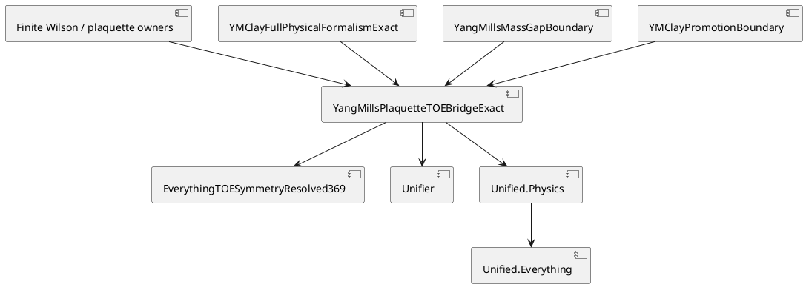

# Yang-Mills plaquette to TOE convergence — 2026-10-27

Status: architecture and verification note. This file is not theorem authority.

## ZKP frame

### O — objective

Connect the exact finite Wilson and plaquette theorem owners to the focused DASHI TOE graph.

Connect exact Yang-Mills non-promotion theorems to the same graph.

### R — reuse

Use these existing owners.

- `SUNWilsonAction`: finite SU(N) Wilson gauge invariance.
- `BalabanSU2WilsonPlaquetteSecondJetExact`: exact SU(2) plaquette second variation.
- `BalabanP33PhysicalFlatWilsonCurlIdentificationExact`: physical flat Wilson and periodic curl identity.
- `BalabanPlaquetteCrossChargeZeroFloorNoGoExact`: exact zero-field cross-charge theorem.
- `BalabanClayT4BetaNormalizationConventionExact`: exact rational one-loop convention.
- `YMClayFullPhysicalFormalismExact`: current Route-S and Level-2 Pareto facts.
- `YangMillsMassGapBoundary`: exact mass-gap and Stone-Hamiltonian non-promotion.
- `YMClayPromotionBoundary`: exact Clay non-promotion.

Do not copy these theorem bodies into a second TOE surface.

### C — concrete result

The normalized owner is:

`DASHI/Physics/YangMills/YangMillsPlaquetteTOEBridgeExact.agda`.

Its regression root is:

`DASHI/Physics/YangMills/YangMillsPlaquetteTOEBridgeValidation.agda`.

### S — invariants

- A finite plaquette theorem is not a continuum Yang-Mills theorem.
- A finite or selected spectral target is not a physical Stone-Hamiltonian theorem.
- A rational beta convention is not a physical RG-coefficient identification.
- The zero physical field blocks an unconditional positive cross-charge floor on a carrier that contains zero.
- A TOE import edge cannot promote Clay Yang-Mills.
- ESD and digital_esd surfaces are not edited.

### L — lane

This lane owns only plaquette-to-TOE normalization.

Meta-introspector repositories provide process and tooling precedent only.

The relevant precedent includes deterministic inventory identity, deduplication, dependency graphs, and proof-chain capture.

No theorem is imported from those repositories into the Yang-Mills theorem cone.

### P — postconditions

The focused TOE aggregate reaches the exact plaquette bridge.

`DASHI.Unifier` imports the exact bridge without changing its historical placeholder interfaces.

`DASHI.Unified.Physics` exposes direct mass-gap and Clay non-promotion projections.

`DASHI.Unified.Everything` reaches the bridge through `DASHI.Unified.Physics`.

### G — governance

Original mathematical attribution remains in each theorem owner.

Wilson owns the Wilson-action source root.

Bałaban owns the constructive RG and localization source roots.

Gross, Wilczek, Politzer, Dashen, and Gross retain the one-loop and lattice/continuum coupling attribution recorded by the beta-convention owner.

The bridge claims no standards certification.

### F — verification

Required deterministic checks:

1. Read back the bridge and validation files.
2. Confirm each referenced full-formalism theorem name exists.
3. Confirm the three TOE entry points import or project the bridge.
4. Confirm no changed file is an ESD or digital_esd surface.
5. Scan the bridge tranche for trust escapes.
6. Keep kernel certification separate from source/static verification.

## Current Pareto state exposed to TOE

Route S remains the least-privilege mass-gap route.

The current H1 owner has one theorem-bearing field.

The historical published-localization wrapper is not mandatory for canonical H1.

The source envelope is not mandatory between H1 and R387.

D1 requires no new analytic inequality.

D2 requires no second mixing-map abstraction.

A bare D2 transport ABI does not establish physical mixing.

D2 requires no independent physical one-step recurrence proof after the generated recurrence compiler.

D2 same-family composite convergence remains physical.

D3 rejects a perturbation-independent Ward-charge sequence.

## C4 view

System: DASHI TOE.

Container: Yang-Mills exact theorem graph.

Component: `YangMillsPlaquetteTOEBridgeExact`.

Upstream components: finite Wilson/plaquette owners, full physical formalism, mass-gap boundary, Clay promotion boundary.

Downstream components: `EverythingTOESymmetryResolved369`, `Unifier`, `Unified.Physics`, then `Unified.Everything`.

## PlantUML

## Process-control mapping

These are engineering process mappings. They are not certification claims.

- ITIL: one owned service surface and explicit change boundary.
- ISO 9000 family: named owners, repeatable verification, and nonconformity visibility.
- ISO/IEC 42001: explicit AI-assisted provenance and claim boundary.
- ISO/IEC 27001 and 27701: least-privilege repository scope and no unrelated data-surface edits.
- ISO/IEC 23894 and NIST AI RMF: explicit risk boundary between source evidence, compiler result, physical inhabitant, and promotion.
- ISO 9241: simple status language and one canonical navigation path.
- Six Sigma: remove duplicate theorem carriers and reduce handoff defects.
- C4 and PlantUML: keep the dependency path inspectable.

## D2 source-entry soundness result

Published source entry does not pay D2a.

`BalabanSourceNativePublishedFlowEntryExact` proves that the strong state uses the published CMP119/CMP122 density and source coordinates.

The strong-state record stores the composite insertion as an extra consumer coordinate.

`YMClayLevel2D2SourceEntryInsufficiencyExact` proves this separation constructively.

It replaces the composite insertion while preserving every other strong-state coordinate.

The exact published-flow entry then recompiles.

Therefore:

- published source entry does not determine the composite insertion value;
- published source entry does not prove composite insertion/blocking naturality;
- D2a still needs the actual one-step insertion/blocking law;
- no second state-entry theorem is needed.

This is a non-implication theorem.

It does not add a new physical hypothesis.
