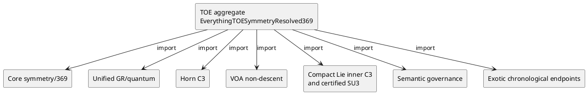

# TOE convergence receipt — 27 October 2026

## O — Objective

Use `DASHI/EverythingTOESymmetryResolved369.agda` as the focused TOE
import aggregate. Keep `DASHI/Unifier.agda` as historical context.
Treat the current `DASHI/Unified/` proofs as original owners.
Do not equate kernel-valid mathematics with a complete physical TOE.

## R — Reuse search and original owners

GitHub code search returned the canonical TOE aggregate,
`DASHI/Physics/Closure/TOESymmetryResolved369BridgeExact.agda`,
`DASHI/Core/SymmetryResolvedFibreExact.agda` and
`DASHI/Unified/GRQuantumProofTermRegression.agda`.
GitHub code search did not index all topology branch changes.
Exact paths were therefore read directly on #1244 and #1254.

| Source owner | Exact reuse | Non-promotion condition |
| --- | --- | --- |
| #1244: `AlexanderHornedC3FiniteStageExact` | `rotationCommutesAtEveryFiniteStage` | An abstract C3 word rotation does not identify an ambient embedding |
| #1244: `AlexanderHornedC3VOAKernelBidiExact` | `cannotRecoverExteriorGroupFromSelectedVOAActor` | A nonfaithful finite actor does not recover the source group |
| #1244: `CompactLieInnerC3Exact` | `innerC3FromElementCube` | A cube-one group element is an explicit precondition |
| #1244: `AlexanderHornedC3SUNLieGroupReuseExact` | `sun3HornAction` and existing certified SU3 group | A Gotô commutator section and actual matrix theory are explicit inputs |
| #1278: `FormalisationGovernanceCapstoneExact` | `kernelClosureIsNotSemanticExhaustiveness` | A proof does not establish full source semantics |
| #1254: `ExoticHornChronologicalCantorConsumerExact` | actual chronological endpoint-cylinder inclusion | A clopen endpoint event is not a clopen wild exterior |
| Existing: `EverythingSSPRepresentationReductionRound9` and `TOESymmetryResolved369BridgeExact` | canonical 369/TOE graph | No Monster 3B same-object representation by analogy |

Original mathematical attribution is retained.
Alexander (1924) owns the horned sphere construction.
Hatcher (2002) owns his abstract horn-group exposition.
Morikuni Gotô (1949), DOI 10.2969/jmsj/00130270, owns the
single-commutator theorem for compact connected semisimple groups.
The DOI page was checked against the original journal record.
DASHI authors own their Agda source implementations.
Meta-introspector projects `zkperf`, `zos-server`,
`erdfa-py` and `aristotle-cli-rs` retain their original
repository attribution. No code was copied or modified in those
repositories. Do not infer proof provenance from a similar file name.

## C — Current change and C4 model

The existing TOE aggregate imports the listed proof owners.
It exports the all-depth horn rotation theorem and the selected
VOA source-recovery no-go. It also reuses the canonical governance
non-promotion theorem. The compact Lie and SU3 bridge remain
import-only. Their concrete matrix and Gotô preconditions are not
discharged by this aggregate.

A C4/PlantUML source model is:

## S — Preconditions, invariants, and postconditions

**Preconditions.** Use the exact current parent #1244 sources.
Keep all group carriers separate. Supply the cube-one witness
for the compact Lie theorem. Supply the actual nonfaithful-actor
witness for VOA information loss. Supply the certified SU3 matrix
carrier and a Gotô section before claiming an SU3 horn action.

**Invariants.** Reuse each original theorem without truncation.
Do not create a duplicate group, VOA or C3 carrier. Do not identify
the symbolic horn group with a wild geometric complement.
Do not equate finite equivariance, kernel success, or actor quotient
with an experimental result or complete TOE.

**Postconditions.** The TOE import graph exposes the canonical
C3 finite-depth and VOA non-recovery results. The original source
modules remain unchanged. The physical and geometric promotion
gates remain open.

## L — Disjoint nonblocking lanes

| Lane | Owner | Permitted write surface | Gate |
| --- | --- | --- | --- |
| TOE consumer | This #1254 branch | `EverythingTOESymmetryResolved369.agda` and its focused verification configuration | Exact Agda kernel check |
| Horned geometry | Parent #1244 | Original Alexander C3, VOA and compact Lie proof owners | Exact pinned source/geometry certificates |
| Canonical semantics | PR #1278 | Original semantic TOE guard | Keep this original owner; reconcile imports at merge |
| Observer/revisability | PR #1266 | Existing observer proof owner | Import only |
| NS estimates | PR #1271 | NS R735 proof owner | No cross-domain theorem without exact typing |
| Zipf family | PR #1275 | Source-typed statistical proof owner | No TOE inference from matching counts |
| ESD | `dashi_digital_esd` and `*digital_esd*` / `*ESD*` | **No writes** | Import only |
| Meta-introspector | `zkperf`, `zos-server`, `erdfa-py`, `aristotle-cli-rs` | **No writes in this cut** | Preserve original authors, history, and proof trace |

## P — Deterministic verification

The focused #1254 workflow attempts
`agda -i . DASHI/EverythingTOESymmetryResolved369.agda`
with Agda 2.6.4.3 and stdlib 2.1, matching the existing #1278
TOE workflow approach. A workflow file is not an executed proof.
The available execution container has no `agda`,
`lean` or `dashi-agda-preflight` executable.
No `related_symbols`, `discover` or `round_lineage`
receipt is claimed.
Read-back static checks confirm the import graph contains
the Horn C3, VOA, compact Lie, SU3 and governance owners
and does not import `DASHI.Unifier`.
Static import checks are not Agda type checking.

## G — Governance mapping

| Control | Applied interpretation | Testable evidence |
| --- | --- | --- |
| ITIL and ISO 9000 | One authoritative source and controlled change | Parent SHA, child commit, original path |
| ISO/IEC 42001 and ISO/IEC 23894 | Manage risk from ungrounded AI/physics claims | No-promotion preconditions and limitations |
| NIST AI RMF | Govern, Map, Measure and Manage the source-to-claim risk | This claim/owner/gate table |
| ISO/IEC 27001 and 27701 | Restrict writes and preserve origin/privacy boundaries | ESD/meta-introspector read-only rule |
| ISO 9241 and ASD-STE100 | Use direct words and task-centred review | Explicit status and one-condition-per-line gates |
| Six Sigma | Keep deterministic failure cases and proof receipts | Exact-head kernel result and finite regression counts |
| C4/PlantUML | Show one import owner per relation | Diagram above |

These mappings describe the workflow. They do NOT claim
ISO certification or compliance certification for the repositories.

## F — Result and future acceptance

The TOE graph now exposes the finite C3 and VOA restrictions
without new group constructors. The compact Lie and certified
SU3 modules remain the exact mathematical providers.
The integration has not established the analytic Gotô
section inside the repository. It has not identified the
abstract Alexander group with the complement group of an
embedded wild object. It has not proved a complete TOE.

The next release gate is a successful exact-head Agda kernel
check of the aggregate, followed by source-specific same-object
geometry and physical correspondence checks. PR #1278 and #1254
modify the same aggregate path. Reconcile their original theorem
consumers before merging either into `master`.
