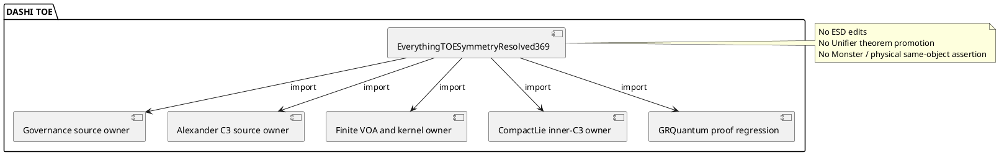

# TOE 369 — one-owner integration, 27 October 2026

## ZKP: O / R / C / S / L / P / G / F

**O — Objective.** Connect existing Alexander C3, VOA, and compact-Lie
proofs to the canonical TOE import graph. The import owner is
`DASHI/EverythingTOESymmetryResolved369.agda`.

**R — Reuse.** GitHub code search located the existing
`Core.SymmetryResolvedFibreExact` and TOE closure imports.
It did not index the branch-local `CompactLieInnerC3` or VOA
modules. Direct exact-branch file inspection found those modules.
PR #1278 already owned the semantic-promotion guard.
This tranche reused that guard. It did not duplicate its proof.

**C — Constraints.** Do not write to `dashi_digital_esd`,
`*digital_esd*`, or `*ESD*`. Do not import the placeholder
theorems in `DASHI.Unifier`. Do not modify `DASHI/Unified/`.
Keep meta-introspector source ownership. Keep Alexander 1924,
Hatcher, CompactLieGroupCore/Derived, and the finite VOA author
roles separate.

**S — Sources and scope.** Imports connect existing theorem
surfaces. Importing two C3 actors does not identify them.
The generic inner action is not a theorem about a particular
nonabelian compact Lie group without a selected instance.
The finite VOA quotient cannot recover a source group word
identified by the actor quotient. It does not establish the
actual wild exterior fundamental group or the Monster 3B action.

**L — Lanes.** Each lane owns one nonblocking task.
- Lane T: the already-existing Alexander horn C3 and endpoint
  cylinder proofs. Import-only.
- Lane V: the original finite VOA actor and nonfaithful-kernel
  consumer. Import-only.
- Lane C: the existing compact-Lie inner-C3 proof. Import-only.
- Lane G: the canonical governance theorem from PR #1278.
  Import-only.
- Lane I: the TOE aggregate and import-graph validator.
  This is the only source-writing lane in this tranche.

**P — Preconditions and invariants.** Every imported Agda
module must exist under its exact declared module path.
The TOE aggregate must import each canonical owner once.
The TOE semantic guard must remain false.
The selected VOA actor recovery theorem must keep its
original `NonfaithfulVOAGroupActor` premise. ESD sources
must remain unchanged. Import-only work must not claim
new physics.

**G — Gates and postconditions.**
- G0: GitHub direct fetch confirmed all 12 imported module paths
  and declared names on the child branch. PASS.
- G1: The repository now contains a deterministic import-graph
  guard and a focused workflow step. SOURCE-WRITTEN.
- G2: The TOE aggregate imports topology, VOA, Lie and governance
  owners and exposes the original typed VOA non-recovery theorem.
  SOURCE-WRITTEN.
- G3: Agda 2.6.4.3 exact-head typecheck. NOT VERIFIED.
- G4: Same-object Alexander wild exterior/group and physical
  TOE closure. OPEN.

**F — Follow-up and failure rule.** If G3 fails, repair the
exact referenced theorem or import type. Do not introduce
axioms, fake models, or another abstraction. If a source
is available only on a stacked branch, keep the stack or
perform a non-destructive merge. Do not copy the original
proof into a second file.

## Quality and risk control

This is an engineering mapping, not a claim of certification.

| Framework | Concrete control in this tranche |
| --- | --- |
| ITIL | One named TOE service owner and a change receipt |
| ISO 9000 | Deterministic required-import inventory |
| ISO/IEC 42001 | Explicit human review gate before scientific promotion |
| ISO/IEC 27001 | ESD read-only source boundary |
| ISO/IEC 27701 | No personal data enters the proof aggregate |
| ISO/IEC 23894 | Nonfaithful VOA and geometry-identification risks remain open |
| ISO 9241 | One claim per status; clear OPEN and PASS labels |
| NIST AI RMF | Govern: preserve authorship; Map: exact owner imports; Measure: preflight and kernel; Manage: block unverified promotion |
| Six Sigma | A failed import count blocks the build; no silent repair |
| C4 / PlantUML | Import architecture below |

## Attribution

Alexander (1924) and Hatcher retain original source credit
for the horned-sphere geometry and its group argument.
The original `CompactLieGroupCore` and
`CompactLieGroupDerived` modules own the generic group laws.
The existing `AlexanderHornedC3VOAKernelBidiExact` and
`AlexanderHornedC3FiniteVOAActorExact` own their selected
formal actor and non-descent results.
The `FormalisationGovernanceCapstoneExact` theorem remains
the original owner of the semantic-closure guard reused
from PR #1278. Meta-introspector repository
content retains the original repository authorship
and dated source paths. This TOE work is a user-directed
import-graph integration. It is not original ownership
of those source theorems.
