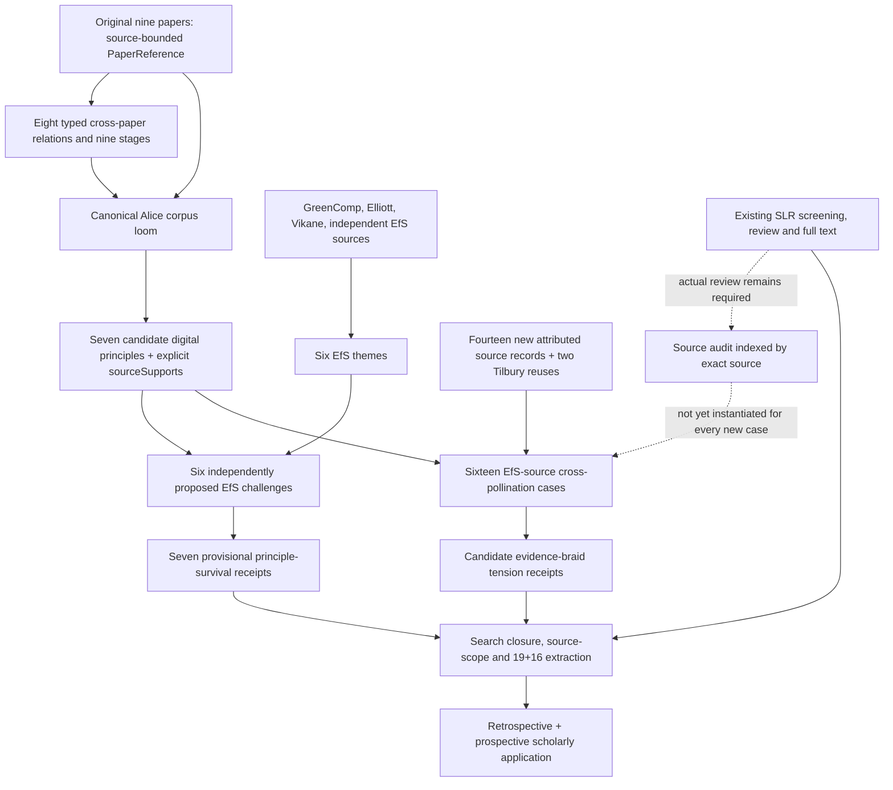

# Digital-ESD hyperfabric: origins, complete direct root, typed joins and open frontiers
## Attributed research derivation, 1 November 2026

**Exact source snapshot:** [source print index](./README.md). **Expanded direct-root code:** [211-module import/interface atlas](./root-direct/IMPORT_GRAPH.md). **Transitive support:** [87 supporting modules and 155 unprinted deeper imports](./root-frontier/INDEX.md). **Derived source hyperedges:** [16 EfS cases linked through seven canonical digital-principle rows to nine original education source identifiers](./DERIVED_SOURCE_HYPEREDGES.md).

**Repository:** chboishabba/dashi_agda. **Working branch:** docs/digital-esd-full-hyperfabric-closure-20261101. **Upstream draft owners:** PR #1237 (EfS independence/challenge), PR #1448 (additional source candidates), with master retaining the original Alice corpus loom. This documentation does not replace source modules, a successful kernel build, source admission or group author approval. ESD stays outside Fleet and TOE.

### 1. What the word "join" means in this account

We must not confuse five different objects.

1. **Import edge:** Agda module A imports module B. This makes B's types and values available to A. It does not establish a theorem connecting their scientific conclusions.
2. **Typed structural join:** a record field contains an owner value or its equality to a canonical owner. The Alice corpus loom and the source-indexed audit have such joins.
3. **Attribution/genealogy join:** a named publication, source role, claim register, published DOI or original-source relationship is preserved. A join may be represented by a record containing identifiers and Strings; it need not be a source-span proof.
4. **Candidate interpretation join:** DASHI relates a digital principle to an independently grounded EfS topic, preserving a competing reading, context and unmet evidence. This is not a new finding by the original authors.
5. **Reviewed evidence/admission join:** an actual source-specific full text, passage, human reviewer decision, study claim ceiling, same-source observation, audit coverage and relevant provenance are connected to a synthesis claim. A URL equality, non-promoting receipt or default Boolean does not pay this join.

The print proves no global empirical integration merely by showing many imports. The **formal derivation below identifies which record fields actually join, which interpretations remain candidate, and which typed witnesses still need observed evidence.**

### 2. Directed architecture

This graph is an explanatory diagram of the **implemented code owners and their stated dependencies**, with dashed lines for missing source-dependent admission. It is not a new Agda theorem or a complete transitive import graph. The exact import graph has its own generated atlas.

### 3. Origin: nine attributed Alice Brown / associates educational source fibres

The canonical EducationCorpusSourceRegistry.agda stores a PaperReference for each row. Its metadata includes original author list, source title, DOI or explicit missing DOI, venue, year and source-bounded contribution. **Nine source references do not mean nine independent causal effects or nine Alice-only papers.**

| Source value | Original author attribution | Distinct research contribution / boundary |
| --- | --- | --- |
| aiFeedbackPaper | Christopher Dann; Petrea Redmond; Melissa Fanshawe; Alice Brown; Seyum Getenet; Thanveer Shaik; Xiaohui Tao; Linda Galligan; Yan Li | AI/OEF feedback classification. Scalable proxy categorisation is not individual student meaning, equity or causal intervention effect. |
| humourFrameworkPaper | Alice Brown; Josephine Pryce; Anja Pabel | Seven teacher-side humour considerations for online engagement. The source version is a HERDSA conference/draft item; not independent proof of learning effectiveness. |
| voiceAgencyPaper | Alice Brown; Megan Kimber | Student epistemic agency and SoTL authority. A survey or consultation is not automatically consequential co-design. |
| onlineSupportStrategiesPaper | Seyum Getenet; Katie Burke; Melissa Fanshawe; Alice Brown | Five student-identified online teacher-education support families; 584 student responses, not universal intervention prescriptions. |
| ecologyOfDataPaper | Roxanne Finn; Alice Brown | Data custodianship and person-place interpretation. Flat feedback codes omit relational contexts. |
| parentalAllyshipLensPaper | Rachel Leslie; Alice Brown; Ellen Larsen | Proximity-to-disability and parental allyship theory. Parent interpretations cannot replace the child's voice. |
| advocacyAllyshipPaper | Rachel Leslie; Ellen Larsen; Melissa Fanshawe; Alice Brown | Qualitative distinction between advocacy and allyship. Not population prevalence. |
| partnershipBarriersPaper | Rachel Leslie; Melissa Fanshawe; Ellen Larsen; Alice Brown | Parent-reported barriers to partnerships. Parent testimony is a situated source, not evidence of every actor's intentions. |
| parentalFearIndependentMobilityPaper | Justen O'Connor; Alice Brown | Child independent mobility and situated parent fear. Neither children nor a digital-HE population are directly observed by inference. |

The original paper references are the authority for titles, dates and identifiers. Separate manuscript versions remain separate until source identity is reconciled. The module's author arrays, not the label "Alice corpus", govern attribution.

### 4. First joins: development, original loom and cross-domain memory

**EducationCorpusSourceRegistry** is linked to **CrossPaperDialecticalDevelopment** through sourcePaper/targetPaper references, claim registers and relations. It contains eight candidate relations:

1. AI classification → student epistemic participation: corrects extractive use.
2. Teacher-designed humour → constitutive student agency: retains useful teaching design and adds governance.
3. Humour audience/context → ecology of data: restores person-place context.
4. AI feedback → ecology: feedback does not reveal all its missing context.
5. AI/OEF residuals → student-valued support: candidates for testing, not a causal routing table.
6. Student voice → support choice: students may shape, refuse and reconsider support.
7. Parental allyship → partnership barriers: plural observers and power.
8. Advocacy distinction → conceptual proximity lens: distinct situated disability experiences.

**CrossPaperDialecticalDevelopment** also orders nine *development stages* from engagement through classification, humour, contextual restoration, epistemic redistribution, student support, multi-observer allyship, co-designed enactment and evidence revision. This chronology is a DASHI cross-paper interpretation, not an author-endorsed single theory.

**AliceBrownCorpusLoom** is an actual typed aggregate (Set₁). It carries canonical equality proofs for its source registry, AI/OEF, humour, voice, support, ecology, parental allyship, parental fear source and several observer/dynamic/consumer-sufficiency bridges, interpretive coding and dialectical development. It also pins paper-fibre separation, non-promoting cross-paper inference and candidate status.

The loom's joins reach further than ordinary online-engagement papers:

- OEF feedback and humour connect to **classification, human/machine coding, conceptual categories and measurement limits**.
- Student voice and epistemic governance connect to **who may set questions, interpret accounts, design action and contest findings**, not merely collecting opinions.
- Ecology of data and parent-school relationships connect to **place, relationships, disability, observer disagreement and whose information is missing**.
- Parental fear/mobility modules distinguish **source attribution, static observer insufficiency, consumer-relative sufficiency, dynamic quotient defects and negotiated contexts**. They are source-bounded cross-domain methodological donors, not automatic higher-education outcomes.
- LearningAlgebra and MemoryFibre retain **revaluation, trust, habituation, reinforcement, extinction, inhibition, event provenance and historical memory**; task performance is not treated as learning.
- Trauma relational-learning and authority boundaries prevent reinterpretation of adaptive responses as evidence that harm was beneficial or that a clinical claim has been established.
- AliceBrown diagnosis/repair, temporal lineage, selective invalidation and recursive Pareto truth maintenance support **revision of dependent interpretations** when evidence or an observer's authority changes.

No one paper independently proves all these joins. The canonical loom and relevant Core/Cognition modules supply the formal relations while the original studies retain their own findings.

### 5. Question-relative representation joins

The key formal constraint is **FactorsThrough**. For a consumer question Q and an observation/projection P, a claim that Q factors through P asserts that the available observation is sufficient to determine Q. **IntersectionalNonFactorability** gives a witness with two distinct situated states that P merges while Q distinguishes. When that witness exists, no reinterpretation of the same reduced data can restore the missing distinction.

The source-audit hyperfabric contains an exact example: a common coarse visibility profile cannot determine the full situated audit state if intersectional tensions differ. The evidence braid contains another: **high service availability** does not determine **realised accessibility** where an assistive workflow is broken.

Those finite witnesses are logically useful counterexamples to overstrong universal inference. They are not evidence that an unstudied cohort has a particular impairment, cause or outcome.

The same principle governs source transfer: source context, target context and transport certificate must remain explicit. Context generalisation is not automatic.

### 6. Seven digital principles: typed origin supports

The **TransferablePrincipleRow** type already contains a principle, a list of original PaperReference supports, a claim register and two candidate/source-bounded flags. This is stronger than a generic narrative claim of lineage. The actual rows are:

| Canonical digital principle | Original attributed PaperReference supports |
| --- | --- |
| situatedRelationalEngagement | humourFrameworkPaper; onlineSupportStrategiesPaper; ecologyOfDataPaper |
| feedbackAsRevisableSignal | aiFeedbackPaper; voiceAgencyPaper; ecologyOfDataPaper |
| constitutiveLearnerAgency | voiceAgencyPaper; onlineSupportStrategiesPaper; humourFrameworkPaper |
| adaptiveSupportWithLocalChoice | onlineSupportStrategiesPaper; aiFeedbackPaper; voiceAgencyPaper; parentalFearIndependentMobilityPaper |
| pluralSituatedObservers | parentalAllyshipLensPaper; advocacyAllyshipPaper; partnershipBarriersPaper; voiceAgencyPaper |
| contextualCustodianship | ecologyOfDataPaper; aiFeedbackPaper; parentalFearIndependentMobilityPaper |
| iterativeEvidenceReturnAndRecharting | voiceAgencyPaper; aiFeedbackPaper; ecologyOfDataPaper; onlineSupportStrategiesPaper |

**Important correction to the earlier roadmap shorthand:** the original principle-level Alice supports are **already present** and typed in these seven rows. What is not currently a field of the *new* sixteen-source CrossPollinationCase is a proof that it selects exactly the correct canonical principle row, original paper passage and claim ceiling. We should join to the existing row; we do **not** need to reconstruct Alice genealogy from scratch.

**DigitalESDTransferablePrincipleDerivationMethodExact** also connects these rows to a nine-stage developmental braid, the existing transformative principle/constraint matrix, the structured-search ledger and the selected integrative conceptual review type. All seven remain candidate synthesis rather than final validated effects.

### 7. Independent EfS-first joins

**DigitalESDEfSIndependentDerivationExact** contains the GreenComp reference with **four competence areas and twelve competencies**, and six named independently proposed EfS themes: values/justice, systems relationships, futures/intergenerational thinking, participation/collective action, ecological/more-than-human relationships and transformative educator enactment.

Its source roles distinguish reference competencies, practitioner theory and situated early-childhood research. Existing Elliott and Vikane/Høydalsvik materials have their own source and context limits.

The independent comparison contains **six candidate ComparisonReceipt values**:

- systems ↔ contextual custodianship: candidate convergence;
- values/justice ↔ revisable feedback: candidate tension;
- futures ↔ evidence revision: candidate convergence;
- collective action ↔ individual learner agency: candidate tension;
- ecological relationships ↔ **no asserted digital match**: unmatched EfS requirement;
- educator enactment ↔ engagement: candidate tension.

**No automatic eighth principle follows from an unmatched EfS requirement.**

**Exact independence limitation:** the EfS-first module imports DigitalESDEfSPedagogicalReciprocityExact, which imports the digital-principle owner. Thus it is **not independent by transitive Agda import closure**, even though the six candidate theme receipts assert that they were formulated without the digital principles. Neither the import pattern nor a true flag certifies independent human blind coding. Source spans, codebook freeze, author/coder identity and disagreement adjudication must still be established.

### 8. Sixteen additional-source joins, made explicit

The newly written CrossPollinationCase contains an attributed external source, a reciprocal digital↔EfS candidate bridge, an equality of the source URL and its bridge locator, and an **admittedToFullReview = false** field with a proof. The original source is not confused with the new DASHI inference.

The [complete derived hyperedge matrix](./DERIVED_SOURCE_HYPEREDGES.md) joins each case to the *existing* canonical principle row and thus to that row's original Alice supports.

**Measured footprint of this code-level lookup:** 16 candidate cases, seven canonical principle rows, nine original source identifiers, 55 case-to-Alice source-support incidences. These incidences repeat underlying publications and are **not 55 independent empirical results**. The 16 cases are ten productive tensions, three mutually refining comparisons and three complementary comparisons.

The sixteen sources are: Taimur/Onuki, Nilsson Dahlström, Adefila and colleagues (EcoCOIL), Singh/Bhagwan/Singh, Barth and colleagues, Giridharan, Jepsen/Cooke, Ferreira/Ryan/Tilbury, Ferreira/Ryan (systems change), Ferreira/Ryan/Davis (leadership), Ryan/Ferreira (2024 overview), Black/Ryan with Okjong Ji, Ferreira/Ryan/Davis (2022 chapter), the UNESCO teacher programme, and two *reused* Tilbury/IUCN owners.

**Candidate status, original source context and author contribution do not change when a source is connected to a principle.** Original authors did not publish the DASHI hyperfabric or its new cross-source comparisons.

There is **no new source-case edge directly targeting feedbackAsRevisableSignal**. That principle has an independent EfS values/feedback tension in the six-comparison layer, so only the new *sixteen-source* layer lacks a direct feedback case.

### 9. The situated source-audit hyperfabric is a different, stronger object

**SourceAuditHyperfabric (source : AttributedSource)** includes:
- a list of SameSourceObservation(source);
- a list of SameSourceAdmissibilityFibre(source);
- a list of SameSourceIntersectionReceipt(source);
- standard lenses;
- evidence-braid TensionReceipt values;
- scoring protocol version and structural-donor statement.

The three same-source child types require equality that their component observation, admissibility or intersection *source equals the indexed source*. That is a real dependent structural join. It is stronger than attaching a source label at the top level.

**CompleteCoreAxisCoverage(source)** then requires ten typed axis receipts: outcome/transformation; representation/missing people; disability/effective accessibility; participant voice/authority; material/environmental lifecycle; externality incidence; political economy; social provisioning/community; institutional maintenance/durability; and contextual/time/intergenerational transfer.

**CompleteDomainBoundaryCoverage(source)** adds seven thin domain boundaries: disability/access, absence/missing people, externality, political economy, social provisioning, durability and material lifecycle. The distinction between *not applicable*, *not observed* and a zero score must be retained. Intersectional adequacy is not the sum of marginal scores.

**SourceAuditAdmission(source)** connects the core coverage, domain boundaries, a SourceAuditHyperfabric of the **same source**, standards applicability, tensions, source-role provenance and non-promotion obligations. Its ten-axis visibility scores are **not** a global source-quality or claim-validity ranking.

**Remaining audit weakness:** SourceAuditHyperfabric contains lists that can be empty. Its tension receipts and generic standard lenses are not all themselves indexed by the same source in the current record. The constructor mkSourceAuditAdmission sets several completion flags true. Neither a source-indexed shell nor these true flags proves that a human examined the relevant source spans. For final manuscript use, instantiate evidence-bearing reviewed objects and preserve explicit absence/residuals. Do not fill the objects merely to obtain a type.

### 10. Claim-ceiling, review and manuscript joins

**DigitalESDStudyClaimCeilingExact** maintains sixteen study/claim coordinates: original population; reported and analysis sample; allocation; comparator; measurement validity; attrition/missingness; confounding; implementation fidelity; multiplicity; effect size; uncertainty; time horizon; external validity; participant role; and strongest justified implication. The type keeps a source, source role, study-design status and whether a number or outcome is reported, derived or missing.

**DigitalESDManuscriptMethodologyExact** defines a nineteen-coordinate extraction schema, including source identity, provenance/role, education level, jurisdiction, digital practice, pedagogy, sustainability dimension, study design/outcome, time, lifecycle, circularity, authority, governance, externality, same-object status, transfer and uncertainty.

The sixteen-coordinate claim ceiling is an additional study-method constraint, **not** sixteen more independent empirical studies or an alternative to the nineteen-coordinate source extraction.

**DigitalESDSLRSourceReviewBridgeExact** connects the canonical shared SLR source substrate, full-text artifact receipts, source-unit analysis, candidate audit observations, reviewed observations, reviewer packets and audited-source consumers. It explicitly blocks title matching, parser output, candidate PNF text and review packet existence from becoming final source admission.

**DigitalESDManuscriptDependencyPaymentAdapterExact** defines the actual dependency graph: structured search → eligible corpus → source/scope matrix → lifecycle, participant-governance and longitudinal syntheses. It preserves the distinction between required search closure, a source/scope lineage payment and final synthesis; closure of an upstream search does not itself prove a downstream finding.

The observed ERIC execution records **46,597 retrieved occurrences**, **43,996 unique metadata records** after removing **2,601 duplicate occurrences**. These are not 43,996 reviewed or admitted full texts. External Scopus, Web of Science, ACM and IEEE obligations and human admission remain open in the roadmap. SLR is a concrete ESD execution dependency, **not** a new independent source-authority theory.

### 11. Reciprocal sustainability and all major cross-domain constraints

**DigitalESDReciprocalBraidExact** defines two directional obligations: digital education builds ESD capacity; sustainability constrains digital education itself. The same module supplies a witness that merely naming both agendas is insufficient to establish a reciprocal transition.

The broader root reaches (some directly, many through first-frontier imports) distinct formal owners for:

| Concern | What is represented | What cannot be promoted |
| --- | --- | --- |
| Learning and time | Learning algebra, memory fibres, history-qualified revision, longitudinal trajectories and transfer | Activity or short-term performance → enduring learning |
| Epistemic and student authority | Student voice, substantive agency, community and institutional decision power | Feedback or consultation → consequential co-governance |
| Disability and intersectionality | Multiple observers, effective access, missing people, context-specific support and non-factorability | Availability score → effective accessibility |
| Trauma/relational experience | Learning under harm, trust, contextual memory and clinical authority boundaries | Adaptation → benefit of harm or clinical diagnosis |
| Environmental/material substrate | ICT lifecycle, energy/inference load, circularity, rebound, impact allocation and uncertainty | Digital delivery → automatic environmental superiority |
| Social and political economy | Burden/benefit incidence, institutional political economy, social provisioning and community consequences | Positive aggregate effect → just distribution |
| Institutional durability | Maintenance, funding/continuity, leadership, policy/professional learning | One successful course → system transformation |
| Scholarly method | Search/review state, source audit, absence, claim ceiling, evidence braid, recursive revision | An attractive formal record → empirical validity or author agreement |
| Knowledge and cultural authority | Two-eyed seeing, Kimmerer/related source roles, intergenerational horizons and epistemic limits | Reuse of cultural language → cultural authority |

These are **distinct domain contracts**. Some modules make substantial logical constructions and finite counterexamples, while others provide source-role boundaries, registries, implementation receipts or candidate bridges. The root import does **not** make all of them equivalent in proof strength or evidentiary status.

JMD/meta-introspector and other external technical donor material, where imported, keeps its own source authorship and remains **reference only** for Digital-ESD. Fleet and TOE have no ESD integration gate or research milestone.

### 12. Full printed import surface and what is still outside it

This expanded source print now includes **321 distinct exact Agda source modules**:

- **211** direct imports in the Digital-ESD umbrella. Their code text is reproduced in seventeen root-direct volumes and indexed with each SHA, exposed declarations and imported dependencies.
- **35** principal original Core/Alice/ESD/EfS owners in five earlier volumes. Twelve of these are also in the umbrella's direct set; sixteen were first-level dependencies outside it.
- **87** additional first-level source modules not already printed. These are reproduced in eight separate support volumes.

The resulting union has **321 unique modules**. From their source text, we extracted **1,472 named DASHI import edges**. This measures the *printed graph*, not transitive kernel certification. The remaining frontier lists **155 distinct further imported module paths** beyond those 321. Those paths are *not necessarily absent or unimplemented*; they are simply outside the current print scope. Their own imports may expand the graph further. See [exact unprinted frontier list](./root-frontier/SECOND_FRONTIER.md).

**Therefore this is the complete direct-root print plus the first support frontier and the original principal owners, not every transitive Agda module in the full repository.** Claiming an exhaustive transitive closure would be false until iterative discovery reaches a fixed point and Agda checks the resulting versioned graph.

### 13. Missing joins and precision gaps (ranked)

| Priority | Current join | Exact remaining work / why it matters |
| --- | --- | --- |
| P0 | Branch/source integrity | EfS PR #1237 is still unmerged and behind master; #1448 is stacked on it. Reconcile and run exact-head preflight/Agda regression. Source-copy equality alone is not type checking. |
| P0 | Source-span and review identity | No automatic source passage, reviewer ID, version, context, claim ceiling or review decision is inferred from the new 16 cases. Keep them candidate-only until actual review. |
| P0 | Original principle-row to new case | Existing row sourceSupports **already** identifies original papers, but CrossPollinationCase does not carry a proof selecting that canonical row or the specific original claim span. Preserve this join rather than rebuilding the seven principles. |
| P0 | EfS-first independence | The EfS-only derivation has a transitive import through the prior bridge to the digital principles. Also missing is independent blind/human coding evidence. Record this separately from a Boolean flag. |
| P1 | Source-audit meaning | A SourceAuditHyperfabric may carry empty child lists; constructors set some completion flags without recording performed review. Require reviewed full-text/source-span and sufficiently populated, same-source evidence for each actual claim. |
| P1 | Generic tension receipt vs two actual sources | canonicalBraid retains a source URL plus broad module-name strings. It does not encode two exact paper-specific source/claim witnesses. Its mutuallyRefining → convergence projection also loses a distinction retained in the original case status. |
| P1 | Independent EfS challenge → survivor | The six challenges and seven survival receipts are still candidate stage. No all-seven reviewed adjudication, split/merge/defeat evidence or independent dissent ledger is complete. |
| P1 | Source-case coverage | None of the sixteen added cases directly targets feedbackAsRevisableSignal. The earlier independent values-versus-feedback challenge *does* cover it; this is a scope-specific gap, not a missing original principle. |
| P1 | Ecological unmatched requirement | The independent comparison preserves ecological/more-than-human relationships as unmatched. Additional source discussion does not automatically create an eighth principle or permit a human-only indicator to stand in for the ecological relationship. |
| P1 | Source-transport adequacy | Earlier childhood, parent and community studies do not directly establish digital higher-education outcomes. Use source/target context and question-relative sufficiency, and retain non-factorability/residuals. |
| P1 | End-to-end reviewed SLR payment | Source receipts, review packets, actual screening, full text, extraction, audit and final synthesis must join through the existing canonical SLR/DASHI interfaces. Runtime activity is not final evidence. |
| P2 | Sustainability mechanisms and distribution | The original Alice sources generally do not observe ICT lifecycle effects, long-run institutional burden, ecological impact or collective EfS action. These may be clear future research variables, not retrospective results. |
| P2 | Retrospective/prospective article demonstrations | Select one original published digital-learning study for a source-bounded retrospective interpretation and one clearly labelled future design. Show both directions and actual limits without inventing new study findings. |
| P2 | Publication/author authority | Retain all coauthors, manuscript versions, source roles, CRediT and group approval. Candidate formal work does not approve itself for submission. |
| P2 | Entire transitive source print | 155 further module paths are referenced beyond the 321 printed files, with deeper dependencies potentially additional. A fixed-point dependency audit and a kernel check are required before claiming the whole repository closure. |

### 14. ZKP-like completion contract (O/R/C/S/L/P/G/F)

**O — Objective.** A faithful, reusable scholarly method: what can original digital education research legitimately say about transformative ESD, and what sustainability conditions constrain digital education itself?

**R — Reuse.** Use the original nine-source registry, typed seven principle supports, Alice loom, independent EfS themes, source-audit type, SLR evidence subsystem and manuscript dependency graph. Do not create duplicate hyperfabric ontologies.

**C — Construction.** The current combined object is a family of already implemented typed/candidate records plus the documented source-to-source lookup. The all-sources reviewed evidence composite is **not yet inhabited** by performed research.

**S — State.** 321 printed source modules are documented and source-indexed; 16 additional crosswalks remain candidate; other review steps and current-head compilation remain open.

**L — Lanes.** Formal/kernel lane; scholarly EfS/digital source-review/SLR lane; coauthor/manuscript lane. Keep Fleet/TOE separate and external donors attributed.

**P — Preconditions, invariants and postconditions.** Before a reviewed claim, require exact source identity and version, author and study role, exact question/observation context, claim ceiling, retained participant/observer distinctions, genuine review and source-audit receipts, and valid transfer. Invariants: no source-author reassignment; no invented causal/ecological effect; no automatic learner/community authority; no compression of unresolved tensions; no claim of source admission from a citation; no unsupported cross-context population transport. Postcondition: either a bounded admitted conclusion with full genealogy, or an explicit justified residual and research question.

**G — Governance.** The journal rubric and author/publisher compliance gate are distinct from representational sufficiency, source admissibility, review-execution payment and human intellectual authority.

**F — Frontier.** Close the concrete missing joins and evidence obligations above. Stop adding new constructions when an existing exact owner answers the same question. Maintain the current 200-word manuscript abstract and intended retrospective/prospective contribution.

### 15. What we should say in the paper

The framework **does not claim** that a nine-paper digital-education corpus has already demonstrated environmental, social or economic sustainability improvement. It establishes a source-governed **method for testing the legitimacy of such interpretations** and for designing studies that could examine them. The new EfS literature supplies independent conceptual and practical challenges, not guaranteed positive results. The seven principles remain provisional and revisable.

The manuscript should show this through a compact worked Alice/digital source interpretation and a prospective design, supported by a transparent source/claim table and a reproducible repository supplement. The complete Agda print belongs in the reproducibility supplement, not the article's main narrative.

### 16. Final scope statement

**Delivered:** 35 principal full-source files, 211 exact direct-root files, 87 additional exact first-frontier files, a 211-module 837-edge direct interface atlas, a 321-module 1,472-edge printed-graph boundary, a full 16-case 55-incidence source hyperedge matrix, and an explicit 155-path deeper print frontier.

**Not delivered:** full transitive fixed-point source print, independently compiled Agda root, completed SLR admissions, actual independent EfS coding, final source-specific principle adjudication, manuscript acceptance or coauthor signoff.

This is the accurate state of the formalisation from attributed origins to the current independent EfS cross-pollination.
