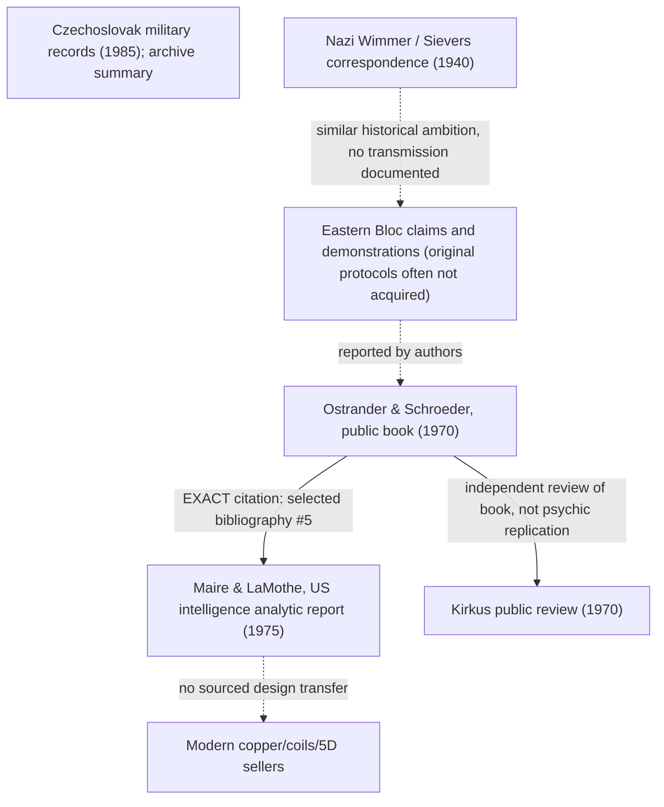

# Cold War psychotronics transmission — max-cut research deliverable

**Current as of 24 October 2026.** This is a consumer-specific Pareto / snowball / Ibrahim graph over the **existing** DASHI research infrastructure. Historical-source owner: `DASHI/Cognition/PsychotronicsColdWarTransmissionParetoExact.agda`. Parent [psychotronics Pareto](psychotronics-pareto-current.md). Prior [attribution investigation](psychotronics-succor-punch-attribution-20261024.md).

## Central answer

The evidence **does** establish direct document reuse from **Sheila Ostrander and Lynn Schroeder, *Psychic Discoveries Behind the Iron Curtain* (Prentice-Hall, 1970)** into **Louis F. Maire III and J. D. LaMothe, *Soviet and Czechoslovakian Parapsychology Research (U)* (September 1975)**. The scanned 1975 report's *Selected Bibliography*, **printed p.69, PDF index 66, entry 5**, explicitly names the 1970 book. The scan's authors/title/task and **information cut-off date 15 April 1975** appear on PDF index 2; it was prepared by US Army Medical Intelligence and Information Agency, Office of the Surgeon General, for a Defense Intelligence Agency task. **Authorship is Maire/LaMothe; DIA is institutional sponsor/tasking recipient, not an invented anonymous experimenter.**

This is a strong **source-transmission** edge, not corroboration of psychic energy, nor proof that every 1975 report passage was copied from the book. The same US report separately cites 1973 Prague conference papers and other sources. Claims of Soviet/Czech experimental effectiveness must be traced to each original report/experiment, not inferred from an intelligence agency's having discussed them.

## Three distinct evidence layers

### 1. Primary actor/institutional documents

| Date | Original actor | Exact carrier / claim | Status and limitation |
|---|---|---|---|
| 30 Oct 1940 | Josef Wimmer, SS Ahnenerbe-associated researcher | [Assessment of confiscated dowsing and pendulum literature](https://digitalcommons.ursinus.edu/dowsing/25/), Ursinus folder XII documents 38, 42 | Actual authorial memorandum discussing censorship, proposed scientific control and Ahnenerbe review; NOT proof of dowsing efficacy |
| 20 Nov 1940 | Wolfram Sievers writing Reinhard Heydrich | [Letter](https://digitalcommons.ursinus.edu/dowsing/13/), folder XII document 18, discusses Wimmer's assessments and oversight | **Direct documentary administrative reference** to Wimmer; institutional inquiry, not working weapons |
| 1962 original / 1963 authorised English translation | Leonid L. Vasiliev | [*Experiments in Mental Suggestion* Wellcome catalogue](https://wellcomecollection.org/works/ygf3wazt) | Identity and Western translated publication established, **not original experiments inspected**; distinguish 1962 Russian original and 1963 English carrier |
| 1970 | Sheila Ostrander & Lynn Schroeder | [*Psychic Discoveries Behind the Iron Curtain*, first edition](https://books.google.com/books/about/Psychic_discoveries_behind_the_Iron_Curt.html?id=Od4vAAAAYAAJ) | Public book about reported Eastern Bloc research; authors **say** they handled generators and watched demonstrations. This is first-person journalistic testimony, not controlled independent verification |
| 1973 conference / 1974 US translation | Prague conference authors, Joint Publications Research Service for US translation | [NTIS JPRSL50221 Part I](https://ntrl.ntis.gov/NTRL/dashboard/searchResults/titleDetail/JPRSL50221.xhtml) | **Bibliographic catalogue and contents paid**; full original participant paper methods not acquired. Seek Pavlita/Rejdák protocols without treating the English translated title as the original creator's title |
| Sep 1975 (cutoff Apr 15) | Louis F. Maire III; Major J. D. LaMothe, MSC | [69-page scan DST-1810S-387-75](https://www.theblackvault.com/documents/parapsychology/sovczech.pdf), PDF index 2 authors, 66 bibliography | The report discusses Pavlita devices and reported telepathy/psychokinesis. Its existence is evidence of US intelligence interest/reporting **not validation of reported paranormal effects** |
| 6 Sep, 24 Oct, 31 Oct 1985 | Czechoslovak Minister of National Defence and army intelligence officials | [Security Services Archive summary](https://www.abscr.cz/en/archivalie/psychotronics-in-the-czechoslovak-peoples-army/) | Archivist **reports** a ministerial instruction, later reports and requests to Soviet/GDR military intelligence. Original file images/fonds record not retrieved; requests are **not evidence that cooperation was accepted or a joint project succeeded** |

**Important policy and authorship boundary:** The Nazi Ahnenerbe actor documents describe interest, management and repression of dowsing literature. They do not link a technical Nazi device to later Soviet or Czech psychotronics. They also **do not** imply Wilhelm Reich worked for the Nazi programme. Historical coexistence, shared electric-field vocabulary and state secrecy are not transmission receipts.

### 2. A documented PUBLIC-to-INTELLIGENCE transmission edge



**The dotted links are NOT transmitted original hardware or proven communication.** The unconnected 1985 Czech military archive node is a later, separate record family: no impossible 1985→1975 citation arrow exists. The actual directed documentary edges in the typed graph are Wimmer→Sievers, 1970 book→1975 report, and book→contemporary review. Czech requests are represented **separately** as reported requests, not invented letters of acceptance.

Later combined editions and online chapter transcriptions provide additional access to book passages, but they are **the same authorial testimony**. A 1997 combined *Psychic Discoveries* edition's chapter 26 uses **p.285** for Pavlita's devices; the scanned **1973 British *PSI* edition's chapter 28 starts p.368**. These are **edition-specific locators**, not a claim that original 1970 pagination is identical. The first 1970 text and each original Pavlita report remain to be checked against the reprints.

### 3. Independent physical controls, not cultural authority

- **J. O. Pehek, H. J. Kyler and D. L. Faust**, [*Image modulation in corona discharge photography*, *Science* 194(4262):263-270, 15 Oct 1976](https://pubmed.ncbi.nlm.nih.gov/968480/), DOI **10.1126/science.968480**: documented independent physical analysis explaining much Kirlian photographic variability through **moisture, electrode configuration, waveform, circuit resistance and corona inception**. This does **not** say a person cannot have meaningful subjective experiences; it does challenge using a coloured corona photograph alone as evidence of a previously unknown aura.
- **Ivan Souček**, [*Medical Pluralism During and After Socialism*, *Český lid* 107(1):51-69 (2020)](https://ceskylid.avcr.cz/media/articles/712/submission/original/712-2425-1-SM.pdf), DOI **10.21104/CL.2020.1.03**: peer-reviewed, partly ethnographic/secondary historical analysis of the **institutions and social strategies** of Czechoslovak psychotronics. Souček reports growth of conferences and research organisations and documents social adaptation; it does not validate energy transfer or prove that every claim repeated by practitioners is accurate.
- **Kirkus**, [21 Apr 1970 contemporaneous review](https://www.kirkusreviews.com/book-reviews/a/sheila-lynn-schroeder-ostrander-2/psychic-discoveries-behind-the-iron-curtain/): independent **public circulation/reception** witness for the book, a derivative account of its alleged paranormal phenomena. Do not count as an independent psychic experimental witness.

## Attribution / Snowball / Ibrahim rules actually reused

- `AttributedSourceCore` owns original author/title/publication/DOI/canonical URL and the proof/authority non-import guard.
- `SnowballAttributionProvenanceInvariantExact` keeps source-role, relation, visibility and authority/proof axes under downstream projection.
- `SnowballOSINTAcquisitionInvariantExact` distinguishes an archival **summary of underlying files** from the native originals; metadata/snippets are discovery coordinates, not inspection or proof.
- `IbrahimSnowballInvestigativeClaimSourceLineageBidiExact.InvestigativeClaimReceipt` records an **exact observed bibliography span**, primary role, inspection, **dependency on the 1970 original**, what was and was not paid.
- `IbrahimSnowballParetoFrontierExact.ParetoFrontierLeaf` supplies rank/status, paid source, unpaid residual, test and downstream consumer. **Local ranks here do not change** the separate globally governed 2014 first-link historical dump/pruning frontier.
- `IntersectionalNonFactorability` provides a **synthetic two-world counterexample**: the same modern 'invisible energy machine' vocabulary can occur with or without actual historical contact. It demonstrates the inferential limit of motif matching; no claim that absence has been historically proved.

## Priority and stop conditions

| Rank | Exact remaining obligation | Paid today | Close only when |
|---|---|---|---|
| **P0 — achieved** | Direct Western public-to-intelligence document link | Explicit 1970 book **cited at 1975 report p.69 item 5**, independent book bibliographic record, author/task metadata | **Done for citation edge only**, not individual experiment claims |
| **P1 — highest** | Pavlita's **first-party** construction papers & original experiments | 1970 journalist chapter and 1975 US analytic passage identify original generator claims; 1973 Prague proceedings **catalogued** | Retrieve original Pavlita/Rejdák paper, original experiment setup, drawings, controls and chain to specific Western passage; do not substitute later book paraphrase |
| **P2** | 1985 Czech → Soviet/GDR cooperation requests | Archivist account specifies order and correspondence sequence | Exact original file IDs, outgoing letters, incoming replies, funded experiment records; distinguish request from acceptance, research from effective apparatus |
| **P3** | Soviet primary protocols (Vasiliev and contemporaries) | 1962 original/1963 translated **bibliographic identity** | Read specific protocols and original criticisms/replications; establish whether electromagnetic shielding controls were adequate rather than inferring from title |
| **P4** | Nazi Ahnenerbe 1940 administrative activity | Wimmer and Sievers original correspondence with exact locators | Further correspondence **only** if a concrete transmission bridge appears; otherwise historically settled *documented interest, not working energy technology* |
| **P5** | 1970 → 2002 Croft or 2026 Rodin/iTorus direct influence | Word and mechanism parallels, source family known | Creator's actual bibliography, dated statement citing a particular page, or same-object circuit provenance; no presumed Nazi/Soviet ancestry |
| **P6** | Psychology/PEMF/5D effect tests | Existing protocol/rank work and modern apparatus leads | Defer. First procure actual device field/sound records; no further 5D theory or sham-arm optimisation until hardware data |

### Final status

This is a **bounded historical research output**, not a new evidence ontology, a paranormal-power finding, a Nazi technology-transfer thesis, or a completed empirical replication. In particular, source counts are *document instances*, not number of independent proofs. Existing psychological and physical study specifications remain archival downstream consumers; focus of the new cut is specific documentary transmission and its outstanding first-party chain.

Local acceptance (no CI needed):
```sh
agda -i . DASHI/Cognition/PsychotronicsColdWarTransmissionParetoExact.agda
agda -i . DASHI/Cognition/Everything.agda
```
