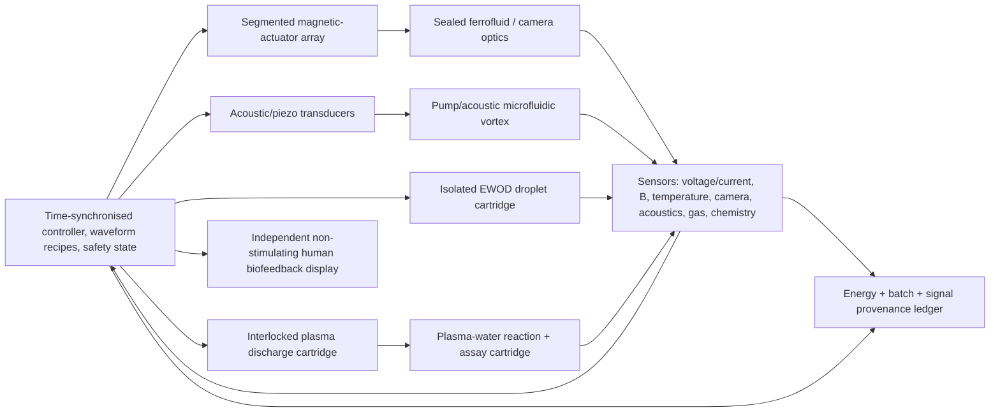

# FIELD LOOM — a reality-compatible psychotronics super-object

**24 October 2026 · speculative engineering architecture grounded in existing laboratory mechanisms.** This is an **original DASHI design synthesis**, not an original discovery of the component laws or evidence that one integrated instrument has been built, certified or experimentally characterised. It is meant to be visually and functionally *science fiction-like* while remaining within conservation laws and independently testable physics.

**Research parents:** [critical psychotronics literature review](psychotronics-literature-review-20261024.md), [current Pareto](psychotronics-pareto-current.md), [claim-specific Pavlita comparison](psychotronics-pavlita-experiment-comparison-20261024.csv). **Executable paper design gate:** `scripts/psychotronics_field_loom_feasibility.py`.

## Executive design

**The Field Loom is a programmable, observable, modular field-and-matter instrument**, housed within a visually toroidal frame. Its subsystems can (a) drive and image controlled magnetic fields; (b) organise microscopic particles/droplets using programmable acoustic/electrokinetic forces; (c) produce luminous plasma in a separate enclosed laboratory cartridge; (d) generate and assay plasma-activated water; (e) form vortices and measure mixing; (f) expose optical field patterns via sealed ferrofluid; (g) use a separate, *passive* biofeedback panel to map breathing, ECG or heart-rate data into sound/light. A shared computer/controller, synchronised sensor clocks, apparatus identity and energy/chemical mass ledgers link them as **one instrument**.

**Not one physical force:** Maxwell electromagnetism, fluid mechanics, ultrasound, interfacial electrowetting, electrochemistry, gas-plasma kinetics and human perceptual reporting coexist but retain different validity ranges. Shared waveforms or a torus shape do not identify them with psychic fields, hidden dimensions or new energy sources.

**Precise prior-art ownership:** the actual reactor/chemistry/plant chain belongs to `DASHI/Environment/PlasmaActivatedWaterSameObjectPrimarySourceExact.agda` and `DASHI/Environment/PlasmaActivatedWaterSameObjectSnowballExact.agda`; energetic performance stays in `DASHI/Environment/PlasmaActivatedWaterPrimaryProcessEnergySourceExact.agda` and isotope-N uptake in `DASHI/Environment/PlasmaActivatedWaterIsotopeMassBalanceSnowballFrontierExact.agda`. Plasma/MHD field validity regimes remain with `DASHI/Physics/Plasma/MHDMaxwellLorentzReductionBidiExact.agda`, Maxwell and optics with their original DASHI owners. Field Loom contributes a new systems proposal, **not evidence** that the named component studies were performed on the same physical machine, or that any paranormal effect exists. A torus, waveform number or shared label does **not automatically** establish common physical mechanisms, historical inheritance or an experimental cause.

## The actual architecture

**Physical segmentation:** all plasma/corona/high-field electrodes live within separate operator-qualified enclosures and gas handling, **not** an exposed spherical showpiece or water accessible to people. The biofeedback sensors are *not* driven by the experiment's high-voltage field or in direct fluid contact. Sealed optical ferrofluid does not flow into analytically sampled PAW. Chemical/actuation operations use sequential, logged sample transfer unless cross-contamination and sensor interference have been explicitly validated.

## Mechanism-by-mechanism steelman and its honest limits

| Historical / sci-fi motif | Real scientific implementation and original credit | Demonstrable readout / distinguishing control | What cannot be inferred |
|---|---|---|---|
| **Rodin/toroidal geometry, magnetic starship** | An independently addressable multi-coil field array can steer a small magnetic bead/rotor through field gradients, using ordinary magnetic force and torque. **An ideal uniformly wound toroidal solenoid confines flux in its winding**, so use separately oriented actuators for useful field in the centre; torus is the frame, not the actuator justification. OpenStax/Maxwell textbook physics. | Spatial Hall/probe map B(x,t), current and temperature, dummy object and magnet reversal | Anti-gravity, magnetic monopoles, "energy vortex", 5D projection |
| **Ferrocell/visible aura** | Sealed ferrofluid nanoparticles alter transmission/scattering/anisotropy with applied magnetic field. Rosensweig spikes can occur in a free interface. UC Santa Cruz demonstration and ferrofluid magneto-optical research. | Camera image vs measured field; rotate illumination and polarisers; subtract background | Image is NOT an exact 3D flux-line reconstruction or human biofield proof |
| **Moving sphere in a copper cage** | Externally driven sphere/rotor can vibrate/rotate under changing B, or active feedback can stabilise magnetic levitation where feasible. Compare to indexed Zero Point Tech Starship sphere maker copy without assuming pictured SKU identity. | Sphere tracking, synchronized current/B, speaker/acoustic microphone, no-drive sham | Perpetual motion or unexplained energy output |
| **Rife/15 Hz/432/369 frequencies** | Any audio/control waveform can modulate a transducer, acoustic element or coil; look for apparatus-specific resonances and frequency-dependent effects. | Impedance, FFT/spectrum, current, magnetic field, acoustic field; randomized matched exposure | Privileged therapeutic or cosmic frequency without controlled outcomes |
| **Kirlian and Oudin luminous plasma** | Separate enclosed corona/dielectric-barrier discharge creates gas excitation, light, ions, ozone/NOx-dependent chemistry. Oudin/Guilleminot original schematic, Pehek/Kyler/Faust 1976 conventional Kirlian investigation. | Optical emission, discharge power, humidity/temperature, shielded off control | A "soul aura" or independently observed vital field |
| **Plasma-charged water** | A separate plasma/water reactor makes measured reactive nitrogen/oxygen species. Reuse Kizer et al. 2025 PAW same-reactor/chemistry/plant work; Zhuang et al. 2025 process-energy; Montalbetti et al. 2024/25 chemistry meta-analysis. | Matched pH/nitrate/nitrite/H2O2/ORP/temperature before/after, treated batch, sham-water and chemically matched no-plasma comparator | Long-term water memory, universal healthy drinking, original Pavlita energy effect |
| **Vortex water/torus flow** | Pumps, spiral flow channels or acoustofluidics create toroidal vortical flow with identifiable velocity gradients, mixing and degassing. For true magnetic-fluid force in electrolyte, Lorentz `J×B` requires **currents through the fluid** and an electrochemistry audit. Annual Reviews on electromagnetically forced shallow electrolyte flows. | Flow imaging, mixing index, dissolved gases and chemistry, nonmagnetic matched stirring | Vortex geometry changes water's chemical phase into a persistent H3O2 state |
| **Programmable matter / 3×3×3 hypervoxel** | Acoustic radiation-force array plus EWOD/magnetic droplet handling allow **programmable micro-scale position/patterns**. An optional 3×3×3 **27-sensor or actuator sampling lattice** is an engineering discretisation, not fundamental ternary/Monster physics. | Droplet trajectories/particle locations, ultrasonic hydrophone field, tracked mass/volume and actuator identity | Macroscopic matter teleportation, consciousness-driven morphogenesis |
| **Quartz/oronite pressure-powered energy** | Piezo materials can transduce **changing force or strain** to voltage; static resin compression may create a one-off charge but cannot continuously supply a load without an energy source. | Dynamic stress/strain vs harvested current/energy; permanent pressure vs periodic drive comparison | Passive continuous power from unchanged compression |
| **Atmospheric electrostatic generators** | Collectors can detect ambient atmospheric potentials and very weak currents; Jefimenko reported electrostatic motor experiments. Practical power depends on actual `V(t)I(t)` and collection area/weather. | Isolated current/voltage, leakage and shaft `τ·ω` under controlled loads, ambient vs externally energised mode | Free energy or a practical primary supply without full power accounting |
| **Heart coherence / 5D perception** | ECG/respiration/HRV sensor drives sound/light in a **non-stimulating biofeedback display**. HoeMath developmental coordinates, NADA self-report and 5D-ASC factor structure are separately scoped constructs. | ECG/respiration traces and independent self-report; signal-processing/blinding controls | Fifth spacetime dimension, psychic communication or EM cure |
| **Quantum/Casimir/portal analogies** | Fields and matter fundamentally have quantum foundations, but **all above described bench effects have classical effective models**. Genuine quantum sensing/interferometry would require separately validated coherence and readout. | An explicit quantum state, decoherence budget, control experiment ruling out classical alternatives | "Quantum" label as evidence for portals, zero-point extraction, timeline shifts |

**Novel cross-pollination candidates with actual experimental value:** (1) EM field maps → ferrofluid optics → camera calibration, (2) acoustic-vortex mixing → independent *same-batch* PAW transport/chemistry (acoustics changes mixing/temperature; test whether measured chemistry changes), (3) plasma chemistry → controlled EWOD/microfluidic assay **after separation from discharge**, (4) closed-loop optical tracking → reconfigured acoustic/magnetic droplet patterns, (5) measured ECG/respiration → physically separate light/sound biofeedback with no field-exposure claims. These are **engineerable cross-domain experiments**, not yet integrated results. Avoid measuring chemical PAW effects in the same ferrofluid sample.

## Physical models / envelopes (necessary, not sufficient)

- **Energy conservation:** `E_in = ∫P_wall dt + ΔE_storage_draw`; compare only with `E_mechanical + E_chemical_free + E_radiated + E_heat + ΔE_stored` over the **same boundary/time interval**, with uncertainty and explicitly unmeasured loss. Useful chemical species concentration is **NOT automatically chemical free energy**. The simulator's simple scalar ledger checks arithmetic only, not first-law experimental closure or plasma efficiency.
- **Magnetic interaction:** dipole torque `τ=m×B` and force `F≈∇(m·B)` for an appropriate small permanent dipole; strong field gradients, ferrofluid nonlinearity and active levitation require calibrated modelling. Maxwell `∇·B=0` limits allowable field shapes; 27 control sites are not 27 independently assignable magnetic vector fields.
- **EWOD interface:** changing wettability depends on dielectric/electrode conditions; avoid direct contact with the energized dielectric. EWOD often needs carefully isolated drive electronics, **not an arbitrary low-voltage GPIO**. See Li and Kim 2020, Xu et al. 2023 and Chen et al. 2026 reviews.
- **Plasma liquid chemistry:** use source-specific `n_i=V_liquid (c_i^after−c_i^before)` only when species-selective assays and positive volume are grounded. Nitrogen uptake by plants is *separate*: DASHI's existing isotope mass-balance frontier is not paid by nitrate concentration. Report feed gas, humidity, volume, dose, wall and delivered power, electrode metal erosion, pH, NO3−, NO2−, NH4+, H2O2 and any applicable biological-safety contaminants.
- **Programmed resonance:** electronics can coordinate phase/frequency across actuators, but interacting systems may have different resonance bands, nonlinearities, sensor latency and mechanical cross-talk. A single magic frequency cannot be assumed to activate every channel.

## S1 quantitative model implemented (NOT hardware): field shaping, not magic torus flux

Runnable source: [`scripts/psychotronics_field_loom_coils.py`](../../scripts/psychotronics_field_loom_coils.py). This is a simple numerical **Biot–Savart line-integral approximation** for circular filaments; it is not finite-element magnetics, an inverse controller, an actual 27-channel actuator driver, an experimental dataset or a claim of stable levitation.

The local example uses **two 100-turn coils**, each with radius **0.10 m**, centre spacing **0.10 m**, and currents **±1.0 A**. These values are **invented illustrative model parameters**, not design ratings for physical hardware. The local executed numerical test gave:

| Mode / computed check | Synthetic model output | Meaning and limitation |
|---|---|---|
| Helmholtz-like equal currents | `B_z(0) = 0.0008991763 T` | Agrees with analytic circular-loop pair at centre to displayed precision; not measured |
| Near-centre 3×3×3 samples (`x,y,z ∈ {-0.015,0,+0.015} m`) | `|B| min ≈ 0.0008983570 T`, `max ≈ 0.0009010886 T` | Nominal near-uniform field in the small measured region; model excludes actual coil geometry, hardware heat, materials |
| Anti-Helmholtz-like opposing currents | `B_z(0) ≈ 0`, `∂B_z/∂z ≈ -0.01076135 T/m` | Field gradient can be created without claiming a monopole; no force levitation or particle capture certified |

**Engineering implication:** the apparent contradiction between a toroidal structure and a sphere that moves in the hole disappears by separating **the structural toroidal frame / flux-confined toroidal winding** from **independent oriented coils that create actual field in the centre**. Force/torque on a specific magnetic object is not established until its moment, inertia, orientation, drag, current waveform and magnetic/thermal safety are measured. For stable levitation an active feedback plant is a separate higher-order control task; no self-sustaining passive levitation or gravity cancellation follows.

The original [`scripts/psychotronics_field_loom_feasibility.py`](../../scripts/psychotronics_field_loom_feasibility.py) checks mutually exclusive subsystem modes, synthetic joule boundaries, and sample nitrate mass-delta, **not plasma yield, biological effectiveness or hazardous-equipment certification**. Both local engineering snippets are runnable standard-library Python, not an Agda-kernel result or a real device experiment.

## Three realistic delivery tiers

**Tier A — *Field Loom demonstrator* (first cut; high feasibility).** Encased separated magnetic coils, sealed ferrofluid optical cartridge, LED illumination, camera, optional **externally isolated** acoustic particle or water-flow demonstration. PC/controller logs drive currents, Hall map, audio/vibration and video timestamps. This is the minimum physical "wow" machine with no plasma/human exposure. Success = **replicable, quantitatively tracked field-to-motion and field-to-image transfer**; no claim of unmeasured radiation/health effect.

**Tier B — *Field Loom chemistry laboratory* (professional qualification required).** Add sealed DBD/plasma-water treatment cartridge and filtered exhaust, isolated wet chemistry, assay instrumentation, sample identity and separate EWOD/acoustic transport. Compare matched plasma/sham/chemical-equivalent conditions; report inlet/outlet power, temperature and fixed-N/RONS yield. This tier is **not a consumer appliance** and creates neither drinkable water nor approved disinfectant by default. No human contact, no exposed arcs, no simultaneous unverified HV modules.

**Tier C — *Field Loom programmable field fabric* (research extrapolation, not a built claim).** Optional 3×3×3 **27-node sensor/actuator** spatial lattice, inverse field-control solver, reconfigurable acoustofluidic array, droplet sorting and optical readout, multimodal physical digital twin and feedback control. This can look like programmable matter at micro-scale, with computationally checked constraints. Do not promise arbitrary matter transport, antigravity, a "coherent consciousness" force, or commercial-ready integration.

## Engineering stop gates and Pareto

| Rank | Exact deliverable | Grounding / why ranked here | Advance only after |
|---|---|---|---|
| **S0** | Mathematically coherent modular architecture | Current document; published subsystems, existing DASHI PAW, EM, MHD, optics and evidence owners | Done as **design proposal**, not built proof |
| **S1** | Magnet/ferrofluid/optics demonstrator | Highest information per safety/complexity; real controllable optical and physical outputs | Same-unit calibrated current/B field, time-aligned footage, geometry and temperature |
| **S2** | Acoustic or EWOD programmable particles | Actual published acoustic metasurface + electrowetting precedents | Position-control precision/error, field map, temperature, particle/droplet mass, isolation |
| **S3** | Plasma-to-water chemistry cartridge | PAW prior art strongest, but HV, gas byproducts and chemistry more difficult | Professional chamber/environmental safety review, sample logs, wall energy, RONS and same-chemistry controls |
| **S4** | Sequential S2→S3 chemistry/flow cross-test | Potentially novel combined experiment, not yet shown to be novel against full literature | Same sample and assay, controls against heat/mixing changes and contaminated paths |
| **S5** | Biofeedback interactive art/experiment | Real signals, no external field-exposure claim | Non-stimulating isolation, data-quality and privacy consent |
| **S6** | Ambitious 27-node reconfigurable geometry | Interesting eventual full fabrication and field inverse problem | Rank/observability, heat, power, force, acoustic interference and calibration budgets |

**First-cut experiment:** spatially calibrate `B(x,t)` with a probe; drive one coil; compare static/dynamic camera images of sealed ferrofluid under rotated illumination; track an inert magnetic test particle in a **separate isolated** enclosure; test absent drive and reversed magnet. **P0 stopping rule:** if optical patterns don't predict field map within declared uncertainty, don't describe them as measured 3D field lines. If particle motion is due primarily to airflow, vibration or heating, retain that mechanism and redesign control.

## Explicit source-author roots (not original DASHI discoveries)

1. OpenStax *University Physics Vol 2*, [Solenoids and Toroids](https://openstax.org/books/university-physics-volume-2/pages/12-6-solenoids-and-toroids): actual Maxwell/toroid textbook basis.
2. Surappa, Pavagada, Soto et al., *Nature Communications* **2025**, DOI [10.1038/s41467-024-55337-0](https://doi.org/10.1038/s41467-024-55337-0): published reconfigurable acoustofluidic metasurface, trapping micrometre particles; not identical to our architecture.
3. Li and Kim, *Lab on a Chip* **2020**, DOI [10.1039/D0LC00144A](https://doi.org/10.1039/D0LC00144A); Xu et al. *Lab on a Chip* **2023**, DOI [10.1039/D2LC00756H](https://doi.org/10.1039/D2LC00756H): EWOD/digital-microfluidic systems.
4. [2025/26 Annual Review of Fluid Mechanics on electromagnetically forced shallow electrolyte flows](https://doi.org/10.1146/annurev-fluid-112723-051243): `J×B` coupled flow, distinct from PAW chemical production.
5. Kooshki, Pareek, Janda, Machala, *Journal of Water Process Engineering* **2024**, DOI [10.1016/j.jwpe.2024.105477](https://doi.org/10.1016/j.jwpe.2024.105477): DBD tunability of RONS chemical output, separate from general 5D/water memory.
6. Kizer, Robinson, Lucas, Shannon, Hernández, Stapelmann, Rojas-Pierce, *PLOS ONE* **2025**, DOI [10.1371/journal.pone.0327091](https://doi.org/10.1371/journal.pone.0327091): PAW–plant same-paper study, already owned in DASHI Environment.
7. Montalbetti and colleagues, *Plasma Processes and Polymers* **2024/25**, DOI [10.1002/ppap.202400249](https://doi.org/10.1002/ppap.202400249): original PAW synthesis already cited in historical review.
8. Pehek, Kyler, Faust, *Science* **1976**, DOI [10.1126/science.968480](https://doi.org/10.1126/science.968480): Kirlian alternative mechanisms, already present in DASHI's literature atlas.
9. The original Ferrocell seller's physics descriptions are **manufacturer statements** ([Ferrocell USA](https://www.ferrocell.us/)), *not* proof of a quantum mechanism. University of California Santa Cruz [ferrofluid demonstration](https://ucscphysicsdemo.sites.ucsc.edu/physics-5c6c-demos/magnetism/ferrofluid/) is independent educational evidence for magnetically controlled ferrofluid shapes.
10. Original modern manufacturers—Zero Point Tech Starship, iPyramids iTorus, Don Croft Succor Punch, Aurumaya—and original psychotronics first-person authors retain ownership of *their* descriptions, claims and versions. A motif or shared waveform is not proof of direct ancestry.

## Honest conclusion

**What is real now:** each cited core mechanism has concrete independent demonstrations in its proper domain; a research instrument can in principle compose them through physically isolated cartridges, data acquisition, controlled timing and conventional actuation. The small local conservative interlock/ledger prototype passes its synthetic tests. **What is not shown:** a commissioned single integrated Field Loom, a validated 27-node control algorithm, an independent novel physical effect, constant-pressure piezo energy, biological 5D, quantum consciousness or a superior PAW process. Those are separate hypotheses or unsupported claims.

**Most important creative insight:** the science-fiction quality comes from **programmable cross-modal fields + live instrumented feedback + matter/chemical response**, not from rebranding multiple classical laws as one magical field.
